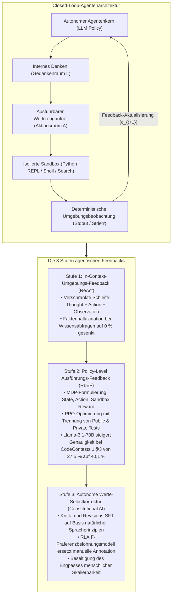
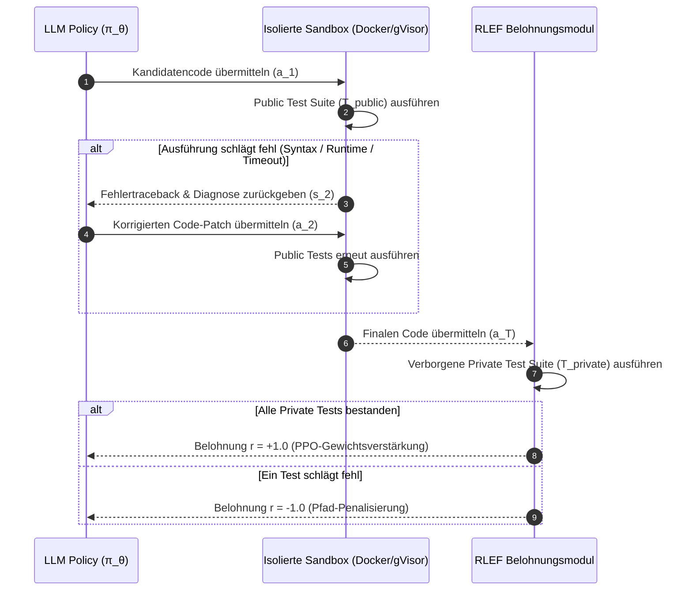
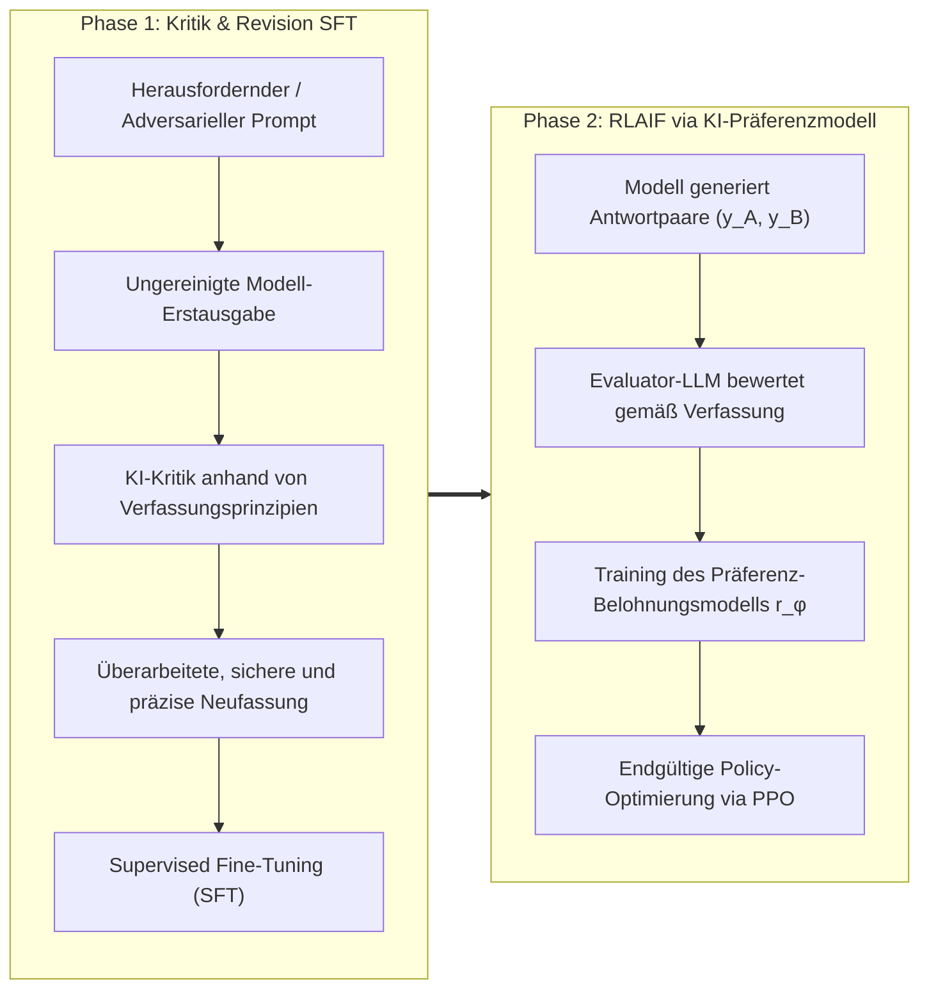

Willkommen zur vierten Ausgabe unserer technischen Analyse der bahnbrechenden Graduierten-Vorlesung der **Stanford University, CS329A: Self-Improving AI Agents (Herbst 2025)**.

In den Vorlesungen 2 und 3 haben wir untersucht, wie Test-Time Compute Scaling und Process Reward Models (PRMs) es Sprachmodellen ermöglichen, Argumentationsbäume systematisch zu explorieren und Zwischenschritte formal zu verifizieren. Dennoch bleibt ein fundamentales Dilemma bestehen: Reine Sprachmodelle, die ausschließlich auf Textgenerierung beschränkt sind, agieren wie **„Schüler, die isoliert in einem geschlossenen Raum Prüfungen ablegen“**. Sie sind vollständig auf das statische, eingefrorene parametrische Gedächtnis (Parametric Memory) angewiesen, das während des Pre-Trainings erworben wurde. Konfrontiert mit dynamischen Fakten der Außenwelt, veränderlichen Web-APIs oder strengen Syntaxregeln ausführbaren Codes halluziniert ein isoliertes Modell unweigerlich.

Die heutige **Vorlesung 4** markiert den entscheidenden architektonischen Übergang vom passiven Sprachmodell zum geschlossenen, aktiven Agenten: **Werkzeugnutzung (Tool Use) und Ausführungs-Feedbackschleifen (Feedback Loops)**.

Moderne autonome Agenten behandeln Code oder API-Aufrufe nicht als bloßen Ausgabetext, sondern als interaktive **Sensoren und Aktuatoren**. In dieser Lektion analysieren wir die drei fundamentalen Ebenen agentischen Feedbacks:
1. **Prompt-basiertes Umgebungs-Feedback:** Die Verknüpfung von Reflexion und Aktion über **ReAct** (Yao et al., 2022).
2. **Policy-basiertes Ausführungs-Feedback:** Die direkte Verankerung von Compiler- und Testdiagnosen in den Modellgewichten über **RLEF** (Reinforcement Learning from Execution Feedback, 2024).
3. **Selbstüberwachtes Werte-Alignment:** Die Ablösung kostspieliger menschlicher Evaluatoren durch prinzipienbasierte Kritik- und Revisionsschleifen über **Constitutional AI** (Anthropic, 2022).



{/* truncate */}

---

### 1. Das ReAct-Framework: Synergie aus Denken und Handeln (Yao et al., 2022)

Vor der Veröffentlichung von ReAct (Yao et al., 2022, Princeton University & Google Research) war die Agentenforschung in zwei isolierte Denkschulen gespalten:
1. **Reine Argumentation (Chain-of-Thought / CoT):** Das Modell wird angeleitet, interne Gedankengänge schrittweise zu formulieren. Bei geschlossenen mathematischen Aufgaben ist dies wirksam; mangels Erdung in einer externen Umgebung führt eine frühe falsche Prämisse jedoch zu immer elaborierteren Halluzinationen.
2. **Reines Handeln (Action-only / WebGPT, Act):** Das Modell sendet direkt API- oder Suchbefehle. Da jedoch ein internes Arbeitsgedächtnis (Working Memory) fehlt, um Zwischenziele zu verfolgen und Beobachtungen zu synthetisieren, verfallen solche Modelle häufig in Endlosschleifen oder verlieren das Hauptziel aus den Augen.

#### Mathematische Erweiterung des Aktionsraums

Die Kerninnovation von ReAct liegt in der formalen Vereinigung des physischen Aktionsraums mit dem sprachlichen Denkraum:

```text
A_hat = A ∪ L
```

Wobei:
* `A` die Menge extern ausführbarer Aktionen im Environment darstellt (z. B. `Search[query]`, `ExecuteCode[script]`, `Click[element]`).
* `L` den Raum freisprachlicher natürlicher Überlegungen (Thoughts) abbildet.

Die entscheidende mathematische Eigenschaft: Ein Denkschritt $a_t \in L$ **verursacht keinerlei Zustandsänderung in der externen Umgebung**. Er aktualisiert ausschließlich den internen Kontextverlauf des Agenten:

```text
c_{t+1} = ( c_t, a_t )   (für a_t ∈ L)
```

Gibt der Agent hingegen eine physische Aktion $a_t \in A$ aus, führt die externe Umgebung diese aus und liefert eine deterministische Beobachtung (Observation) zurück:

```text
c_{t+1} = ( c_t, a_t, o_t )   (für a_t ∈ A, o_t = Env(a_t))
```

#### Der dreigliedrige Interaktionszyklus: Praxisbeispiel

Ein typischer ReAct-Trace verknüpft Denken, Handeln und Beobachten in einer präzisen Sequenz:

```text
Thought 1: Die Benutzerfrage in zwei Teilprobleme zerlegen. Zuerst das Geburtsjahr von Alan Turing ermitteln.
Action 1: Search["Alan Turing Geburtsdatum"]
Observation 1: Alan Mathison Turing (23. Juni 1912 - 7. Juni 1954) war ein britischer Mathematiker...
Thought 2: Turing wurde 1912 geboren. Nun die geschätzte Bevölkerung Londons in diesem Jahr abfragen.
Action 2: Search["London Bevölkerung 1912"]
Observation 2: Im Jahr 1912 zählte die Verwaltungsgrafschaft London schätzungsweise 4,52 Millionen Einwohner...
Thought 3: Beide Werte sind verifiziert. Die finale Antwort lautet 4,52 Millionen.
Action 3: Finish["4,52 Millionen"]
```

#### Empirische Validierung: Das Verschwinden der Halluzination

Die Benchmarks von Yao et al. offenbarten drastische Zuverlässigkeitsgewinne:
* **Multi-Hop Wissensabfrage (HotpotQA):**
  * Eine Fehlerursachenanalyse bei CoT ergab, dass **56 % aller Fehlschläge reine Halluzinationen waren** (Erfindung nicht existierender Entitäten oder Daten).
  * Unter ReAct fiel die Rate erfundener Fakten auf **0 %**, da das Modell gezwungen ist, externe Fakten explizit abzufragen.
* **Interaktive Textumgebungen (ALFWorld):**
  * Bei der Navigation und Objektmanipulation über mehrere Räume hinweg erzielten Action-Only-Modelle lediglich 45 % Erfolgsquote. ReAct steigerte diesen Wert auf **71 %**.
* **Kritische Regel für Produktionssysteme (Stop Sequences):**
  * Autoregressive Modelle besitzen den Drang, Text autonom fortzusetzen. Ohne Gegenmaßnahmen generiert ein Modell nach dem `Action:`-Befehl kurzerhand eigene, erfundene `Observation:`-Inhalte.
  * **Engineering-Anforderung:** In der Inferenz-Engine müssen Stopp-Sequenzen (`stop=["\nObservation:"]`) definiert werden. Sobald die Zeile `Action:` abgeschlossen ist, stoppt die Generierung abrupt. Das Backend führt das echte Tool in der Sandbox aus und hängt das reale Ergebnis an, bevor der nächste Modellturn ausgelöst wird.

---

### 2. Feedback in den Modellgewichten verankern: RLEF (Reinforcement Learning from Execution Feedback)

Während ReAct Interaktionen über Prompts abbildet, erfordert professionelle Softwareentwicklung eine tiefere Fähigkeit: **das selbstständige Beheben von Compiler- und Testfehlern anhand von Tracebacks (Self-Debugging)**.

#### Das Paradoxon prompt-basierten Selbst-Debuggings

Wenn Entwickler versuchen, fehlerhaften Code zu reparieren, indem sie Compiler-Tracebacks in den Prompt eines eingefrorenen Modells (Frozen LLM) einfügen, offenbaren empirische Studien (Olausson et al., 2024; Kapoor et al., 2024) ein ernüchterndes Phänomen:

> **„Einem eingefrorenen Modell Fehlermeldungen vorzulegen, führt oft zu einer geringeren Lösungsquote, als die Fehlermeldung komplett zu ignorieren und stattdessen eine völlig neue Lösung unabhängig neu zu sampeln (Independent Sampling)!“**

Statische Pre-Training-Modelle haben nie gelernt, Fehlermeldungen und Zeilennummern mit der eigenen semantischen Logik kausal zu verknüpfen. Konfrontiert mit einem Fehler geraten sie in Schleifen, benennen Variablen willkürlich um oder erzeugen denselben Syntaxfehler erneut.

Das Ende 2024 vorgestellte Framework **RLEF (arxiv:2410.02089)** überwindet diese Grenze fundamental durch **Reinforcement Learning (PPO)**.

#### Formalisierung mehrstufiger Codegenerierung als MDP

RLEF modelliert den Zyklus aus „Code schreiben $\to$ Feedback empfangen $\to$ Patch anwenden“ über bis zu $T$ Züge als zeitdiskreten Markov-Entscheidungsprozess (MDP):
* **Zustandsraum ($S$):** Problemstellung, bisherige Code-Versuche und Fehlermeldungen:
  ```text
  s_t = ( Problem_Spec, Code_1, Err_1, ..., Code_{t-1}, Err_{t-1} )
  ```
* **Aktionsraum ($A$):** Der vom Agenten generierte Code-Patch bzw. das Gesamtprogramm $a_t$.
* **Umgebungsübergang:** Der Code wird in einer isolierten Sandbox kompiliert und gegen Testsuiten ausgeführt.



#### Duale Testsuiten: Schutz vor Belohnungs-Cheating (Reward Hacking)

Ein Kernpfeiler von RLEF ist die **strikte Trennung von öffentlichen und privaten Tests**:
1. **Öffentliche Tests (`T_public`):** Werden dem Agenten während der Debugging-Züge bereitgestellt. Tracebacks und Assertions bilden den Zustand $s_t$.
2. **Private Tests (`T_private`):** Dem Modellkontext vollständig vorenthalten. Sie werden erst nach Abschluss der Episode zur Berechnung der skalaren Belohnung herangezogen.

Versucht das Modell, öffentliche Tests durch triviale Hardcodings zu überlisten (`if input == test_1: return val_1`), fällt es bei den verdeckten privaten Tests durch und erhält drastische Strafen.

#### Zielfunktion und Belohnungsstruktur

Die Policy $\pi_\theta$ wird über PPO unter Einbeziehung einer KL-Divergenz-Strafe gegenüber dem Referenzmodell $\rho$ optimiert:

```text
R(s_t, a_t) = r(s_t, a_t) - β * log( π_θ(a_t | s_t) / ρ(a_t | s_t) )
```

Die skalare Belohnung $r(s_t, a_t)$ ist definiert als:

```text
r(s_t, a_t) = {
    +1.0,  falls alle Tests in T_private am Episodenende bestanden sind
    -1.0,  falls nach Aufbrauchen des Budgets T Fehler verbleiben
    -0.2,  Zwischenstrafe bei unkompilierbaren Syntaxfehlern in a_t
}
```

#### Benchmark-Ergebnisse: Überflügelung von AlphaCodium bei CodeContests

Auf dem anspruchsvollen Benchmark **CodeContests** (Wettkampf-Programmieraufgaben aus Codeforces und LeetCode Hard) erzielte RLEF herausragende Ergebnisse:
* Bei Anwendung von RLEF auf das Open-Source-Modell `Llama-3.1-70B-Instruct` stieg die Lösungsquote mit nur 3 Retry-Versuchen ($1@3$) von **27,5 % auf 40,1 %**.
* Zum Vergleich: **AlphaCodium** (basierend auf GPT-4 mit 100 parallelen Code-Stichproben, $pass@100$) erreichte lediglich **29,0 %**. RLEF übertraf GPT-4 um **11,1 Prozentpunkte** – mit lediglich 3 sequentiellen Zügen.

#### Das Random-Feedback-Ablationsexperiment

Um zu verifizieren, dass das Modell tatsächliche Fehleranalyse gelernt hat, führten die Forscher ein Ablationsexperiment durch:
* Wurden dem Modell absichtlich gefälschte Fehlermeldungen fremder Aufgaben vorgelegt, brach die Leistung unter das Ausgangsniveau ein.
* Dies beweist mathematisch, dass die RLEF-Policy **eine kausale Abbildung zwischen Traceback-Zeilennummern und internen Code-Modifikationen verinnerlicht hat**.

---

### 3. Autonome Werte-Ausrichtung: Constitutional AI und RLAIF

ReAct nutzt APIs, RLEF nutzt Compiler. Doch wie steuert man Feedback in subjektiven oder offenen Domänen, in denen kein automatisierter Compiler existiert?
* Entspricht ein Architekturkonzept Best Practices bezüglich Modularität und Skalierbarkeit?
* Weist ein Code-Review konstruktiv auf Sicherheitslücken hin, ohne destruktiv zu formulieren?
* Ist ein System gegen Prompt-Injection-Angriffe gehärtet?

Klassisches Reinforcement Learning from Human Feedback (RLHF) erfordert Tausende menschlicher Annotatoren, die Modellantworten manuell bewerten. Dieser Ansatz stößt an harte Grenzen: exorbitante Kosten, subjektive Vorlieben der Bewerter, Ermüdungserscheinungen und mangelnde Reproduzierbarkeit.

2022 stellte Anthropic **Constitutional AI (RLAIF: Reinforcement Learning from AI Feedback)** vor – ein Verfahren, das autonome Ausrichtung anhand eines geschriebenen Regelwerks (der „Verfassung“, Constitution) ermöglicht.



#### Die zweistufige Verfassungs-Pipeline

1. **Phase 1: Kritik und Revision (Critique $\to$ Revision $\to$ SFT)**
   * Dem Modell werden komplexe oder heikle Aufgaben gestellt.
   * Nach der Generierung der Rohantwort $y_0$ wählt das System ein Prinzip aus der Verfassung aus und weist das Modell an:
     * **Kritik-Prompt:** *„Untersuche deine letzte Antwort anhand von Prinzip 3: ‚Strikte statische Typisierung erzwingen und Sicherheitslücken vermeiden‘. Identifiziere alle konkreten Verstöße.“*
     * **Revisions-Prompt:** *„Schreibe die Antwort unter Beseitigung aller Mängel neu, ohne an technischer Tiefe einzubüßen.“*
   * Die so generierten korrigierten Daten $`{y*}`$ bilden den Datensatz für das überwachte Feintuning (SFT).

2. **Phase 2: RLAIF (Reinforcement Learning from AI Feedback)**
   * Das feingetunte Modell generiert Antwortpaare $(y_A, y_B)$ für einen Prompt $x$.
   * Ein unabhängiges Evaluator-Modell vergibt Wahrscheinlichkeiten anhand der Verfassungsprinzipien:
     ```text
     P( y_A > y_B | x, Constitution )
     ```
   * Anhand dieser Soft-Labels wird ein Präferenz-Belohnungsmodell $r_\phi(x, y)$ trainiert, welches anschließend zur PPO-Optimierung der Ziel-Policy dient.

#### Skalierbare Aufsicht (Scalable Oversight)

Constitutional AI demonstriert, dass Zehntausende Stunden menschlicher Arbeit in **ein einziges Dokument deklarativer Prinzipien** komprimiert werden können. Entwickler steuern übergeordnete Verfassungsregeln, während KI-Flotten die Aufsicht über Milliarden Tokens hinweg automatisiert skalieren.

---

### 4. Enterprise-Architektur: Sichere Tool- und Code-Ausführungsumgebungen

Der produktive Einsatz autonomer Werkzeuge und Code-Ausführung verlangt eine robuste Verteidigungsarchitektur. Stanford CS329A empfiehlt folgende Enterprise-Blaupause:

```text
┌────────────────────────────────────────────────────────────────────────┐
│             Enterprise-Architektur für Sandbox & Tool-Ausführung       │
├────────────────────────────────────────────────────────────────────────┤
│                                                                        │
│  [ Benutzeranforderung / PRD-Spezifikation ]                           │
│          │                                                             │
│          ▼                                                             │
│  ┌──────────────────────────────────────────────────────────────────┐  │
│  │                    Orchestrierungs-Agentenkern                   │  │
│  │  • ReAct-Prompting mit strikten Stop Sequences                   │  │
│  │  • Kontextmanager (Gleitendes Arbeitsgedächtnis + AST-Index)     │  │
│  │  • JSON-RPC-Tool-Dispatcher mit Schemavalidierung                │  │
│  └───────────────────┬──────────────────────────────▲───────────────┘  │
│                      │ Strukturierter Tool-Call     │ Bereinigte Telemetrie│
│                      ▼                              │ (Stdout/Stderr)      │
│  ┌──────────────────────────────────────────────────┴───────────────┐  │
│  │                     Sicherheits-Sandbox-Gateway                  │  │
│  │  • MicroVM / gVisor-Isolation (Kein Host-Dateisystemzugriff)     │  │
│  │  • Egress-Firewall (Ausschließlich Whitelist-Domains)            │  │
│  │  • Ressourcenlimits: 2.0 CPU-Kerne, 2GB RAM, 5s Timeout          │  │
│  ├──────────────────────────────────────────────────────────────────┤  │
│  │                     Isolierte Ausführungs-Runtimes               │  │
│  │  ┌─────────────────────────┐     ┌────────────────────────────┐  │  │
│  │  │ Ephemere Python-REPL    │     │ Restriktive Bash-Shell     │  │  │
│  │  │ • Pytest Public Harness │     │ • AST-Statischer Linter    │  │  │
│  │  │ • Traceback-Sanitizer   │     │ • Semgrep Security Scanner │  │  │
│  │  └─────────────────────────┘     └────────────────────────────┘  │  │
│  └──────────────────────────────────────────────────────────────────┘  │
│                                                                        │
└────────────────────────────────────────────────────────────────────────┘
```

#### Drei fundamentale Sicherheitsprinzipien
1. **Ephemere Isolation:** Jeder Codeblock muss in einer flüchtigen Sandbox (gVisor oder Firecracker-MicroVM) ausgeführt werden, die nach dem Prozess unverzüglich zerstört wird.
2. **Netzwerk-Egress-Sperre:** Verhindert, dass durch Prompt-Injection kompromittierte Agenten Umgebungsvariablen oder Datenbankpasswörter an externe Server übermitteln.
3. **Traceback-Bereinigung:** Absolute Host-Pfade und Umgebungsvariablen müssen vor der Rückgabe an den Agenten maskiert werden, um Kontextüberlauf und Datenlecks auszuschließen.

---

### 5. Technische Vertiefung: Praktische Engineering-Q&A

**F: Wie wird verhindert, dass ein ReAct-Agent gefälschte Beobachtungen erfindet, anstatt auf die reale Ausführung zu warten?**
**A:** Ein klassischer Fehler in der Praxis. Autoregressive Modelle versuchen den Dialog eigenständig fortzusetzen und generieren nach `Action: Search[...]` direkt eigene Pseudo-Ergebnisse wie `Observation: Erfolg...`. Die zwingende Lösung sind Inferenz-Stopp-Token: `stop=["\nObservation:"]`. Sobald der Befehl `Action:` ausgegeben wurde, bricht die Generierung sofort ab. Das Backend führt das Tool real in der Sandbox aus und hängt die authentische Ausgabe an, bevor das Modell erneut aufgerufen wird.

**F: Warum generalisiert RLEF-Reinforcement-Learning besser als überwachtes Feintuning (SFT) auf statischen Fehlerprotokollen?**
**A:** Statisches SFT leidet unter dem Phänomen der **Verteilungsverschiebung (Distributional Shift)**. Wenn das Modell in der Praxis einen Fehler macht, der im historischen Trainingsdatensatz nicht enthalten war, gerät es in einen unbekannten Zustand und versagt. RLEF hingegen lässt das Modell im Rahmen eines MDP seine eigenen Fehlermuster erkunden, Strafen erfahren und mithilfe von PPO Reparaturpfade erlernen. Das erzeugt robuste Resilienz.

---

### 6. Zusammenfassung und Kernfakten

1. **Erdung durch Interaktion:** Modelle, die rein auf statischem Wissen basieren, halluzinieren zwangsläufig. ReAct verbindet Gedanken- und Aktionsraum ($\hat = A \cup L$) und senkt Faktenhalluzinationen bei Wissensabfragen auf 0 %.
2. **Ausführungsfeedback in den Modellgewichten:** Reines Prompting bei eingefrorenen Modellen stößt an Grenzen. RLEF formuliert Debugging als MDP und lässt 70B-Modelle selbst 100-Sample-GPT-4-Konfigurationen übertreffen.
3. **Autonome Verfassungsausrichtung:** Constitutional AI ersetzt ressourcenintensives menschliches RLHF durch prinzipienbasierte Selbstkorrektur und ermöglicht skalierbare Aufsicht (RLAIF).
4. **Verteidigung in der Tiefe:** Produktionsreife Agenten erfordern strikte Stopp-Sequenzen, ephemere Sandboxen und die Trennung von öffentlichen und privaten Testsuiten.

---

### Ausblick auf Vorlesung 5:
In **Vorlesung 5** gehen wir von Einzelschritt-Werkzeugen über zu strategischer Mehrschrittplanung: **《Multi-Step Planning & Tree Search: ADaPT, LATS, SPRINT und MCTS für Sprachagenten》**. Wir analysieren, wie Agenten wie Schachgroßmeister Dutzende Schritte im Voraus planen und Suchbäume aufbauen. Bleiben Sie dran!