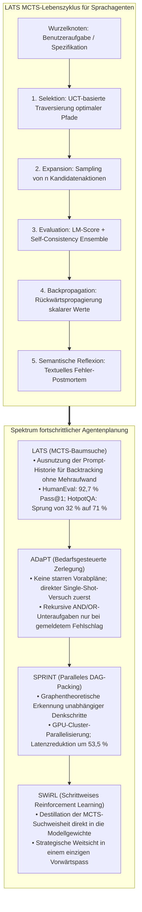
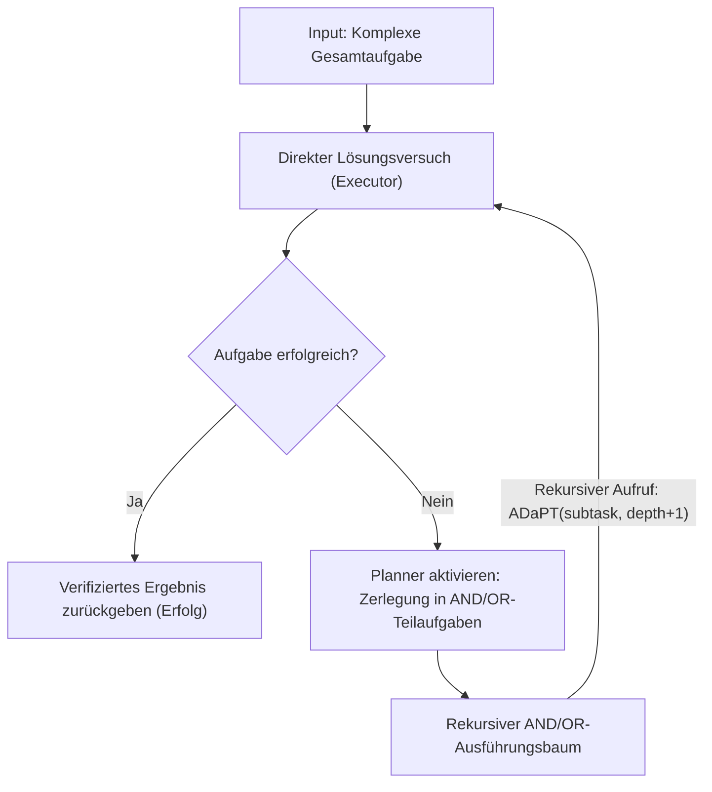
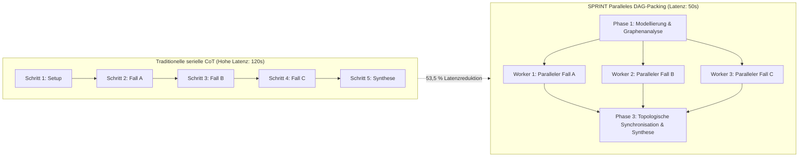

Willkommen zur fünften Ausgabe unserer technischen Analyse der Graduierten-Vorlesung der **Stanford University, CS329A: Self-Improving AI Agents (Herbst 2025)**.

In Vorlesung 4 haben wir untersucht, wie autonome Agenten ihre geschlossenen Räume verlassen, externe Tools ansteuern und Compiler-Feedbackschleifen zur Fehlerbehebung nutzen (ReAct, RLEF). Dennoch unterscheidet sich das Beheben lokaler Syntaxfehler grundlegend vom architektonischen Entwurf komplexer Softwaresysteme mit über 100.000 Zeilen Code oder der Bewältigung wissenschaftlicher Langzeithorizonte.

Standardansätze wie ReAct oder Chain-of-Thought (CoT) sind im Kern **gierige Einweg-Sucher (Greedy Single-Path)**: Sie bewerten ausschließlich den nächsten Schritt und marschieren unumkehrbar vorwärts. Wie ein Schachamateur, der nur den nächsten Zug berechnet und drei Züge später schachmatt gesetzt wird, gerät ein gieriges Sprachmodell bei fehlerhaften Zwischenentscheidungen unweigerlich in eine irreversible Sackgasse.

Die heutige **Vorlesung 5** bildet das monumentale Finale von **Part 1 (Foundation · Fundamentale Grundlagen)** des Stanford-Lehrplans: **Mehrschritt-Planung (Multi-Step Planning) und Baumsuche (Tree Search)**.

Indem wir den mathematischen Kern von AlphaGo – die **Monte-Carlo-Baumsuche (MCTS)** – in autoregressive Sprachmodelle verpflanzen, verwandeln wir reaktive Textgeneratoren in strategische Großmeister. Wir analysieren Systeme, die Konsequenzen Dutzende Schritte im Voraus antizipieren, Sackgassen dynamisch beschneiden, auf frühere Entscheidungszustände zurücksetzen (Backtracking) und parallele Denkprozesse orchestrieren:
1. **Synthese von Denken, Handeln und Planen:** Language Agent Tree Search (**LATS**, Zhou et al., 2023).
2. **Bedarfsgesteuerte rekursive Zerlegung:** Modulare Aufteilung erst bei Scheitern über **ADaPT** (Allen AI, 2023).
3. **Paralleles Abhängigkeits-DAG-Packing:** Halbierung der Inferenzlatenz um 53,5 % via **SPRINT** (Stanford Future Data, 2025).
4. **Adaptive Verzweigung via Thompson-Sampling:** Lösung des Dilemmas zwischen Breite und Tiefe mit **AB-MCTS** (Sakana AI, 2025).
5. **Verankerung der Planungsintelligenz in neuronalen Gewichten:** **SWiRL** (Step-Wise RL, 2025).



{/* truncate */}

---

### 1. Die gierige Falle: Warum Einweg-Deduktion bei langen Horizonten kollabiert

Bei einfachen Aufgaben genügt ein gieriges autoregressives Decoding oder eine standardmäßige Chain-of-Thought (CoT), da der Lösungsraum dicht und verzeihend ist. Sobald jedoch die Tiefe voneinander abhängiger Entscheidungen zunimmt ($H > 10$), führt das sequentielle Vorgehen zu einer exponentiellen **Fehlerfortpflanzung (Error Propagation)**:

```text
P(Success) = ∏_{t=1}^H P(Correct_Action_t | History_{<t})
```

Selbst wenn jeder einzelne Denk- oder Tool-Schritt eine Zuverlässigkeit von 90 % aufweist, bricht die Gesamtwahrscheinlichkeit bei einer 15-stufigen Software-Engineering-Aufgabe dramatisch ein:

```text
P(Success) = 0.90^{15} ≈ 0.2059  (Gesamterfolgsquote ca. 20,6 %)
```

In standardmäßigen autoregressiven Sprachmodellen werden fehlerhafte Tokens bei $t=3$ dauerhaft an den Prompt angehängt. Dem Modell fehlt ein nativer Mechanismus, um die Zeit zurückzudrehen und Sackgassen zu verwerfen. Um echte Autonomie zu erreichen, müssen Agenten auf einem **Zustandssuchbaum (Search Tree of States)** operieren.

---

### 2. Sprachagenten und MCTS: LATS (Zhou et al., 2023)

In klassischen RL-Umgebungen stützt sich MCTS auf deterministische Spiel-Engines (World Models), um hypothetische Züge zu simulieren. Wie jedoch kann ein Agent in offenen Domänen wie Programmierung oder Forschung simulieren, wenn kein formaler Physiksimulator existiert?

Der Durchbruch von **LATS (Zhou et al., 2023, UIUC & Google DeepMind)** basierte auf einer fundamentalen Eigenschaft großer Sprachmodelle:

> **„Im Kontext eines Sprachagenten wird jeder Zustand der Umgebung vollständig durch den Textverlauf des Prompts repräsentiert. Um zu einem früheren Entscheidungszeitpunkt zurückzukehren, bedarf es keiner komplexen Simulations-Engine: Man übergibt dem Modell schlicht den Prompt-Text dieses früheren Zeitpunkts und lässt es in eine neue Richtung verzweigen!“**

LLMs bieten eine **perfekte Zustandsreversibilität (Backtracking) ohne jeglichen Mehraufwand**.

#### Der 5-Phasen-MCTS-Zyklus von LATS

LATS teilt ein einzelnes LLM in drei kooperierende Rollen auf – **Akteur (Actor)**, **Bewerter (Critic)** und **Reflektor (Diagnostiker)** – und durchläuft fünf iterative Phasen:

```text
                           [ Wurzel: Benutzeraufgabe ]
                                        │
                       1. Selektion (UCT-Metrik)
                                        ▼
                           [ Vielversprechender Knoten s ]
                                        │
                       2. Expansion (n Aktionen samplen)
                                        ▼
                        [ Sandbox-Ausführung & Observation ]
                                        │
                       3. Evaluation (LM-Score + SC)
                                        ▼
                       4. Backpropagation (Werteaktualisierung)
                                        │
                       5. Reflexion (Bei Fehler: Semantische Analyse)
```

#### 1. Selektion via UCT (Upper Confidence Bound for Trees)
Ausgehend von der Wurzel navigiert LATS abwärts, indem es den UCT-Wert maximiert und so die Ausnutzung bewährter Pfade (Exploitation) mit der Erkundung unbesuchter Knoten (Exploration) ausbalanciert:

```text
UCT(s) = V(s) + w * sqrt( ln N(p) / N(s) )
```

Hierbei gilt:
* $V(s)$ ist der geschätzte Durchschnittswert von Zustand $s$.
* $N(s)$ ist die Besuchshäufigkeit von Zustand $s$.
* $N(p)$ ist die Besuchshäufigkeit des Elternknotens $p$.
* $w$ ist der Explorationsfaktor (standardmäßig $w = sqrt(2)$).

#### 2. Expansion
Erreicht der Agent einen Blattknoten $s$, generiert die Policy $n$ diverse Aktionskandidaten $`a^(1), ..., a^(n)`$. Jede Aktion wird in einer isolierten Sandbox (z. B. Python REPL oder Shell) ausgeführt, um reale Beobachtungen $`o^(1), ..., o^(n)`$ zu erfassen.

#### 3. Werte-Evaluation
Die skalare Belohnung $V(s)$ wird durch eine gewichtete Kombination aus qualitativer Bewertung und statistischer Selbstkonsistenz ermittelt:

```text
V(s) = λ * LM_Score(s) + (1 - λ) * Self_Consistency(s)
```

* **`LM_Score(s)`:** Das LLM bewertet die logische Konsistenz anhand der Umgebungsbeobachtung auf einer Skala von 1 bis 10.
* **`Self_Consistency(s)`:** Häufigkeit, mit der stochastische Rollouts vom Zustand $s$ zur identischen Lösungsformel konvergieren.

#### 4. Backpropagation
Die am Blattknoten erzielte Belohnung $r$ wird entlang des Pfades bis zur Wurzel zurückpropagiert, wobei Besuchszähler und Durchschnittswerte inkrementell aktualisiert werden:

```text
N(s_i) = N(s_i) + 1
V(s_i) = ( V(s_i)_old * N(s_i)_old + r ) / N(s_i)_new
```

#### 5. Semantische Reflexion (Semantic Reflection)
Führt ein Pfad zu einem Fehlschlag (z. B. Assertion-Error), vergibt klassisches MCTS lediglich eine numerische Strafe ($r = -1$). LATS erweitert dies um **semantische Reflexion**:
Das Modell fragt sich selbst: *„Warum ist dieser Pfad gescheitert? Welche Annahme war fehlerhaft?“*.
Das resultierende textuelle Postmortem wird im episodischen Gedächtnis abgelegt und dynamisch in nachfolgende System-Prompts injiziert, um identische Fehlentscheidungen auszuschließen.

#### Herausragende Benchmark-Erfolge
* **HotpotQA (Mehrschritt-Deduktion):** Standard-ReAct erreichte 32,0 %. LATS steigerte die Genauigkeit auf **71,0 %** (mehr als das 2,2-Fache).
* **HumanEval (Python-Codegenerierung):** LATS erzielte **92,7 % Pass@1** und übertraf damit frühere Methoden wie Reflexion (91,0 %) und Basismodelle (80,1 %).
* **Ablationsstudien:** Der Ersatz von MCTS durch eine Tiefensuche (DFS) ließ die Leistung auf 42 % einbrechen, was die Notwendigkeit des systematischen UCT-Gleichgewichts untermauert.

---

### 3. Zerlegung erst bei Scheitern: ADaPT (Allen AI, 2023)

Während LATS horizontale Alternativpfade exploriert, markiert **ADaPT (Allen Institute for AI, 2023)** die Spitze der vertikalen, hierarchischen Aufgabenreduktion.

Klassische „Plan-and-Execute“-Ansätze erstellen vorab starre 10-Stufen-Pläne. Tritt jedoch in Schritt 2 ein unvorhergesehenes Problem auf, werden die verbleibenden 8 Schritte sofort hinfällig.

ADaPT adaptiert die Vorgehensweise pragmatischer Ingenieure:

> **„Plane nicht unnötig im Voraus. Übergib die Gesamtaufgabe zunächst ungeteilt an einen einzelnen Executor. Erst wenn dieser scheitert und aktiv Hilfe anfordert, greift der Planner ein und zerlegt die Aufgabe rekursiv in 3 bis 5 modulare Teilaufgaben.“**



#### Die rekursive AND/OR-Ausführungs-Engine

ADaPT strukturiert Aufgaben über logische Operatoren:
* **AND-Knoten:** Sequentielle Teilaufgaben, die ausnahmslos erfolgreich sein müssen (z. B. `Daten abrufen` $\to$ `Transformieren` $\to$ `In DB schreiben`).
* **OR-Knoten:** Alternative Hypothesen, bei denen der Erfolg eines beliebigen Zweigs genügt (z. B. `Lokalen Cache prüfen` OR `Remote-API abfragen`).

#### Empirische Effizienz
* Bei komplexen ALFWorld-Aufgaben (*Pick2*) scheiterten ReAct-Modelle mit unter 12 % Erfolgsquote, während ADaPT **52,9 %** erreichte.
* Da einfache Probleme sofort gelöst und nur schwierige Aufgaben vertieft werden, sparte ADaPT gegenüber statischen Vorab-Planern **über 40 % der Tokens** ein.

---

### 4. Die parallele Denk-Autobahn: SPRINT (Stanford Future Data, 2025)

Anfang 2025 bewiesen Modelle mit langen Denkketten (wie DeepSeek-R1), dass massives Inferenz-Computing zu Durchbrüchen führt. Für Produktionsumgebungen entstand jedoch ein massiver Engpass: **Latenzzeiten von bis zu zwei Minuten pro Antwort**.

Das **SPRINT**-Team der Stanford Future Data Labs analysierte diese langen Sequenzen und deckte enorme Redundanzen auf:

> **„Autoregressive Modelle generieren Tausende Tokens in einer streng linearen Kette. Logisch betrachtet sind jedoch ‚Lemma A prüfen‘, ‚Grenzfall B untersuchen‘ und ‚Kritik C abwägen‘ völlig unabhängige Rechenschritte. Warum müssen sie hintereinander warten? Sie können in einem parallelen Abhängigkeits-DAG gebündelt werden!“**



#### Der topologische Packing-Algorithmus

SPRINT modelliert Denkschritte als gerichteten azyklischen Graphen (DAG). Anhand der Kausalabhängigkeiten $D$ weist der Algorithmus jedem Schritt $S_i$ eine topologische Stufennummer $\sigma(S_i)$ zu:

```text
σ(S_i) = {
    1,                                                         (falls Parents(S_i) = ∅)
    max_{S_p ∈ Parents(S_i)} ( σ(S_p) + 1[ E_p ≠ ∅ ] ),        (andernfalls)
}
```

Alle Schritte mit identischer Stufennummer $\sigma$ werden parallel auf verteilte GPU-Knoten verteilt und **zeitgleich berechnet**. Nach Abschluss aller parallelen Threads führt eine Synchronisationsbarriere die Ergebnisse zusammen, woraufhin die nächste Planungsstufe berechnet wird:

```text
Planung  ──►  Paralleler Dispatch  ──►  Topologische Synchronisation  ──►  Re-Planung
```

#### Ergebnisse: Gesteigerte Genauigkeit bei halber Latenz
* Auf dem Benchmark **MATH-500** stieg die Genauigkeit von **89,1 % auf 92,5 %** gegenüber der seriellen Ausführung (durch wechselseitige Validierungseffekte).
* Gleichzeitig sank die reale Ausführungszeit um **53,5 %**, wodurch komplexe Deduktionen von 120 Sekunden auf unter 50 Sekunden komprimiert wurden.

---

### 5. Adaptive Verzweigung und neuronale Verankerung: AB-MCTS und SWiRL

Mit der Weiterentwicklung baumbasierter Agenten eröffnen sich zwei wegweisende Forschungsrichtungen:

#### 1. AB-MCTS: Das Dilemma zwischen Breite und Tiefe (Sakana AI, 2025)
Standard-MCTS verwendet starre Verzweigungsfaktoren. **AB-MCTS (Adaptive Branching MCTS)** nutzt **Thompson-Sampling**, um online zwischen Breiten- und Tiefensuche abzuwägen:
* Die Auswahl eines bestehenden Knotens vertieft den Pfad (*Deeper*).
* Die Wahl der virtuellen Meta-Aktion `GEN` veranlasst das Modell, einen völlig neuen Lösungsansatz zu kreieren und den Baum horizontal zu verbreitern (*Wider*).
* Indem Belohnungserwartungen als Posterior-Verteilungen modelliert werden, durchläuft AB-MCTS einfache Phasen rasch und konzentriert die Rechenleistung auf echte Engpässe.

#### 2. SWiRL: Strategische Intuition direkt in neuronalen Gewichten (2025)
Externe MCTS-Bäume bei jeder Inferenz aufzubauen, verursacht erhebliche Betriebskosten. **SWiRL (Step-Wise Reinforcement Learning)** internalisiert diese Suchfähigkeit:
* Trajektorien werden in Einzelschritte zerlegt, und generative Reward-Modelle bewerten die logische Stimmigkeit intermediärer Pläne.
* Durch Step-Wise PPO lernt das neuronale Netz, **Suchbäume implizit in den eigenen Aktivierungen zu simulieren**, und erzielt meisterhafte Planungsqualität in einem einzigen Vorwärtspass.

---

### 6. Enterprise-Architektur: Blaupause für skalierbare MCTS-Planung

Der sichere und wirtschaftliche Einsatz von MCTS-Planungs-Engines in Produktionsumgebungen erfordert ein vielschichtiges Sicherheitsdesign:

```text
┌────────────────────────────────────────────────────────────────────────┐
│             Enterprise-Architektur für hierarchische MCTS-Planung      │
├────────────────────────────────────────────────────────────────────────┤
│                                                                        │
│  [ Geschäftsanforderung / PRD-Spezifikation ]                          │
│          │                                                             │
│          ▼                                                             │
│  ┌──────────────────────────────────────────────────────────────────┐  │
│  │                  Adaptiver Planungs-Orchestrator                 │  │
│  │  • Phase 1: Direkter Single-Shot-Versuch (Keine MCTS-Kosten)     │  │
│  │  • Phase 2: Bei Fehlschlag -> ADaPT AND/OR-Aufgabenzerlegung     │  │
│  │  • Phase 3: Hohe Komplexität -> Start der LATS-MCTS-Baumsuche    │  │
│  └───────────────────┬──────────────────────────────▲───────────────┘  │
│                      │ Paralleler Teilaufgaben-DAG  │ Evaluierte       │
│                      ▼                              │ Zustandswerte    │
│  ┌──────────────────────────────────────────────────┴───────────────┐  │
│  │                     SPRINT Verteilter Dispatcher                 │  │
│  │  • Topologische Sortierung & Datenflussanalyse                   │  │
│  │  • Asynchroner GPU-Worker-Pool (7B/8B-Modelle für schnelles Sampling)│
│  │  • Synchronisationsbarriere & Kontext-Packing                    │  │
│  ├──────────────────────────────────────────────────────────────────┤  │
│  │                     Sicherheits- & Circuit-Breaker-Schicht       │  │
│  │  • UCT-Pruning-Engine (Verwerfen von Ästen mit V < 0.2)          │  │
│  │  • Early-Stopping (Sofortiger Abbruch bei 100 % Testabdeckung)   │  │
│  │  • Semantischer Reflexions-Speicherpuffer                        │  │
│  └──────────────────────────────────────────────────────────────────┘  │
│                                                                        │
└────────────────────────────────────────────────────────────────────────┘
```

#### Drei unverzichtbare Leitplanken für die Produktion
1. **Early-Stopping-Schutzschalter:** Sobald ein einziger Pfad alle formalen Kriterien (z. B. 100 % bestandene Unit-Tests) erfüllt, wird die gesamte MCTS-Suche augenblicklich abgebrochen und das Ergebnis ausgeliefert.
2. **Hierarchisches Serving:** Aufwändige 70B+-Modelle dürfen nicht für triviales Blatt-Sampling verwendet werden; diese Aufgaben übernehmen kompakte 7B/8B-Modelle, während Spitzenmodelle der Wertermittlung vorbehalten bleiben.
3. **Budgetkontingente:** Feste Schranken für maximale Tiefe ($`d_max` \le 6$) und Iterationsanzahl ($N \le 30$) verhindern unkontrollierte Inferenzkosten.

---

### 7. Technische Vertiefung: Praktische Engineering-Q&A

**F: Kann bei SPRINT ein Rechenfehler in einem parallelen Zweig nicht das Gesamtergebnis verfälschen?**
**A:** Das verhindert die strenge mathematische Fundierung des SPRINT-DAGs. Es werden ausschließlich Schritte parallelisiert, die **keinerlei datenbezogene Kausalbeziehung** aufweisen. Benötigt Schritt B Zwischenergebnisse aus Schritt A, erzwingt die topologische Sortierung, dass Schritt B erst nach Abschluss und Verifikation von Schritt A startet. Zudem fungiert die Zusammenführung mehrerer paralleler Zweige als implizites Ensemble, was die Gesamtgenauigkeit um 3,4 Prozentpunkte steigerte.

**F: Worin unterscheidet sich semantische Reflexion von klassischer skalarer Backpropagation in MCTS?**
**A:** Klassisches MCTS aktualisiert lediglich statistische Zahlenwerte ($N, V$). Diese können jedoch nicht vermitteln, *warum* ein Code-Snippet fehlschlug oder *welche* logische Prämisse verletzt wurde. Semantische Reflexion formuliert natürliche Textanalysen und speichert sie im Kontext. Erreicht der Agent später einen ähnlichen Zustand, fungiert dieser Text als aktive Randbedingung im Prompt und verhindert das Wiederholen bekannter Fehler.

---

### 8. Zusammenfassung und Kernfakten

1. **Überwindung kurzsichtiger Generierung:** Autoregressive Modelle scheitern bei langen Aufgaben an exponentieller Fehlerfortpflanzung. MCTS verleiht Agenten Fähigkeiten zur systematischen Exploration, Beschneidung und Umkehr.
2. **Kostenlose Reversibilität via Prompts:** LATS nutzt die Eigenschaft, dass der Promptverlauf den vollständigen Zustand darstellt, und ermöglicht vollwertiges MCTS ohne externe Simulatoren.
3. **Bedarfsgesteuerte Zerlegung:** ADaPT vermeidet starre Vorabpläne, versucht stets zuerst die direkte Lösung und zerlegt Aufgaben erst bei tatsächlichem Scheitern in AND/OR-Bäume.
4. **Beschleunigung via parallele DAGs:** SPRINT bricht die serielle Kette auf, bündelt unabhängige Denkschritte in parallele Graphen und senkt die Latenz um 53,5 % bei gleichzeitiger Genauigkeitssteigerung.
5. **Verankerung im Modellnetz:** SWiRL nutzt schrittweises Reinforcement Learning, um MCTS-Planungsmuster fest in den synaptischen Gewichten zu verankern.

---

### Herzlichen Glückwunsch: Part 1 (Fundamentale Grundlagen) abgeschlossen!
Mit dem Abschluss von Vorlesung 5 haben wir **Part 1: Foundation (Vorlesungen 1 bis 5)** der Stanford CS329A vollständig gemeistert:
* **L1:** Der Paradigmenwechsel vom statischen LLM zum selbstverbessernden Agenten
* **L2:** Skalierungsgesetze für Inferenz-Computing und Abdeckungs-Potenzgesetze
* **L3:** Robuste schrittweise Verifikation (PRMs) und Weaver-Ensembles
* **L4:** Werkzeugnutzung (ReAct), Compiler-Feedback (RLEF) und Constitutional AI
* **L5:** Mehrschritt-MCTS-Planung (LATS), adaptive Zerlegung (ADaPT) und parallele DAGs (SPRINT)

Damit beherrschen wir das vollständige mathematische Rüstzeug für Denken, Interagieren, Prüfen und Planen.

Ab der nächsten Ausgabe betreten wir **Part 2: Training & Evolution (Vorlesungen 6 bis 9)**. Wir verlassen reine Inferenztechniken und widmen uns der Kernfrage autonomer KI: **wie Modelle ihre eigenen Gewichte durch Reinforcement Learning und Evolution permanent selbst upgraden**.

Das Thema der nächsten Vorlesung lautet:
**《Lecture 6: Train-Time Scaling & RL: DeepSeekMath, GRPO und großskalige Denkoptimierung》**.
Wir analysieren die mathematische Architektur von Group Relative Policy Optimization (GRPO) und zeigen, wie Spitzenmodelle ohne teure Critic-Netze trainiert werden. Bis zum nächsten Mal!