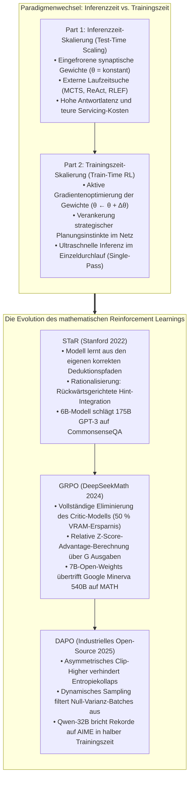
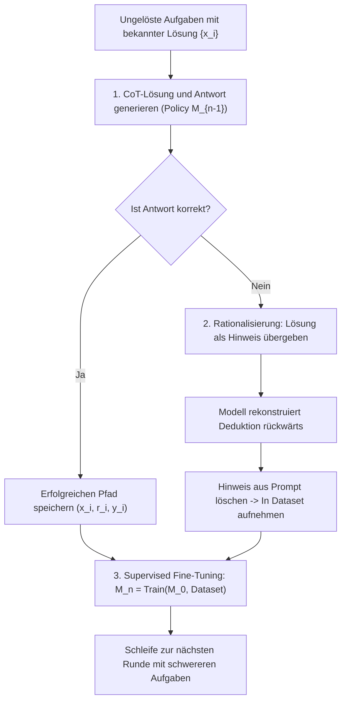
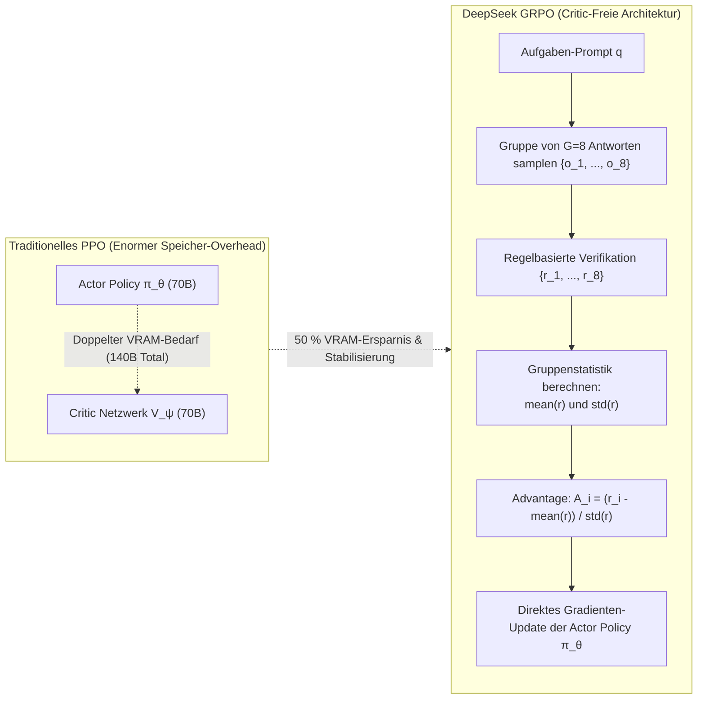

Willkommen zur sechsten Ausgabe unserer technischen Analyse der Graduierten-Vorlesung der **Stanford University, CS329A: Self-Improving AI Agents (Herbst 2025)**.

In den Vorlesungen 1 bis 5 (Part 1: Grundlagen) haben wir untersucht, wie autonome Agenten die Leistungsfähigkeit eingefrorener Sprachmodelle maximieren, indem sie Inferenz-Rechenzeit (Test-Time Compute) allozieren: durch MCTS-Suchbäume, Compiler-Fehleranalysen und Verifikator-Ensembles.

Dennoch müssen wir eine fundamentale mathematische Grenze anerkennen:
Erhält ein Grundschüler bei einer Klausur zehn Minuten zusätzliche Bedenkzeit, wird er dennoch keinen Beweis der Infinitesimalrechnung erbringen. Wenn ein Sprachmodell in seinen eingefrorenen synaptischen Gewichten ($\theta$) die zugrundeliegenden mathematischen Konzepte nicht repräsentiert, führt auch das Generieren von 10.000 Rollouts oder Beam-Search nicht zu wahrer Intelligenz, sondern zu statistischem Zufall.

Mit dem heutigen Tag eröffnen wir **Part 2: Training & Evolution (Vorlesungen 6 bis 9)** und wenden uns der entscheidenden Frage zu:
> **„Wie können wir, statt bei jeder Inferenz kostspielige Suchbäume zu durchlaufen, massive Rechenleistung während des Trainings investieren, um die Gewichte des Modells permanent in einen Spitzen-Denker zu transformieren?“**

In **Vorlesung 6** analysieren wir die drei Säulen des **Post-Training Reinforcement Learnings (RL)**, die den Engpass menschlicher Annotationen überwunden und moderne Denkmodelle hervorgebracht haben:
1. **Autonomes Reasoning-Bootstrapping:** Self-Taught Reasoner (**STaR**, Zelikman et al., Stanford 2022).
2. **Das Ende des Critic-Modells:** Group Relative Policy Optimization (**GRPO**, DeepSeekMath 2024).
3. **Skalierung auf 1.000 GPUs:** Entkoppeltes Clipping und dynamisches Sampling (**DAPO**, 2025).



{/* truncate */}

---

### 1. Trainingszeit- vs. Inferenzzeit-Skalierung: Verschiebung der Rechenfront

Um zu verstehen, warum die Spitzenforschung auf Post-Training Reinforcement Learning umschwenkte, betrachten wir die fundamentale Rechenbudget-Gleichung (FLOPs):

```text
Compute_Total = Compute_Train + Compute_Inference
```

1. **Inferenzzeit-Skalierung (Inference-Time Scaling):** Der Parametervektor $\theta$ bleibt fixiert. Rechenleistung fließt in wiederholtes Sampling, Beam-Search und MCTS. Dies ist zwar bei Einzelfragen effektiv, belastet jedoch jede Interaktion in Produktionssystemen mit prohibitiven Latenzen und Serverkosten.
2. **Trainingszeit-Skalierung (Train-Time Scaling):** Rechenleistung wird im Vorfeld massiv investiert, um die Gewichte $\theta$ über Reinforcement Learning zu optimieren:

```text
θ* = argmax_θ E_{x ~ D, y ~ π_θ(·|x)} [ R(x, y) ]
```

Wenn der Agent durch RL eigenständig überlegene Deduktionsschemata entdeckt, verankert die Backpropagation diese Strategien dauerhaft in den Gewichtsmatrizen. Zur Laufzeit agiert das Modell dann **in einem einzigen Vorwärtspass (Single Forward Pass) mit großmeisterlicher Übersicht – ohne externe Suchalgorithmen**.

---

### 2. Autonomes Reasoning-Bootstrapping: STaR (Zelikman et al., Stanford 2022)

Supervised Fine-Tuning (SFT) erfordert Zehntausende von Experten verfasste Datensätze (Problem $\to$ Rationale $\to$ Lösung). Es ist wirtschaftlich unmöglich, promovierte Mathematiker oder Software-Architekten Millionen komplexer Lösungswege manuell formulieren zu lassen.

2022 formulierte Eric Zelikman an der Stanford University eine kühne Hypothese:
> **„Wenn wir automatisiert und deterministisch prüfen können, ob eine finale Antwort korrekt ist: Warum lassen wir das Sprachmodell seine Lösungswege nicht selbst generieren, filtern jene Pfade heraus, die zur richtigen Lösung geführt haben, und trainieren das Modell auf seinen eigenen Erfolgen?“**

Dies war die Geburtsstunde des **Self-Taught Reasoners (STaR)**.



#### Mathematische Fundierung: Diskrete Policy-Gradient-Approximation

STaR ist kein bloßer Daten-Trick; es entspricht mathematisch einer diskreten Annäherung des Policy Gradient Reinforcement Learnings unter einer Indikator-Belohnungsfunktion $`1(y_hat = y*)`$:

```text
∇_θ J(θ) = ∑_i E_{r_hat, y_hat ~ π_θ(·|x_i)} [ 1(y_hat = y_i*) * ∇_θ log π_θ(r_hat, y_hat | x_i) ]
```

Bei fehlerhaften Antworten gilt $\mathbb{1} = 0$; der Gradient verschwindet und der Pfad wird verworfen. Nur bei korrekten Antworten ($\mathbb{1} = 1$) erfolgt ein Gradientenaufstieg (MLE), wodurch sich die Wahrscheinlichkeitsverteilung des Modells stetig auf verifizierte Lösungswege konzentriert.

#### Die Raffinesse der Rationalisierung (Rationalization)

Eine Schwachstelle des naiven Selbst-Filterns liegt auf der Hand: Aufgaben, die das Modell von vornherein nicht lösen kann, produzieren keine Trainingsdaten.

STaR löste dies durch **Rationalisierung**:
1. Scheitert das Modell, hängt das System die korrekte Lösung als Hinweis an: *„Hinweis: Das Ergebnis lautet 42. Erkläre rückblickend, warum 42 mathematisch zwingend ist.“*
2. Da das Ziel bekannt ist, gelingt dem Modell die logische Brücke rückwärts.
3. **Der entscheidende Schritt:** Bevor das Beispiel im Trainingsset landet, **wird der Hinweis vollständig entfernt**:

```text
Datensatz-Eintrag: Prompt [ x_i ] ──► Ziel-Rationale [ r_rückwärts ] + Antwort [ y_i* ]
```

Das Modell trainiert so, als hätte es den Lösungsweg ohne fremde Hilfe eigenständig hergeleitet, und internalisiert die kausale Intuition für künftige Runden.

#### Empirische Resultate: 6B-Modell schlägt 175B-Riesen
* Auf dem Benchmark **CommonsenseQA** steigerte STaR die Genauigkeit eines kompakten **6B GPT-J-Modells** von 60,0 % auf **72,5 %**.
* Damit zog das 6B-Modell mit einem fast 30-mal größeren, feingetunten **GPT-3 mit 175B Parametern (73,0 %)** gleich.

---

### 3. Der Tod des Critic: DeepSeekMath & GRPO (2024)

Während STaR auf iterativem SFT basierte, leitete das DeepSeek-Team im Frühjahr 2024 mit **DeepSeekMath und GRPO (Group Relative Policy Optimization)** das Zeitalter des echten Online-Reinforcement-Learnings für mathematisches Denken ein.

#### Das Versagen traditioneller PPO-Architekturen

Klassisches PPO erfordert das gleichzeitige Vorhalten zweier riesiger Netze im GPU-Speicher:
1. Das **Policy-Netzwerk (Actor, $\pi_\theta$)**, das Tokens ausgibt;
2. Das **Value-Netzwerk (Critic, $V_\psi$)**, das den Erwartungswert jedes Zustands schätzt.

Für ein 70B-Modell benötigt man somit ein zweites 70B-Critic-Modell, was den VRAM-Bedarf verdoppelt.
Schwerer wog das Problem der **Kreditzuweisung**: Bei mathematischen Aufgaben, bei denen erst nach 3.000 Tokens ein einziges $+1$ oder $-1$ vergeben wird, ist das präzise Training eines tokenweisen Critics mathematisch hochgradig instabil.

#### Die GRPO-Innovation: Verzicht auf das Value-Netzwerk

Die Idee von DeepSeek war radikal einfach:
> **„Warum Milliarden Parameter für ein Critic-Modell verschwenden? Wir sampeln für jeden Prompt `q` eine Gruppe von `G` Antworten $`{o_1, ..., o_G}`$ aus der aktuellen Policy. Wir berechnen Mittelwert und Standardabweichung der Belohnungen innerhalb der Gruppe und normalisieren via Z-Score. Diese relative Rangfolge ist der perfekte Advantage!“**



#### Die mathematische Zielfunktion von GRPO

GRPO optimiert die Policy $\pi_\theta$ ohne separates Value-Netzwerk unter Verwendung einer KL-Divergenz-Schranke zur Referenz-Policy $`pi_ref`$:

```text
J_GRPO(θ) = E_{q, {o_i}_{i=1}^G} [ 
    (1 / G) * ∑_{i=1}^G (1 / |o_i|) * ∑_{t=1}^{|o_i|} {
        min(
            ( π_θ(o_{i,t}) / π_old(o_{i,t}) ) * A_hat_{i,t},
            clip( π_θ(o_{i,t}) / π_old(o_{i,t}), 1 - ε, 1 + ε ) * A_hat_{i,t}
        )
    } - β * D_KL( π_θ || π_ref )
]
```

Der Advantage `A_hat_{i,t}` für die Lösung `o_i` wird direkt aus der Gruppenstatistik abgeleitet:

```text
A_hat_{i,t} = r_tilde_i = ( r_i - mean({r_1, ..., r_G}) ) / ( std({r_1, ..., r_G}) + δ )
```

#### Outcome- vs. Process-Supervision
1. **Outcome-Supervision:** Ist das Endergebnis korrekt, gilt $r_i = +1$, sonst $-1$. Der standardisierte Wert `r_tilde_i` wird auf alle Tokens der Sequenz gleichmäßig übertragen.
2. **Process-Supervision:** Zwischenschritte erhalten Teilbelohnungen, und die diskontierte Summe zukünftiger Vorteile wird dem jeweiligen Token zugerechnet.

#### Benchmark-Triumphe: 7B schlägt 540B
* `DeepSeekMath-Base 7B` übertraf allein durch Pre-Training auf 120B Mathe-Tokens **Googles 540B Minerva-Modell**.
* Durch GRPO stieg die Genauigkeit auf dem MATH-Benchmark von 46,8 % auf **51,7 %** – das erste Mal, dass ein reines Open-Source-7B-Modell ohne Taschenrechner über 50 % erzielte.
* Mit 64-Sample Self-Consistency kletterte der Wert auf **60,9 %**.

---

### 4. Großskaliges RL-Engineering: DAPO (2025)

Als Forschungsgruppen versuchten, die GRPO-Formel auf schwere Wettbewerbe wie **AIME 2024** anzuwenden, traten unerwartete Hürden auf:
* Während DeepSeek-R1-Zero 47 Punkte erreichte, stagnierten naive GRPO-Implementierungen bei **nur rund 30 Punkten**.

Im März 2025 legte **DAPO (Decoupled Clip and Dynamic Sampling Policy Optimization)** die vier entscheidenden Engineering-Prinzipien offen:

```text
Natives GRPO (30 Punkte) 
  ──► + Längenfilter (36 Punkte) 
  ──► + Clip-Higher (38 Punkte) 
  ──► + Token-Level Loss (42 Punkte) 
  ──► DAPO (50 Punkte, schlägt DeepSeek-R1-Zero!)
```

#### Geheimnis 1: Asymmetrisches Clip-Higher ($`eps_low` = 0,20, `eps_high` = 0,28$)
* **Das Problem:** Symmetrisches PPO-Clipping ($\pm 0,2$) unterdrückt Exploration. Entdeckt das Modell ein seltenes, innovatives Token mit Ausgangswahrscheinlichkeit 0,01, wird es bei $1 + 0,2 = 1,2\times$ auf maximal 0,012 gedeckelt, während triviale Tokens (0,9) leicht steigen.
* **Die Folge:** Das Modell vermeidet kreative Pfade und verfällt in den **Entropiekollaps (Entropy Collapse)**, indem es nur noch monotone Kurzschlüsse reproduziert.
* **Die DAPO-Lösung:** Die untere Grenze bleibt bei $`eps_low` = 0,20$, aber die obere Grenze wird auf **$`eps_high` = 0,28$** (+40 %) angehoben, damit innovative Tokens signifikant an Wahrscheinlichkeit gewinnen können.

#### Geheimnis 2: Dynamisches Sampling (Dynamic Sampling)
* **Das Problem:** Ist eine Aufgabe zu leicht, sind alle $G$ Pfade richtig ($r_i = 1$). Ist sie zu schwer, sind alle falsch ($r_i = 0$).
* In beiden Fällen ist `formula`; der Advantage wird 0 und **Tausende GPUs verschwenden Rechenleistung an Gradienten von exakt 0**.
* **Die DAPO-Lösung:** Batches werden gefiltert und nur beibehalten, wenn `0 < Correct Rollouts < G` gilt. So wird sichergestellt, dass jeder Trainingsschritt zu 100 % aus informativer Varianz lernt.

#### Geheimnis 3: Token-Level-Verlustnormalisierung
Standard-GRPO mittelt über Stichproben. Dadurch wird ein gravierender Fehler in einer 2.000-Token-Herleitung im Vergleich zu einer 50-Token-Antwort unverhältnismäßig verwässert. DAPO normalisiert den Verlust streng über die Gesamtsumme aller Tokens $\sum_i |o_i|$, was das künstliche Aufblähen von Antworten unterbindet.

#### Geheimnis 4: Soft-Penalisierung überlanger Texte
Überschreitet ein Modell bei tiefen Überlegungen das Kontextlimit (z. B. 16.384 Tokens), führt ein harter Abbruch mit $-1$ Belohnung zur Zerstörung vielversprechender Argumentationen. DAPO führt auf den letzten 4.096 Tokens einen **linearen Soft-Abzug** ein, der das Modell behutsam dazu erzieht, Herleitungen rechtzeitig zu schließen.

---

### 5. Enterprise-Architektur: Großskalige verteilte GRPO/DAPO-Infrastruktur

Für den industriellen Einsatz auf GPU-Clustern erfordert Reasoning-RL eine strikt entkoppelte Topologie:

```text
┌────────────────────────────────────────────────────────────────────────┐
│             Verteilte Enterprise-Infrastruktur für GRPO/DAPO           │
├────────────────────────────────────────────────────────────────────────┤
│                                                                        │
│  [ Aufgaben-Curriculum (Symbolische Mathematik / Compiler / Tests) ]   │
│          │                                                             │
│          ▼                                                             │
│  ┌──────────────────────────────────────────────────────────────────┐  │
│  │                    Dynamische Batching- & Sampling-Engine        │  │
│  │  • Varianz-Filter: Verwerfen von 100% Erfolgs-/Fehl-Batches      │  │
│  │  • Bin-Packing nach Kontextlänge                                 │  │
│  └───────────────────┬──────────────────────────────────────────────┘  │
│                      │ Gefilterte Batches                              │
│                      ▼                                                 │
│  ┌──────────────────────────────────────────────────────────────────┐  │
│  │                    vLLM / TensorRT-LLM Inferenz-Flotte           │  │
│  │  • Asynchrones G=8 Rollout-Sampling auf dedizierten Knoten       │  │
│  │  • Verteiltes KV-Caching via PagedAttention                      │  │
│  └───────────────────┬──────────────────────────────▲───────────────┘  │
│                      │ Rollouts {o_1..o_G}          │ Synchronisierte  │
│                      ▼                              │ Gewichte θ       │
│  ┌──────────────────────────────────────────────────┴───────────────┐  │
│  │                    Deterministische Regel-Verifikatoren          │  │
│  │  • Docker/gVisor Sandboxes für Python & SymPy-Prüfung            │  │
│  │  • XML-Formatprüfung für `<think> ... </think>`-Blöcke           │  │
│  │  • Advantage-Standardisierung: A_i = (r - μ) / σ                 │  │
│  └───────────────────┬──────────────────────────────────────────────┘  │
│                      │ Token-Advantage-Streams                         │
│                      ▼                                                 │
│  ┌──────────────────────────────────────────────────────────────────┐  │
│  │                    Megatron-LM / DeepSpeed Trainings-Cluster     │  │
│  │  • Reines Policy-Modell (Kein Critic, 50 % VRAM-Ersparnis)       │  │
│  │  • Asymmetrisches Clip-Higher (ε_high = 0.28, ε_low = 0.20)      │  │
│  │  • Token-Level-Loss via FlashAttention-3                         │  │
│  └──────────────────────────────────────────────────────────────────┘  │
│                                                                        │
└────────────────────────────────────────────────────────────────────────┘
```

#### Grundregeln für den Produktivbetrieb
1. **Keine menschlichen Bewerter im RL-Loop:** Reasoning-RL darf ausschließlich auf deterministisch verifizierbaren Aufgaben trainiert werden (Compiler, symbolische Gleichungslöser, Unit-Tests). Subjektive Bewertungen destabilisieren den Prozess.
2. **Physikalische Trennung von Inferenz und Training:** Inferenz-Server (vLLM) und Backpropagation-Knoten (Megatron-LM) müssen physisch getrennt und über schnelle RDMA-Netzwerke verbunden sein, um VRAM-Fragmentierung zu verhindern.
3. **Format-Leitplanken:** Belohnungen müssen die Einhaltung struktureller Tags (`<think>`) erzwingen, um zu verhindern, dass Modelle Zwischenschritte überspringen und Lösungen erraten.

---

### 6. Technische Vertiefung: Praktische Engineering-Q&A

**F: Warum ist der KL-Divergenz-Term in GRPO trotz allem unverzichtbar?**
**A:** Der KL-Term ($\beta `D_KL`(\pi_\theta \parallel `pi_ref`)$) schützt vor **Reward Hacking** und katastrophalem Vergessen. Ohne ihn generiert das Modell rasch absurde Sonderzeichenketten, die Regelsysteme austricksen. Beim Auslösen emergenter langer Denkprozesse (wie bei DeepSeek-R1-Zero) wird $\beta$ in der Frühphase jedoch bewusst nahe 0 gesetzt, um unkonventionelle Pfade zu ermöglichen, bevor später wieder reguliert wird.

**F: Verleitet die Rationalisierung in STaR das Modell nicht dazu, sich auf Schummel-Tipps zu verlassen?**
**A:** Das verhindert die strikte Trennung zwischen Datengenerierung und Gradienten-Update. Der Hinweis dient ausschließlich dazu, bei der Generierung die Kausalität rückwärts aufzubauen. Vor dem Einfügen in den Trainingsdatensatz wird der Hinweis **vollständig getilgt**. Für die Backpropagation sieht es so aus, als hätte das Modell die Herleitung aus eigener Kraft gefunden.

---

### 7. Zusammenfassung und Kernfakten

1. **Notwendigkeit der Trainingszeit-Skalierung:** Reine Laufzeitsuche kann fehlendes Wissen nicht kompensieren. Trainingszeit-Skalierung verankert strategisches Denken dauerhaft in den Gewichten.
2. **Autonomes Bootstrapping:** STaR beweist, dass Modelle durch das Filtern eigener Erfolge und rückwärtige Rationalisierung mit 30-fach größeren Systemen gleichziehen können.
3. **Durchbruch ohne Critic:** GRPO von DeepSeek spart 50 % Speicher durch Wegfall des Value-Netzwerks und errechnet präzise Vorteile aus relativen Gruppenstatistiken.
4. **Industrielle Stabilisierung:** DAPO verhindert den Entropiekollaps mittels asymmetrischem Clip-Higher ($\epsilon=0,28$), dynamischem Sampling und Token-Level Loss und überflügelte DeepSeek-R1-Zero in der halben Schrittzahl.

---

### Ausblick auf Vorlesung 7:
In **Vorlesung 7** verlassen wir vorgegebene Prüfungsaufgaben und betreten das Feld autonomer wissenschaftlicher Entdeckungen:
**《Lecture 7: Open-Ended Evolution: ADAS, The AI Scientist, AlphaEvolve und selbstverbessernde Agenten》**.
Wir analysieren, wie Agenten eigene Forschungsarbeiten verfassen, neue ML-Architekturen erfinden und Nachfolgemodelle designen. Bleiben Sie dran!