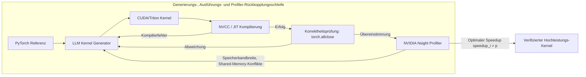

# Stanford CS329A (Ep 10): SWE-Agents — Autonome Softwareentwicklung, CodeMonkeys, KernelBench und Agent-System Interface

Reale Softwareentwicklung in Produktionsumgebungen hat praktisch keine Ähnlichkeit mit isolierten Programmierwettbewerben oder akademischen Spielzeugproblemen. Ein realer GitHub-Fehlerbericht wird nicht fein säuberlich mit vordefinierten Unit-Tests geliefert; er ist über hunderte von Dateien, veraltete Abhängigkeiten und Millionen von Zeilen verteilten Produktionscodes verstreut. Darüber hinaus darf Software in der Praxis nicht nur funktional korrekt sein — sie muss recheneffizient, speicherschonend und optimal auf parallele Low-Level-Hardwarearchitekturen abgestimmt sein.

Zum Auftakt von **Teil 3: Agent Engineering (Lektionen 10 bis 12)** von **Stanford CS329A: Self-Improving AI Agents** verlassen wir die grundlegenden Modell-Trainingscluster und steigen tief in die technische Praxis der industriellen Softwareentwicklung ein:
> **"Wie navigieren autonome KI-Agenten durch Repositories mit mehreren Millionen Token, isolieren schwer fassbare Regressionsfehler, erstellen reproduzierbare Testumgebungen und schreiben benutzerdefinierte GPU-Kernel, die von Menschen optimierte PyTorch-Baselines übertreffen?"**

Dieser Beitrag untersucht die moderne Grenze des **SWE-Agent Autonomous Coding** anhand von drei bahnbrechenden Durchbrüchen: **CodeMonkeys Automated Refactoring** auf dem **SWE-bench Benchmark GitHub**, **KernelBench GPU Performance Tuning** mittels Hardware-Profiler-Schleifen und Stanfords **Agent-Computer Interface ACI** (Agent-System Interface, ASI), das entwickelt wurde, um semantische Diskrepanzen zwischen übergeordneten Agentenabsichten und physischer Parallel-Hardware aufzulösen.

{/* truncate */}


---

## 1. Die Realität autonomer Softwareentwicklung

Die Lösung realer GitHub-Issues erfordert die Bewältigung von drei zentralen systemtechnischen Herausforderungen:
1. **Das Kontext-Explosions-Dilemma:** Ein durchschnittliches industrielles Repository umfasst über 3.000.000 Token. Das ungefilterte Einspeisen solch riesiger Codebasen in Spitzen-LLMs führt zu untragbaren API-Kosten und gravierendem Aufmerksamkeitsverlust (*Needle-in-a-Haystack*-Versagen).
2. **Das Verifikations-Dilemma:** Agenten neigen häufig zu „bequemen Patches“, bei denen Tests modifiziert werden, anstatt den eigentlichen Architekturfehler zu beheben, was zu trügerischen Scheinerfolgen führt.
3. **Die Hardware-Wand:** Der Übergang von einfachem Python-Glue-Code zu hardwarenaher GPU-Beschleunigung (CUDA, Triton) verlangt ein tiefes Verständnis von Memory Coalescing, Thread-Block-Synchronisation und Hardwareregister-Druck.

```
┌─────────────────────────────────────────────────────────────────────────┐
│               Die 3 Säulen produktiver SWE-Agenten                      │
└────────────────────────────────────┬────────────────────────────────────┘
                                     │
       ┌─────────────────────────────┼─────────────────────────────┐
       ▼                             ▼                             ▼
┌──────────────────────────┐  ┌──────────────────────────┐  ┌──────────────────────────┐
│  CodeMonkeys SWE-bench   │  │   KernelBench Profiler   │  │  Agent-System Interface  │
├──────────────────────────┤  ├──────────────────────────┤  ├──────────────────────────┤
│ • 50.5x Kontextkompression│ │ • fast_p Metrik (Laufzeit)│ │ • 14x DSL-Code-Kompression │
│ • Zweiseitiges Debugging │  │ • E+P Profiler-Feedback  │  │ • AutoGuide Log-Übersetzer│
│ • Diskriminator-Tests    │  │ • Fusion & Shared Memory │  │ • Semantische Ausrichtung│
│ • 57,4% SWE-bench Verif. │  │ • 13x GPU-Beschleunigung │  │ • 3,8x Speedup vs Tuner  │
└──────────────────────────┘  └──────────────────────────┘  └──────────────────────────┘
```

---

## 2. Lösung von Produktions-GitHub-Issues: CodeMonkeys (2025)

Der weltweite Goldstandard zur Evaluierung autonomer Software-Engineering-Agenten ist **SWE-bench Verified** (kuratiert aus 500 realen Pull Requests bedeutender Open-Source-Repositories wie Django, SymPy und scikit-learn).

Das Anfang 2025 vorgestellte System **CodeMonkeys** erreichte eine Spitzenlösungsrate von 57,4 %, indem es das agentische Software Engineering in drei disziplinierte Phasen unterteilte:

```
                  [Reales GitHub-Issue & 3M Token Repository]
                                     │
                                     ▼
           1. Kontext-Pipeline (Repo-Scan & 50.5x Kompression)
              (Qwen2.5-Coder-32B lokaler Scan -> Zusammenfassen -> Rang -> 128k)
                                     │
                                     ▼
           2. Generierungs-Zustandsautomaten (Zweiseitige Debugging-Schleife)
              ┌────────────────────────────────────────────────────────┐
              │ Testing Machine: Synthetisiert Reproduktion (Exit 2)   │
              │                       │                                │
              │                       ▼                                │
              │ Editing Machine: Patcht Quellcode -> Test (Exit 0)     │
              └────────────────────────────────────────────────────────┘
                                     │
                                     ▼
           3. Selektions-Zustandsautomat (Diskriminator-Test-Synthese)
              (Generiert differentielle Randfall-Tests zur Patch-Prüfung)
                                     │
                                     ▼
                       [Finaler verifizierter Patch]
                    (57,4% Gelöst auf SWE-bench Verified)
```

### Phase 1: Die Kontext-Pipeline (50.5x Kompression)
Das direkte Abfragen von Flaggschiff-Modellen (Claude 3.5 Sonnet) über Repositories mit Millionen Token hinweg ist wirtschaftlich unrentabel. CodeMonkeys trennt die Kontexterkennung strikt von der Patch-Synthese:
- Ein kostengünstiges, lokal gehostetes Modell (`Qwen2.5-Coder-32B`) scannt jede Python-Datei im Repository.
- Relevante Klassendefinitionen, Funktionssignaturen und Docstrings werden extrahiert.
- Ein nachgelagerter Ranking-Durchlauf filtert die wichtigsten Kandidatendateien heraus und komprimiert eine Codebasis von 3.000.000 Token in ein kompaktes **128.000-Token-Arbeitsfenster (eine 50,5-fache Reduktion)**.
- Da dieses Kontextartefakt für mehrere parallele Generierungsversuche wiederverwendet wird, beansprucht die Kontextextraktion weniger als **15 % des gesamten Lösungsbudgets**.

### Phase 2: Zweiseitige Debugging-Zustandsautomaten
Ein häufiges Fehlermuster autonomer Codierungs-Agenten ist das „selbsttäuschische Patchen“ — Code wird modifiziert, ohne vorher sicherzustellen, dass der Fehler überhaupt reproduziert werden konnte. CodeMonkeys koppelt zwei getrennte Zustandsautomaten:
1. **Testing State Machine:** Bevor der Quellcode angetastet wird, erstellt der Agent ein isoliertes Reproduktionsskript (`reproduce_issue.py`). Dieses Skript muss zwingend auf der unveränderten Codebasis ausgeführt werden und **Exit Code 2 (Reproduzierter Fehler)** zurückgeben. Besteht das Skript sofort fehlerfrei, ist der Test ungültig und wird verworfen.
2. **Editing State Machine:** Geleitet von dem fehlschlagenden Test nimmt die Editing Machine Codeänderungen vor. Sie iteriert bis zu achtmal gegen Compilerfehler, Tracebacks und Assertions, bis der Reproduktionstest **Exit Code 0 (Erfolg)** liefert.

### Phase 3: Der Selektions-Zustandsautomat (Diskriminator-Tests)
Das Generieren von 10 parallelen Lösungspfaden erzielt eine theoretische Abdeckung von **69,8 %** (mindestens ein gültiger Patch ist vorhanden). Die zufällige Auswahl eines Patches senkt die Trefferquote jedoch auf **45,8 %**, da viele Entwürfe versteckte Regressionsfehler in Nebenmodulen verursachen.

Um diese Lücke zu schließen, führte CodeMonkeys den **Diskriminator-Selektions-Automaten** ein:
- Er analysiert feine Verhaltensunterschiede zwischen den Kandidatenpatches $P_A$ und $P_B$.
- Das LLM wird angewiesen, einen **differentiellen Diskriminator-Test** zu verfassen, der gezielt auf $P_A$ erfolgreich durchläuft und auf $P_B$ scheitert.
- Durch die Ausführung dieser Diskriminator-Suiten in isolierten Sandkästen werden fehlerhafte Patches schrittweise eliminiert, was die finale Einreichungsgenauigkeit auf **57,4 %** anhebt.

---

## 3. Jenseits von Korrektheit: KernelBench & GPU-Performance (2025)

Funktionale Korrektheit ist nur die halbe Miete. In moderner Machine-Learning-Infrastruktur entscheiden maßgeschneiderte GPU-Operatoren über Latenz und Wirtschaftlichkeit ganzer Rechenzentren. Menschliche Ingenieure benötigten nach der Veröffentlichung des Transformer-Papers fast fünf Jahre, um FlashAttention in CUDA zu erfinden und zu perfektionieren. Können autonome Agenten hochperformante GPU-Kernel direkt aus PyTorch-Definitionen synthetisieren?

Das im Februar 2025 vorgestellte **KernelBench** evaluiert Agenten über 250 verschiedene PyTorch-Operatoren hinweg und misst sowohl die mathematische Korrektheit als auch die reale Hardwarebeschleunigung.

```text
Die fast_p Speedup-Frontier-Metrik:
========================================================================================
fast_p = (1 / N) * Σ_{i=1}^N  1[ correct_i  AND  speedup_i > p ]

Wobei:
  • fast_0 : Funktionale Korrektheit (Tensor-Ausgabe stimmt mit PyTorch überein)
  • fast_1 : Korrektheit + Schneller als natives PyTorch (Speedup > 1.0x)
  • fast_2 : Korrektheit + Doppelt so schnell wie natives PyTorch (Speedup > 2.0x)
========================================================================================
```



### Die Profiler-Feedback-Revolution
Bei naiver Single-Shot-Generierung scheitern selbst Spitzenmodelle wie OpenAI o1 oder DeepSeek-R1 dramatisch: **Weniger als 20 % der generierten CUDA-Kernel erzielen überhaupt einen Geschwindigkeitsvorteil gegenüber Standard-PyTorch ($fast_1 < 20\%$)**, und stürzen häufig durch ungültige Speicherzugriffe oder Shared-Memory-Bankkonflikte ab.

Wird der Agent jedoch in eine dreistufige geschlossene Schleife eingebunden:
1. **Generierung:** Erstellt die initiale Triton/CUDA-Implementierung.
2. **Ausführung:** Liefert Compiler-Diagnosedaten und PyTorch-Tensortoleranzen (`torch.allclose`) zurück.
3. **Profiler-Feedback (E+P):** Versieht den Kernel mit NVIDIA Nsight-Telemetriedaten und liefert präzise Engpassanalysen (z. B. *"Memory bound: Global Memory Stall in Zeile 42; 8-facher Bankkonflikt im Shared Memory Tile"*).

Unter dieser Schleife verdoppelte sich die Erfolgsquote von DeepSeek-R1 bei komplexen Operatoren der Stufe 2 von **36 % auf 72 %**. Der Agent synthetisierte autonom Fused-Attention-Muster, Register-Tiling und Warp-Shuffle-Reduktionen, die Berechnungen um bis zu **13x gegenüber Standard-PyTorch beschleunigten**.

---

## 4. Semantische Ausrichtung: Agent-System Interface (ASI, Stanford 2025)

Wenn Agenten versuchen, komplexe, verteilte C++-Systeme auf Hardwareebene zu optimieren, entsteht ein architektonischer Impedanzbruch. Ein LLM mit rohen C++-Pointern, Thread-Synchronisationsprimitiven und kryptischen Compiler-Meldungen zu konfrontieren, gleicht dem Versuch, einen Softwarearchitekten Maschinencode auf Bitebene debuggen zu lassen.

Das auf der ICML 2025 von Alex Aikens Forschungsgruppe an der Stanford University vorgestellte **Agent-System Interface (ASI)** schlägt eine Brücke:
> **"Anstatt LLMs dazu zu zwingen, fehleranfälliges C++ zu schreiben oder rohe Stacktraces zu entziffern, müssen wir eine Zwischenabstraktionsschicht schaffen: eine deklarative domänenspezifische Sprache (DSL), die den Suchraum eingrenzt, und einen AutoGuide-Übersetzer, der Hardware-Assertions in handlungsorientierte natürlichsprachliche Ratschläge transformiert."**

```text
┌─────────────────────────────────────────────────────────────────────────┐
│                          LLM Reasoning Agent                            │
│           (Strategische Absicht & Algorithmisches Design)               │
└────────────────────────────────────▲────────────────────────────────────┘
                                     │
          ┌──────────────────────────┴──────────────────────────┐
          │ Deklarative DSL          ▲ Handlungsorientierte     │
          │ Optimierungsanweisungen  │ natürliche Sprachtipps   │
          ▼                          │                          │
┌────────────────────────────────────┴────────────────────────────────────┐
│                    Agent-System Interface (ASI-Schicht)                 │
│  • Domain-Specific Language (DSL): 14x Codekomplexitäts-Kompression     │
│  • AutoGuide Diagnose-Übersetzer: Wandelt Segfaults in Handlungsanweis. │
└────────────────────────────────────▲────────────────────────────────────┘
                                     │
          │ Generierter C++ Code     ▲ Rohe Hardwarefehler      │
          │ & Speicherallokationen   │ & Compiler-Assertions    │
          ▼                          │                          │
┌────────────────────────────────────┴────────────────────────────────────┐
│                  Physische parallele Hardware-Ausführung                │
│                (Verteilter Speicher, GPU-Kerne, Shared VRAM)            │
└─────────────────────────────────────────────────────────────────────────┘
```

### Die zwei Komponenten von ASI
1. **Domain-Specific Language (DSL):** Die Abstraktion von Daten-Tiling, Loop-Unrolling und Speicherhierarchie-Zuordnungen in deklarative Primitive komprimiert den Systemcode um das **14-Fache** und eliminiert Syntax-Halluzinationen vollständig.
2. **AutoGuide-Übersetzer:** Löst ein Kernel eine hardwarenahe Assertion aus (z. B. `Assertion failed: stride mismatch at dim 1; invalid warp alignment`), fängt AutoGuide den Fehler ab und liefert präzisen Kontext:
   > *"Hardware-Diagnose: Die Stride-Ausrichtung schlug fehl, da Tensordimension 1 nicht auf ein Vielfaches von 32 aufgefüllt ist. Passen Sie das Row-Major-Speicherlayout auf ein 32-Byte-Alignment an."*

### Empirische Ergebnisse: 10 Iterationen schlagen 1.000
Ausgerüstet mit ASI benötigte ein autonomer LLM-Agent lediglich **10 Iterationen**, um einen parallelen Tensor-Ausführungsplan zu entdecken, der **3,8x schneller** war als der von **OpenTuner nach 1.000 Iterationen** gefundene Plan. Komplexe Schaltungssimulationen, die zuvor Tage erfahrener Ingenieursarbeit banden, wurden in **10 Minuten** gelöst.

---

## 5. Architektonischer Vergleich der Entwicklungsparadigmen

```text
=========================================================================================================
Dimension             Klassischer KI-Assistent       CodeMonkeys (SWE-bench)  KernelBench + ASI
---------------------------------------------------------------------------------------------------------
Ziel-Artefakt         Einzelne Funktionen / Snippets Vollständige Patches     Hochleistungs-CUDA/Triton
Kontext-Management    Lokale Datei (4k-8k Token)     50.5x komprimiert 128k   Deklarative DSL (14x Squeeze)
Verifikationsschleife Unit-Test-Ausführung           Zweiseitiger Automat     Nsight Profiler (fast_p)
Feedback-Signal       Traceback-Fehlertexte          Exit 2 -> Exit 0 Wechsel AutoGuide Hardware-Hinweise
Kernziel              Funktionale Korrektheit        Produktions-Regressionen Reale Hardwarebeschleunigung
=========================================================================================================
```

---

## 6. Technische Tiefenanalyse (Q&A)

### F1: Warum muss CodeMonkeys einen Reproduktionstest synthetisieren, BEVOR Quellcode geändert wird?
Modifiziert ein Agent den Code vor dem Erstellen eines Testgerüsts, verfällt er unweigerlich in eine „selbsttäuschende Verifikation“ — er schreibt einen fehlerhaften Patch und formuliert anschließend einen Test, der genau auf diesen fehlerhaften Patch zugeschnitten ist.

Indem die **Testing State Machine** dazu verpflichtet wird, zuerst ein unabhängiges Skript zu erstellen, das auf der unveränderten Codebasis mit **Exit Code 2 (Reproduzierter Fehler)** abbricht, etabliert das System ein unveränderliches, objektives Orakel. Erst wenn die nachfolgende **Editing State Machine** denselben Test auf **Exit Code 0** umkehrt, ist die tatsächliche Fehlerbehebung mathematisch bewiesen.

### F2: Warum scheitern LLMs bei der One-Shot-Generierung von CUDA-Code und wie hilft die Profiler-Schleife?
Sprachmodelle erfassen Tensoroperationen auf hoher Abstraktionsebene fehlerfrei, scheitern jedoch an den Feinheiten massiver GPU-Nebenläufigkeit:
- **Thread-Index-Berechnungen:** Beim Ermitteln von `int idx = blockIdx.x * blockDim.x + threadIdx.x` werden Grenzbedingungen oft falsch behandelt, was Speicher-Segfaults auslöst.
- **Shared-Memory-Konflikte:** Gleichzeitige Zugriffe auf dieselbe Speicherbank serialisieren die Ausführung und zerstören die Bandbreite.

Klassische Compilerfehler prüfen nur syntaktische Gültigkeit, keine Laufzeitengpässe. Die **Profiler-Rückkopplungsschleife (E+P)** speist Auslastungsdaten, Speicher-Stalls und Warp-Divergenz-Kennzahlen direkt in den Kontext ein, sodass der Agent gezielte strukturelle Optimierungen wie Bank-Padding und Registerwiederverwendung vornehmen kann.

---

## Fazit & Ausblick

Software-Engineering-Agenten haben sich weit über einfache Autovervollständigungen hinausentwickelt. Mit **CodeMonkeys** sahen wir, wie hierarchische Kontext-Pipelines und zweiseitige Zustandsautomaten reale Repositories auf SWE-bench meistern. Mit **KernelBench** und **ASI** wurde deutlich, wie Hardware-Profiler und deklarative Abstraktionen KI in die Lage versetzen, Hochleistungs-Infrastruktur autonom zu optimieren.

In **Lektion 11** widmen wir uns der entscheidenden Herausforderung langlebiger Agenten: **Agent Memory — Hierarchische Speichersysteme, Cartridges, CacheBlend und persistenter Langzeitkontext (MemGPT)**.

---

### Kern-Erkenntnisse
- **Amortisierte Kontexterkennung:** Das Vorfiltern riesiger Repositories mit leichtgewichtigen Modellen (50,5x Kompression) macht ganzheitliches Software Engineering wirtschaftlich tragbar.
- **Zweiseitiges Debugging verhindert Scheinlösungen:** Ein Bug gilt erst dann als gelöst, wenn ein zuvor fehlgeschlagener Reproduktionstest (Exit 2) stabil auf Exit 0 wechselt.
- **Performance ist eine iterative Schleife:** Einzelversuche erzeugen selten konkurrenzfähigen CUDA-Code; die Verbindung von Ausführungstelemetrie mit Hardware-Profilern (fast_p) ist für echtes High-Performance Computing unerlässlich.