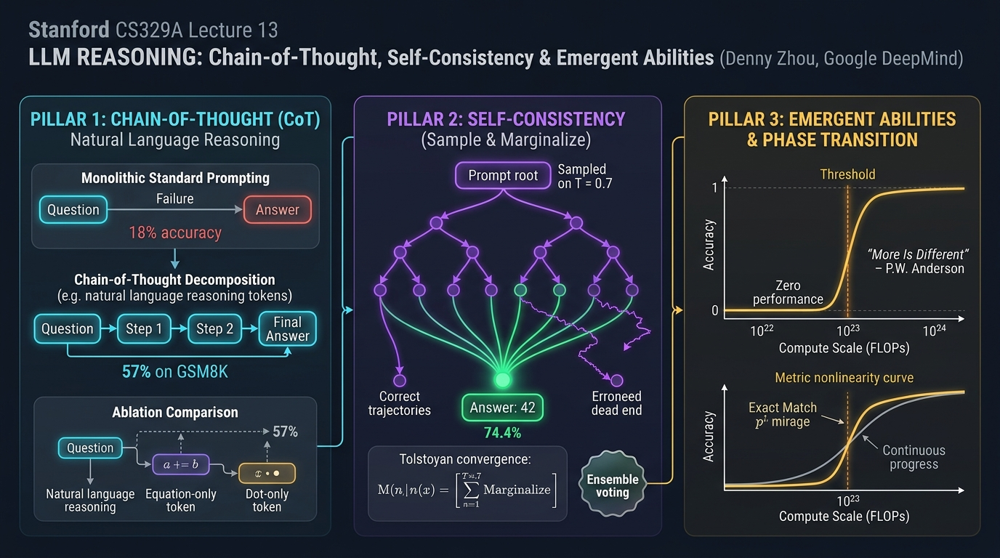
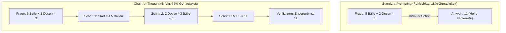
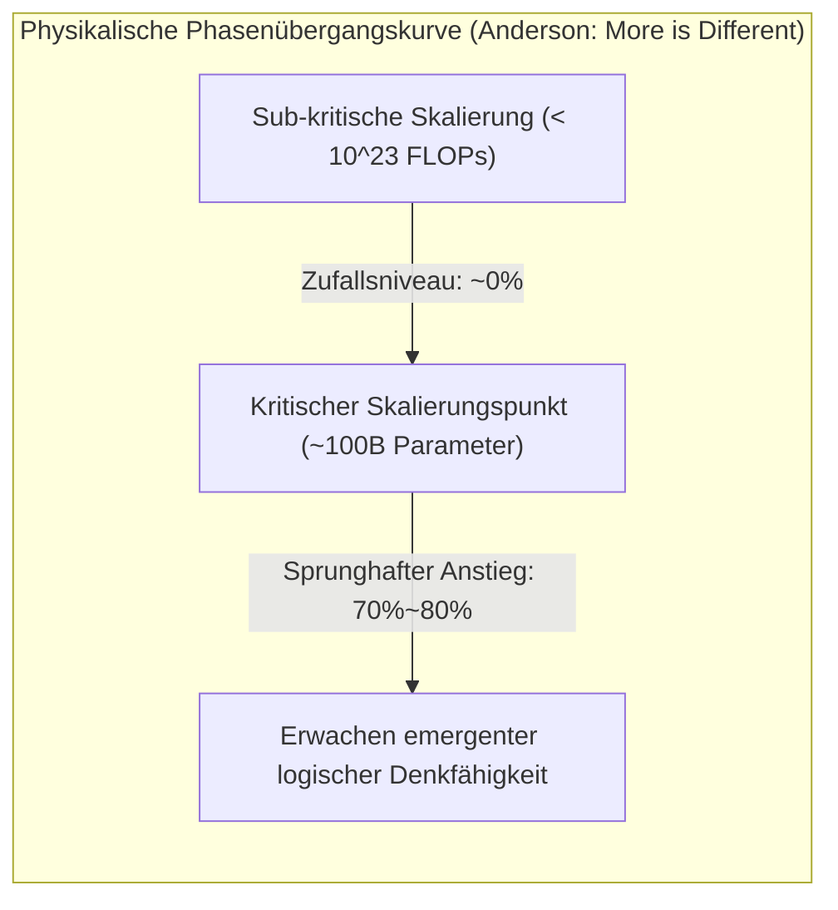

# Stanford CS329A (Ep 13): LLM Reasoning — Denny Zhou, Chain-of-Thought (CoT), Self-Consistency und emergente Fähigkeiten

Über Jahrzehnte hinweg herrschte in der KI-Forschung eine tief verwurzelte Skepsis gegenüber konnektionistischen neuronalen Netzen:
> *„Ein autoregressives Sprachmodell ist lediglich ein stochastischer Papagei (Stochastic Parrot), der statistisch wahrscheinliche Wörter aneinanderreiht. Wird es mit mehrstufigen Rechenaufgaben, formaler Logik oder Kausalketten konfrontiert, halluziniert es oberflächlich, da statistische Sequenzmodellierung zu echter logischer Deduktion unfähig ist.“*

Frühe Modelle schienen diese Skepsis zu bestätigen: Bei einfachen mathematischen Textaufgaben antworteten sie oft unmittelbar mit falschen Zahlen, unfähig, Zwischenschritte zu behalten.

Mit diesem Auftakt zu **Teil 4: Die Frontlinien (Lektionen 13 bis 17)** von **Stanford CS329A: Self-Improving AI Agents** betreten wir den theoretischen Gipfel künstlicher Intelligenz: die **LLM Reasoning Foundations**. Angeleitet von den bahnbrechenden Arbeiten von **Dr. Denny Zhou** (Leiter der Reasoning-Forschung bei Google DeepMind) entschlüsseln wir, wie der Funke des logischen Denkens in Sprachmodellen entzündet wird:
- **Chain of Thought CoT Prompting (NeurIPS 2022):** Wie die Zerlegung von Aufgaben in natürlichsprachliche Zwischenschritte die Genauigkeit von PaLM 540B von 18% auf 57% katapultierte — ohne ein einziges Modellgewicht zu verändern.
- **Self-Consistency Decoding LLM (ICLR 2023):** Inspiriert von Tolstois Anna-Karenina-Prinzip — *„Wahre Lösungswege konvergieren zur selben Wahrheit, fehlerhafte Pfade driften ins Chaos ab“* — filtert Mehrheitsentscheidung stochastisches Rauschen heraus.
- **Emergent Cognitive Abilities AI (2022):** Physikalische Phasenübergänge („More is Different“) und die historische Debatte: Ist Emergenz ein realer Durchbruch oder eine optische Täuschung nichtlinearer Metriken?

{/* truncate */}



---

## 1. Der Zusammenbruch des Mythos vom „stochastischen Papageien“

Frühe Prompting-Ansätze verknüpften Eingangsfragen direkt mit dem Endergebnis:

```text
[Standard-Prompting (Fehlermodus)]
-----------------------------------------------------------------------------------------
F: Roger hat 5 Tennisbälle. Er kauft 2 Dosen Tennisbälle dazu. 
   Jede Dose enthält 3 Bälle. Wie viele Tennisbälle hat er jetzt?
A: Die Antwort ist 11.
-----------------------------------------------------------------------------------------
```

Dieser Ansatz zwang das Modell, den gesamten mehrstufigen Berechnungsgraphen in einen einzigen Ausgabeschritt zu pressen. Ohne Scratchpad für Zwischenzustände scheiterte das Modell unweigerlich.

Denny Zhou und Jason Wei änderten eine einzige Zeile im Demonstrations-Prompt und veränderten damit die KI-Geschichte:

```text
[Chain-of-Thought Prompting (Kognitive Zündung)]
-----------------------------------------------------------------------------------------
F: Roger hat 5 Tennisbälle. Er kauft 2 Dosen Tennisbälle dazu. 
   Jede Dose enthält 3 Bälle. Wie viele Tennisbälle hat er jetzt?
A: Roger hatte anfangs 5 Bälle. 
   2 Dosen zu je 3 Bällen sind 2 * 3 = 6 Tennisbälle. 
   5 + 6 = 11. 
   Die Antwort ist daher 11.
-----------------------------------------------------------------------------------------
```

```
┌─────────────────────────────────────────────────────────────────────────┐
│               Die 3 Säulen maschinellen logischen Denkens               │
└────────────────────────────────────┬────────────────────────────────────┘
                                     │
       ┌─────────────────────────────┼─────────────────────────────┐
       ▼                             ▼                             ▼
┌──────────────────────────┐  ┌──────────────────────────┐  ┌──────────────────────────┐
│ Chain-of-Thought (CoT)   │  │ Self-Consistency Voting  │  │   Emergente Fähigkeiten  │
├──────────────────────────┤  ├──────────────────────────┤  ├──────────────────────────┤
│ • Triplet <F, Schritte, A│  │ • Sample-and-Marginalize │  │ • Andersons Phasenübergan│
│ • Null Modell-Updates    │  │ • Tolstoi-Konvergenz     │  │ • Schwelle > 10^23 FLOPs │
│ • GSM8K: 18% -> 57% Sprun│  │ • Mehrheitsvotum (T=0.7) │  │ • Trugbild-Debatte (p^L) │
│ • Natürlichsprachl. Logik│  │ • Genauigkeit: 56%->74.4%│  │ • Kognitiver Quantensprun│
│ • Formel/Punkte-Ablation │  │ • Intrinsische Konfidenz │  │ • Nichtlineare Intelligen│
└──────────────────────────┘  └──────────────────────────┘  └──────────────────────────┘
```

---

## 2. Chain-of-Thought (CoT) Prompting (Wei, Zhou et al., NeurIPS 2022)

Das Ende 2022 publizierte Papier **《Chain-of-Thought Prompting Elicits Reasoning in Large Language Models》** revolutionierte das Paradigma der Inferenzberechnung.

Bis dahin galt die Überzeugung, dass logisches Denken nur durch aufwendiges Fine-Tuning mit Tausenden Beispielen oder durch externe Verifizierer erlernt werden könne:
- Im GSM8K-Benchmark für mathematische Textaufgaben erreichte das damalige Flaggschiff **PaLM 540B** mit Standard-Prompts magere **18%**.
- Durch das Einfügen von **nur 8 Beispielen mit natürlichsprachlichen Gedankenschritten** sprang die Genauigkeit auf **57%**!
- Dies übertraf den bisherigen Bestwert von OpenAI (33%), der mühsam durch Finetuning und Reward-Modelle erreicht worden war, **um mehr als 24 Prozentpunkte — ohne ein einziges Gewicht neu zu trainieren**.



### Die Ablationsstudien: Was ermöglichte das logische Denken?
Zweifler fragten, ob CoT nur funktionierte, weil Formeln eingefügt oder zusätzliche Rechenschritte durch Token-Verzögerungen erzeugt wurden. Zhous Team bewies das Gegenteil durch präzise Ablationsexperimente:
1. **Nur-Gleichungen (Equation Only):** Gab man nur die mathematische Gleichung ohne Erklärung vor (`5 + (2 * 3) = 11`), stürzte die Leistung wieder auf **18%** ab.
2. **Punkte-Verzögerung (Dots Only):** Ersetzte man die Gedankenschritte durch Punkte (`......`), um Rechenzeit zu simulieren, gab es **keinerlei Leistungszuwachs**.
3. **Erklärung nach dem Ergebnis:** Musste das Modell die Zahl zuerst nennen und danach erklären, scheiterte es ebenfalls.
- **Fazit:** Entscheidend ist weder Formel-Syntax noch künstliche Rechenzeit, sondern das **sukzessive logische Schließen in natürlicher Sprache (Natural Language Reasoning Steps)**, das es den Aufmerksamkeitsköpfen erlaubt, jede Schlussfolgerung auf explizit formulierte Prämissen zu stützen.

---

## 3. Die Demokratie des Denkens: Self-Consistency (Wang, Zhou et al., ICLR 2023)

Trotz des Erfolgs von CoT blieb eine Schwachstelle des deterministischen **Greedy Decoding** bestehen:
> *„Greedy Decoding wählt an jeder Stelle starr das Token mit der höchsten Wahrscheinlichkeit. Unterläuft dem Modell in Schritt 3 einer 10-stufigen Kette ein kleiner Rechenfehler, führen die nachfolgenden Schritte unausweichlich zu einer falschen Antwort.“*

2023 führten Denny Zhou und Xuezhi Wang **Self-Consistency Decoding LLM** ein und ersetzten den deterministischen Pfad durch ein statistisches Konsensverfahren.

### Das Tolstoi-Konvergenzprinzip
Leo Tolstoi eröffnete *Anna Karenina* mit dem berühmten Satz:
> *„Alle glücklichen Familien gleichen einander, jede unglückliche Familie ist auf ihre eigene Art unglücklich.“*

Zhou erkannte, dass dieses Prinzip die Topologie logischer Denkräume präzise beschreibt:
- Bei komplexen Problemen konvergieren **alle logisch korrekten Lösungswege — ob algebraisch, geometrisch oder rekursiv — stets zur selben Wahrheit ($Antwort = 42$)**.
- Fehlerhafte Pfade hingegen stolpern über unzählige unterschiedliche Denkfehler und **driften chaotisch in einen unendlichen Raum falscher Zahlen ab (z. B. $-14, 108, 3.14$)**.

```text
                                [Aufgabenstellung]
                                         │
        ┌────────────────┬───────────────┼───────────────┬────────────────┐
        ▼                ▼               ▼               ▼                ▼
   [Pfad 1: Algebra] [Pfad 2: Geomet.] [Pfad 3: Vorzeich] [Pfad 4: Indukt.] [Pfad 5: Formelf.]
    ... Schritte ... ... Schritte ...  ... Schritte ... ... Schritte ...  ... Schritte ...
        │                │               │               │                │
        ▼                ▼               ▼               ▼                ▼
     Antw: 42         Antw: 42        Antw: -14       Antw: 42         Antw: 108
     (1 Stimme!)      (1 Stimme!)                     (1 Stimme!)
        │                │                               │
        └────────────────┴───────────────┬───────────────┘
                                         ▼
                         [Mehrheitsentscheid: 42]
                        (Stochastisch bereinigter Konsens)
```

### Die Sample-and-Marginalize-Methodik
Self-Consistency generiert $m$ unabhängige CoT-Pfade bei moderater Temperatur ($T = 0.7$) und bestimmt das Ergebnis per Mehrheitsentscheid:

```text
========================================================================================
Mathematische Formulierung des Self-Consistency-Mehrheitsvotums:
========================================================================================
Final Answer = argmax_a  Σ_{i=1}^m  1[ a_i = a ]

Wobei:
  • m   : Anzahl der gesampelten Pfade (typischerweise 5 bis 40)
  • a_i : Das diskrete Endergebnis des i-ten Pfades
  • 1[·]: Indikatorfunktion, die 1 liefert, wenn das Ergebnis mit Kandidat a übereinstimmt
========================================================================================
```

### Empirische Gewinne & Intrinsische Unsicherheitsmessung
- Auf `PaLM 540B` steigerte Self-Consistency die CoT-Genauigkeit von **56,5% auf 74,4% (+17,9 Prozentpunkte)**.
- **Unüberwachte Konfidenz-Kalibrierung:** Der Stimmenanteil der Siegerantwort (z. B. 38 von 40 Stimmen vs. 12 von 40) korreliert nahezu perfekt mit der tatsächlichen Korrektheit. Dies verleiht Agenten ein **intrinsisches Maß für metacognitive Sicherheit** ohne externe Diskriminatoren.

---

## 4. „More is Different“: Emergente Fähigkeiten und die Trugbild-Debatte

Warum funktionierten CoT und Self-Consistency nicht bei kleinen Modellen mit 1B oder 7B Parametern?

1977 prägte Physik-Nobelpreisträger Philip Anderson den Leitsatz *„More is Different“*. Die Eigenschaften flüssigen Wassers lassen sich nicht durch die isolierte Betrachtung eines Wasserstoffatoms vorhersagen.

In **《Emergent Abilities of Large Language Models》** zeigten Jason Wei und Denny Zhou, dass neuronale Netze physikalische **Phasenübergänge (Phase Transitions)** durchlaufen:
> **„Eine emergente Fähigkeit ist eine kognitive Fertigkeit, die bei kleineren Modellen praktisch nicht existiert (Leistung auf Zufallsniveau), aber ab einer kritischen Rechenskala (typischerweise $10^{23}$ FLOPs oder ~100B Parameter) abrupt und sprunghaft in Erscheinung tritt.“**



### Die große Kontroverse: Ist Emergenz ein messtechnisches Trugbild?
2024 veröffentlichte ein Forschungsteam der Stanford University um Sanjeev Arora die provokante Gegenthese: **《Are Emergent Abilities of Large Language Models a Mirage? (Sind emergente Fähigkeiten ein Trugbild?)》**

#### Die Kritik der Arora-Gruppe: Verzerrung durch nichtlineare Metriken
Die Autoren kritisierten die weit verbreitete Metrik der **exakten Übereinstimmung (Exact Match)**:
- Angenommen, eine $L$-stufige Deduktionskette erfordert die korrekte Vorhersage von $L$ Tokens, wobei jedes Token mit Wahrscheinlichkeit $p$ korrekt generiert wird.
- Mit wachsender Modellgröße wächst die grundlegende Token-Genauigkeit $p$ **völlig stetig und linear** ($0.6 \to 0.7 \to 0.8 \to 0.9$).
- Verlangt der Test jedoch, dass alle $L=5$ Tokens ausnahmslos korrekt sind, skaliert das Gesamtergebnis mit $p^L$:
  $$0.6^5 = 0.07 \; (7\%) \quad \longrightarrow \quad 0.9^5 = 0.59 \; (59\%)$$
- **Die Trugbild-Hypothese:** Die zugrundeliegenden Fähigkeiten wachsen kontinuierlich; der scheinbar sprunghafte Phasenübergang ist lediglich ein Artefakt nichtlinearer Bewertungsmetriken!

```text
========================================================================================
Formulierung der nichtlinearen Trugbild-Hypothese:
========================================================================================
Accuracy_ExactMatch = ( p_token )^L

Wobei:
  • p_token : Wahrscheinlichkeit pro Token (wächst stetig linear mit der Skalierung)
  • L       : Länge der voneinander abhängigen Kausalschritte
  • Bei steigendem L wird lineares Wachstum als stufenförmige Emergenz wahrgenommen!
========================================================================================
```

#### Zhous Erwiderung & Synthese
Denny Zhous Team konterte mit fundierten Daten:
1. Auch bei kontinuierlichen Metriken wie dem **Cross-Entropy Loss** bleibt der Verlust bei hochkomplexen Aufgaben bis zu einer kritischen Skalierung flach, bevor er abrupt abfällt — was einen echten physikalischen Phasenübergang belegt.
2. Auch bei semantischen Ähnlichkeitsmaßen (BLEU, ROUGE) und Multiple-Choice-Tests bleiben nichtlineare Leistungssprünge evident.

**Die ausgewogene Erkenntnis:**
> *„Nichtlineare Metriken betonen die Steilheit des Sprungs. Dennoch ist logisches Schließen inhärent sequentiell: Prämisse B ist wertlos, wenn Prämisse A fehlerhaft ist. In komplexen Kausalketten führen infinitesimale Verbesserungen mikroskopischer Wahrscheinlichkeiten unweigerlich zu makroskopischen Phasenübergängen der Gesamtintelligenz.“*

---

## 5. Vergleichsmatrix der kognitiven Denkparadigmen

```text
=============================================================================================================
Dimension             Standard Direct Prompting     Chain-of-Thought (CoT)        Self-Consistency Voting
-------------------------------------------------------------------------------------------------------------
Denkpfad              Direkte Abbildung (F -> A)    Schrittweise natürliche Logik Mehrere Pfade via Konsens
Decodierungsstrategie Greedy argmax                 Greedy argmax                 Sample-and-Marginalize Mode
Zusatzrechenaufwand   1x Basis-FLOPs                ~3x Token pro Abfrage         15x bis 30x Rechenaufwand
GSM8K Genauigkeit     18% (PaLM 540B)               57% (+39 Prozentpunkte)       74.4% (+17.4 Prozentpunkte)
Fehlermodus           Unmittelbare Halluzination    Kaskadierender Einzelfehler   Konsens über geteilte Fehler
Unsicherheitsmaß      Keines                        Keines                        Stimmenanteil der Siegeroption
Skalierungsschwelle   Auf allen Größen nutzbar      Emergiert ab >100B / 10^23 FL.Erfordert CoT-Fähigkeit
=============================================================================================================
```

---

## 6. Technische Tiefenanalyse (Q&A)

### F1: Können kleinere Open-Source-Modelle (z. B. 7B oder 8B) heute CoT-Denken ausführen?
Im Jahr 2022 versagten unmodifizierte Basismodelle unter 50B Parametern bei CoT vollständig.

Dank moderner Post-Training-Methoden hat sich das Bild gewandelt:
- **Wissensdestillation:** Kompakte Modelle werden gezielt auf Millionen hochqualitativer CoT-Pfade großer Modelle trainiert.
- **Verifizierbares Reinforcement Learning (RLVR):** Modelle wie `DeepSeek-R1-Distill-Qwen-7B` erreichen heute über 85% im GSM8K-Benchmark und übertreffen das ursprüngliche PaLM 540B bei weitem.
- Die Schwelle der Emergenz ist nicht fix; algorithmische Verfeinerungen senken die Barriere kontinuierlich ab.

### F2: Wie viele Pfade (m) sollten in der Praxis für Self-Consistency gesampelt werden?
Empirische Skalierungskurven belegen:
- **5 bis 10 Pfade** schöpfen bereits über **80% des maximalen Genauigkeitsgewinns** ab.
- Eine Ausweitung auf 40 Pfade vervierfacht die API-Kosten bei einem marginalen Zuwachs von nur 1–2%.
- **Praxisempfehlung:** Im Produktionseinsatz stellt das Sampling von **5 bis 8 Pfaden bei $T = 0.7$** den optimalen Pareto-Sweet-Spot zwischen Inferenzkosten und Genauigkeit dar.

---

## Fazit & Ausblick auf die nächste Lektion

Maschinelles Denken ist kein Mythos. Mit **Chain-of-Thought (CoT)** wies Denny Zhou nach, dass natürliche Sprache das Medium ist, über das latente logische Fähigkeiten geweckt werden. Durch **Self-Consistency** filtert demokratischer Konsens zufällige Fehler heraus, während die **Emergenz-Debatte** die fundamentalen Phasenübergänge künstlicher Intelligenz verdeutlichte.

Dennoch bleibt sprachliches CoT-Denken probabilistisch und anfällig für subtile Halluzinationen. Was geschieht, wenn absolute mathematische Strenge gefordert ist — wie bei Aufgaben der **Internationalen Mathematik-Olympiade (IMO)**?

In **Lektion 14** analysieren wir: **《AlphaProof & Mathematical Reasoning: Formale Verifikation, Lean 4 und IMO-Goldmedaillen-Theoreme》**.

---

### Kern-Erkenntnisse
- **Sprache ist das Werkzeug des Denkens:** Das Zerlegen von Problemen in natürliche Gedankenschritte steigerte die PaLM 540B-Genauigkeit um 39 Prozentpunkte ohne Retraining.
- **Wahrheit konvergiert, Fehler streuen:** Self-Consistency nutzt mathematische Topologie, um stochastisches Rauschen zu eliminieren und die Genauigkeit auf 74.4% zu heben.
- **Phasenübergänge sind real:** Jenseits von $10^{23}$ FLOPs transformieren kumulierte mikroskopische Wahrscheinlichkeitsgewinne statistische Modelle in logische Denkmotoren.