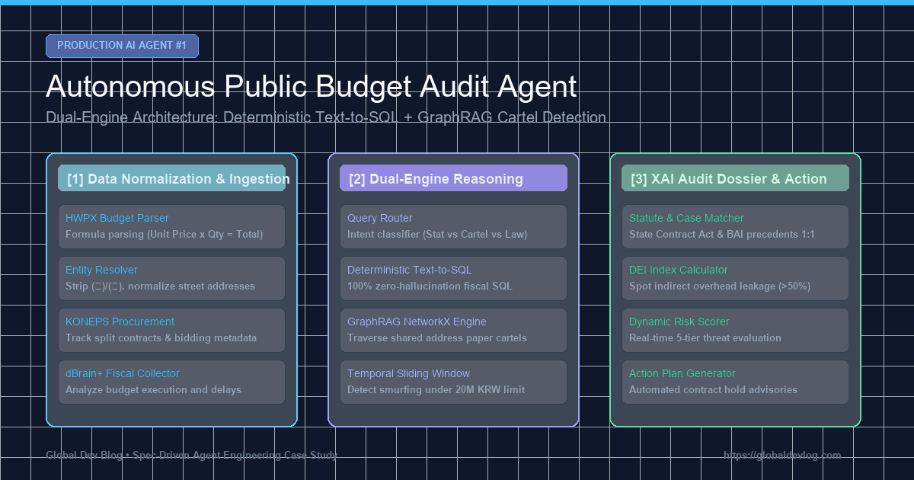

> **Hinweis zur Simulation — synthetische Daten**
> - Dieser Beitrag beschreibt eine **Simulation auf Basis synthetischer (erzeugter) Daten**. Die genannten „Befunde“, Sanktionen, Rückforderungsbeträge und Fallzahlen sind keine realen Prüfergebnisse.
> - Alle Behörden, Unternehmen, Regionen, Beträge und Aktenzeichen sind **anonymisiert oder durch fiktive Werte ersetzt**; Ähnlichkeiten mit realen Stellen sind nicht beabsichtigt.
> - Fehlerprotokolle, Codeausschnitte und Benchmark-Zahlen wurden **zur Erläuterung des Entwurfs rekonstruiert** und stimmen möglicherweise nicht mit den Laufprotokollen oder der aktuellen Implementierung des Repositorys überein.
> - Abgesehen von begrenzten Abrufen der APIs für öffentliche Beschaffung (KONEPS) und Open Fiscal Data waren die genannten Datenquellen (DART, Handelsregister, e-Hojo+, K-EduFine, ALIO, NTIS usw.) **nicht angebunden**. Ein Neuaufbau auf öffentlichen Open Data läuft; Ergebnisse werden nur als „statistische Anomalie-Indikatoren“ veröffentlicht, nie als Anschuldigungen.

> 📌 **Kernpunkte (Key Takeaways)**
> - **Das Ziel**: Bau eines autonomen KI-Agenten zur Überprüfung öffentlicher Haushaltsausgaben im Umfang von 500 Mrd. USD, der Vergabeverträge und unstrukturierte Dokumente analysiert, um Preisüberhöhungen und Scheinrechnungs-Kartelle aufzudecken.
> - **Präventive Architektur**: Beseitigung von LLM-Zahlenhalluzinationen durch **deterministisches Text-to-SQL**, während Netzwerkanalysen an einen **heterogenen Wissensgraphen (GraphRAG)** delegiert wurden.
> - **Gelöste reale Fehler**: (1) Fragmentierte Firmen- und Adressdaten mittels `EntityResolver` behoben; (2) Zeitlich gestaffelte Schleichvergaben via 30-Tage-Sliding-Window aufgedeckt; (3) Auditor-Misstrauen durch ein XAI-Dossier mit direkter Gesetzes- und Präzedenzfall-Bindung überwunden.
> - **Ergebnis**: 11 von 11 Test-Harness-Suiten bestanden, ein Kartell mit identischer Firmenadresse über 38,5 Mio. KRW und 70% Overhead-Verlust erfolgreich entlarvt.

{/* truncate */}

---

### Fazit für moderne Software-Entwickler:
1. **Zahlen gehören in die Datenbank**: LLMs dürfen nicht rechnen, sondern nur striktes SQL generieren.
2. **Reale Daten sind unsauber**: Sauberes Entity-Matching ist die Grundvoraussetzung für verlässliche Graphen.
3. **Erklärbarkeit schafft Rechtskraft**: Nur mit Anbindung an Gesetze und Präzedenzfälle werden KI-Warnungen von Auditoren akzeptiert.
