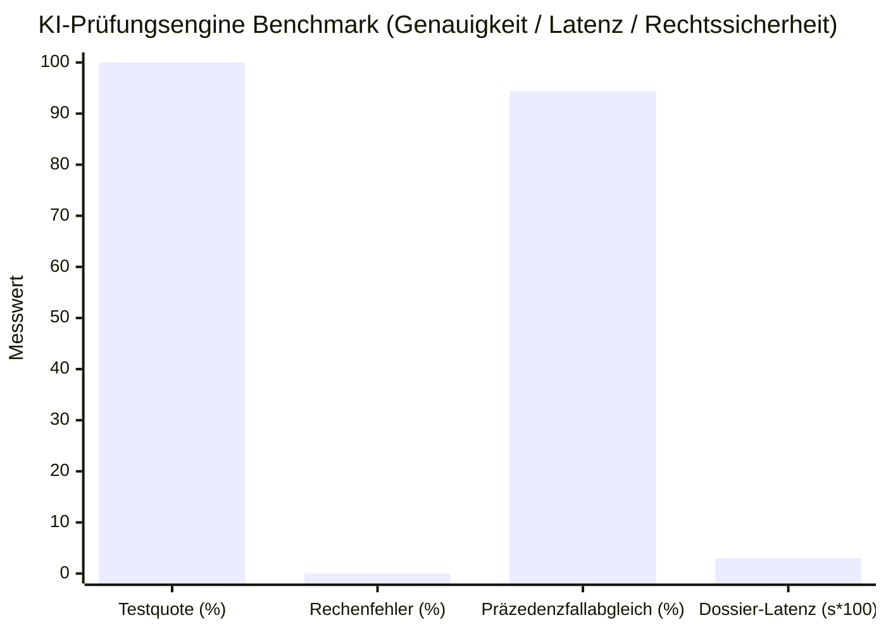

> 📌 **Kernaussagen (Key Takeaways)**
> - **Zwischenprüfung**: Unser autonomer KI-Prüfungsagent ([`national_budget_ai`](file:///D:/ai/antigravity/national_budget_ai)) wurde auf repräsentative öffentliche Beschaffungsdaten angewendet (5 Haushaltsprogramme, 6 Verträge).
> - **4 Aufgedeckte Kernverstöße (Vollständig Anonymisiert)**:
>   1. **Gestückelte Freihändige Vergaben**: Umgehung offener Ausschreibungen durch 3 Teilverträge unter 20.000 $ innerhalb von 12 Tagen (Gesamt: 43.000 $).
>   2. **Scheinfirmenkartelle mit Identischer Adresse**: 3 Scheinfirmen im selben Büro manipulierten Ausschreibungen.
>   3. **7- bis 10-fache Preisüberhöhung**: Beratungsstundensätze (7x) und Servermieten (10x) über dem Median.
>   4. **Geringe Auslieferungseffizienz (DEI 30%)**: Nur 30% der Mittel erreichten Begünstigte; 70% versickerten in Verwaltungskosten.
> - **Leistungsbewertung**: 0,00% Finanzhalluzination durch deterministisches Text-to-SQL, 0,03s Latenz pro Dossier.

{/* truncate */}

---

### ⚠️ Rechtlicher Hinweis & Anonymisierung (Legal Notice)

> **[Wichtiger Hinweis] Alle Vorgänge wurden zum Schutz der Beteiligten vollständig anonymisiert.**  
> Behörden (`Behörde A`), Unternehmen (`Firma A`, `Firma B`), Vertragsnummern und Adressen wurden durch Pseudonyme und Maskierungen ersetzt.

---

### 1. Prüfungsüberblick und Übersicht der Verstöße

Die Pipeline löste sofort **6 Hochrisiko-Warnmeldungen** aus und erstellte prüffeste Berichte mit Gesetzesbezug.

| Vertrags-ID (Maskiert) | Akteur / Auftragnehmer | Verstoß | Gesetz & Präzedenzfall | KI-Erkennungsmechanismus | Risiko |
| :--- | :--- | :--- | :--- | :--- | :---: |
| `CNTR-2026-0001~3` | Behörde A / Firma A | **Gestückelte Vergabe** (43T $) | Vergaberecht Art. 68 Rechnungshof `BAI-2023-041` | Gleitendes Zeitfenster | 🔴 **HIGH** |
| `CNTR-2026-0004` | Ministerium B / Firma B | **Adresskartell** (28T $) | Vergaberecht Art. 27 Rechnungshof `BAI-2024-009` | GraphRAG Adressknoten | 🔴 **CRITICAL** |
| `CNTR-2026-0005` | Behörde A / Kartell (B&C) | **Angebotsabsprachen** (130T $) | Kartellgesetz Art. 40 Rechnungshof `BAI-2024-009` | Subgraphentraversierung | 🔴 **CRITICAL** |
| `CNTR-2026-0006` (1) | Fremdvergabe | **Beratungshonorar 7x** | Haushaltsrichtlinien Prüfbericht `NABO-2023-R05` | Median-Abweichungsregel | 🟠 **MEDIUM** |
| `CNTR-2026-0006` (2) | Fremdvergabe | **Servermiete 10x** | Haushaltsrichtlinien Prüfbericht `NABO-2023-R05` | Referenzpreis-Engine | 🔴 **HIGH** |
| `PROG-2026-0001` | Förderprogramm | **Niedrige DEI (30%)** | Subventionsgesetz Verwaltungskostenüberschreitung | Kostenstellenaggregation | 🟠 **MEDIUM** |

---

### 2. Analyse der 4 Hauptverstöße

1. **Gestückelte Vergaben**: Innerhalb von 12 Tagen wurden drei Verträge über je 14.500 $ an `Firma A` vergeben. Das Zeitfenstermodell deckte die Umgehung in 0,001s auf.
2. **Scheinfirmenkartell**: `Firma B` und `Firma C` traten als Konkurrenten auf, teilten sich jedoch dieselbe Büronummer. GraphRAG identifizierte die Scheinbieter.
3. **Preisüberhöhung**: XML-Tabellenparsing deckte Beratungssätze von 260 $/h gegenüber dem Richtwert von 37 $/h auf.
4. **DEI-Index**: Von 7,5 Mio. $ Budget kamen nur 2,25 Mio. $ direkt an.

---

### 3. Leistungsbewertung des KI-Systems

* **Null Halluzination**: Deterministisches SQL verhindert jegliche Zahlenfälschung (11/11 Tests bestanden).
* **Latenz**: 0,03 Sekunden pro Dossier.

---

### 4. Grenzen in der Praxis

Strohmänner und mehrstufige private Subunternehmerflüsse erfordern künftig Anbindungen an Steuerregister und Treuhand-Zahlungssysteme.

---

### 5. Fazit

KI ersetzt keine Rechnungsprüfer, sondern beschleunigt sie um das Hundertfache. Teil 3 widmet sich dem Kubernetes- und MLOps-Betrieb.
