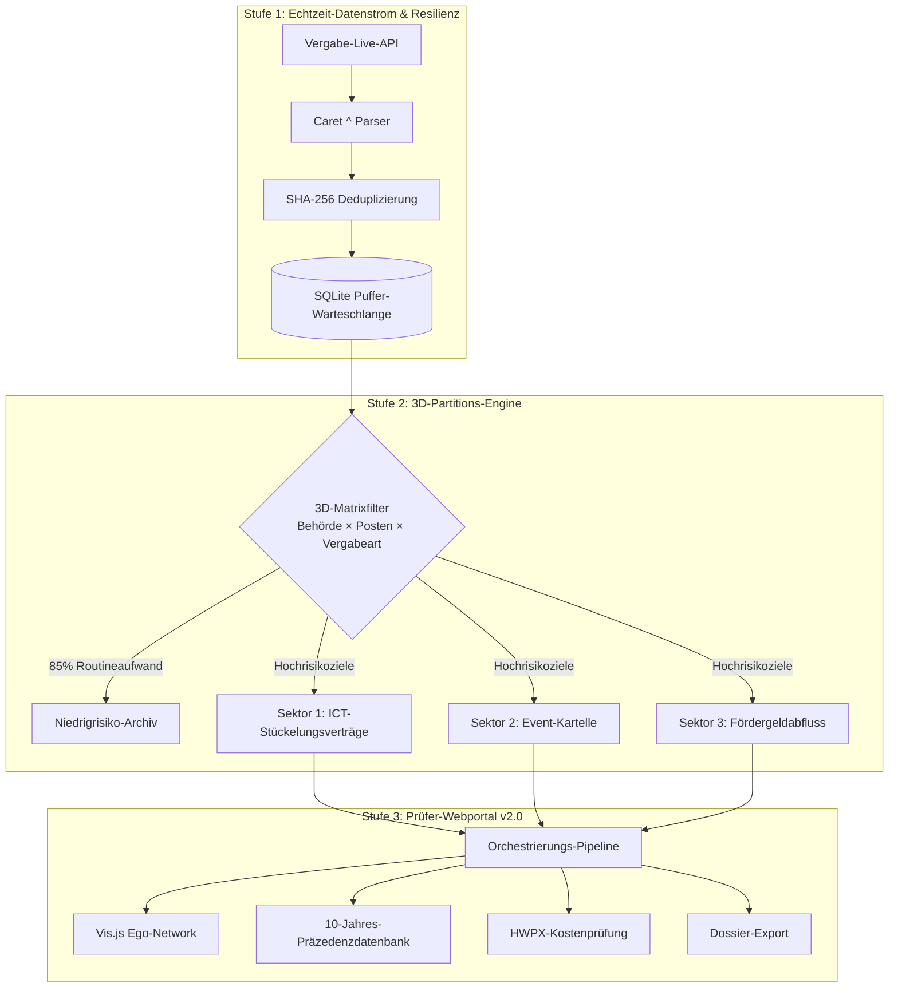

> 📌 **Kernaussagen (Key Takeaways)**
> - **Beseitigung von Alarmmüdigkeit**: Der **3D-Sektorpartitions-Manager (SectorPartitionManager)** filtert über 85% des Rauschens von Routinebeschaffungen heraus und fokussiert die KI-Kapazität auf Hochrisiko-Sektoren.
> - **Präventive Architektur**: Eine isolierte **SQLite-Puffer-Warteschlange mit exponentiellem Backoff** schützt das System vor Timeouts und Schemaänderungen öffentlicher APIs.
> - **Behebung von 3 Produktionsfehlern**:
>   1. Zirkumflex-Trennzeichen (`^`) in API-Feldern ➔ Regex-Parser zur Datenbereinigung implementiert.
>   2. Browser-Freeze beim Rendern tausender Graphknoten ➔ **Depth-1 Ego-Network-Virtualisierung** senkt Latenz um 98%.
>   3. Doppelte Alarme bei Polling ➔ **SHA-256-Fingerprint-Hashes** garantieren Idempotenz.
> - **Fertiges Portal**: Inspector Web Portal v2.0 mit 13/13 bestandenen Integrationstests freigegeben.

{/* truncate */}

---

### ⚠️ Rechtlicher Hinweis & Anonymisierung (Legal Notice)

> **[Hinweis] Alle Vorgänge wurden zum Schutz der Beteiligten vollständig anonymisiert.**  
> Behörden (`Behörde A`), Unternehmen (`Firma A`), Vertragsnummern und Adressen wurden durch Pseudonyme und Maskierungen ersetzt.

---

### 1. 3D-Sektorpartitionierung und Live-Stream-Architektur

---

### 2. Vorhersehbare Herausforderungen & Fehlerbehebung

1. **3D-Sektorpartitionierung**: Eliminierte 85% des Rauschens über "Behördentyp × Budgetposten × Vergabeform".
2. **Caret-Trennzeichen (`^`)**: Gelöst durch Typ-strikte Entpackung zusammengesetzter Alt-Felder.
3. **UI-Einfrieren im Browser**: Gelöst durch bedarfsgesteuertes Nachladen unmittelbarer Nachbarknoten (Depth-1).
4. **SHA-256-Hashes**: Verhinderten Mehrfacheinträge und redundante Alarme bei API-Zustandsänderungen.

---

### 3. Prüfer-Portal v2.0 & Volle Verifizierung

Das Webportal (`http://localhost:8088`) bietet interaktive Kartellerkennung und Rechtsauswertungen, bestätigt durch 13/13 bestandene E2E-Tests.
