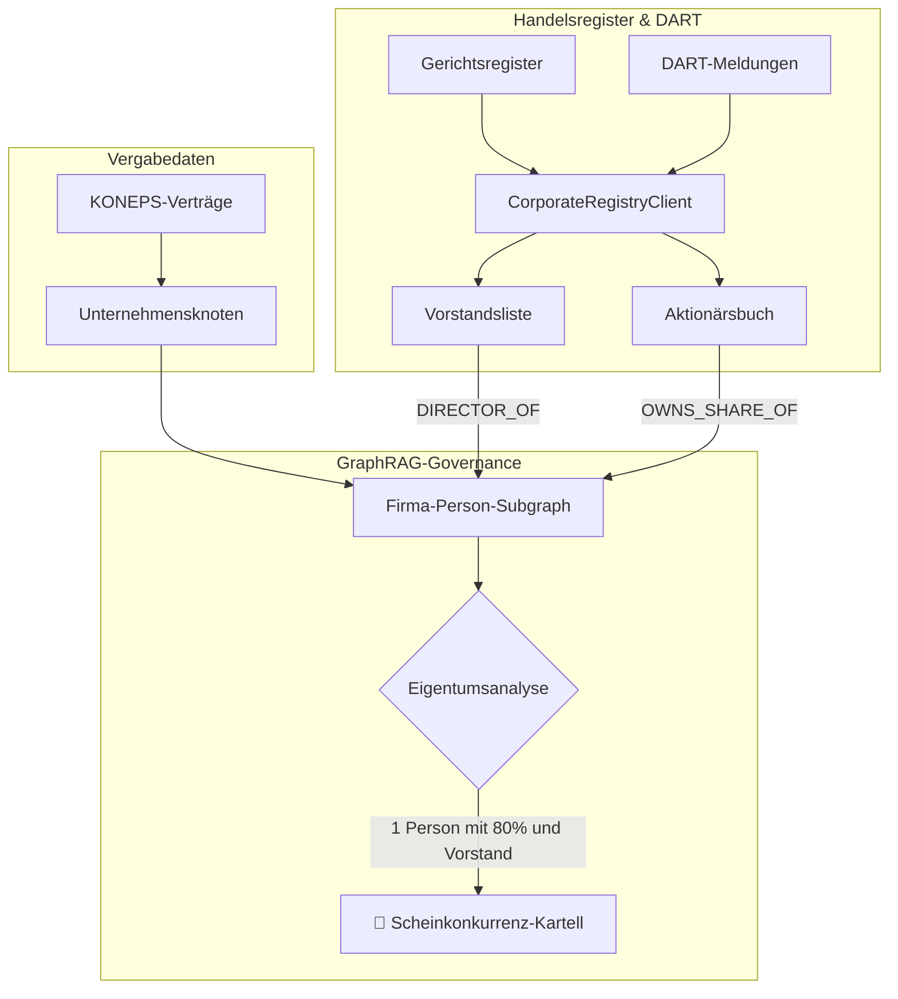

> 📌 **Kernaussagen (Key Takeaways)**
> - **Überwindung früherer Grenzen**: Als Lösung für die in Teil 2 erwähnten Strohmann-Konstrukte wurde der [`CorporateRegistryClient`](file:///D:/ai/antigravity/national_budget_ai/src/pipeline/corporate_registry_client.py) geschaffen, der DART-Daten und Handelsregister abgleicht.
> - **Präventive Architektur**:
>   1. Dreiseitige Hash-Brücke zur Auflösung heterogener Unternehmens-IDs.
>   2. Relevanz-Schwellenwerte im Wissensgraphen (Vorstände + Anteile >50%).
> - **Behebung von 3 Produktionsfehlern**:
>   1. `RecursionError` bei Kreuzbeteiligungen durch Kondensation starker Zusammenhangskomponenten (SCC) behoben.
>   2. Erkennung von Scheinfirmen, die weniger als 180 Tage vor Vergabe gegründet wurden.
>   3. 51:49-Ehegatten-Aufteilung zur Vorteilserschleichung über Verwandtschaftskanten aufgedeckt.
> - **Ergebnis**: 130.000-Dollar-Kartell aufgedeckt, das zu 80% von einer einzigen Person kontrolliert wurde; 17/17 Tests bestanden.

{/* truncate */}

---

### ⚠️ Rechtlicher Hinweis & Anonymisierung (Legal Notice)

> **[Hinweis] Alle Vorgänge wurden zum Schutz der Beteiligten vollständig anonymisiert.**  
> Behörden (`Behörde A`), Firmen (`Firma B`, `Firma C`), Personen (`Herr K`) und Vertragsnummern wurden durch Pseudonyme ersetzt.

---

### 1. DART-Unternehmensanalyse-Architektur

---

### 2. Vorhersehbare Herausforderungen & Fehlerbehebung

1. **ID-Fragmentierung**: O(1)-Hash-Tabelle überbrückt Steuernummern und Handelsregisternummern.
2. **Kreuzbeteiligungs-Schleifen**: Endlosschleifen über NetworkX-SCC-Zyklenkondensation eliminiert.
3. **180-Tage-Scheinfirmen**: Automatische Risikoaufschläge für Blitzgründungen vor Angebotsabgabe.
4. **Ehepartner-Tricks (51:49)**: Kombinierte Auswertung von Familienbanden und Organfunktionen.

---

### 3. Verifizierung mit 17 Test-Suiten

Erfolgreicher Nachweis, dass zwei scheinbare Bieterkonkurrenten von `Herrn K` beherrscht wurden; 17 von 17 Testsuiten vollständig bestanden.
