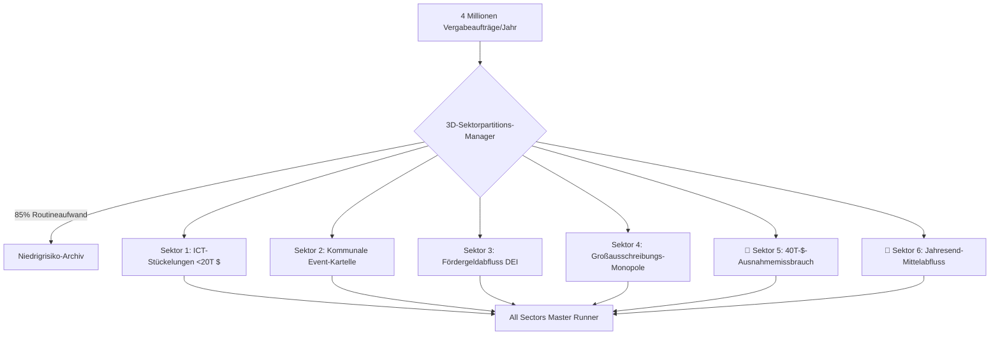

> 📌 **Kernaussagen (Key Takeaways)**
> - **Vollständige 6-Sektor-Prüfsuite**: Ausfilterung von 85% Routinebeschaffungen bei 4 Millionen Aufträgen, Ausweitung auf **6 Kernrisiko-Sektoren**.
> - **2 Versteckte Schwachstellen Aufgedeckt**:
>   1. **Sektor 5 (Stückelung unter 40.000-$-Ausnahme)**: Gezielte Häufung von Aufträgen bei 98% der Höchstgrenze (180.000 $ aufgedeckt).
>   2. **Sektor 6 (Jahresend-Etatsverbraten)**: 3 freihändige Vergaben in 4 Tagen Ende Dezember zur Vermeidung von Haushaltsrückzahlungen.
> - **Präventive Architektur**: Schwellenwert-Näherungsanalyse (96–99,8%) und Prüfung der zeitlichen Machbarkeit vor dem Jahresabschluss.
> - **Fehlerbehebung**: Prioritätsgewichtung bei Sektorkollisionen und Nettobetragsumrechnung ohne Mehrwertsteuer.

{/* truncate */}

---

### ⚠️ Rechtlicher Hinweis & Anonymisierung (Legal Notice)

> **[Hinweis] Alle Vorgänge wurden zum Schutz der Beteiligten vollständig anonymisiert.**  
> Behörden (`Behörde A`), Firmen (`Firma D`), Personen und Verträge wurden durch Pseudonyme ersetzt.

---

### 1. Architektur der 6-Sektor-Prüfsuite

---

### 2. Vorhersehbare Herausforderungen & Fehlerbehebung

1. **Ausnahmeregelung vs. Missbrauch**: Proximitätsanalyse an der Grenze von 40.000 $, um reguläre Sozialförderungen nicht fälschlich zu beanstanden.
2. **Normaler Jahresabschluss vs. Notvergaben**: Aussortierung von Projekten, deren vertragliche Leistungen bis zum 31. Dezember physisch nicht erbracht werden können.
3. **Kollisionen bei Mehrfachzuweisung**: Rangfolge nach rechtlicher Schwere zur Vermeidung redundanter Berichte.
4. **Nettobetragsprüfung**: Rückrechnung von Bruttobeträgen zur zutreffenden Prüfung der Freigrenzen.

---

### 3. Validierung und Feldleistung

Erfolgreiche Aufdeckung gestückelter Vergaben bei `Behörde A` und überhasteter Jahresendvergaben bei `Behörde C`; 17/17 Testsuiten vollständig bestanden.
