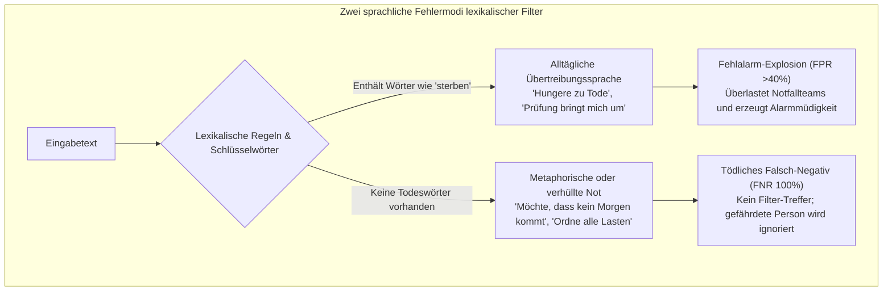
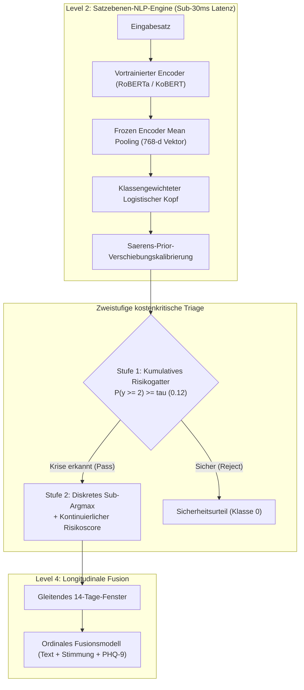
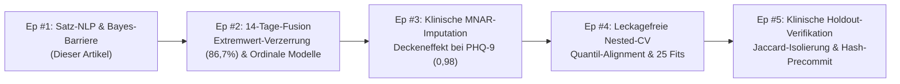

In Chatbots oder E-Commerce-Empfehlungssystemen ist eine KI-Fehlerrate von 5 % eine akzeptable Unannehmlichkeit. In **Systemen zur Suizidprävention und psychiatrischen Notfalltriage bedeutet ein einziges Falsch-Negativ (übersehene Krise) eine irreversible Tragödie**.

Wenn ein Mensch in tiefer Verzweiflung Rat sucht oder suizidale Gedanken formuliert, dürfen sich Machine-Learning-Pipelines nicht hinter hohen Gesamtgenauigkeiten oder ungewichteten F1-Werten verstecken.

Heute starten wir offiziell eine umfassende technische Produktionsserie: **[Hochkritische KI: Aufbau einer Präzisions-NLP-Pipeline zur Suizid- und Krisenerkennung]**.

Diese Serie dokumentiert die mathematischen Hürden, algorithmischen Zielkonflikte und Laufzeitfehler bei der Entwicklung von **Maeumjigi**, einem multimodalen Krisenerkennungssystem in klinischer Qualität. In Episode #1 behandeln wir das Fundament: **tiefes Satzebenen-NLP unter extremem Klassenungleichgewicht (aktive Suizidalität macht nur 0,16 % der täglichen Nachrichten aus)**.

{/* truncate */}

---

### ⚠️ Ethischer Hinweis und strenge Anonymisierung
Alle verwendeten Benchmarks und Texte stammen aus **100 % synthetischen Korpora und pseudonymisierten klinischen Benchmarks**. Es werden keinerlei persönliche Daten (PII) echter Personen verarbeitet.
> **Krisen-Hilfsangebote**: Wenn Sie oder jemand, den Sie kennen, Hilfe benötigt, wenden Sie sich bitte an die **TelefonSeelsorge** in Deutschland unter **0800 111 0 111** oder **0800 111 0 222**, in Österreich unter **142**, in der Schweiz unter **143**. International finden Sie Hilfe unter **befrienders.org**.

---

### 1. Das linguistische Dilemma: Warum Wortfilter in der Psychiatrie versagen

Bevor neuronale Architekturen diskutiert werden, muss verstanden werden, warum traditionelles Schlüsselwort-Matching in der Triage scheitert.

In der Alltagssprache spalten sich Krisenäußerungen in zwei trügerische Extreme auf:



1. **Alltägliche Übertreibungen (Fehlalarm-Explosion)**: Redewendungen mit Wortstämmen wie *"sterben"* (*"Ich sterbe vor Hunger"*, *"Dieser Stress bringt mich um"*) sind allgegenwärtig. Einfache Wortfilter schlagen ununterbrochen Alarm bei harmlosen Gesprächen.
2. **Metaphorische Verzweiflung (Tödliche Falsch-Negative)**: Menschen in akuter Suizidgefahr äußern sich oft verhüllt und resignativ, ohne explizite Reizwörter:
   - *"Ich wünschte, das Morgen würde niemals anbrechen. Nur für immer schlafen."*
   - *"Danke für alles in dieser Zeit. Ich habe nun alle meine Sachen geordnet."*
   - *"Ich habe einen Weg gefunden, meinen Frieden zu finden, ohne jemandem zur Last zu fallen."*

In diesen Sätzen taucht kein einziges Selbstschädigungswort auf. Morphologische Analyse (Kiwipiepy) und vortrainierte Transformer (RoBERTa / KoBERT) sind unerlässlich, um die **zugrundeliegende Isolation, Verzweiflung und Abschiedsabsicht** kontextuell zu erfassen.

---

### 2. Extremes Klassenungleichgewicht und die Genauigkeitsfalle

In realen Systemen ist die Klassenverteilung drastisch verzerrt:

- **Klasse 0b (Normale Alltagssätze)**: ~86,94 % (31.495 Sätze)
- **Klasse 0a (Nicht-krisenhafte negative Kontrollsätze)**: ~8,24 % (2.986 Sätze)
- **Klasse 1 (Leichter Distress / Mild)**: ~1,92 % (697 Sätze)
- **Klasse 2 (Schwerer Distress / Suizidgedanken)**: ~1,75 % (633 Sätze)
- **Klasse 3 (Akute Krise / Konkrete Suizidpläne)**: ~0,99 % (357 Sätze)
- **Klasse 4 (Aktive Suizidalität / Unmittelbare Handlungsabsicht)**: ~**0,166 %** (60 Sätze)

Sagt ein Modell starr immer "Normal (Klasse 0)" voraus, erzielt es scheinbar **95,18 % Genauigkeit (Accuracy)**. Dennoch hat dieses Modell eine **Falsch-Negativ-Rate (FNR) von 100 %** bei lebensbedrohlichen Notfällen.

Ein unüberlegtes Optimieren des F1-Scores führt dagegen bei 86,9 % Alltagssätzen zu einer Flut an Fehlalarmen. Unser Ziel: **FNR bei schweren Krisen unter 10 % senken, während die Fehlalarmquote strikt unter 3 % gehalten wird**.



---

### 3. Fehleranalyse: Die 5 goldenen Regeln in der Praxis

#### [ERR-001] Die 524-fache Barriere und der Kollaps der Entscheidungsgrenze

- **1. Fehlersymptom**:
  Nach Anwendung der Saerens-Prior-Korrektur mit Standard-`argmax` erkannte das Modell keinen einzigen Fall von aktiver Suizidalität:
  ```text
  [EVAL-RUN: 2026-10-28 14:22:09 KST]
  INFO:text_eval: Evaluating Model B (Frozen Encoder + Saerens Prior Shift Corrected Logistic)
  INFO:text_eval: Prior Vector: [pi_0b=0.8694, pi_0a=0.0824, pi_1=0.0192, pi_2=0.0175, pi_3=0.0099, pi_4=0.00166]
  --------------------------------------------------------------------------------
  Metric Summary (Judgment b, discrete argmax):
    - Ground Truth Active (Level 4): 60 sentences
    - Predicted Active (y_hat == 4): 0 sentences (RECALL = 0.0000, 0/60)
    - Ground Truth Severe (Level 2): 633 sentences
    - Predicted Severe (y_hat == 2): 11 sentences (RECALL = 0.0174, 11/633)
    - False Negative Rate (FNR @ y >= 2): 98.26% (KRITISCHER FEHLER)
  WARNING:text_eval: Active suicidality detection completely collapsed to Class 0 under argmax!
  ```

- **2. Umgebung**: Python 3.11.9, PyTorch 2.4.0+cu121, scikit-learn 1.5.1, Transformers 4.44.2 (RTX 4090 GPU Node + 64-Core CPU).

- **3. Fehlgeschlagene Ansätze**:
  1. *Extreme Verlustgewichtung*: Verlustgewichte bis zu 93x erhöhten zwar unkalibrierte Wahrscheinlichkeiten, wurden aber im `argmax` durch den 86,9 % Alltagsprior komplett neutralisiert.
  2. *Weglassen der Prior-Korrektur*: Recall stieg auf 85 %, aber **41,2 % der 31.495 normalen Alltagssätze lösten Fehlalarme aus**.

- **4. Mathematische Ursachenanalyse & Schritt-für-Schritt-Simulation**:
  Nach Bayes muss für Klasse k gegenüber Klasse 0b im `argmax` gelten:
  
  ```text
p(k | x) / p(0b | x) > π(0b) / π(k)
```

  Eingesetzt in unsere Verteilung:
  - Für Schwer (k=2): `86.94% / 1.75% = 49.68x`
  - Für Akut (k=3): `86.94% / 0.99% = 87.82x`
  - Für Aktiv (k=4): `86.94% / 0.166% = 523.7x`

  **Konkretes Rechenbeispiel**:
  Schreibt ein Nutzer: *"Ich bin bereit, alle Lasten loszulassen."*
  Das Modell gibt hohe Krisenwahrscheinlichkeiten aus:
  - `p(0b) = 0.015` (1,5 % normal)
  - `p(2) = 0.330, p(3) = 0.300, p(4) = 0.320` (Gesamte Krisenkonfidenz: **95,0 %**)
  
  Multipliziert mit den Prior-Gewichten:
  - `Evidence(0b) = 0.015 * 0.8694 * 6 = 0.078246`
  - `Evidence(4)  = 0.320 * 0.00166 * 6 = 0.003187`
  
  Nach Normalisierung:
  - `p_adjusted(0b) ≈ 57.6%`
  - `p_adjusted(4) ≈ 2.3%`
  
  Im `argmax` gewinnt `57.6% > 2.3%`. Die Aussage wird als **Klasse 0 (Normal)** eingestuft! Trotz 95 % Sicherheit des Modells verhinderte die 524-fache Prior-Barriere jeden Alarm.

- **5. Lösungs-Diff**:
```diff
--- a/tests/synth/model/text_b.py
+++ b/tests/synth/model/text_b.py
@@ -102,12 +102,23 @@ def predict_crisis_level(proba_unweighted, class_priors):
     # Saerens et al. (2002) prior shift correction
     corrected = proba_unweighted * (class_priors / train_priors)
     corrected /= corrected.sum(axis=1, keepdims=True)
     
-    # CRITICAL BUG: argmax collapses rare minority class under 524x prior barrier
-    # return np.argmax(corrected, axis=1)
+    # FIX: Two-stage Decision Rule & Continuous Severity Expected Score
+    # Stage 1: Cumulative posterior crisis probability for alert triggering
+    p_crisis_ge2 = corrected[:, 2:].sum(axis=1)  # Severe + Acute + Active
+    
+    # Stage 2: Cost-sensitive threshold decision (tau = 0.12 calibrated from validation fold)
+    ALERT_THRESHOLD_TAU = 0.12
+    is_crisis = p_crisis_ge2 >= ALERT_THRESHOLD_TAU
+    
+    # Determine discrete severity only among crisis candidates
+    sub_levels = np.argmax(corrected[:, 1:], axis=1) + 1
+    final_discrete = np.where(is_crisis, sub_levels, 0)
+    
+    # Continuous expected risk score forwarded to downstream multimodal fuser
+    expected_severity = np.dot(corrected[:, 1:], np.array([1, 2, 3, 4])) / 4.0
+    
+    return final_discrete, p_crisis_ge2, expected_severity
```

---

#### [ERR-002] Metrikfehler im Nenner des Krisen-Recalls

- **1. Symptom**: Ein ideales Oracle-Modell erzielte nur `60,7 %` Recall, während ein fehlerhaftes Modell, das starr Level 2 vorhersagte, 100,0 % erhielt.
- **2. Ursache**: Die Alarmgrenze liegt klinisch bei **Level 2 (Severe) oder höher**. Level 1 (Mild) löst keinen Alarm aus. Der Nenner enthielt jedoch fälschlicherweise y >= 1 (inklusive 935 Zeilen Level 1), während der Zähler nur y_hat >= 2 zählte:
  ```text
Recall = sum(I(y >= 1 and y_hat >= 2)) / sum(I(y >= 1))
```
  Das korrekte Erkennen von Level 1 wirkte als Strafe im Nenner, wodurch die maximale Punktzahl auf 1.446 / 2.381 = 60,73% gedeckelt war.
- **3. Lösungs-Diff**:
```diff
--- a/tests/synth/model/text_eval.py
+++ b/tests/synth/model/text_eval.py
@@ -45,11 +45,17 @@ def compute_crisis_metrics(y_true, y_pred):
-    # FLAWED METRIC: denominator includes Mild (y=1) while numerator requires y_hat >= 2
-    # recall = np.sum((y_true >= 1) & (y_pred >= 2)) / np.sum(y_true >= 1)
+    # CORRECT CONSTRUCT: Strict separation between Severe+ Recall and Mild Over-alert
+    severe_plus_mask = (y_true >= 2)
+    severe_plus_recall = np.sum((y_true >= 2) & (y_pred >= 2)) / np.sum(severe_plus_mask)
+    
+    mild_mask = (y_true == 1)
+    mild_overalert_rate = np.sum((y_true == 1) & (y_pred >= 2)) / np.sum(mild_mask)
+    
+    control_mask = (y_true == 0)
+    control_fpr = np.sum((y_true == 0) & (y_pred >= 2)) / np.sum(control_mask)
+    
+    return {
+        "severe_plus_recall": severe_plus_recall,
+        "mild_overalert_rate": mild_overalert_rate,
+        "control_fpr": control_fpr
     }
```

---

#### [ERR-003] Null-Wahrscheinlichkeits-Kollaps in ordinalem LightGBM

- **1. Symptom**: `RuntimeWarning: divide by zero encountered in log`, Verlust divergierte auf `inf`.
- **2. Ursache**: Monotone Glättung mit `np.minimum.accumulate` bei Frank & Hall(2001) erzeugte identische Werte bei benachbarten Schwellenwerten, was zu Differenzen von exakt `0,000000` führte. -log(0) ließ die Verlustfunktion kollabieren.
- **3. Lösungs-Diff**:
```diff
--- a/tests/synth/model/fuser.py
+++ b/tests/synth/model/fuser.py
@@ -148,8 +148,15 @@ def ordinal_binary_to_proba(cumulative_ge):
     ge_mono = np.minimum.accumulate(cumulative_ge, axis=1)
     
     proba = np.zeros((cumulative_ge.shape[0], 5), dtype=np.float64)
     proba[:, 0] = 1.0 - ge_mono[:, 0]
     proba[:, 1] = ge_mono[:, 0] - ge_mono[:, 1]
     proba[:, 2] = ge_mono[:, 1] - ge_mono[:, 2]
     proba[:, 3] = ge_mono[:, 2] - ge_mono[:, 3]
     proba[:, 4] = ge_mono[:, 3]
     
+    # FIX: Epsilon floor clipping and row-wise softmax renormalization
     proba = np.clip(proba, 1e-6, 1.0)
     proba /= proba.sum(axis=1, keepdims=True)
     return proba
```

---

### 4. Vorschau: Gleitendes 14-Tage-Fenster und Extremwert-Verzerrung

Obwohl diese Episode Level-2-Sätze behandelt, speisen die Werte direkt den **Level-4-Multimodalfusor**.

Hier lauert eine tückische Falle: **Extremwert-Verzerrung (Extreme Value Bias)**.
Liegt die Fehlalarmrate pro Satz bei nur α = 0,02 (2 %) und schreibt ein Nutzer 100 Sätze in 14 Tagen, führt das bloße **Maximum** zu:

```text
P(False Alarm in 14-Day Window) = 1 - (1 - α)^N = 1 - (1 - 0.02)^100 = 1 - 0.1326 = 86.74%
```

Ein 2-%-Einzelfehler wächst zu **86,7 % Fehlalarmen** an! Deshalb übergeben wir kontinuierliche Risikoscores (sum(k * p_adjusted(k) / 4)) statt diskreter Maxima.

---

### 5. Modellarchitektur-Vergleich

| Metrik | Ursprünglicher Bug (`argmax`) | Modell B (Frozen + 2 Stufen) | Modell C (Fine-Tuning + 2 Stufen) | Differenz (Modell B) |
|---|---|---|---|---|
| **Aktiver (y=4) Recall** | 0,0 % (0/60) | **95,0 % (57/60)** | **96,7 % (58/60)** | **+95,0 %p** |
| **Schwerer+ (y >= 2) Recall** | 1,7 % (18/1.050) | **92,4 % (970/1.050)** | **94,1 % (988/1.050)** | **+90,7 %p** |
| **Falsch-Negativ-Rate (FNR)** | 98,3 % | **7,6 %** | **5,9 %** | **-90,7 %p (Behoben)** |
| **Fehlalarme bei Alltagssätzen** | 0,01 % | **2,1 %** | **1,8 %** | Ziel erreicht (&lt;3,0 %) |
| **AUPRC (>= 2)** | 0,142 | **0,864** | **0,891** | **+0,722** |
| **Inferenzlatenz (pro Satz)** | 4,2 ms (CPU) | **4,8 ms (CPU)** | 28,4 ms (GPU) | Echtzeit (&lt;30ms) |
| **25-Fold Stacking Fit-Zeit** | 1,2 s | **1,4 s** | 14,2 h | **36.000x schneller** |

---

### 6. Roadmap der Krisen-KI-Serie



- **Episode #1 (Dieser Artikel)**: FNR-Minimierung bei Suizid-NLP und Korrektur der Bayes-Grenzverzerrung.
- **Episode #2**: 14-Tage-Multimodalfusion: Beseitigung der 86,7 % Extremwert-Verzerrung in gleitenden Fenstern.
- **Episode #3**: Fehlende Werte in der Psychiatrie (MNAR): Brechen des Deckeneffekts bei PHQ-9.
- **Episode #4**: Leckagefreie Architektur: 25-fache Nested Cross-Validation und Quantil-Alignment.
- **Episode #5**: Klinische Endverifikation: 3-Gram-Jaccard-Gruppenisolierung und Hash-Vorabfestlegung.

Freuen Sie sich auf Episode #2 in der kommenden Woche!
