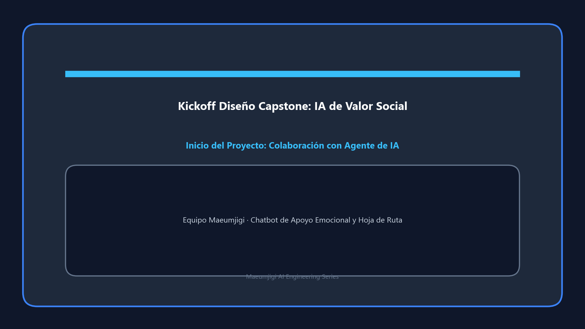

Este es el registro del 26 de marzo de 2026, el primer día del gran viaje del proyecto final "Maeumjigi".
En aquel momento, en lugar del actual "Maeumjigi" basado en IA, el proyecto dio sus primeros pasos simplemente como una aplicación de alarma para Android.

{/* truncate */}
