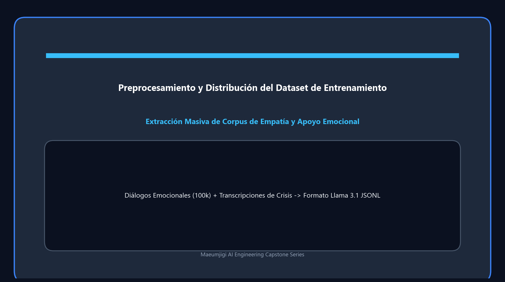

Este es el registro del 1 de abril, cuando comenzamos a procesar una enorme cantidad de datos de conversación en un formato adecuado para entrenar el modelo Llama 3.1, que se convertirá en el motor central del proyecto Maeumjigi.

{/* truncate */}
