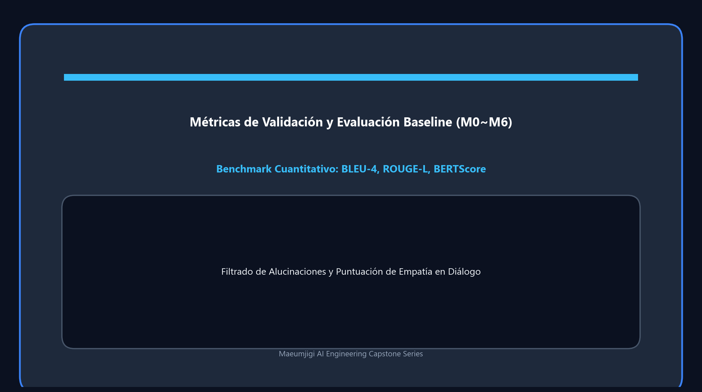

Este es el registro del 3 de abril, el día en que comenzamos en serio la tarea de refinar los datos de conversación de entrenamiento para introducirlos en el modelo de aprendizaje profundo (Llama 3.1).
También fue el día en que ejecutamos una canalización masiva que hace que la IA lea el texto y juzgue la emoción por su cuenta.

{/* truncate */}
