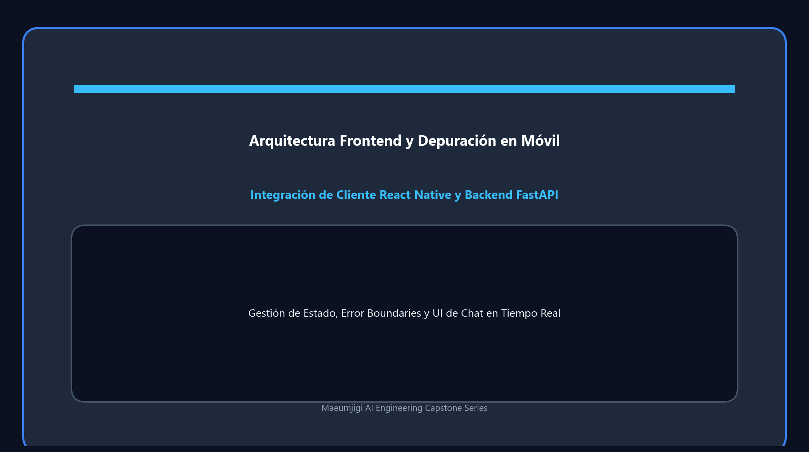

El 5 de abril marca el día en que concluimos el arduo viaje de preprocesamiento de datos (v1~v4) generando un informe final, 
al tiempo que iniciamos (kickoff) el proyecto de frontend que se convertirá en el rostro del servicio web Maeumjigi.

{/* truncate */}
