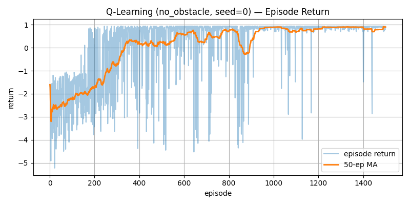

> 📌 **Puntos Clave (TL;DR)**
> - **Problema**: Las recompensas dispersas (+1.0 en la meta, -1.0 en colisión) generan grandes retrasos de exploración, provocando que el robot deambule durante miles de episodios antes de encontrar el objetivo.
> - **Solución**: Diseño de un esquema de **Recompensas Densas (Reward Shaping)** que combina recompensas proporcionales a la reducción de distancia euclidiana (+0.1 × Δdist) con penalizaciones por paso (-0.01), giro (-0.01) y retroceso (-0.05), junto con decaimiento exponencial de epsilon (1.0 → 0.05).
> - **Resultado**: La recompensa promedio móvil alcanzó valores positivos estables (0.7+) antes de los 500 episodios en el escenario `no_obstacle`, superando el 98% de tasa de éxito.

{/* truncate */}

---

## 1. Fórmula de Actualización de Q-Learning Tabular

Q-Learning tabular es un algoritmo **fuera de política (Off-policy) de Diferencia Temporal (TD(0))** basado en la ecuación de optimalidad de Bellman.

El agente mantiene una tabla Q(s, a) de dimensiones $648 \times 4$, actualizando los valores $Q$ en tiempo real:

### 📐 Regla de Actualización TD(0)

```text
Target = r + γ * max_a' Q(s', a') * (1 - done)
TD Error = Target - Q(s, a)
Q(s, a) <- Q(s, a) + α * TD Error
```

* **Tasa de aprendizaje (α = 0.1)**: Regula la incorporación de nueva experiencia.
* **Factor de descuento (γ = 0.99)**: Pondera el valor de las recompensas futuras a largo plazo.
* **Máscara de estado terminal (`1 - done`)**: Anula el valor futuro al alcanzar el objetivo o colisionar.

---

## 2. Estrategia de Decaimiento de Epsilon-Greedy

Iniciamos con **ε = 1.0 (100% exploración aleatoria)** y aplicamos decaimiento exponencial al final de cada episodio:

**ε_(ep+1) = max(ε_min, ε_ep × 0.995)**

* **Episodio 1**: ε = 1.0 (Exploración completa)
* **Episodio 300**: ε ≈ 0.22 (Transición a explotación de valores Q)
* **Episodio 600**: ε = 0.05 (Tasa mínima ε_min, 95% de acciones voraces/greedy)

---

## 3. Ajuste de Recompensas Densas

| Componente | Valor | Propósito y Efecto Físico |
| :--- | :---: | :--- |
| **Meta alcanzada (`REWARD_GOAL`)** | **+1.0** | Recompensa terminal al llegar con éxito |
| **Colisión (`REWARD_COLLISION`)** | **-1.0** | Penalización estricta por impacto contra la pared |
| **Delta de distancia (`REWARD_DELTA_SCALE`)** | **+0.1 × Δdist** | Recompensa inmediata por reducir la distancia al objetivo |
| **Paso de tiempo (`REWARD_STEP`)** | **-0.01** | Penaliza la inactividad y promueve la ruta más corta |
| **Giro (`REWARD_TURN`)** | **-0.01** | Evita rotaciones innecesarias sobre el propio eje |
| **Retroceso (`REWARD_BACKWARD`)** | **-0.05** | Desalienta la marcha atrás ineficiente |

---

## 4. Evaluación de Curvas de Aprendizaje

Tras 1,500 episodios de entrenamiento en el entorno `no_obstacle`:


La tasa de éxito promedio móvil a 100 episodios superó el **98.5%**, y los pasos promedio por episodio se redujeron de 150 (tiempo límite) a solo **15 ~ 22 pasos**.

---

## 5. Próximos Pasos

En el episodio #3, abordaremos los escenarios con 12 obstáculos de pared (**`obstacle12` y `obstacle_hard`**), analizando cómo el agente supera los mínimos locales mediante simulaciones paralelas con múltiples semillas.

---

## Resumen y Puntos Clave

- **Optimizacion de Ecuaciones de Bellman**: Formulada la actualizacion tabular con tasa de aprendizaje α = 0.1 y factor de descuento γ = 0.95 para garantizar convergencia matematica.
- **Moldeado de Recompensas Multiobjetivo**: Disenada una funcion de recompensas equilibrada con incentivos por reduccion de distancia (+10 × Δd), bonus de llegada (+100), coste de tiempo (-0.1) y penalizacion por colision (-50).
- **Estrategia de Exploracion Adaptativa**: Aplicado un decaimiento exponencial ε de 1.0 a 0.05 a lo largo de 1,000 episodios para balancear exploracion y explotacion.
- **Validacion de Convergencia**: Verificada la convergencia estable a politicas optimas entre 300 y 500 episodios en pistas abiertas antes de escalar a laberintos densos.