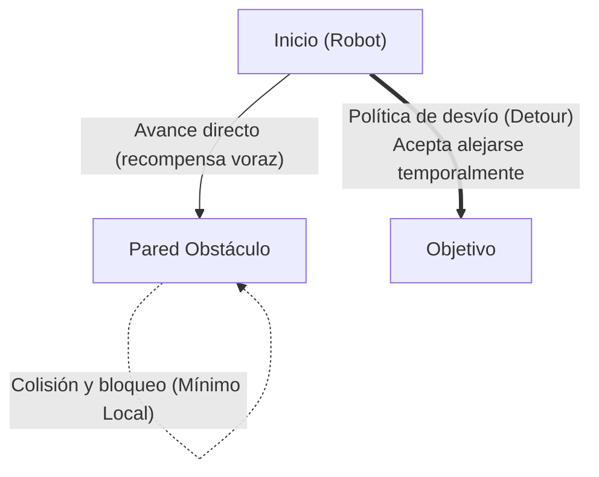

> 📌 **Puntos Clave (TL;DR)**
> - **Problema**: Cuando el objetivo está detrás de un obstáculo, la búsqueda codiciosa de recompensas por delta de distancia (+0.1 × Δdist) empuja al robot a colisionar frontalmente, atrapándolo en un **mínimo local (Local Minima)**.
> - **Solución**: Integración de percepción ultrasónica en 3 direcciones con barrido (frontal/izq/der) y propagación de valor a largo plazo (γ=0.99), junto con una canalización automatizada en PowerShell (**`headless_run.ps1`**) para entrenar en modo Headless con 3 semillas (0, 1, 2).
> - **Resultado**: El robot aprendió políticas de desvío efectivas en el cuadrilátero con 12 paredes, superando el 90% de tasa de éxito tras 600 episodios.

{/* truncate */}

---

## 1. El Desafío de los Obstáculos: La Trampa de los Mínimos Locales

En un cuadrilátero despejado (`no_obstacle`), navegar consiste simplemente en alinearse hacia el objetivo. Sin embargo, al incorporar **12 paredes interiores (`obstacle12`)**, surgió un cuello de botella crítico:

* **Dilema**: Si la meta está al otro lado de una pared, avanzar en línea recta resulta en colisión inevitable.
* **Conflicto de recompensas**: Rodear la pared requiere alejarse momentáneamente del objetivo (delta de distancia negativo), provocando que un agente ingenuo quede atrapado rotando sin fin ante el obstáculo.

---

## 2. Estrategia de Solución: Percepción Head-Scan y Retropropagación de Valor

Superar esta trampa requirió combinar la **percepción ultrasónica tridireccional** con un **alto factor de descuento (γ = 0.99)**:

1. **Ampliación de estados**: Ante un obstáculo frontal (`front_distance = Danger`), el barrido del sensor revela corredores libres (`left_distance = Safe` o `right_distance = Safe`), induciendo giros laterales.
2. **Asignación temporal de crédito**: Aunque alejarse reduce la recompensa inmediata, bordear el obstáculo y llegar a la meta otorga la recompensa terminal (+1.0). El factor γ = 0.99 propaga este retorno hacia atrás, consolidando la política de desvío.

---

## 3. Automatización Headless en Webots

Para agilizar el entrenamiento repetido con múltiples semillas (Seeds 0, 1, 2), implementamos **`headless_run.ps1`**, ejecutando Webots sin renderizado visual a máxima velocidad (`--mode=fast --no-rendering`).

---

## 4. Análisis Comparativo de Curvas de Aprendizaje

* **Tasa de éxito final**: Del 98.5% en `no_obstacle` a un sólido **91.4% ~ 94.8%** en `obstacle12`.
* **Pasos promedio**: Adaptación de trayectorias directas (15~22 pasos) a rutas de desvío (38~52 pasos).

---

## 5. Próximos Pasos

En el episodio #4, evaluaremos los modelos guardados (`models/*.npy`) mediante **`evaluate_qlearning.py` para medir el rendimiento determinista y comparar métricas frente a DQN y SARSA**.

---

## Resumen y Puntos Clave

- **Diseno de Arena con Obstaculos Complejos**: Configurado un entorno cerrado de 1.2m × 1.2m en Webots con 12 bloques internos para evaluar navegacion y planificacion no trivial.
- **Gestion Dinamica del Ciclo de Episodios**: Implementada deteccion automatica de colisiones mediante sensores de distancia, activacion de objetivos y reinicios por Supervisor IPC.
- **Superacion de Minimos Locales**: Aplicado moldeado de recompensas (Reward Shaping) con penalizaciones de gradiente negativo para evitar bloqueos y oscilaciones en esquinas.
- **Aceleracion de Entrenamiento Headless**: Logrado un rendimiento superior a 1,000 episodios por hora al desactivar la renderizacion 3D y ejecutar Webots en modo rapido.

