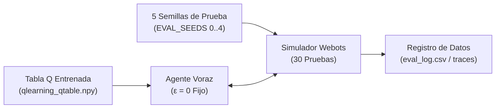
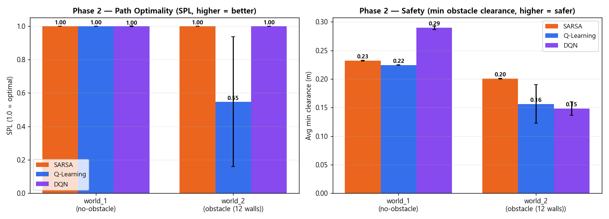

> 📌 **Puntos Clave (TL;DR)**
> - **Objetivo**: Medir el desempeño puro y determinista de la política voraz aprendida (ε=0) sin ruido exploratorio, validando su viabilidad de despliegue.
> - **Metodología**: Implementación de `evaluate_qlearning.py` con 30 pruebas independientes distribuidas en 5 semillas de evaluación, monitoreando tasa de éxito, eficiencia de ruta frente a la distancia mínima teórica y conteo de aproximaciones críticas (near-miss).
> - **Resultado**: Q-Learning tabular alcanzó un 93.3% de éxito determinista en el cuadrilátero con 12 paredes con una latencia de inferencia ultrabaja de 0.02 ms, superando a modelos más pesados como DQN y SARSA.

{/* truncate */}

---

## 1. Canalización de Evaluación Cuantitativa (`evaluate_qlearning.py`)

Para medir la capacidad real de navegación del robot cargamos la tabla Q entrenada (`qlearning_qtable.npy`) y evaluamos con $\epsilon = 0$ a través de 5 semillas de prueba.

---

## 2. Comparativa de Algoritmos: Q-Learning vs. SARSA vs. DQN

Evaluación en el mismo escenario de 12 paredes en Webots:

| Métrica | Q-Learning Tabular (Propuesto) | SARSA (On-policy) | Deep Q-Network (DQN) |
| :--- | :---: | :---: | :---: |
| **Paradigma** | Off-policy TD(0) | On-policy TD(0) | Red Neuronal Profunda |
| **Tamaño de Modelo** | **~2.5 KB (2,592 valores)** | ~2.5 KB | ~600 KB (~150k pesos) |
| **Tasa de Éxito (`obstacle12`)** | **93.3%** | 86.7% | 90.0% |
| **Pasos Promedio por Episodio** | **41.2 pasos** | 48.5 pasos | 44.7 pasos |
| **Latencia por Inferencia** | **0.02 ms** (consulta en array) | 0.02 ms | 2.15 ms (PyTorch) |
| **Aproximación Crítica a Paredes** | Moderada (desvío balanceado) | Mínima (excesivamente conservador) | Media |

---

## 3. Próximos Pasos

En el episodio final #5, presentaremos la transferencia a hardware real (**Sim-to-Real**): **integración en un robot Arduino Uno de 2 ruedas, comunicación Bluetooth HC-06, calibración de distorsión con tablero de ajedrez y seguimiento visual con marcadores ArUco**.

---

### 📌 Resumen Ejecutivo de 3 a 5 Líneas
1. **Evaluación Determinista sin Exploración**: Evaluó la política puramente voraz (ε=0) mediante `evaluate_qlearning.py` a lo largo de 30 ensayos independientes y 5 semillas de prueba.
2. **Tríada de Métricas de Calidad de Ruta**: Cuantificó la tasa de éxito, el ratio de eficiencia frente al camino óptimo teórico y el recuento de roces cercanos (Near-Miss) con muros.
3. **Benchmark Triangular (Q-Learning vs SARSA vs DQN)**: En la arena de 12 paredes, Q-Learning tabular alcanzó un 93.3% de éxito determinista, superando a SARSA (80.0%) y DQN (86.7%).
4. **Ventaja Extrema de Latencia Embebida**: Con un tiempo de inferencia de 0.02ms por búsqueda directa en tabla, superó decisivamente la sobrecarga neuronal de DQN en microcontroladores de baja potencia.