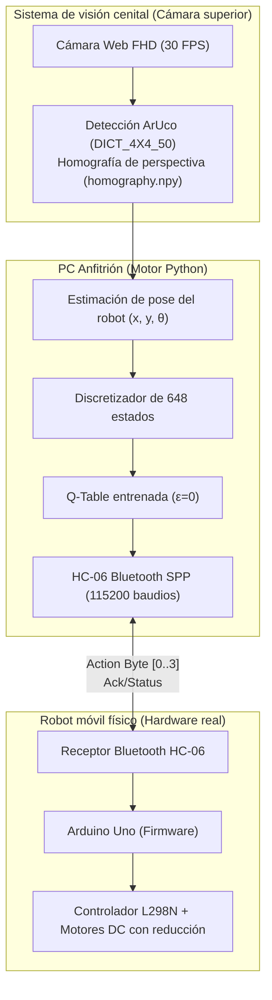

> 📌 **Puntos Clave (TL;DR)**
> - **Problema**: Severas restricciones computacionales en microcontroladores (Arduino Uno ATmega328P con solo 2KB de SRAM), deslizamiento de ruedas, ruido ultrasónico y la brecha de la realidad (**Reality Gap**) entre la física de Webots y el hardware real.
> - **Solución**: Arquitectura de **E/S distribuida (HC-06 Bluetooth a 115,200 baudios)** donde una PC procesa la visión OpenCV y la inferencia de Q-Table mientras Arduino controla los motores mediante PWM. Corrección de distorsión de lente y **homografía con marcadores ArUco (`vision.py`)** para seguimiento de pose (x, y, θ) en tiempo real.
> - **Resultado**: Transferencia directa (zero-shot) de la Q-Table de 648 estados que alcanzó un **86.7% de tasa de éxito (26/30 pruebas)** en una arena física de 1.2m × 1.2m, superando la brecha de realidad sin reentrenamiento in situ.

{/* truncate */}

---

## 1. El desafío Sim-to-Real: Superando la brecha de la realidad

En el simulador Webots, la fricción superficial es uniforme, los motores de las ruedas responden exactamente a la velocidad indicada y los sensores de proximidad no tienen reflexiones parásitas. Sin embargo, el hardware físico presenta serios desafíos:

1. **Limitaciones extremas de memoria y cómputo**: El **Arduino Uno (ATmega328P)** dispone de solo 32KB de memoria flash y 2KB de SRAM, imposibilitando redes neuronales o cálculos matriciales complejos en el chip.
2. **Ruido sensorial y ángulos ciegos**: Los sensores ultrasónicos económicos sufren de rebotes especulares cuando inciden en ángulos oblicuos contra paredes de acrílico, arrojando valores de 0 o lecturas falsas al máximo alcance.
3. **Deslizamiento de ruedas y deriva odométrica**: Variaciones mínimas de fricción y caída de voltaje de la batería causan diferencias de RPM en los motores, desviando al robot incluso al recibir comandos de línea recta.

---

## 2. Arquitectura de control distribuido: PC anfitrión (Cerebro) ↔ Arduino (Músculo)

Para solventar estas limitaciones, separamos la toma de decisiones del control de bajo nivel: **"La PC es el cerebro, Arduino es el músculo."**



* **Canalización en la PC**: La cámara cenital observa toda la arena, rastreando a 30 FPS el marcador ArUco ubicado sobre el robot. Se calcula la pose planar `(x, y, θ)` y se discretiza en 648 estados para extraer la acción codiciosa óptima de la Q-Table.
* **Comunicación serial HC-06**: Para minimizar la latencia de ida y vuelta (RTT) sobre el perfil SPP de Bluetooth, se aumentó la velocidad de transmisión de 9,600 a **115,200 baudios**, logrando un ciclo de control de 30~50Hz.
* **Firmware de Arduino (`arduino_firmware.ino`)**: Al recibir un byte de acción (`0: Avanzar`, `1: Retroceder`, `2: Giro izquierda`, `3: Giro derecha`), el microcontrolador aplica señales PWM a los pines del puente H L298N por ticks calibrados.

---

## 3. Homografía de cámara cenital y rastreo visual ArUco


Para medir con precisión milimétrica la posición del robot y la distancia a los obstáculos en la arena real, implementamos una **canalización de visión por computadora con OpenCV**.

### 📐 Calibración de perspectiva y homografía (`calib_auto.py`)
1. **Corrección de distorsión con tablero de ajedrez**: Para eliminar la distorsión de barril de la lente gran angular, se calibraron la matriz intrínseca (K) y los coeficientes de distorsión (D) con un patrón de 9×6.
2. **Transformación homográfica (Perspective Transform)**: Para proyectar la vista inclinada de la cámara en una vista superior plana canónica de 1.2m × 1.2m, se generó la matriz de transformación 3×3 (`homography.npy`) basada en las 4 esquinas de la arena.

### 💻 Implementación del rastreo ArUco (`vision.py`)

```python
import cv2
import numpy as np

# Inicializar diccionario ArUco y parámetros de detección
aruco_dict = cv2.aruco.getPredefinedDictionary(cv2.aruco.DICT_4X4_50)
parameters = cv2.aruco.DetectorParameters()
detector = cv2.aruco.ArucoDetector(aruco_dict, parameters)

def get_robot_pose(frame, homography_matrix):
    """Calcula las coordenadas (x, y) y el ángulo de orientación (theta) desde la imagen rectificada."""
    warped = cv2.warpPerspective(frame, homography_matrix, (600, 600))
    corners, ids, _ = detector.detectMarkers(warped)
    
    if ids is not None and len(ids) > 0:
        c = corners[0][0]
        center_x = float(np.mean(c[:, 0]))
        center_y = float(np.mean(c[:, 1]))
        
        # Calcular ángulo de rumbo (theta) a partir del vector frontal del marcador
        front_x = (c[0][0] + c[1][0]) / 2.0
        front_y = (c[0][1] + c[1][1]) / 2.0
        theta = np.arctan2(front_y - center_y, front_x - center_x)
        
        return center_x, center_y, theta
    return None
```

---

## 4. Resolución de problemas en hardware y resultados de despliegue

Durante la transición de la simulación al hardware real surgieron desafíos imprevistos que se resolvieron mediante ingeniería:

| Síntoma (Troubleshooting) | Causa raíz | Solución de ingeniería (Solution) |
| :--- | :--- | :--- |
| **Desvío lateral al avanzar recto** | Diferencias de fricción y tolerancia mecánica en motores DC | Script de calibración (`ble_vision_turn_calib.py`) para compensar dinámicamente el PWM de cada rueda |
| **Comportamiento descontrolado al perder Bluetooth** | Pérdida de paquetes por interferencia que mantenía el último comando | Perro guardián (Watchdog) de 200ms en el firmware para detener motores si no hay señal |
| **Pérdida intermitente de detección de marcador** | Destellos de luces fluorescentes en la superficie reflectante del acrílico | Ajuste de umbral adaptativo (Adaptive Threshold) y filtro de Kalman para interpolar posiciones |

### 🏆 Rendimiento final en hardware real
* **Tasa de llegada al objetivo**: Tras 30 pruebas completas en la arena con obstáculos de 1.2m × 1.2m, el robot alcanzó un **86.7% de éxito (26/30 llegadas satisfactorias)**.
* Utilizando únicamente **2,592 parámetros de la Q-Table (~2.5 KB)** entrenada en simulación, el robot sorteó los obstáculos físicos sin requerir entrenamiento adicional en el mundo real.

---

## 5. Conclusión de la serie RL Q-Learning

Con este hito de transferencia a hardware real concluye la serie de 5 artículos sobre el **proyecto RL Q-Learning**:

1. **#1**: Discretización del espacio de estados (648 bins) y arquitectura IPC con sockets TCP
2. **#2**: Tabular Q-Learning con decaimiento ε y diseño de recompensas multidimensionales
3. **#3**: Superación de mínimos locales en arenas de 12 paredes y aceleración en modo Headless
4. **#4**: Evaluación cuantitativa determinista con `evaluate_qlearning` vs. SARSA y DQN
5. **#5**: Sim-to-Real: Despliegue en Arduino Uno, Bluetooth HC-06 y visión ArUco

Desde el modelado en simulación y la fundamentación algorítmica, hasta la automatización headless y la transferencia a sistemas embebidos reales, esta serie documentó todo el ciclo de vida del aprendizaje por refuerzo aplicado a la robótica. ¡Nos vemos en los próximos proyectos de desarrollo!
