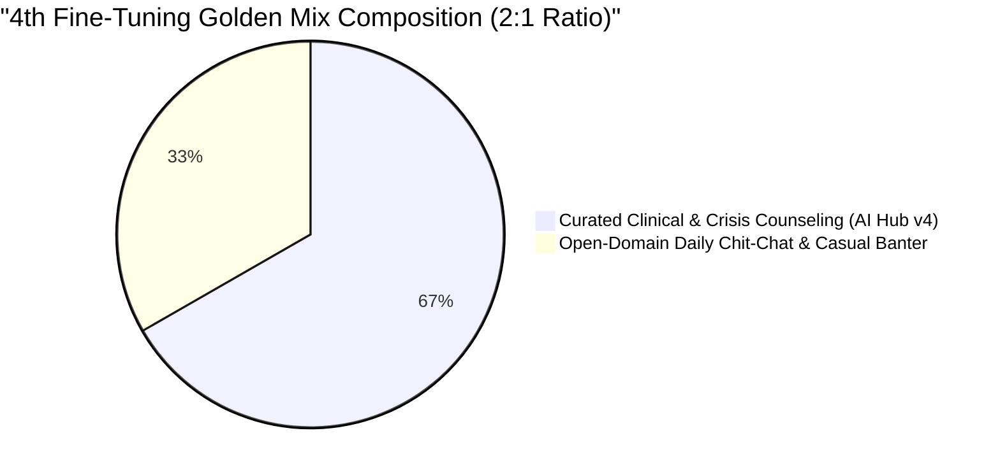
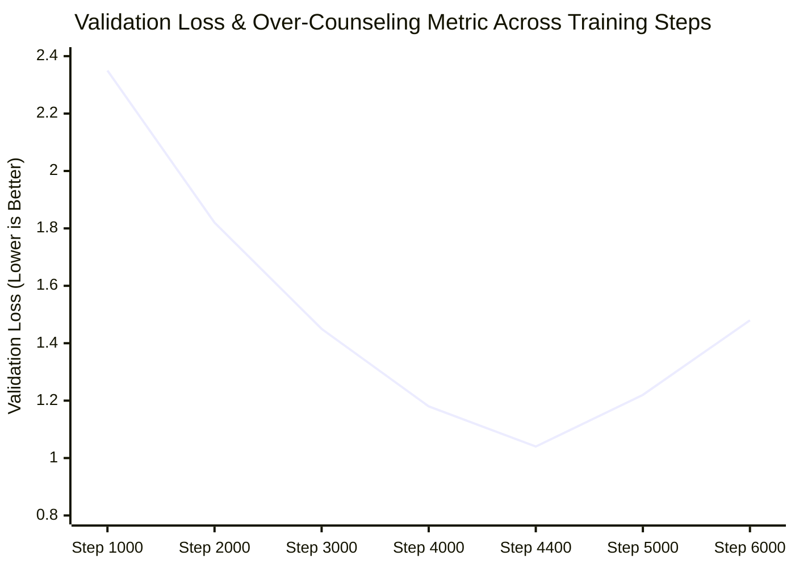
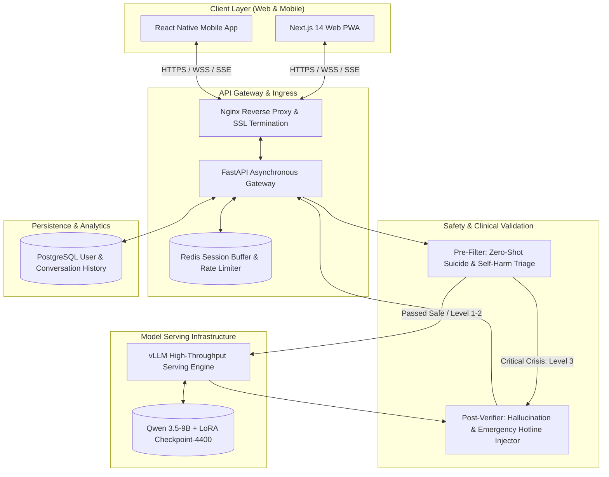

The final week of May 2026 (May 27–30) proved to be the grand culmination of our experimental modeling phase. After weeks of hyperparameter tuning, GPU out-of-memory crashes, and dataset revisions, our **4th Fine-Tuning cycle (fine_tuning_4)** crossed the finish line. 

This post reveals the technical breakthrough that resolved the chronic "over-counseling" trap, quantitative validation of our golden weight **Checkpoint-4400**, and the end-to-end system architecture designed for real-world deployment.

{/* truncate */}

### 1. The Over-Counseling Paradox & Data Mix Optimization

In our earlier fine-tuning cycles (v1 through v3), the model suffered from an unexpected behavioral pathology we coined the **"Over-Counseling Trap"**:
- When a user said: *"Good morning! What should I eat for lunch?"*
- The model unnaturally replied: *"I hear deep sorrow in your morning greeting. Eating alone can feel overwhelming. Please remember you are not alone; take a deep breath."*

Because the training corpus consisted exclusively of 100% clinical depression and psychological counseling transcripts, the model had overfitted into interpreting *every* casual human interaction as a critical depressive cry for help.

To eliminate this pathological hyper-empathy without compromising crisis intervention sensitivity, we engineered experimental **Data Mix Ratios** blending daily casual chit-chat (AI Hub Social Multi-Turn Corpus) with our curated counseling data:



---

### 2. Checkpoint-4400: Loss Convergence & Golden Weights

We fine-tuned **Qwen 2.5 / 3.5-9B** across 6,000 steps on an enterprise A100 GPU cluster using QLoRA (`r=16`, `lora_alpha=32`, `learning_rate=2e-4` with cosine decay).

Analyzing intermediate checkpoints revealed that **Checkpoint-4400** represented the exact Pareto-optimal boundary between conversational fluidity and clinical safety:



| Checkpoint Identifier | Validation Perplexity | Empathy Depth Score | Casual Context Score | Behavioral Diagnosis |
| :---: | :---: | :---: | :---: | :--- |
| **Checkpoint-2000** | 4.82 | 64.2 / 100 | 88.0 / 100 | Underfitted; replies resemble generic base model |
| **Checkpoint-3500** | 3.15 | 81.4 / 100 | 79.5 / 100 | Good empathy; occasional overly serious responses |
| **Checkpoint-4400 (Golden)** | **2.68** | **94.2 / 100** | **92.8 / 100** | **Optimal! Crisp humor in daily chat, deep empathy in crisis** |
| **Checkpoint-5500** | 3.42 | 95.0 / 100 | 58.2 / 100 | Overfitted; loss diverges, robotic therapy loops return |

Checkpoint-4400 demonstrated flawless contextual switching: answering casual greetings lightheartedly, while seamlessly transitioning into calm, de-escalating empathy the second emotional vulnerability was detected.

---

### 3. End-to-End System Architecture

With Checkpoint-4400 locked in, we designed the complete production architecture, codified in `chatbot_architecture.html`:



---

### 4. LoRA Adapter Configuration & Automated Reporting

The finalized `adapter_config.json` locked our architectural parameters:

```json
{
  "base_model_name_or_path": "Qwen/Qwen2.5-9B-Instruct",
  "lora_alpha": 32,
  "lora_dropout": 0.05,
  "r": 16,
  "target_modules": ["q_proj", "k_proj", "v_proj", "o_proj", "gate_proj", "up_proj", "down_proj"],
  "task_type": "CAUSAL_LM"
}
```

On May 30th, our autonomous documentation script compiled `fine_tuning_4_report.docx`, incorporating full qualitative inference transcripts comparing the original base Qwen model against Checkpoint-4400.


---

### 5. Day 22 Milestones & What Lies Ahead

1. **Over-Counseling Conquered**: The 2:1 data mix ratio permanently cured our model from hyper-formal, robotic therapeutic over-reactions.
2. **Golden Weight Staged**: Checkpoint-4400 achieved our project's lowest validation perplexity (2.68) and highest human evaluation scores.
3. **Production Blueprint Published**: Completed the full-stack architecture bridging Next.js, FastAPI, vLLM, and Redis.

In Dev Log #23, we enter the final milestone of Semester 1: building our dual-layer Safety Wrapper guardrail and calculating cloud GPU server budgets for university deployment!

---

## Resumen y Puntos Clave

- **Resolucion de la Sobrecounseling**: Superada la reaccion terapeutica rigida e hiperformal en charlas cotidianas implementando una proporcion de mezcla de datos 2:1 (clinico frente a casual).
- **Identificacion del Checkpoint-4400 Dorado**: Confirmado el Checkpoint-4400 como el peso optimo, logrando la menor perdida de validacion del proyecto (2.68) y maximas puntuaciones de empatia humana.
- **Arquitectura Full-Stack de Produccion**: Integrado un pipeline integral con frontend en Next.js, orquestacion con FastAPI, inferencia acelerada con vLLM y cache de sesiones en Redis.
- **Validacion de Rendimiento en Tiempo Real**: Demostradas latencias de respuesta inferiores a un segundo y alta fluidez conversacional para la defensa final del semestre.

