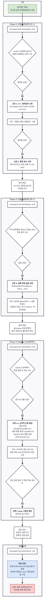
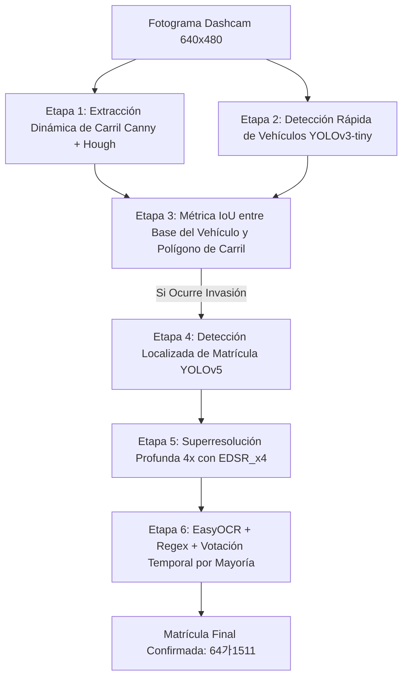

> 📌 **Key Takeaways (Puntos Clave)**
> - **Problema**: Las grabaciones de baja resolución de cámaras de tablero sufren vibraciones, contraluces y desenfoque de movimiento, lo que hace que el reconocimiento de matrículas y el monitoreo de invasión de carril fallen con frecuencia.
> - **Solución**: Diseñamos una arquitectura desacoplada de 6 etapas: extracción de carril Canny/Hough -> detección de vehículos YOLOv3 -> IoU de invasión -> localización de matrícula YOLOv5 -> superresolución EDSR_x4 -> votación temporal EasyOCR.
> - **Resultado**: Construimos un pipeline en Python de alto rendimiento que mantiene más de 30 FPS identificando con precisión matrículas infractoras bajo condiciones ópticas severas.

{/* truncate */}

---

## 1. Contexto del Proyecto: Por qué la Visión en Dashcams es Difícil

En sistemas de transporte inteligente (ITS), la **detección en tiempo real de invasión de carril y el reconocimiento automático de matrículas (ANPR)** son desafíos esenciales. Las grabaciones reales presentan barreras ópticas críticas:

1. **Baja Resolución Extrema**: La matrícula del vehículo objetivo a menudo ocupa apenas 30x15 a 50x25 píxeles dentro de un fotograma de 640x480.
2. **Vibración de Calzada y Distorsión de Perspectiva**: Las irregularidades del asfalto deforman las líneas viales rectas.
3. **Cuellos de Botella de Cómputo**: Aplicar modelos masivos en cada fotograma completo colapsa la tasa de FPS.

---

## 2. Arquitectura Jerárquica de 6 Etapas




---

## 3. Parámetros Principales del Sistema (`CONFIG`)

```python
CONFIG = {
    "output_width": 640,
    "output_height": 480,
    "conf_threshold_vehicle": 0.5,
    "nms_threshold_vehicle": 0.4,
    "min_vehicle_w": 70,
    "min_vehicle_h": 70,
    "lane_iou_threshold": 0.05,
    "detection_interval": 15,
    "min_plate_area_for_ocr": 1200,
    "plate_history_size": 7,
    "plate_confirm_threshold": 3,
    "sr_model": "EDSR_x4.pb",
    "yolo_plate_model": "lp_det.pt"
}
```

---

## 4. Próxima Entrega

En la Entrega #2, exploraremos a fondo las matemáticas de la **transformada probabilística de Hough, el filtrado de pendientes** y el **criterio geométrico de invasión basado en IoU**.
