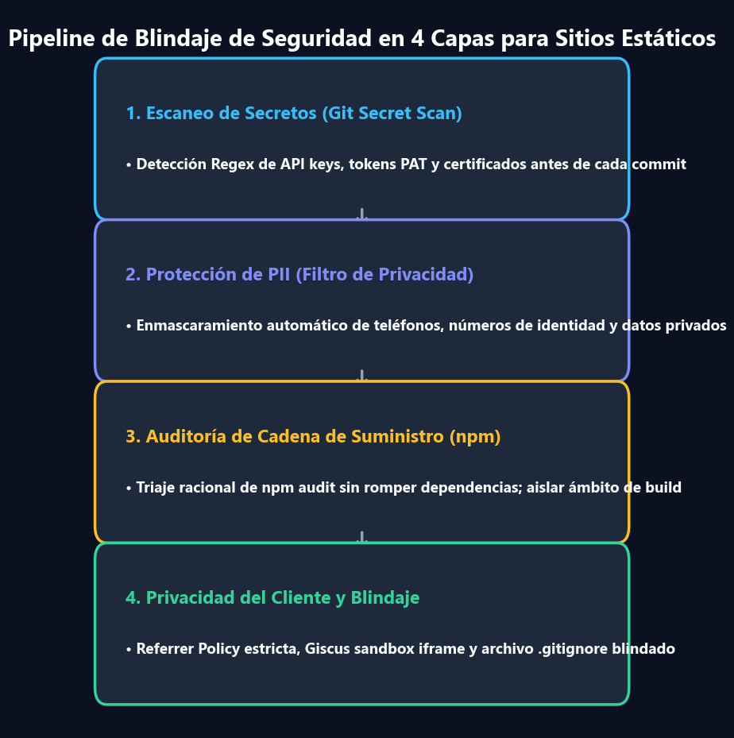

Todo desarrollador web moderno ha experimentado ese sobresalto: ejecutas `npm audit` en tu repositorio y la terminal responde con un mensaje alarmante en rojo:

```text
45 vulnerabilities (15 moderate, 15 high, 15 critical)
To address all issues (including breaking changes), run:
  npm audit fix --force
```

Al ver palabras como **Critical**, **Remote Code Execution (RCE)** y **Prototype Pollution**, el instinto natural es escribir `npm audit fix --force` para eliminar las advertencias.

Sin embargo, en el mundo de los **Generadores de Sitios Estáticos (SSG)** como Docusaurus o Next.js alojados en GitHub Pages o AWS S3, hacer esto a ciegas es un error común que rompe la compilación de producción sin mejorar la seguridad real.

En este artículo, definimos el **modelo de amenazas en sitios estáticos**, explicamos por qué las vulnerabilidades en herramientas de construcción difieren radicalmente de las vulnerabilidades en tiempo de ejecución, y compartimos un plan práctico de **seguridad en 4 capas**.

{/* truncate */}

---


---

## 1. Resumen Ejecutivo: El Criterio de Ingeniería

1. **Herramientas de Compilación != Tiempo de Ejecución en Producción**: Paquetes señalados en `npm audit` (como `tinypool` o `serialize-javascript`) son dependencias que solo se ejecutan localmente al compilar con `npm run build`.
2. **Cero Servidores Activos en la CDN**: Tras la compilación, GitHub Pages solo aloja archivos estáticos (HTML, CSS, JS). **No hay ningún proceso Node.js en ejecución, ni puertos abiertos, ni conexiones a bases de datos.**
3. **El Peligro de `--force`**: Forzar la resolución degrada frameworks como `@docusaurus/core` a versiones antiguas (3.7.0), rompiendo la compatibilidad con React 19 y plugins modernos.
4. **Las Amenazas Reales**: Los verdaderos riesgos en blogs estáticos son la **fuga de claves API en Git**, la **exposición de datos personales (PII)** y la **fuga de privacidad en el cliente**.

---

## 2. La Realidad tras las 45 Vulnerabilidades

### A. Tinypool y la Polución de Prototipos (`GHSA-5gmw-xhrv-c9v3` - Critical)
- `tinypool` se utiliza internamente para paralelizar tareas de compilación entre los núcleos de tu CPU local. Las entradas provienen únicamente de tu archivo `docusaurus.config.ts`. Ningún visitante externo puede enviar cargas útiles HTTP a tu entorno local.

### B. Serialize-JavaScript y RCE (`GHSA-5c6j-r48x-rmvq` - High)
- Webpack utiliza este paquete para generar fragmentos de código estáticos. En el directorio `build/`, los archivos son activos pasivos distribuidos por HTTPS; no existe deserialización en servidor.

### C. PostCSS Selector Parser (`GHSA-rj75-hqrm-r3gf` - Moderate)
- El CSS analizado corresponde a las hojas de estilo del propio autor (`custom.css`). Salvo que alguien comprometa los permisos de tu repositorio Git, no se procesa CSS externo malicioso.

Degradar librerías con `--force` en este contexto equivale a **introducir fallos reales en tu aplicación para solucionar exploits que físicamente no pueden ocurrir en tu arquitectura**.

---

## 3. Seguridad Práctica en 4 Capas para Sitios Estáticos



### Capa 1: Escaneo Automatizado de Secretos Previo al Commit
El mayor peligro es subir por error una clave de OpenAI (`sk-...`), un token de GitHub (`ghp_...`) o credenciales de AWS (`AKIA...`). Implementamos un script de auditoría (`tools/audit_security.py`) que analiza los archivos con expresiones regulares de alta entropía antes de cada despliegue.

### Capa 2: Protección de Datos Personales (PII)
En proyectos de IA y visión por computador, utilizamos **datos sintéticos (`synth_gen`)** generados con modelos de lenguaje para garantizar el cumplimiento ético y la privacidad médica y personal.

### Capa 3: Configuración Blindada de `.gitignore`
Ampliamos `.gitignore` para bloquear exhaustivamente archivos `.env`, certificados privados (`*.pem`, `*.key`) y volcados de métricas (`*.csv`).

### Capa 4: Privacidad en Cliente y Sandboxing
- **Política de Referrer Estricta**: Configuramos `strict-origin-when-cross-origin` para evitar que la ruta completa de navegación se transmita a dominios externos.
- **Iframe de Giscus Aislado**: Comentarios configurados con `emitMetadata="0"` y `loading="lazy"` para prevenir la fuga de metadatos entre orígenes.

---

## 4. Conclusiones para Desarrolladores

- **No entres en pánico con `npm audit`**: Distingue siempre entre dependencias de compilación y dependencias en tiempo de ejecución.
- **Evita el uso ciego de `--force`**: Las degradaciones automáticas suelen introducir errores reales mientras mitigan riesgos teóricos inexistentes en una CDN.
- **Protege lo que de verdad importa**: Automatiza el escaneo de secretos, protege la privacidad de tus datos y asegura tu historial en Git.