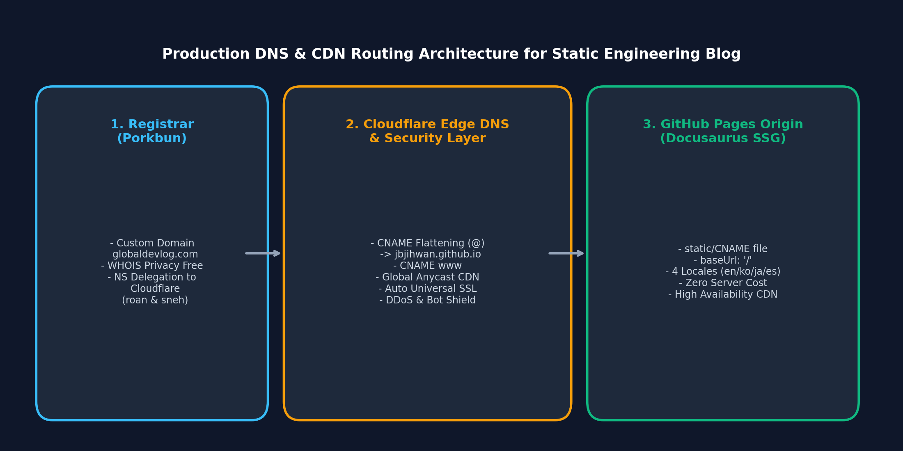
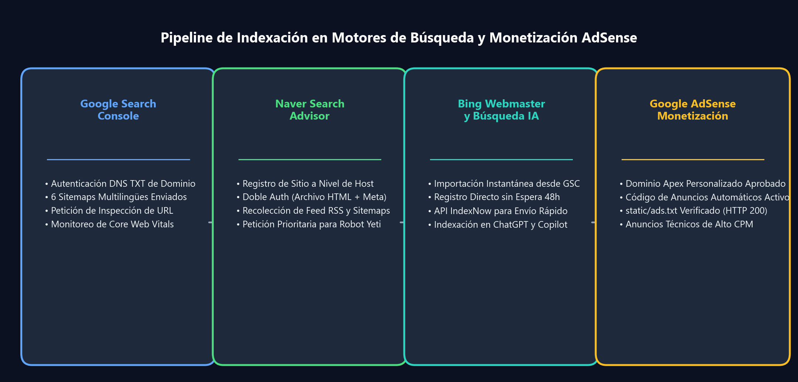

Alojar un blog de ingeniería en GitHub Pages bajo `username.github.io/proyecto` es rápido y eficiente. Sin embargo, en cuanto se busca profesionalizar la marca e implementar monetización, surge un impedimento crítico: **Google AdSense prohíbe taxativamente registrar subdominios gratuitos como `*.github.io`**. Para calificar para la cuenta de editor de AdSense y forjar autoridad de dominio (Domain Authority), es indispensable contar con un **dominio apex propio**.

Migrar un sitio estático generado por Docusaurus implica mucho más que cambiar un registro DNS: requiere delegación autoritativa en el registrador, cifrado SSL en el edge, aplanamiento CNAME (Flattening), mapeo de rutas raíz, provisión directa de `ads.txt` y sortear peculiaridades de interfaz en Google Search Console, Naver Search Advisor y Bing Webmaster Tools.

En este artículo detallamos la arquitectura técnica de nuestra migración de `jbjihwan.github.io/global_blog` a `https://globaldevlog.com`, junto con la resolución de los errores reales de indexación encontrados.

{/* truncate */}

---



---

## 1. Estrategia de Arquitectura: Porkbun + Cloudflare + GitHub Pages

Conectar un dominio apex (`globaldevlog.com`) directamente a las IPs de GitHub mediante registros `A` convencionales carece de protección DDoS, mitigación de bots y renovación automatizada de certificados edge.

Implementamos una arquitectura robusta de 3 capas:

| Capa | Proveedor | Responsabilidades Clave |
| :--- | :--- | :--- |
| **Registrador** | **Porkbun** | Compra de dominio, privacidad WHOIS perpetua gratuita y delegación de servidores de nombres |
| **Edge DNS & Seguridad** | **Cloudflare** | DNS Anycast de baja latencia, aplanamiento CNAME en `@`, Universal SSL Edge y cortafuegos de bots |
| **Origen SSG** | **GitHub Pages** | Alojamiento de artefactos estáticos compilados por Docusaurus, costo cero de servidor y sincronización `gh-pages` |

### Delegación de Servidores de Nombres en Porkbun
En la consola de Porkbun, se sustituyen los servidores de nombres predeterminados por los asignados por Cloudflare:
```text
NS: roan.ns.cloudflare.com
NS: sneh.ns.cloudflare.com
```

### Configuración de CNAME Flattening en Cloudflare
El estándar RFC 1034 no admite CNAME en el apex (`@`), pero Cloudflare lo soluciona con **CNAME Flattening**:
- **Tipo**: `CNAME` | **Nombre**: `@` | **Destino**: `jbjihwan.github.io` | **Estado**: Con proxy (Nube naranja)
- **Tipo**: `CNAME` | **Nombre**: `www` | **Destino**: `jbjihwan.github.io` | **Estado**: Con proxy
- **Modo SSL/TLS**: Configurado en **Full** (o Full Strict) para garantizar cifrado integral.

---

## 2. Migración de la Configuración de Docusaurus

Para adaptar las rutas desde la subcarpeta (`/global_blog/`) a la raíz del nuevo dominio (`/`), se ajusta `docusaurus.config.ts`:

```typescript
const config: Config = {
  title: 'Global Dev Blog',
  url: 'https://globaldevlog.com',
  baseUrl: '/',
  organizationName: 'jbjihwan',
  projectName: 'global_blog',
  trailingSlash: false,
  // ...
};
```

### Archivo CNAME Estático
Se añade el archivo `static/CNAME`:
```text
globaldevlog.com
```
Al ejecutar `npm run deploy`, este archivo se traslada a la raíz de la rama `gh-pages`, indicando al router de GitHub a qué repositorio enlazar el tráfico entrante.

---

## 3. Configuración de Google AdSense para Sitios Estáticos

La revisión de AdSense exige verificar la titularidad, inyectar el script de carga y alojar un archivo `ads.txt` accesible en la raíz.

### A. Inyección Asíncrona del Script de AdSense
Se agrega el script en el arreglo `scripts` de `docusaurus.config.ts`:

```typescript
  scripts: [
    {
      src: 'https://pagead2.googlesyndication.com/pagead/js/adsbygoogle.js?client=ca-pub-4654073335496617',
      async: true,
      crossorigin: 'anonymous',
    },
  ],
```

### B. Despliegue de `static/ads.txt`
Se crea el archivo con la identificación de editor correspondiente:
```text
google.com, pub-4654073335496617, DIRECT, f08c47fec0942fa0
```
Comprobación inmediata vía terminal:
```bash
curl -I https://globaldevlog.com/ads.txt
# HTTP/2 200
# content-type: text/plain; charset=utf-8
```

---



---

## 4. SEO Multimotor y Resolución de Errores Reales

### A. Google Search Console: Cómo Eliminar Sitemaps con Errores
Si por error se registra la URL raíz (`https://globaldevlog.com/`) en lugar del sitemap, hacer clic en los tres puntos (`⋮`) de la fila en la tabla únicamente mostrará desactivada la opción "Ver indexación de páginas", sin botón de borrado.

**La Solución:**
1. No use el menú flotante de la fila. **Haga clic directamente sobre el texto de la URL del sitemap** para ingresar a la **Vista de Detalles**.
2. En la esquina superior derecha de la pantalla de detalle, haga clic en los tres puntos verticales (`⋮`).
3. Seleccione **[Eliminar sitemap]**.
4. Si un sitemap multilingüe (como `es/sitemap.xml`) arrojó temporalmente "No se pudo recuperar", basta con volver a ingresarlo en "Añadir un sitemap" y enviar para que cambie a **Correcto**.

### B. Naver Search Advisor: Error de Entrada a Nivel de Host
1. **Error de Host**: Ingresar la URL del sitemap en la ventana inicial de alta genera el mensaje *"URL을 호스트 단위로 입력해주세요"*. Debe registrarse primero solo el dominio (`https://globaldevlog.com`).
2. **Doble Verificación**: Se despliega simultáneamente el archivo HTML de autenticación (`static/naver<hash>.html`) y la etiqueta meta en la configuración de cabeceras.
3. **Envío de Sitemaps y RSS**: En el panel de control de Naver:
   - **[Petición]** > **[Envío de Sitemap]**: ingresar `sitemap.xml`
   - **[Petición]** > **[Envío de RSS]**: ingresar `https://globaldevlog.com/blog/rss.xml`
4. **Aceleración del Robot Yeti**: Mediante la opción de recolección manual de páginas se envían las rutas prioritarias (`blog`, `ko/blog`).

### C. Herramientas para Webmasters de Bing y Búsquedas AI
- **Importación directa desde GSC**: Con un clic se transfieren las credenciales de verificación y los sitemaps.
- **Evitar la latencia de 48 horas**: El proceso de sincronización automática puede demorar dos días. Ingresar manualmente `https://globaldevlog.com/sitemap.xml` en la sección de sitemaps de Bing activa el rastreador al instante para ChatGPT Search y Copilot.

---

## 5. Lista de Verificación en Producción

- [x] **Resolución DNS**: `globaldevlog.com` y `www` responden sin alertas SSL.
- [x] **Archivo CNAME**: Activo en el origen de GitHub Pages.
- [x] **Activos de AdSense**: `ads.txt` responde con código HTTP 200 y el ID correcto.
- [x] **Sitemaps Multilingües**: Las 4 variantes (`sitemap.xml`, `ko/`, `ja/`, `es/`) son operativas.
- [x] **Indexación Activa**: Google, Naver y Bing registran y procesan los feeds y páginas.

---

### 📌 Resumen Ejecutivo de 3 a 5 Líneas
1. **Infraestructura Edge con Costo Cero de Servidor**: Migrar del subdominio gratuito `github.io` a un dominio apex combinando Porkbun, Cloudflare DNS y GitHub Pages brinda CDN Anycast y SSL sin pagar hosting.
2. **Aplanamiento CNAME y Enrutamiento Canónico**: Supera las restricciones de RFC 1034 para dominios raíz mediante CNAME Flattening, redirigiendo tráfico de `www` al apex de forma transparente.
3. **Verificación de AdSense y Despliegue de ads.txt**: Inserta etiquetas de propiedad en `<head>` y expone `static/ads.txt` en la raíz para garantizar la aprobación sin errores 404 de rastreo.
4. **Indexación Integral en Tres Buscadores**: Sincroniza sitemaps multilingües y canales RSS en Google Search Console, Naver Search Advisor y Bing Webmaster Tools sin fallos de host.