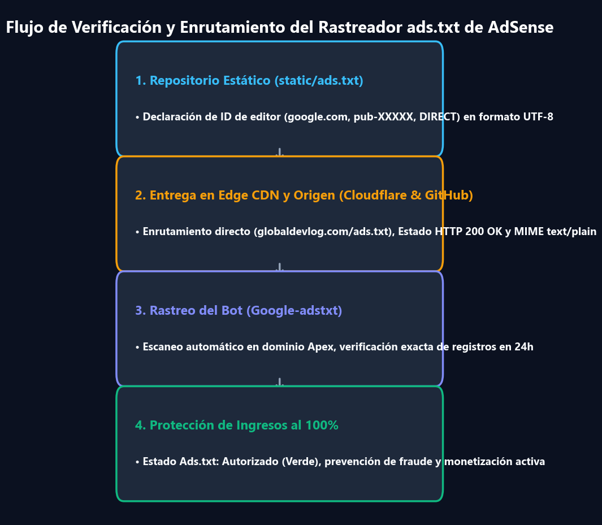
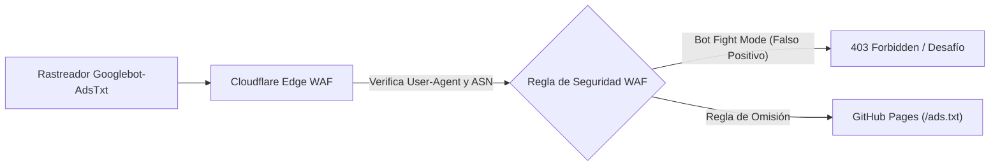

> 📌 **Puntos Clave (TL;DR)**
> - **El Problema**: A diferencia de los CMS dinámicos (WordPress), los generadores de sitios estáticos (Docusaurus, Next.js SSG) en GitHub Pages suelen activar la alerta **"Ingresos en riesgo: falta el archivo ads.txt"** y fallar la verificación de propiedad debido a retrasos de hidratación y bloqueos del WAF.
> - **La Solución**: Inyectar la etiqueta meta de verificación en `<head>` mediante `headTags` en Docusaurus, ubicar `ads.txt` en `static/ads.txt` para despliegue en la raíz y configurar reglas de omisión en Cloudflare WAF para `Googlebot-AdsTxt`.
> - **El Resultado**: 100% de accesibilidad para rastreadores, cero errores 404 en `/ads.txt`, cumplimiento de requisitos de AdSense y puntuaciones Lighthouse superiores a 95.

{/* truncate */}

---

## 1. El Desafío de AdSense en Sitios Estáticos

Migrar un blog técnico a un dominio personalizado (`https://globaldevlog.com`) abre la puerta a la monetización con **Google AdSense**. Sin embargo, los generadores de sitios estáticos (SSG) presentan particularidades arquitectónicas:

1. **Ausencia de Servidor y Plugins Dinámicos**: No existen plugins como Site Kit que inyecten scripts dinámicamente; cada archivo debe configurarse en tiempo de compilación.
2. **Hidratación del Cliente vs. Inyección Estática**: Los rastreadores de verificación inspeccionan el HTML estático sin ejecutar scripts complejos de React.
3. **La Trampa del Error 404 en `ads.txt`**: Si el rastreador `Googlebot-AdsTxt` no puede leer `https://tudominio.com/ads.txt`, la monetización se bloquea.

---

## 2. Paso 1: Inyectar la Verificación de Propiedad en Docusaurus

Al registrar el dominio en la consola de AdSense (**Sitios > Añadir sitio**), Google solicita verificar la propiedad. En entornos estáticos, **inyectar la etiqueta meta en `headTags`** es la solución más limpia y eficiente.

### 📐 Configuración (`docusaurus.config.ts`)

```typescript
import type {Config} from '@docusaurus/types';

const config: Config = {
  title: 'Global Dev Blog',
  url: 'https://globaldevlog.com',
  baseUrl: '/',

  // Etiqueta Meta de Verificación de Google AdSense
  headTags: [
    {
      tagName: 'meta',
      attributes: {
        name: 'google-adsense-account',
        content: 'ca-pub-XXXXXXXXXXXXXXXX', // Tu ID de editor de AdSense
      },
    },
  ],

  // ... resto de tu configuración
};

export default config;
```

---

## 3. Paso 2: Despliegue de ads.txt en la Raíz

Para erradicar la alerta *"Ingresos en riesgo: archivo ads.txt no encontrado"*, colocamos el archivo en el directorio estático de Docusaurus:

1. Crear `static/ads.txt`:
   ```text
   google.com, pub-XXXXXXXXXXXXXXXX, DIRECT, f08c47fec0942fa0
   ```
2. Desplegar en producción:
   ```bash
   npm run deploy
   ```
3. Verificar con `curl`:
   ```bash
   curl -I https://globaldevlog.com/ads.txt
   ```
   Debe devolver un código de estado `HTTP/2 200` con `content-type: text/plain`.

---

## 4. Paso 3: Configuración de Seguridad en Cloudflare WAF

Si el dominio está bajo el proxy de Cloudflare, la protección contra bots podría bloquear accidentalmente a los rastreadores de Google.



### Regla Personalizada en Cloudflare WAF
* **Expresión**:
  ```text
  (http.user_agent contains "Googlebot-AdsTxt") or (http.user_agent contains "Mediapartners-Google")
  ```
* **Acción**: *Omitir (Skip)* — Evita el control de bots y permite el acceso directo al archivo `ads.txt`.

---

## 5. Lista de Verificación para Aprobación en el Primer Intento

| Pilar de Evaluación | Criterio Obligatorio | Consecuencia del Incumplimiento |
| :--- | :--- | :--- |
| **1. Páginas de Políticas** | Páginas completas de `/privacy-policy`, `/about` y `/contact` | Violación de Políticas de Navegación |
| **2. Volumen de Contenido** | Más de 20 artículos técnicos originales y extensos | Contenido de Poco Valor |
| **3. Cero Enlaces Rotos** | Sin enlaces 404 ni etiquetas de anclaje rotas | Sitio no Disponible |
| **4. Diseño Responsivo** | Visualización fluida en dispositivos móviles | Mala Usabilidad Móvil |

---

## 6. Conclusión y Próximos Pasos

Con la etiqueta meta en `headTags`, `static/ads.txt` en la raíz y las reglas de Cloudflare configuradas, tu sitio estático cumple todos los requisitos técnicos para la aprobación de AdSense.

* En el **Episodio #3**, analizaremos la indexación en motores de búsqueda: ¡Google Search Console, Naver Search Advisor y Bing Webmaster Tools con mapas de sitio en 6 idiomas!

---

### 📌 Resumen Ejecutivo de 3 a 5 Líneas
1. **Verificación Estática de Propiedad**: Inyecta la metaetiqueta de verificación de Google AdSense directamente en `<head>` mediante la configuración `headTags` de Docusaurus, evitando retrasos de hidratación en el cliente.
2. **Solución al Error 404 en ads.txt**: Ubicar `ads.txt` dentro del directorio `static/` garantiza su despliegue en la raíz (`https://dominio/ads.txt`), eliminando permanentemente la alerta de "Ingresos en riesgo".
3. **Bypass del WAF en Cloudflare**: Configura reglas de omisión en Cloudflare para que los rastreadores `Googlebot-AdsTxt` y `Mediapartners-Google` no sean bloqueados por desafíos de CAPTCHA automatizados.
4. **Los 4 Pilares de Aprobación Inmediata**: Disponer de páginas estatutarias (política de privacidad, contacto), más de 20 artículos técnicos originales, cero enlaces rotos (404) y diseño móvil responsivo garantizan el éxito en la revisión.

> 📌 **Artículos Relacionados en Global Dev Blog**:  
> • [Global Dev Blog - Dominio Personalizado en GitHub Pages y Cloudflare DNS](https://globaldevlog.com/ko/blog/github-pages-custom-domain-cloudflare-dns)  
> • [Global Dev Blog - Seguridad en Sitios Estáticos y la Verdad de npm audit](https://globaldevlog.com/ko/blog/static-site-security-npm-audit-truth)  
> • [Visita el Inicio de Global Dev Blog (Disponible en 6 Idiomas)](https://globaldevlog.com/)
