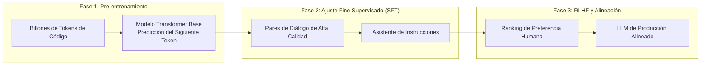

Bienvenidos al análisis técnico de la **Clase 2 (Semana 1) de Stanford CS146S: El Desarrollador de Software Moderno**.

Si en la primera lección definimos la transición del desarrollador de mero mecanógrafo a director de orquesta de agentes autónomos, en esta segunda clase nos sumergimos en el motor fundamental de esta revolución: los **Modelos de Lenguaje para Código (Coding LLMs)** y la disciplina de **Ingeniería de Prompts (Prompt Engineering)**.

Basado en las lecturas de Andrej Karpathy (*Deep Dive into LLMs*), OpenAI (*How OpenAI Uses Codex*) y las guías de Google Cloud y DAIR.AI, analizamos el pipeline de entrenamiento de tres fases, el fenómeno del **Modelo de Queso Suizo** en la generación de código y la doctrina de **"Confía pero Verifica"**.

{/* truncate */}

---

### 1. El Pipeline de Entrenamiento: Pre-entrenamiento, SFT y RLHF

---

### 2. El Modelo de Queso Suizo y la Arquitectura "Confía pero Verifica"

Los modelos pueden escribir 200 líneas de código sintácticamente impecable, pero dejar una vulnerabilidad crítica de desbordamiento de búfer o una condición de carrera. Por ello, la ingeniería moderna impone barreras deterministas: linters estrictos, pruebas unitarias automatizadas y fuzzing de invariantes antes de la revisión humana.

### Referencias y Materiales del Curso
- **Lista de Reproducción Oficial en YouTube**: [Stanford CS146S: The Modern Software Development (YouTube Playlist)](https://www.youtube.com/playlist?list=PLxpwjSdVZQ95OWe3QvkVEcU1f1X-6NDj9)
- **Literatura Principal**: Andrej Karpathy, *Deep Dive into LLMs*; OpenAI, *How OpenAI Uses Codex*; Google Cloud & DAIR.AI, *Prompt Engineering Guide*.
- **Institución**: Universidad de Stanford, Departamento de Ciencias de la Computación
