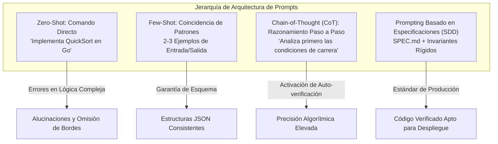
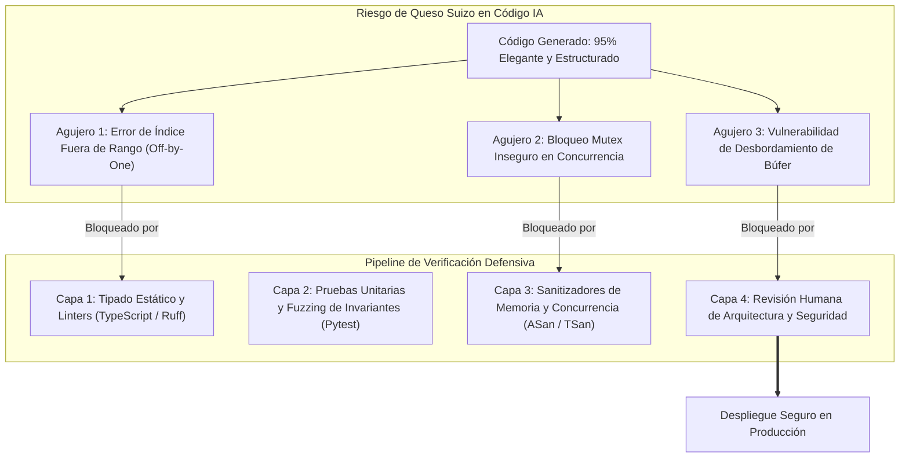

Bienvenidos al análisis técnico de la **Clase 2 (Semana 1) de Stanford CS146S: El Desarrollador de Software Moderno**.

Si en la primera lección definimos la transición del desarrollador de mero mecanógrafo a director de orquesta de agentes autónomos, en esta segunda clase nos sumergimos en el motor fundamental de esta revolución: los **Modelos de Lenguaje para Código (Coding LLMs)** y la disciplina de **Ingeniería de Prompts (Prompt Engineering)**.

Basado en las lecturas fundamentales de Andrej Karpathy (*Deep Dive into LLMs*), OpenAI (*How OpenAI Uses Codex*) y las investigaciones de Google Cloud y DAIR.AI, analizamos cómo las redes neuronales adquieren competencia en código, por qué sufren del traicionero **Modelo de Queso Suizo** y cómo los ingenieros deben implementar la doctrina de **"Confía pero Verifica"**.

{/* truncate */}

---

### 1. Anatomía de un LLM: El Pipeline de Tres Etapas

Para dirigir y depurar eficazmente asistentes de código con IA, un ingeniero de software debe entender cómo se forjaron los pesos del modelo:

```mermaid
flowchart LR
    subgraph Fase1 ["Fase 1: Pre-entrenamiento (Pre-training)"]
        D1[Trillones de Tokens de Código Web & GitHub] --> N1[Modelo Transformer Base<br/>Predicción del Siguiente Token P(w_t | Context)]
    end

    subgraph Fase2 ["Fase 2: Ajuste Fino Supervisado (SFT)"]
        N1 --> D2[Pares de Diálogo de Alta Calidad<br/>Protocolo de Instrucción]
        D2 --> N2[Asistente de Instrucciones<br/>Persona de Desarrollador]
    end

    subgraph Fase3 ["Fase 3: RLHF y Alineación"]
        N2 --> D3[Ranking de Preferencia Humana<br/>Modelo de Recompensa (Reward Model)]
        D3 --> N3[LLM de Código para Producción<br/>Seguro, Alineado y Determinista]
    end
```

#### 1.1. Pre-entrenamiento: Ingestión de Conocimiento no Supervisada
Un modelo Transformer tipo Decoder procesa petabytes de código fuente dividido en tokens mediante **BPE (Byte-Pair Encoding)**:
- Un token representa aproximadamente 3–4 caracteres o fragmentos comunes (`def `, `return `, `const `).
- El objetivo de pérdida es la **Predicción del Siguiente Token (Next-Token Prediction)**:

```text
P(w_t | w_1, w_2, ..., w_t-1) = Softmax(W_v * h_t-1)
```

- Al minimizar la pérdida de entropía cruzada, la red codifica implícitamente árboles sintácticos, algoritmos e interfaces de API. Sin embargo, el modelo base resultante es solo un motor de autocompletado colosal.

#### 1.2. Ajuste Fino Supervisado (SFT)
Para convertir el autocompletado en un programador par, se introducen decenas de miles de pares `<Pregunta, Código Óptimo>` curados por ingenieros sénior, enseñándole al modelo a estructurar bloques de código y explicar casos borde.

#### 1.3. RLHF y Optimización Directa de Preferencias (DPO)
Mediante un **Modelo de Recompensa**, evaluadores humanos puntúan múltiples respuestas generadas ante una misma tarea de programación. Algoritmos como PPO o DPO ajustan los pesos para favorecer código seguro y legible.

> **Concepto Clave**: Cuando un LLM de código responde, realiza una **simulación estadística** ultraveloz de lo que un ingeniero experimentado escribiría.

---

### 2. Cómo Entiende el Código OpenAI Codex

OpenAI reveló que los LLMs destacan en programación por tres razones estructurales:
1. **Gramáticas Formales y Árboles AST**: El código sigue gramáticas libres de contexto y se parsea en **Árboles de Sintaxis Abstracta (AST)** sin ambigüedad.
2. **Invariantes de Largo Alcance**: La atención multidireccional del Transformer rastrea declaraciones de tipos a cientos de líneas de distancia.
3. **Ingestión Masiva de GitHub**: Millones de repositorios proporcionan un catálogo exhaustivo de patrones de diseño.

Sin embargo, el modelo no compila ni ejecuta el código mientras predice tokens: no tiene capacidad de verificación intrínseca.

---

### 3. Ingeniería de Prompts como Disciplina de Ingeniería de Software

En Stanford CS146S, la ingeniería de prompts es el diseño sistemático de entradas para guiar modelos probabilísticos hacia resultados deterministas:



#### 3.1. Cadena de Pensamiento (Chain-of-Thought, CoT)
Al solicitar código concurrente o algoritmos difíciles, exigir al modelo que analice primero los pasos lógicos (`"Let's think step by step"`) genera tokens intermedios de razonamiento que actúan como contexto propio, aumentando radicalmente la tasa de acierto.

---

### 4. El "Modelo de Queso Suizo" de la Generación de Código

Adaptando el modelo de seguridad de James Reason, Andrej Karpathy ilustra cómo la IA puede producir código deslumbrante con agujeros ocultos críticos:



Debido a que el código luce impecable, los desarrolladores caen en el **Sesgo de Automatización (Automation Bias)**. Si se aprueban PRs generados por IA sin verificación profunda, los agujeros del queso colapsarán los sistemas en producción.

---

### 5. La Arquitectura de Ingeniería "Confía pero Verifica"

```mermaid
sequenceDiagram
    autonumber
    actor Dev as Ingeniero de Software (Arquitecto)
    participant Spec as SPEC.md e Invariantes
    participant LLM as LLM de Código (Claude Code / Cursor)
    participant Gate as Compuerta de Verificación Automatizada
    participant Prod as Rama Principal de Producción

    Dev->>Spec: Escribe Restricciones e Invariantes
    Dev->>LLM: Envía Tarea con Especificación
    LLM->>LLM: Razonamiento Paso a Paso (CoT)
    LLM->>Gate: Confirma Código y Pruebas Unitarias

    rect rgb(30, 41, 59)
        note over Gate: Compuerta de Verificación Automatizada
        Gate->>Gate: 1. Tipado Estático Estricto (tsc / mypy)
        Gate->>Gate: 2. Ejecución de Pruebas Unitarias
        Gate->>Gate: 3. Fuzzing de Invariantes
    end

    alt Falla Alguna Prueba
        Gate-->>LLM: Reinyecta Traza de Error (Ingeniería de Bucles)
        LLM->>Gate: Sintetiza Parche de Corrección
    else Pasa Todas las Pruebas
        Gate-->>Dev: Diff Limpio con 100% de Métricas Aprobadas
        Dev->>Dev: Revisión de Seguridad y Arquitectura
        Dev->>Prod: Merge a Producción
    end
```



---

### 6. Matriz Comparativa de Paradigmas

| Dimensión | Prompting Conversacional | Prompting con Esquema Few-Shot | Prompting Dirigido por Especificaciones (CS146S) |
| :--- | :--- | :--- | :--- |
| **Formato de Entrada** | Chat en lenguaje natural (`"Arregla este bug"`) | Prompt de sistema + 2–3 ejemplos JSON | Especificación formal (`SPEC.md`) + contratos |
| **Cognición del Modelo** | Generación de tokens sin restricciones | Generación condicionada al esquema de ejemplo | Razonamiento paso a paso (CoT) + MCP |
| **Riesgo de Alucinación** | **Alto** (30–45% en casos borde) | **Bajo** en sintaxis, **Medio** en negocio | **Extremadamente Bajo** (bloqueado por pruebas) |
| **Reproducibilidad** | Baja (varía con el tono) | Alta (estructuras consistentes) | Total (versionado en Git junto con los tests) |

---

### 7. Preguntas y Respuestas de Stanford CS146S

> **P. ¿Por qué un LLM resuelve problemas de LeetCode de forma brillante, pero en un repositorio empresarial de 100.000 líneas comienza a alucinar y romper componentes?**

**Respuesta del Claustro:**
Es el problema de **Saturación de Contexto y Dilución de la Atención**.
1. Al inyectar miles de líneas de código en la ventana de contexto, los pesos de atención se dispersan.
2. Ocurre el fenómeno **"Lost in the Middle"**: el modelo prioriza el inicio y el final, olvidando reglas intermedias críticas.
3. La solución de ingeniería moderna es el **Mapeo de Repositorios (Repo Mapping)**: extraer únicamente los símbolos AST y dependencias directas mediante herramientas como Tree-sitter y MCP.

---

### 8. Conclusiones de la Clase 2

1. **Entiende la Máquina**: Los LLMs son simuladores estadísticos de tokens.
2. **Diseña el Prompt**: Aplica CoT y restricciones explícitas para generar contexto de razonamiento.
3. **Cuidado con el Queso Suizo**: Desconfía de la elegancia superficial del código de IA.
4. **Confía pero Verifica**: Automatiza linters, pruebas unitarias y fuzzers antes de la revisión humana.

---

### 📌 Resumen Ejecutivo de 3 a 5 Líneas
1. **La Naturaleza de los LLMs de Código**: Los LLMs no son entidades conscientes, sino simuladores estadísticos de tokens forjados a través de pre-entrenamiento, SFT y alineación por RLHF/DPO.
2. **Ingeniería de Prompts Disciplinada**: Para lógicas complejas y concurrencia, exigir razonamiento paso a paso (Chain-of-Thought) y restricciones negativas previene alucinaciones y valida invariantes.
3. **El Peligro del Queso Suizo**: El código generado con IA luce impecable superficialmente pero oculta agujeros sutiles (off-by-one, deadlocks); los desarrolladores deben vencer el sesgo de automatización.
4. **Doctrina "Confía pero Verifica"**: Implementar una compuerta defensiva de cuatro capas—tipado estricto, pruebas unitarias deterministas, fuzzing de invariantes y revisión arquitectónica humana—es indispensable para producción.

### Referencias y Materiales del Curso
- **Lista de Reproducción Oficial en YouTube**: [Stanford CS146S: The Modern Software Development (YouTube Playlist)](https://www.youtube.com/playlist?list=PLxpwjSdVZQ95OWe3QvkVEcU1f1X-6NDj9)
- **Literatura Principal**: Andrej Karpathy, *Deep Dive into LLMs*; OpenAI, *How OpenAI Uses Codex*; Google Cloud & DAIR.AI, *Prompt Engineering Guide*.
- **Institución**: Universidad de Stanford, Departamento de Ciencias de la Computación
