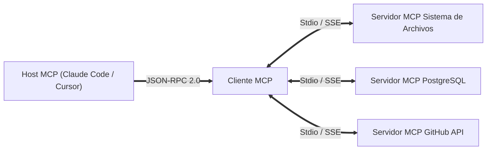

Bienvenidos al análisis técnico de la **Clase 3 (Semana 2) de Stanford CS146S: El Desarrollador de Software Moderno**.

En esta lección abordamos el mayor cuello de botella en los sistemas de IA: ¿cómo conectar modelos fundacionales con bases de datos, APIs y entornos de ejecución de forma segura y estandarizada? Analizamos el **Model Context Protocol (MCP)**, el estándar abierto que está revolucionando la orquestación de agentes autónomos.

{/* truncate */}

---

### 1. El LSP para la IA: La Arquitectura de MCP

De la misma manera que el Language Server Protocol (LSP) desacopló los compiladores de los editores, MCP desacopla el razonamiento de los modelos de la ejecución física de herramientas mediante JSON-RPC 2.0.

### Referencias y Materiales del Curso
- **Lista de Reproducción Oficial en YouTube**: [Stanford CS146S: The Modern Software Development (YouTube Playlist)](https://www.youtube.com/playlist?list=PLxpwjSdVZQ95OWe3QvkVEcU1f1X-6NDj9)
- **Literatura Principal**: Model Context Protocol Specification (modelcontextprotocol.io); Anthropic Claude Tool Use Architecture; Microsoft Language Server Protocol (LSP).
- **Institución**: Universidad de Stanford, Departamento de Ciencias de la Computación
