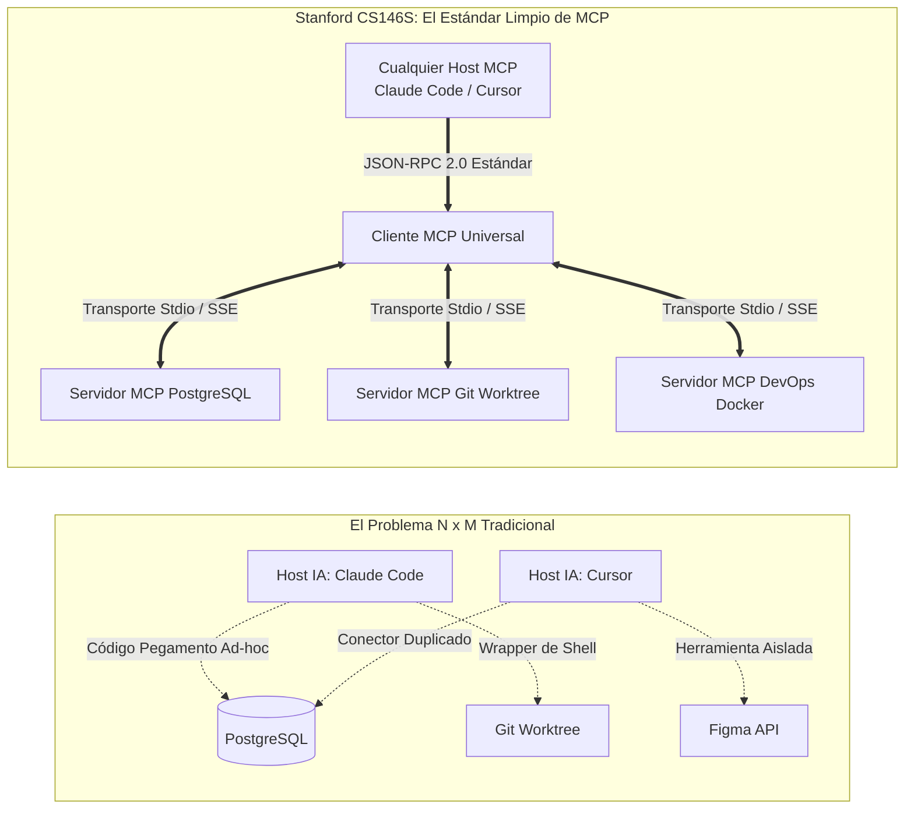
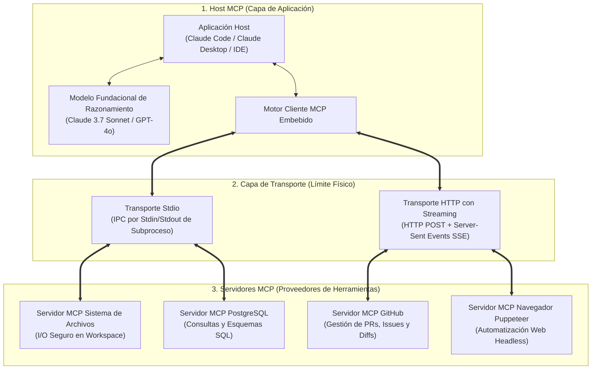

Bienvenidos al análisis técnico de la **Clase 3 (Semana 2) de Stanford CS146S: El Desarrollador de Software Moderno**.

En la Clase 1 estudiamos la transición de mecanógrafo de sintaxis a director de orquesta de agentes, y en la Clase 2 abordamos la naturaleza probabilística de los LLMs y la arquitectura defensiva "Confía pero Verifica". En esta **Clase 3**, resolvemos el cuello de botella más crítico de los sistemas de IA: **¿Cómo interactúan los modelos fundacionales aislados con bases de datos, terminales y APIs externas de manera segura y modular?**

Antes de 2024, conectar un LLM a un recurso empresarial requería código de integración ad-hoc frágil. Basado en el estándar abierto impulsado por Anthropic y la investigación de Stanford, analizamos el **Model Context Protocol (MCP)**: el adaptador universal que está haciendo por los agentes de IA lo que el **Language Server Protocol (LSP)** hizo por los editores de código modernos.

{/* truncate */}

---

### 1. La Crisis de Fragmentación: Por Qué Necesitábamos un "LSP para la IA"

Históricamente, cada nuevo entorno de desarrollo con IA (Cursor, Claude Code, GitHub Copilot) intentaba conectarse a recursos idénticos: repositorios Git, bases de datos PostgreSQL y clústeres en la nube.

En la década de 2010, Microsoft resolvió la complejidad $N \times M$ de los compiladores mediante el **Language Server Protocol (LSP)**. 

**Model Context Protocol (MCP)** representa exactamente el mismo salto cualitativo: desacopla el razonamiento del modelo de la ejecución física de herramientas, estableciendo un protocolo de comunicación neutral sobre **JSON-RPC 2.0**.

---

### 2. La Arquitectura del Sistema MCP en 3 Niveles

1. **Host MCP**: La aplicación que gestiona la interfaz, la ventana de contexto y los permisos de usuario.
2. **Cliente MCP**: Módulo embebido en el host que mantiene la conexión 1 a 1 con el servidor y serializa las llamadas.
3. **Servidor MCP**: Proceso ligero que expone recursos de datos y funciones ejecutables.

---

### 3. Capas de Transporte: Stdio vs. Streamable HTTP/SSE

| Dimensión | Transporte Stdio (IPC Local) | Transporte HTTP/SSE (Remoto) |
| :--- | :--- | :--- |
| **Canal de Comunicación** | Tuberías de entrada (`stdin`) y salida (`stdout`) del subproceso local | HTTP POST para peticiones, Server-Sent Events (SSE) para respuestas |
| **Latencia y Sobrecarga** | **Latencia cero** (tubería de SO, sin handshake de red) | Latencia de ida y vuelta + cifrado TLS |
| **Seguridad** | Permisos locales del sistema de archivos y aislamiento | Tokens OAuth 2.0 Bearer, mTLS y firewalls |
| **Casos Típicos** | Edición de archivos locales, operaciones Git, SQLite | Clústeres de bases de datos remotas, APIs SaaS corporativas |

---

### 4. Las Tres Primitivas Fundamentales de MCP

1. **Recursos (Resources - Contexto de Sólo Lectura)**: Equivalente a peticiones GET. Datos estáticos o dinámicos (archivos, logs, esquemas) mediante URIs (`postgres://db/users`). Sin efectos secundarios.
2. **Herramientas (Tools - Acciones Ejecutables)**: Funciones que el modelo puede invocar, con parámetros definidos en estricto JSON Schema. El host solicita autorización humana previa a su ejecución.
3. **Prompts (Plantillas Parametrizadas)**: Flujos de trabajo reutilizables almacenados en el servidor (ej. `/auditoria-seguridad`).

---

### 5. El Bucle de Ejecución de Herramientas en Claude Code

```mermaid
sequenceDiagram
    autonumber
    actor Dev as Desarrollador
    participant Host as Claude Code (Host)
    participant Model as Claude 3.7 Sonnet (LLM)
    participant Client as Cliente MCP
    participant Server as Servidor MCP PostgreSQL

    Dev->>Host: "Diagnostica por qué falló el pedido del usuario 8492"
    Host->>Client: Solicita herramientas disponibles (tools/list)
    Client->>Server: JSON-RPC tools/list
    Server-->>Client: Retorna [query_orders, inspect_logs]
    Client-->>Host: Inyecta esquemas en el prompt de sistema

    Host->>Model: Prompt + Esquema de Herramientas + Consulta
    Model->>Model: Chain-of-Thought: Requiere consultar la base de datos
    Model-->>Host: Razón de parada: tool_use (query_orders, args: {id: 8492})

    rect rgb(30, 41, 59)
        note over Host,Dev: Barrera de Autorización Humana
        Host->>Dev: ¿Autorizar tool: query_orders(8492)? [Y/n]
        Dev-->>Host: Confirmado: Sí
    end

    Host->>Client: Ejecuta llamada de herramienta
    Client->>Server: JSON-RPC tools/call (query_orders)
    Server-->>Client: Retorna JSON: {status: 'failed', error: 'saldo_insuficiente'}
    Client-->>Host: Carga útil del resultado

    Host->>Model: Reinyecta el resultado en el contexto
    Model->>Model: Sintetiza el análisis de causa raíz
    Model-->>Host: "El pago falló debido a fondos insuficientes en el webhook de Stripe."
    Host-->>Dev: Presenta el informe de diagnóstico final
```

---

### 6. Preguntas y Respuestas de Stanford CS146S

> **P. ¿En qué se diferencia MCP de Function Calling de OpenAI o de las herramientas de LangChain?**

**Respuesta del Claustro:**
Function Calling es únicamente una **característica de la API del LLM**: el modelo emite un JSON. Sin embargo, no existía un estándar que definiera quién ejecutaba esa función, cómo se autenticaba o cómo se reutilizaba en otro editor.
MCP es un **protocolo industrial abierto**. Un servidor MCP de PostgreSQL desarrollado hoy puede utilizarse de forma idéntica en Claude Code, Cursor o en cualquier agente autónomo futuro sin modificar una sola línea de código.

---

### 7. Conclusiones de la Clase 3

1. **Adopta Estándares Abiertos**: Estandariza las integraciones de herramientas sobre MCP.
2. **Separa Cerebro y Manos**: Mantén al LLM enfocado en el razonamiento y delega la ejecución física a servidores MCP en sandbox.
3. **Mantén al Humano en el Bucle**: Exige compuertas de autorización explícita para herramientas que modifiquen el estado del sistema.

---

### 📌 Resumen Ejecutivo de 3 a 5 Líneas
1. **El Paradigma de Estandarización de MCP**: Model Context Protocol (MCP) actúa como el "LSP para Agentes de IA", resolviendo el espagueti de integraciones $N \times M$ mediante un protocolo abierto y bidireccional JSON-RPC 2.0.
2. **Desacoplamiento entre Cerebro y Manos**: El LLM se concentra exclusivamente en el razonamiento lógico, mientras que las mutaciones físicas de estado e I/O se delegan a servidores MCP aislados.
3. **Arquitectura de Doble Transporte (Stdio vs HTTP/SSE)**: Permite flujos locales de sub-milisegundo mediante pipes Stdio de alta velocidad, escalando a entornos remotos con streaming HTTP/SSE protegido por OAuth 2.0.
4. **Guardarraíles de Seguridad con Humano en el Bucle**: Aplica el principio de mínimo privilegio, bloqueando cualquier mutación destructiva de disco o base de datos hasta recibir confirmación explícita del desarrollador.

### Referencias y Materiales del Curso
- **Lista de Reproducción Oficial en YouTube**: [Stanford CS146S: The Modern Software Development (YouTube Playlist)](https://www.youtube.com/playlist?list=PLxpwjSdVZQ95OWe3QvkVEcU1f1X-6NDj9)
- **Literatura Principal**: Model Context Protocol Specification (modelcontextprotocol.io); Anthropic Claude Tool Use Architecture; Microsoft Language Server Protocol (LSP).
- **Institución**: Universidad de Stanford, Departamento de Ciencias de la Computación