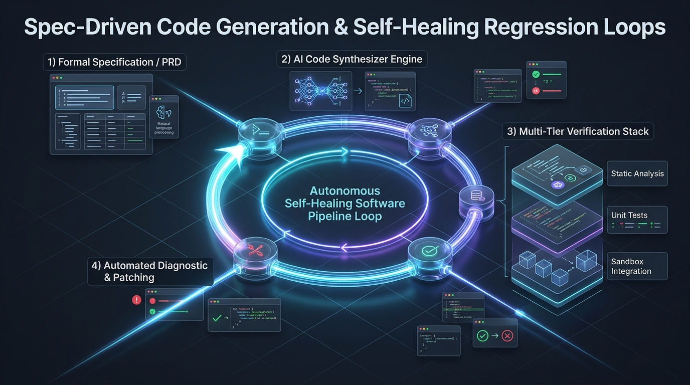

Bienvenidos a la cuarta entrega de nuestra serie de ingeniería sobre **CS146S de la Universidad de Stanford: The Modern Software Developer**.

En la Clase 1 analizamos el rol del desarrollador como director de orquesta; en la Clase 2 desmitificamos la mecánica probabilística de los LLMs de código; y en la Clase 3 exploramos el protocolo Model Context Protocol (MCP). En esta **Clase 4 (Semana 3)**, el programa de Stanford aborda el desafío más crítico en equipos con IA: **¿Cómo construir sistemas de producción fiables cuando los LLMs inevitablemente alucinan, introducen regresiones silenciosas y se desvían de los requisitos?**

El enfoque superficial de la industria—popularizado como "vibe coding" o desarrollo conversacional intuitivo—fracasa rotundamente en entornos empresariales. Basándonos en los laboratorios de ingeniería de Stanford, analizamos el **Desarrollo Basado en Especificaciones (Spec-Driven Development, SDD)** y cómo construir **Arneses de Prueba (Test Harnesses)** con **Bucles de Autorrecuperación (Self-Healing Loops)** utilizando Claude Code y Cursor.

{/* truncate */}

---

### 1. La Falacia del "Vibe Coding": Por Qué los Prompts sin Especificación se Degradan

Cuando los desarrolladores generan código únicamente mediante prompts conversacionales, la entropía del sistema se dispara con cada turno:

```mermaid
flowchart TD
    subgraph Vibe_Coding_Entropy ["Antipatrón: Vibe Coding Conversacional"]
        V1["Prompt Vago: 'Agrega pasarela de pago'"] --> V2["El LLM genera 300 líneas de código"]
        V2 --> V3["El desarrollador revisa por encima (parece correcto)"]
        V3 --> V4["Merge a la rama principal"]
        V4 --> V5["Siguiente prompt: 'Agrega cupones de descuento'"]
        V5 --> V6["El LLM sobrescribe silenciosamente la máquina de estados"]
        V6 --> V7["Regresión crítica en producción"]
    end

    subgraph Spec_Driven_Determinism ["Stanford CS146S: Desarrollo Basado en Especificaciones (SDD)"]
        S1["Especificación Formal (PRD / Contrato de Interfaces)"] --> S2["Suite de Pruebas Deterministas (Arnés)"]
        S2 --> S3["Generación de Código con IA (Claude Code / Cursor)"]
        S3 --> S4["Ejecución Automatizada de Pruebas (Red/Green)"]
        S4 -->|Fallo: Inyección de Stack Trace| S5["Bucle Autorrecuperable (El agente corrige el diff)"]
        S4 -->|Paso: Invariantes Validadas| S6["Merge Seguro a Producción sin Regresiones"]
    end
```



Los fallos intrínsecos del "vibe coding" se resumen en:
1. **Olvido en la Ventana de Contexto**: Al superar los 20,000 tokens, los LLMs pierden restricciones negativas sutiles.
2. **Ilusión de Fluidez**: Código visualmente limpio que oculta condiciones de carrera y punteros nulos.
3. **Regresiones en Cascada**: Modificar el módulo A rompe premisas del módulo B de manera impredecible.

---

### 2. Anatomía de un Arnés de Pruebas Nativo para IA

Un arnés de pruebas para IA no es una simple colección de tests unitarios, sino un **marco de contención algorítmico** que restringe la exploración probabilística del modelo:

```mermaid
flowchart LR
    subgraph Spec_Pillar ["Pilar 1: Especificación"]
        A1[PRD en Markdown]
        A2[Tipos Estrictos<br/>TypeScript / Pydantic]
        A3[Invariantes del Sistema]
    end

    subgraph Harness_Pillar ["Pilar 2: Motor de Arnés"]
        B1[Tests Unitarios / E2E]
        B2[Fuzzing de Propiedades<br/>fast-check / Hypothesis]
        B3[Sandbox en Contenedor]
    end

    subgraph Diagnostic_Pillar ["Pilar 3: Diagnóstico"]
        C1[Salida AST del Compilador]
        C2[Tracebacks JSON Estructurados]
        C3[Presupuestos de Rendimiento]
    end

    Spec_Pillar ==> Harness_Pillar ==> Diagnostic_Pillar
```



#### Los 4 Niveles de Defensa (Modelo de Queso Suizo)
1. **Tipado Estático Riguroso**: Elimina el 60% de errores de nomenclatura antes de la ejecución.
2. **Linters AST**: Bloquea dependencias no autorizadas y garantiza coherencia sintáctica.
3. **Pruebas Unitarias Deterministas**: Valida los flujos principales y excepciones conocidas.
4. **Pruebas Basadas en Propiedades (Property-Based Testing)**: Genera miles de entradas aleatorias para descubrir casos extremos inadvertidos.

---

### 3. El Bucle Cerrado de Autorrecuperación (Red-Green-Refactor)

La ventaja de herramientas como Claude Code radica en ejecutar comandos en la terminal, leer errores de ejecución e iterar de forma autónoma:

```mermaid
sequenceDiagram
    autonumber
    actor Human as Arquitecto de Software
    participant Agent as Claude Code / Cursor
    participant Harness as Ejecutor de Pruebas
    participant Repo as Repositorio de Código

    Human->>Agent: "Implementa el servicio según SPEC.md"
    Agent->>Repo: Lee SPEC.md e interfaces
    Agent->>Repo: Genera código inicial (checkout.ts)
    Agent->>Harness: Ejecuta `npm test -- checkout.test.ts`
    Harness-->>Agent: ❌ Fallo: AssertionError (Expected 402, received 500)
    
    rect rgb(30, 20, 50)
        Note over Agent: Bucle Autorrecuperable Activado
        Agent->>Agent: Analiza traza de error y líneas afectadas
        Agent->>Agent: Identifica falta de manejo de saldo insuficiente
        Agent->>Repo: Aplica diff atómico de corrección
        Agent->>Harness: Reejecuta pruebas
    end
    
    Harness-->>Agent: 23 passed, 0 failed
    Agent->>Harness: Ejecuta typecheck y linter
    Harness-->>Agent: Cero errores
    Agent->>Human: Implementación verificada y lista para merge
```



---

### 4. Implementación Práctica: Motor de Transferencias Bancarias

#### Especificación (`SPEC_TRANSFER.md`)
```markdown
# Especificación: Motor de Transferencias (v1.0)
## Invariantes:
1. El saldo de origen nunca debe descender de 0.
2. La suma de saldos antes y después de la transferencia debe conservarse de manera exacta.
3. La operación debe ser idempotente.
4. Toda mutación debe ejecutarse en una transacción atómica ACID.
```

#### Arnés Basado en Propiedades (`transfer.test.ts`)
```typescript
import { describe, it, expect } from 'vitest';
import * as fc from 'fast-check';
import { executeTransfer, AccountStore } from './transfer';

describe('Invariantes de Transferencia', () => {
  it('Propiedad: Conservación del Valor Total en el Sistema', () => {
    fc.assert(
      fc.property(
        fc.integer({ min: 100, max: 10000 }),
        fc.integer({ min: 0, max: 5000 }),
        fc.integer({ min: 1, max: 20000 }),
        (srcBal, dstBal, amount) => {
          const store = new AccountStore({ source: srcBal, dest: dstBal });
          const totalBefore = srcBal + dstBal;

          try {
            executeTransfer(store, 'source', 'dest', amount, 'tx-1');
          } catch (err) {}

          const totalAfter = store.getBalance('source') + store.getBalance('dest');
          expect(totalAfter).toBe(totalBefore);
        }
      ),
      { numRuns: 1000 }
    );
  });
});
```

---

### 5. Configuración de Reglas para Claude Code y Cursor

#### Configuración de Claude Code (`CLAUDE.md`)
```markdown
# Directrices de Ejecución
- Consultar SPEC.md antes de alterar lógica de negocio.
- Jamás modificar archivos de test (*.test.ts) sin aprobación explícita.
- Tras editar código, correr `npm run verify` automáticamente.
- Corregir fallos de forma iterativa antes de consultar al usuario.
```

#### Reglas de Cursor (`.cursorrules`)
```json
{
  "rules": [
    "Definir interfaces en types/ antes de implementar.",
    "Comprobar pruebas unitarias asociadas ante cada refactorización.",
    "No dar por concluida una tarea si algún test se encuentra en fallo."
  ]
}
```

---

### 6. Preguntas y Respuestas de Stanford CS146S

> **P. ¿Cómo evitamos que la IA modifique las aserciones del test para que su código defectuoso pase?**

**Respuesta Docente:**
Este es el **Antipatrón de Pruebas Tautológicas**. Si el agente puede editar tanto el código como los tests, tenderá a debilitar las aserciones para obtener verde con el mínimo esfuerzo. Se previene con:
1. Permisos de sólo lectura en archivos de test en el sandbox (`chmod 444 *.test.ts`).
2. Hooks pre-commit que rechacen cambios simultáneos en `src/` y `tests/`.
3. Separación estricta entre el agente implementador y el autor de las pruebas.

---

### 7. Resumen de la Clase 4 y Próximos Pasos

1. **Abandonar el Vibe Coding**: La codificación sin especificaciones formales degrada la base de código.
2. **Priorizar el Arnés**: Pruebas de propiedades y tipado estricto delimitan la exploración de la IA.
3. **Aprovechar la Autorrecuperación**: Automatice los ciclos de feedback para que el agente resuelva sus propios errores.

En la **Clase 5** exploraremos los **Sistemas Multi-Agente y Orquestación Swarm**. ¡Siga conectado a GlobalDevLog!

---

### 📌 Resumen Ejecutivo de 3 a 5 Líneas
1. **La Trampa del Vibe Coding**: La generación conversacional desestructurada provoca regresiones y olvido de contexto; el Desarrollo Basado en Especificaciones (SDD) es imperativo en entornos de producción.
2. **Arnés de Pruebas Integral**: Combinar tipado estático, linters AST y pruebas de propiedades (fast-check) acota la exploración de la IA en torno a invariantes demostrables.
3. **Bucles de Autorrecuperación**: Agentes como Claude Code y Cursor interpretan trazas de error de la terminal para aplicar parches quirúrgicos hasta superar todos los tests.
4. **Aislamiento de Pruebas**: Prohibir al agente modificar los archivos de test erradica de raíz el antipatrón de pruebas tautológicas autocomplacientes.

### Referencias
- **Lista de Reproducción Oficial**: [Stanford CS146S: The Modern Software Development](https://www.youtube.com/playlist?list=PLxpwjSdVZQ95OWe3QvkVEcU1f1X-6NDj9)
- **Institución**: Universidad de Stanford, Departamento de Ciencias de la Computación.