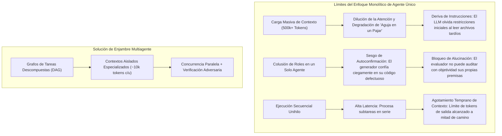
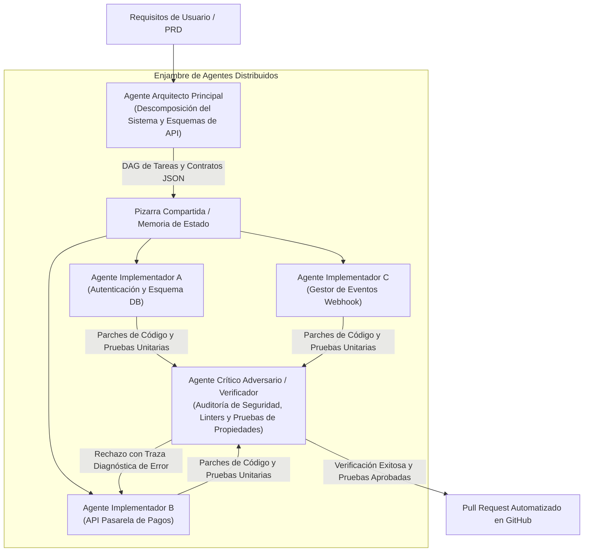

Bienvenidos a la 5ª clase de nuestra serie técnica sobre **CS146S de la Universidad de Stanford: El Desarrollador de Software Moderno (The Modern Software Developer)**.

En nuestras clases previas, exploramos la ingeniería de prompts avanzada, la mecánica interna de los modelos de código, el uso autónomo de herramientas mediante el Protocolo de Contexto de Modelo (MCP) y los arneses de pruebas guiados por especificaciones con autorreparación. Cada uno de estos paradigmas asumía una premisa común: una **única sesión de LLM principal** interactuando de forma conversacional con un desarrollador o un espacio de trabajo en el IDE.

Sin embargo, cuando un proyecto de software supera los miles de líneas de código y se distribuye a través de microservicios y repositorios empresariales masivos, este paradigma monolítico colapsa. Los agentes individuales sufren de **saturación de la ventana de contexto, dilución de la atención e inestabilidad cognitiva (cognitive thrashing)**.

En la lección de hoy, el cuerpo docente de Stanford presenta la frontera de la ingeniería nativa de IA: **Sistemas Multiagente (MAS) y Orquestación de Enjambres (Swarm Orchestration)**. Analizaremos cómo la estricta separación de responsabilidades entre los roles de **Arquitecto, Implementador y Crítico**—coordinados mediante grafos acíclicos dirigidos (DAGs) y buses de mensajes estructurados—multiplica exponencialmente la precisión y la escala de generación de software.

{/* truncate */}

---

### 1. Los Límites de Escalado de los LLMs Monolíticos de Contexto Único

¿Por qué no podemos simplemente introducir un repositorio empresarial de 500.000 líneas en un modelo con ventana de contexto de 1 millón de tokens y pedirle "refactoriza el pipeline de facturación"?

Los investigadores de Stanford identifican tres cuellos de botella estructurales:



1. **Dilución de la Atención y 'Pérdida en el Medio' (Lost in the Middle)**: Cuando el contexto supera los 100k tokens, los mecanismos de atención pierden precisión. Restricciones sutiles de bases de datos o contratos de APIs situados en archivos intermedios se ignoran con frecuencia.
2. **Colusión de Roles y Sesgo de Confirmación**: Si un único LLM actúa como diseñador, programador y tester de control de calidad, experimenta un grave sesgo de confirmación. Rara vez imagina casos límite capaces de descubrir sus propios errores ocultos.
3. **Contaminación y Agitación del Contexto**: Modificar 15 archivos en una sola sesión satura el búfer con volcados de terminal, errores de compilación e hipótesis descartadas, provocando alucinaciones y agotamiento del presupuesto de tokens.

---

### 2. La Arquitectura Tripartita de Enjambre: Arquitecto, Implementador y Crítico

Para garantizar robustez industrial, Stanford CS146S formaliza el **Patrón de Enjambre Tripartito (Tripartite Agent Swarm Pattern)**:



#### Desglose de Roles Especializados:
1. **Agente Arquitecto Principal (Lead Architect Agent)**:
   - **Entradas**: PRD de usuario, árbol de dependencias del repositorio, objetivos del negocio.
   - **Salidas**: Un Grafo Acíclico Dirigido (DAG) de subtareas desacopladas, interfaces estrictas en JSON Schema y contratos de datos.
   - **Regla Fundamental**: El Arquitecto no escribe una sola línea de implementación. Dedica toda su capacidad cognitiva a la estabilidad de las interfaces y la descomposición modular.
2. **Agentes Implementadores (Implementer Swarm Workers)**:
   - **Entradas**: Una tarea individual del DAG, el esquema de interfaz acordado y el subárbol de archivos relevante.
   - **Salidas**: Código fuente modular, pruebas unitarias y especificación de dependencias.
   - **Ejecución**: Múltiples implementadores operan de forma 100% concurrente en ramas o contenedores efímeros aislados.
3. **Agente Crítico Adversario y Verificador (Adversarial Critic & Verifier Agent)**:
   - **Entradas**: El parche propuesto, la especificación original del Arquitecto y los registros de ejecución de pruebas automatizadas.
   - **Salidas**: Métricas de análisis estático, auditoría de vulnerabilidades (AST, fuga de credenciales) y veredicto definitivo de Aprobado/Rechazado.
   - **Bucle de Retroalimentación**: En caso de fallo, el Crítico genera un diff diagnóstico detallado con trazas de pila y lo devuelve al implementador correspondiente para activar el bucle de autorreparación.

---

### 3. Topologías de Comunicación Interagente: Control Determinista

Permitir que los agentes conversen libremente sin estructura provoca explosiones de alucinaciones y bucles infinitos. CS146S destaca dos topologías de orquestación deterministas:

#### A. Patrón de Pizarra Centralizada (Blackboard Pattern)
Los agentes no se comunican directamente; leen y escriben en un almacén de estado JSON validado:

```json
{
  "task_id": "TASK-402-AUTH",
  "status": "in_review",
  "dependencies": ["TASK-401-DB-SCHEMA"],
  "assigned_agent": "worker-claude-code-01",
  "contract_schema_hash": "sha256:7f8a92...",
  "artifacts": {
    "patch_path": "/workspace/patches/auth_service.patch",
    "test_coverage": 94.2
  },
  "critic_feedback": null
}
```

#### B. Flujo de Trabajo en Grafo Acíclico Dirigido (DAG)
Las tareas se modelan como nodos en un DAG donde las aristas representan dependencias de datos. Si el Módulo B depende del contrato del Módulo A, el Implementador B no se iniciará hasta que el Implementador A supere la verificación del Crítico.

---

### 4. Implementación: Construcción de un Orquestador Asíncrono en Python

A continuación se muestra el motor de orquestación asíncrono que implementa el ciclo Arquitecto-Implementador-Crítico utilizando validación estructurada con Pydantic:

```python
# swarm_orchestrator.py - Motor de Enjambre Multiagente de Producción
import asyncio
from typing import List, Dict, Optional
from pydantic import BaseModel, Field

class SubTaskContract(BaseModel):
    task_id: str
    description: str
    file_targets: List[str]
    interface_schema: Dict[str, str]

class ArchitectPlan(BaseModel):
    plan_title: str
    subtasks: List[SubTaskContract]

class PatchResult(BaseModel):
    task_id: str
    code_diff: str
    unit_tests: str

class CriticAudit(BaseModel):
    passed: bool
    score: float = Field(ge=0.0, le=100.0)
    diagnostic_trace: Optional[str] = None

class SwarmOrchestrator:
    def __init__(self, architect_llm, coder_llm, critic_llm):
        self.architect = architect_llm
        self.coder = coder_llm
        self.critic = critic_llm

    async def execute_task(self, user_prd: str):
        print("[ORQUESTADOR] Paso 1: Generando Plan de Arquitectura...")
        plan: ArchitectPlan = await self.architect.generate_plan(user_prd)
        
        print(f"[ORQUESTADOR] El Arquitecto descompuso el PRD en {len(plan.subtasks)} subtareas DAG.")
        
        # Ejecutar subtareas en paralelo con trabajadores Implementadores
        tasks = [self._worker_critic_loop(task) for task in plan.subtasks]
        results = await asyncio.gather(*tasks)
        
        print("[ORQUESTADOR] ¡Todas las subtareas del enjambre fueron verificadas e integradas!")
        return results

    async def _worker_critic_loop(self, task: SubTaskContract, max_retries: int = 3) -> PatchResult:
        attempt = 0
        error_context = None

        while attempt < max_retries:
            attempt += 1
            print(f"[{task.task_id}] Implementador trabajando (Intento {attempt}/{max_retries})...")
            
            patch: PatchResult = await self.coder.implement_task(task, feedback=error_context)
            
            print(f"[{task.task_id}] El Crítico está auditando el parche...")
            audit: CriticAudit = await self.critic.verify(task, patch)
            
            if audit.passed:
                print(f"[{task.task_id}] ¡APROBADO en verificación (Puntuación: {audit.score}/100)!")
                return patch
            
            print(f"[{task.task_id}] RECHAZADO por el Crítico: {audit.diagnostic_trace}")
            error_context = audit.diagnostic_trace

        raise RuntimeError(f"La tarea {task.task_id} no superó la auditoría del Crítico tras {max_retries} intentos.")
```

---

### 5. Conclusiones de la Clase 5 y Próximos Pasos

1. **Los Agentes Monolíticos no Escalan**: La saturación del contexto y el sesgo de autoconfirmación hacen imprescindible la división en enjambres multiagente.
2. **Especialización Tripartita**: Desacoplar con precisión al **Arquitecto** (planificación y contratos), al **Implementador** (programación concurrente) y al **Crítico** (verificación adversaria y auditoría de seguridad).
3. **Coordinación Determinista**: Sustituir el chat no estructurado por esquemas Pydantic JSON y dependencias basadas en DAG para garantizar la estabilidad del enjambre.

En la **Clase 6**, exploraremos **Depuración y Perfilado Asistido por IA: Uso de eBPF, Trazado Dinámico y LLMs para Mitigación de Incidentes en Tiempo de Ejecución**.

---

### 📌 Resumen Ejecutivo (3 a 5 Líneas)
1. **Necesidad de Escalamiento Multiagente**: Superación de los fallos de LLMs monolíticos (dilución de atención, sesgo de confirmación y olvido de directrices) mediante enjambres autónomos especializados.
2. **Modelo Tripartito de Roles**: Separación formal entre el Arquitecto (descomposición en DAG y contratos API), Implementadores (codificación paralela aislada) y el Crítico (auditoría adversaria y pruebas automatizadas).
3. **Protocolos de Coordinación Estructurados**: Eliminación de alucinaciones caóticas mediante contratos Pydantic JSON, almacenes centralizados tipo Pizarra (Blackboard) y ejecución en grafos acíclicos dirigidos.
4. **Bucles Asíncronos de Autorreparación**: Retroalimentación automática con diagnósticos precisos desde el Crítico hacia los Implementadores hasta superar todas las pruebas de regresión.

### Referencias y Material de Stanford CS146S
- **Curso**: Stanford CS146S (The Modern Software Developer), 2026.
- **Departamento**: Departamento de Ciencias de la Computación, Universidad de Stanford.
- **Marcos de Orquestación Relacionados**: LangGraph, AutoGen, CrewAI, Anthropic Multi-Agent Orchestration Protocols.
