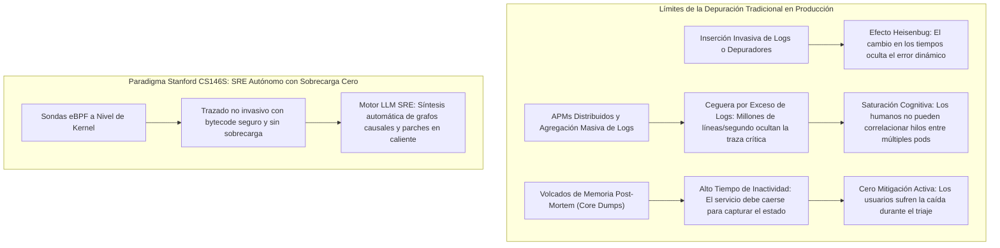
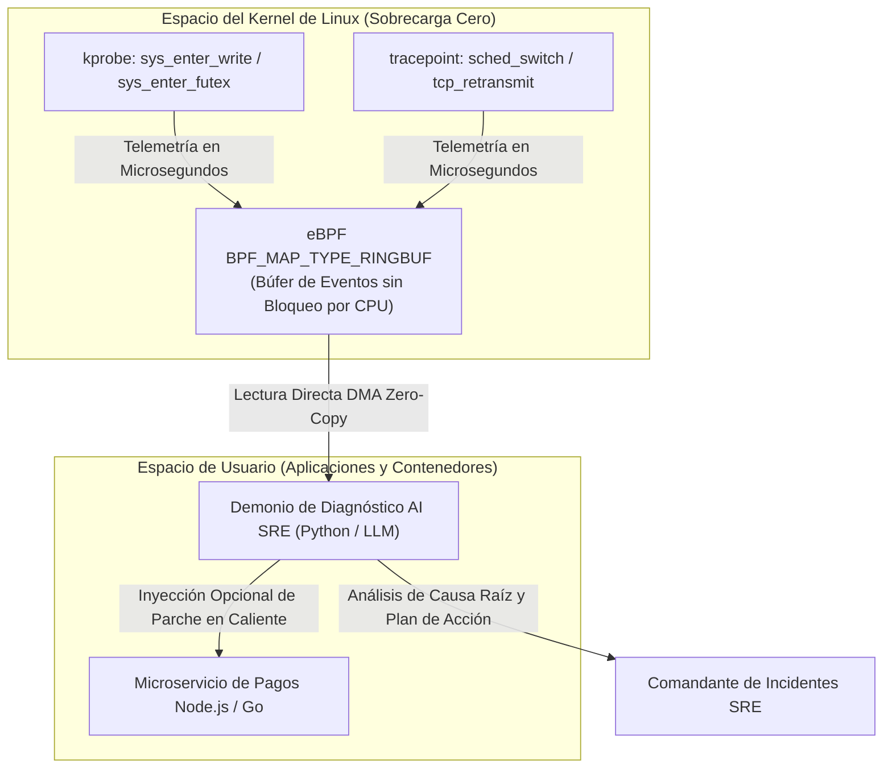

Bienvenidos a la 6ª clase de nuestra serie técnica sobre **CS146S de la Universidad de Stanford: El Desarrollador de Software Moderno (The Modern Software Developer)**.

En la lección previa, exploramos la orquestación de enjambres multiagente: la coordinación de LLMs Arquitectos, Implementadores y Críticos mediante flujos DAG estructurados para construir bases de código masivas. Sin embargo, incluso el software verificado con mayor rigor se enfrenta eventualmente a las caóticas demandas de los entornos de producción.

A las 3:00 AM, cuando un interbloqueo de concurrencia sutil congela un clúster de pagos distribuido o una consulta no indexada dispara la latencia a 12 segundos, los flujos de trabajo tradicionales de depuración colapsan. El análisis estático no puede predecir condiciones de carrera dinámicas, la inserción invasiva de registros (`printf`) provoca el **efecto Heisenbug** (alterando los tiempos de ejecución y ocultando el error), y las herramientas de telemetría distribuida ahogan a los ingenieros de confiabilidad (SRE) en gigabytes de ruido inútil.

En la clase de hoy, el cuerpo docente de Stanford presenta la frontera de la resiliencia autónoma del software: **Depuración Asistida por IA y Perfilado en Tiempo de Ejecución**. Combinando la potencia no invasiva y de sobrecarga cero de **eBPF (extended Berkeley Packet Filter)** con **Agentes de Diagnóstico SRE impulsados por LLMs**, los equipos de ingeniería pueden capturar estados de ejecución a nivel de kernel en tiempo real, aislar la causa raíz en minutos y sintetizar parches en caliente de forma autónoma.

{/* truncate */}

---

### 1. La Crisis de los Incidentes en Producción: Por Qué Falla la Depuración Tradicional

Cuando los microservicios de alto rendimiento fallan bajo estrés, los ingenieros enfrentan tres paradojas fundamentales de observabilidad:



1. **El Dilema del Heisenbug**: Agregar logs adicionales o acoplar depuradores interactivos (`gdb`) detiene hilos, altera el orden de adquisición de bloqueos (locks) y vacía las cachés de la CPU, haciendo que los errores de carrera desaparezcan durante la investigación.
2. **Diluvio de Telemetría vs. Ceguera Semántica**: Los sistemas modernos recopilan petabytes de trazas. Sin embargo, cuando un incidente dispara 45 alertas simultáneamente, los ingenieros pierden horas intentando averiguar cuál es la causa raíz primaria y cuáles son síntomas secundarios.
3. **La Brecha Semántica entre Kernel y Aplicación**: Un error de alto nivel como "HTTP 504 Gateway Timeout" no ofrece visibilidad sobre si el bloqueo real reside en el agotamiento del pool de hilos, la saturación del búfer TCP o retrasos en el vaciado de páginas sucias en la capa VFS de Linux.

---

### 2. La Revolución de eBPF: Observabilidad No Invasiva a Nivel de Kernel

Para erradicar el problema del Heisenbug, Stanford CS146S adopta **eBPF (extended Berkeley Packet Filter)**. eBPF es una tecnología que permite ejecutar programas en un entorno aislado (sandbox) y verificado directamente en el kernel de Linux sin necesidad de recompilar el kernel ni cargar módulos potencialmente peligrosos.



#### Ventajas Cruciales de eBPF para la Depuración con IA:
- **Sobrecarga Prácticamente Nula**: Los programas eBPF son verificados y compilados JIT a código máquina nativo, manteniendo el consumo de CPU por debajo del 1.5% bajo tráfico máximo.
- **Observabilidad Integral**: Enganchándose a `kprobes` (entradas a funciones del kernel), `kretprobes` (salidas), `uprobes` (símbolos en espacio de usuario) y filtros de sockets, supervisa llamadas al sistema y contenciones de hilos sin modificar una sola línea del código de la aplicación.
- **Búferes de Anillo sin Bloqueo**: Millones de eventos del kernel se transmiten al espacio de usuario mediante búferes libres de bloqueo (`BPF_MAP_TYPE_RINGBUF`), impidiendo que el monitoreo degrade el rendimiento de la aplicación.

---

### 3. Superando la Brecha Semántica: Alimentando a los Agentes LLM con Trazas del Kernel

Introducir volcados eBPF en bruto (punteros hexadecimales y marcas de tiempo en nanosegundos) en el contexto de un LLM saturaría inmediatamente los tokens y causaría alucinaciones severas.

Stanford CS146S formaliza un **Motor de Destilación de Telemetría en Dos Fases**:

1. **Agregación Determinista y Plegado de Gráficos de Llamadas (Flame-Graphs)**:
   - El demonio en espacio de usuario condensa las pilas de llamadas en formatos agregados ponderados (ej.: `process;thread;function_A;function_B;futex_wait 450ms`).
   - El análisis diferencial compara la distribución normal de trazas frente a la del incidente para aislar anomalías estadísticas.
2. **Generación de Hipótesis y Grafos Causales**:
   - El LLM recibe únicamente el delta refinado de la anomalía, el código fuente del microservicio y el estado actual de los pods.
   - Mediante **prompts de razonamiento Chain-of-Thought (CoT)**, el LLM mapea bloqueos de bajo nivel en el kernel hacia fallas en la lógica de negocio (ej.: agotamiento de conexiones de base de datos que bloquea los hilos de Node.js).

---

### 4. Implementación Práctica: Monitor eBPF y Pipeline de Mitigación con LLM en Python y C

A continuación se muestra el código funcional para capturar llamadas al sistema lentas mediante BCC y activar un agente SRE asíncrono con LLMs:

```python
# ebpf_ai_debugger.py - Pipeline de Observabilidad eBPF y Mitigación AI SRE
import asyncio
import json
from bcc import BPF
from pydantic import BaseModel, Field
from typing import List, Optional

# 1. Programa eBPF en lenguaje C para el Kernel
EBPF_PROGRAM = """
#include <uapi/linux/ptrace.h>
#include <linux/sched.h>

struct event_t {
    u32 pid;
    u64 latency_ns;
    char comm[TASK_COMM_LEN];
};

BPF_HASH(start_time, u32, u64);
BPF_PERF_OUTPUT(latency_events);

int trace_sys_enter_write(struct pt_regs *ctx) {
    u32 pid = bpf_get_current_pid_tgid() >> 32;
    u64 ts = bpf_ktime_get_ns();
    start_time.update(&pid, &ts);
    return 0;
}

int trace_sys_exit_write(struct pt_regs *ctx) {
    u32 pid = bpf_get_current_pid_tgid() >> 32;
    u64 *tsp = start_time.lookup(&pid);
    if (tsp == 0) return 0;

    u64 delta = bpf_ktime_get_ns() - *tsp;
    start_time.delete(&pid);

    // Reportar únicamente syscalls con estancamientos superiores a 50ms
    if (delta > 50000000) {
        struct event_t evt = {};
        evt.pid = pid;
        evt.latency_ns = delta;
        bpf_get_current_comm(&evt.comm, sizeof(evt.comm));
        latency_events.perf_submit(ctx, &evt, sizeof(evt));
    }
    return 0;
}
"""

class IncidentRemediationPlan(BaseModel):
    root_cause: str
    culprit_function: str
    confidence_score: float = Field(ge=0.0, le=1.0)
    remediation_script: str
    mitigation_strategy: str

class AIDiagnosticEngine:
    def __init__(self, llm_client):
        self.llm = llm_client

    async def diagnose_and_mitigate(self, event_data: dict, source_context: str) -> IncidentRemediationPlan:
        prompt = f"""
        [ALERTA DE DIAGNÓSTICO DE INCIDENTE]
        Telemetría del Kernel: El proceso '{event_data['comm']}' (PID: {event_data['pid']}) 
        experimentó un bloqueo severo en llamada al sistema: {event_data['latency_ms']:.2f} ms.
        
        Contexto del Código Fuente:
        {source_context}
        
        Determina la causa raíz y genera un plan estructurado en JSON con el parche de remediación.
        """
        response = await self.llm.generate_structured(prompt, schema=IncidentRemediationPlan)
        return response

class eBPFTelemetryMonitor:
    def __init__(self, ai_engine: AIDiagnosticEngine):
        self.bpf = BPF(text=EBPF_PROGRAM)
        self.bpf.attach_kprobe(event="__x64_sys_write", fn_name="trace_sys_enter_write")
        self.bpf.attach_kretprobe(event="__x64_sys_write", fn_name="trace_sys_exit_write")
        self.ai = ai_engine

    def handle_event(self, cpu, data, size):
        event = self.bpf["latency_events"].event(data)
        latency_ms = event.latency_ns / 1_000_000.0
        print(f"[ALERTA] Llamada write() en {event.comm} (PID: {event.pid}) tardó {latency_ms:.2f}ms!")
        
        # Disparo asíncrono al agente LLM SRE
        asyncio.create_task(self.ai.diagnose_and_mitigate(
            event_data={"comm": event.comm, "pid": event.pid, "latency_ms": latency_ms},
            source_context="// Código del controlador de pagos..."
        ))

    def start_polling(self):
        self.bpf["latency_events"].open_perf_buffer(self.handle_event)
        print("[MONITOR eBPF] Sondas activas. Monitoreando latencia de llamadas al sistema...")
        while True:
            self.bpf.perf_buffer_poll()
```

---

### 5. Conclusiones de la Clase 6 y Próximos Pasos

1. **La Observabilidad No Invasiva es Indispensable**: La depuración en producción debe sustentarse en sondas eBPF a nivel de kernel, eliminando el riesgo de alterar los tiempos de ejecución.
2. **Destilación de Telemetría Antes del LLM**: Condensar millones de eventos en deltas estadísticos y grafos de llamadas permite a los LLMs razonar con precisión sin sufrir alucinaciones.
3. **Autonomía Activa en SRE**: La combinación de eBPF e IA convierte la depuración de una autopsia forense tardía en una mitigación proactiva en tiempo real.

En la **Clase 7**, abordaremos la **Revisión de Código a Gran Escala: Linters Conscientes de AST, Análisis de Contaminación (Taint Analysis) y Revisores Autónomos de PRs con LLMs**.

---

### 📌 Resumen Ejecutivo (3 a 5 Líneas)
1. **Superación de la Crisis de Depuración**: Erradicación del efecto Heisenbug y la saturación por ruido de logs mediante el trazado no invasivo con eBPF en el kernel de Linux.
2. **Telemetría con Sobrecarga Cero**: Despliegue de sondas eBPF en kprobes con búferes de anillo sin bloqueo, capturando estancamientos en llamadas al sistema con un impacto inferior al 1.5% de CPU.
3. **Motor de Destilación Hacia LLMs**: Agregación de millones de eventos en anomalías de grafos de llamadas, resolviendo la brecha semántica entre el kernel y la lógica de la aplicación.
4. **Mitigación Autónoma de Incidentes**: Arquitectura de un agente AI SRE que analiza la telemetría en tiempo real, aísla condiciones de carrera y genera parches en caliente para resolver caídas de producción.

### Referencias y Material de Stanford CS146S
- **Curso**: Stanford CS146S (The Modern Software Developer), Fall 2026.
- **Institución**: Departamento de Ciencias de la Computación, Universidad de Stanford.
- **Tecnologías Relacionadas**: Linux eBPF/BCC, bpftrace, Cilium, Pixie, OpenTelemetry, LangChain SRE.