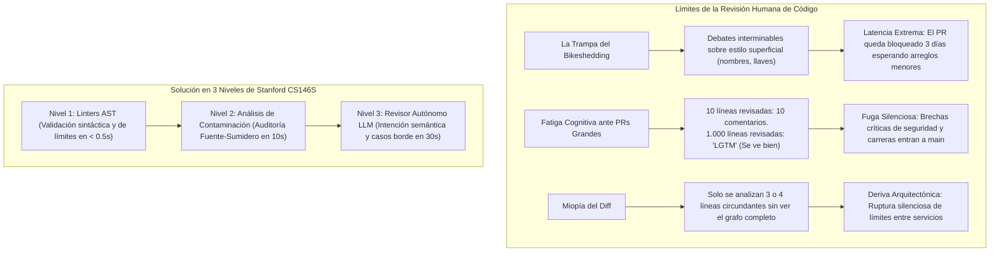
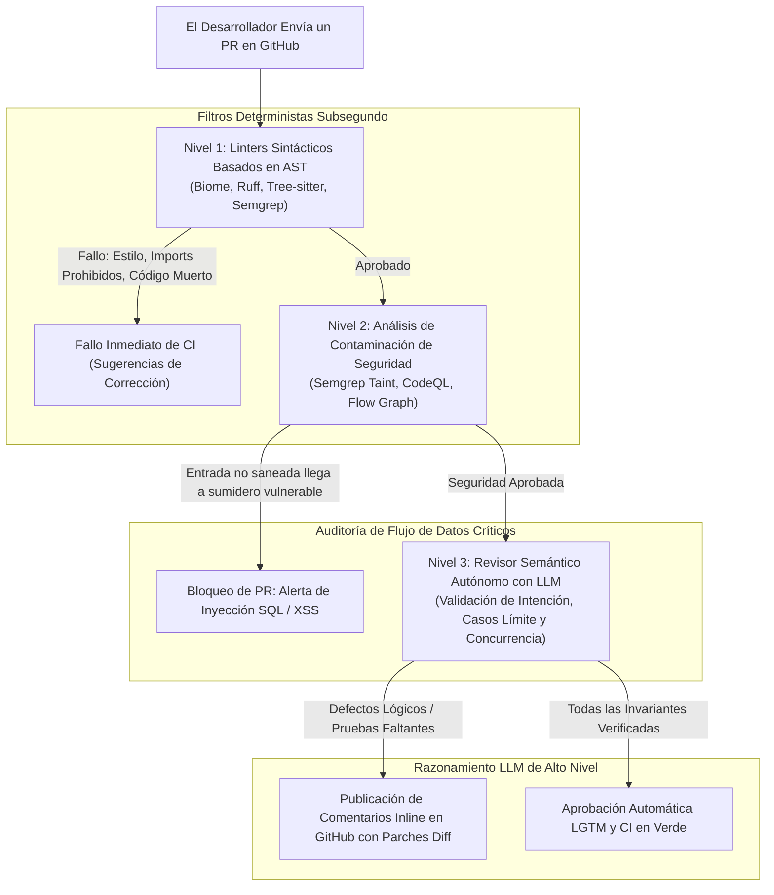

Bienvenidos a la 7ª clase de nuestra serie técnica sobre **CS146S de la Universidad de Stanford: El Desarrollador de Software Moderno (The Modern Software Developer)**.

En la lección previa, abordamos los incidentes de producción en tiempo de ejecución utilizando trazado eBPF y agentes de diagnóstico AI SRE. No obstante, como todo líder de ingeniería experimentado sabe, **el error más rentable es aquel que nunca llega a fusionarse (merge) en la rama principal**.

En organizaciones de software de alta velocidad, la revisión de código en los Pull Requests (PR) representa el guardián fundamental de la calidad, la seguridad y la arquitectura. Sin embargo, a medida que los equipos crecen, la revisión humana entre pares degenera inevitablemente en un cuello de botella paralizante. Los ingenieros sénior dedican entre 15 y 20 horas semanales a revisar diffs, quemando energía mental en detalles triviales de estilo (sangrías, nombres de variables, orden de imports) mientras sufren de **fatiga de revisión** ante cambios masivos de más de 1.000 líneas. Inevitablemente, terminan aprobando con un simple "LGTM" cambios que introducen sutiles condiciones de carrera, inyecciones SQL y violaciones de límites arquitectónicos.

En la clase de hoy, el cuerpo docente de Stanford presenta la arquitectura de la **Revisión Automatizada de Código a Escala**. Al construir una jerarquía en tres niveles que combina **linters sobre el Árbol de Sintaxis Abstracta (AST)**, **análisis estático de contaminación de seguridad (Taint Analysis)** y **revisores semánticos autónomos con LLMs**, los equipos de ingeniería pueden eliminar el 90% del trabajo manual de revisión al tiempo que disparan la detección de vulnerabilidades críticas.

{/* truncate */}

---

### 1. La Crisis de la Revisión de Código: Límites del Enfoque Humano

¿Por qué la revisión humana tradicional colapsa cuando un repositorio abarca decenas de equipos distribuidos?

Los investigadores de Stanford identifican tres modos de falla fundamentales:



1. **La Trampa del Bikeshedding**: Los humanos tienden psicológicamente a comentar sobre detalles obvios y superficiales en lugar de analizar invariantes distribuidos complejos. Esto genera fricciones innecesarias y dispara el tiempo de cierre de los PRs.
2. **Fatiga de Revisión y el Umbral de las 400 Líneas**: Los estudios de ingeniería de software demuestran que la precisión para detectar defectos cae exponencialmente cuando un PR supera las 400 líneas. Frente a 1.000 líneas, los revisores sufren agotamiento cognitivo y aprueban de forma ciega.
3. **Miopía del Diff**: La vista estándar de GitHub solo muestra unas pocas líneas de contexto alrededor del diff. El cerebro humano no puede rastrear si un parámetro modificado rompe un contrato cinco capas arriba en otro microservicio.

---

### 2. La Arquitectura de Revisión Automatizada en Tres Niveles

Para erradicar la monotonía y establecer barreras de calidad infranqueables, Stanford CS146S formaliza la **Jerarquía de Revisión en 3 Niveles**:



#### Desglose de Responsabilidades:
1. **Nivel 1: Linters Sintácticos Basados en AST (Tiempo: < 500ms)**
   - **Herramientas**: Tree-sitter, Biome, Ruff, Semgrep OSS.
   - **Responsabilidad**: Validación estructural del AST, formateo, eliminación de código muerto y cumplimiento de límites de arquitectura (ej.: impedir que componentes UI importen modelos ORM de base de datos).
   - **Regla de Oro**: **Los humanos nunca deben comentar sobre aspectos verificables por un linter.** Si surge un comentario de estilo en una revisión humana, se considera una falla del equipo por no haberlo codificado en el Nivel 1.
2. **Nivel 2: Análisis de Contaminación entre Procedimientos (Tiempo: 5s – 30s)**
   - **Herramientas**: Semgrep Pro, CodeQL, motores de flujo de datos estáticos.
   - **Responsabilidad**: Rastrear datos de usuario no confiables ("Fuentes" como parámetros HTTP o headers) a través del grafo de llamadas hasta puntos de ejecución críticos ("Sumideros" como llamadas a `exec()` o consultas SQL directas).
   - **Cumplimiento**: Si una ruta de datos carece de una función de saneamiento (Sanitizer) matemáticamente probada, el PR se bloquea de inmediato.
3. **Nivel 3: Revisor Semántico Autónomo con LLM (Tiempo: 15s – 60s)**
   - **Motores**: Claude 3.5 Sonnet, GPT-4o, LLMs especializados.
   - **Responsabilidad**: Evaluación de la intención de negocio, condiciones de carrera, compatibilidad hacia atrás y suficiencia de pruebas unitarias para casos extremos.
   - **Salida**: Generación de bloques de sugerencia inline ejecutables en GitHub (````suggestion`) que el desarrollador puede incorporar con un solo clic.

---

### 3. Fundamentos Matemáticos del Análisis de Contaminación (Taint)

En el Nivel 2, ¿cómo garantiza matemáticamente el analizador estático que una entrada externa no es explotable?

Stanford CS146S formaliza el rastreo de contaminación mediante el **Análisis de Flujo de Datos en Retículos Acotados**:

$$\mathcal{S} \xrightarrow{\text{Dataflow Edge } e} \mathcal{T} \quad \text{where } \text{Taint}(\mathcal{T}) = \begin{cases} \text{Clean} & \text{if } f_{\text{sanitizer}}(x) \in \text{Path}(\mathcal{S}, \mathcal{T}) \\ \text{Tainted} & \text{otherwise} \end{cases}$$

```mermaid
flowchart LR
    Source["Fuente (No Confiable)<br/>req.body.searchQuery"] -->|Propagación| VarA["let query = searchQuery.trim()"]
    VarA -->|Flujo de Datos| Sanitizer{"¿Existe Sanitizer?<br/>ej.: db.escape()"}
    
    Sanitizer -->|No (Concatenación Directa)| Sink["Sumidero (Punto Vulnerable)<br/>db.raw('SELECT * FROM users WHERE name = ' + query)"]
    Sink --> Alert["ALERTA CRÍTICA: Vulnerabilidad de Inyección SQL"]
    
    Sanitizer -->|Sí (Enlace Parametrizado)| SafeSink["Sumidero Seguro<br/>db.query('SELECT * FROM users WHERE name = $1', [query])"]
```

#### Aumento con LLMs para el Análisis de Contaminación:
Los analizadores estáticos convencionales fallan ante **sanitizers personalizados** (ej.: regex complejas propias), arrojando molestos falsos positivos. En los pipelines de Stanford, cuando se detecta una ruta ambigua, se despacha el fragmento a un LLM para evaluar: *"¿Esta función de saneamiento neutraliza eficazmente la inyección SQL en cualquier codificación Unicode?"*

---

### 4. Implementación Práctica: Bot Autónomo de Revisión de PRs en GitHub

A continuación se muestra el código funcional de un bot de revisión de PRs en Python que procesa diffs, ejecuta auditorías de contaminación y consulta a un LLM para emitir sugerencias inline:

```python
# pr_review_bot.py - Motor Autónomo de Revisión de Pull Requests en 3 Niveles
import asyncio
import os
from typing import List, Optional
from pydantic import BaseModel, Field

class InlineReviewComment(BaseModel):
    file_path: str
    line_number: int
    severity: str = Field(pattern="^(CRITICAL|WARNING|SUGGESTION)$")
    critique: str
    suggested_diff: Optional[str] = None

class PRReviewSummary(BaseModel):
    pr_id: int
    verdict: str = Field(pattern="^(APPROVE|REQUEST_CHANGES|COMMENT)$")
    architectural_summary: str
    inline_comments: List[InlineReviewComment]

class AutonomousPRReviewer:
    def __init__(self, llm_client, semgrep_runner):
        self.llm = llm_client
        self.semgrep = semgrep_runner

    async def review_pull_request(self, pr_id: int, pr_diff: str, repo_context: str) -> PRReviewSummary:
        print(f"[PR-BOT] Iniciando revisión automática del PR #{pr_id}...")

        # Paso 1: Ejecutar Nivel 1 y Nivel 2 con Semgrep (AST + Taint)
        print("[PR-BOT] Ejecutando análisis de AST y contaminación de seguridad...")
        taint_findings = await self.semgrep.run_taint_audit(pr_diff)
        
        # Paso 2: Configurar prompt estructurado para el Nivel 3 (LLM)
        system_prompt = """
        Eres un Arquitecto Principal de Software realizando una revisión rigurosa en GitHub.
        Sigue la doctrina de Stanford CS146S:
        1. Ignora el estilo, espaciado y formato menor (ya cubiertos por linters).
        2. Analiza condiciones de carrera, estados nulos no controlados, regresiones de rendimiento y ruptura de límites arquitectónicos.
        3. Para cada defecto, proporciona un bloque de sugerencia inline con el diff de reemplazo directo.
        """

        user_prompt = f"""
        [PULL REQUEST #{pr_id} DIFF]
        {pr_diff}

        [HALLAZGOS DE ANÁLISIS DE CONTAMINACIÓN]
        {taint_findings}

        [CONTEXTO DE ARQUITECTURA DEL REPOSITORIO]
        {repo_context}

        Evalúa los cambios y devuelve un JSON estructurado según PRReviewSummary.
        """

        print("[PR-BOT] Ejecutando revisión semántica con LLM...")
        review_result: PRReviewSummary = await self.llm.generate_structured(
            system_prompt=system_prompt,
            user_prompt=user_prompt,
            schema=PRReviewSummary
        )

        return review_result

    def post_to_github(self, review: PRReviewSummary):
        """Publica los comentarios y el veredicto en la API de GitHub."""
        print(f"\n================ [VEREDICTO GITHUB PR #{review.pr_id}: {review.verdict}] ================")
        print(f"Resumen Arquitectónico: {review.architectural_summary}\n")
        for comment in review.inline_comments:
            print(f"[{comment.severity}] {comment.file_path}:{comment.line_number}")
            print(f"Crítica: {comment.critique}")
            if comment.suggested_diff:
                print("Sugerencia de Reemplazo:")
                print(comment.suggested_diff)
            print("-" * 60)
```

---

### 5. Conclusiones de la Clase 7 y Próximos Pasos

1. **La Máquina Debe Revisar lo Trivial**: Las reglas de formato y dependencias deben validarse de forma subsegundo mediante linters AST en el Nivel 1.
2. **Defensa Rigurosa mediante Análisis de Contaminación**: Asegurar el bloqueo de vulnerabilidades de inyección antes del merge mediante análisis de retículos matemáticos en el Nivel 2.
3. **Elevación de los LLMs a Socios Arquitectónicos**: Emplear a los LLMs para certificar la lógica de negocio, verificar la seguridad concurrente y suministrar parches de código listos para aplicar.

En la **Clase 8**, abordaremos **Arquitectura de Software Nativa de IA y Refactorización: Desacoplamiento de Monolitos, Deuda Semántica y Migraciones Masivas Autónomas**.

---

### 📌 Resumen Ejecutivo (3 a 5 Líneas)
1. **Resolución del Cuello de Botella en PRs**: Eliminación del bikeshedding superficial y la fatiga en cambios masivos mediante una jerarquía de revisión automatizada en 3 niveles.
2. **Control AST y Análisis de Contaminación**: Automatización de sintaxis y arquitectura en menos de un segundo, bloqueando matemáticamente vulnerabilidades de inyección mediante flujos Fuente-Sumidero.
3. **Revisión Semántica con LLMs**: Despliegue de modelos de lenguaje para razonar sobre lógica de negocio, concurrencia y generación de diffs inline ejecutables en GitHub.
4. **Aceleración de la Velocidad de Ingeniería**: Reducción de hasta un 70% en los tiempos de merge de PRs con un aumento sustancial en la captura de fallas críticas.

### Referencias y Material de Stanford CS146S
- **Curso**: Stanford CS146S (The Modern Software Developer), Fall 2026.
- **Departamento**: Departamento de Ciencias de la Computación, Universidad de Stanford.
- **Herramientas Relacionadas**: Tree-sitter, Semgrep, CodeQL, Biome, GitHub Copilot PR Reviewer.
