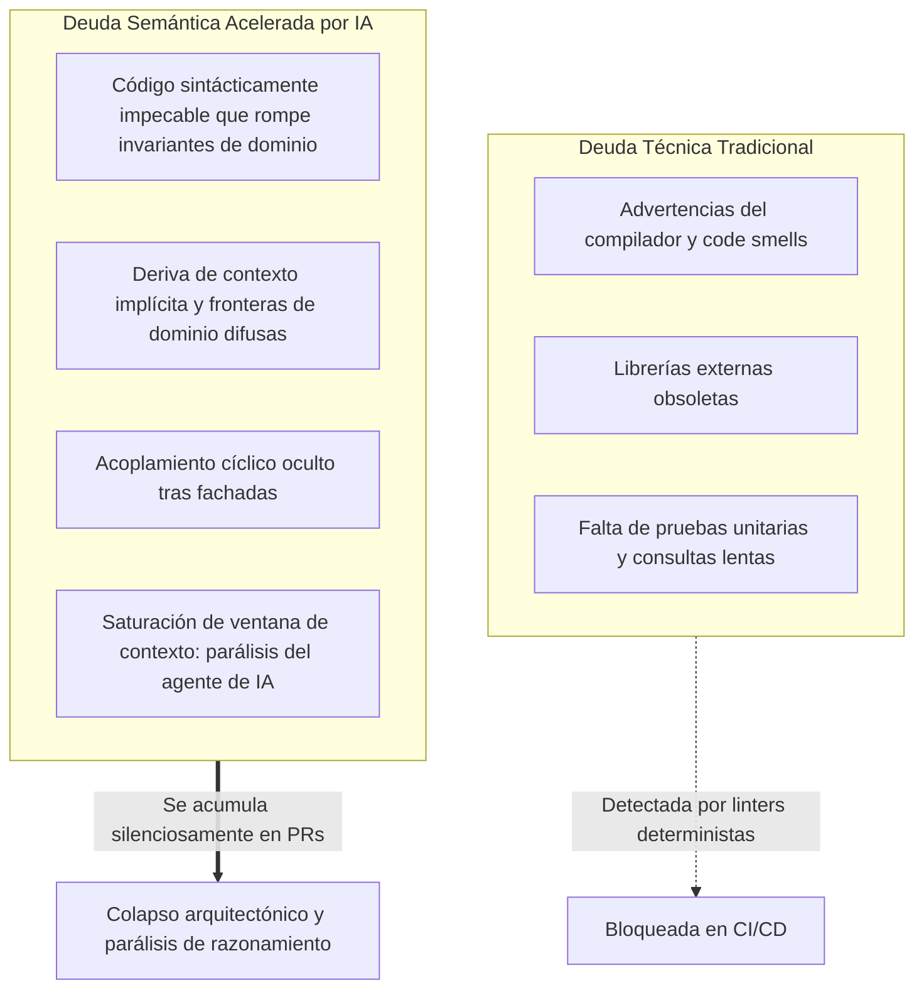

Bienvenidos a la octava entrega de nuestra serie técnica que analiza **Stanford CS146S: The Modern Software Developer (El Desarrollador de Software Moderno)**.

Tras abordar la ingeniería de prompts para LLMs de código (Lección 2), el Model Context Protocol (MCP) (Lección 3), los arneses de prueba autorreparables (Lección 4), la orquestación de enjambres multi-agente (Lección 5), la depuración en tiempo de ejecución con eBPF (Lección 6) y la revisión automatizada de PR con linters AST y análisis de taint (Lección 7), la **Lección 8** aborda el dilema arquitectónico fundamental: **¿Cómo diseñamos arquitecturas de software que los agentes autónomos de IA puedan navegar, comprender y refactorizar sin colapsar bajo una complejidad inmanejable?**

A medida que los equipos aceleran la generación de código con agentes de IA, los monolitos heredados con estados mutables globales y dependencias cíclicas saturan la ventana de contexto de los LLMs. En esta sesión, Stanford formaliza el concepto de **Deuda Semántica (Semantic Debt)** y establece los **Cuatro Invariantes de la Arquitectura Nativa para IA**.

{/* truncate */}

---

### 1. La Paradoja de la Velocidad: Deuda Técnica vs. Deuda Semántica

La ingeniería tradicional evalúa la salud del código a través de la **Deuda Técnica**: dependencias obsoletas, consultas de base de datos ineficientes y falta de cobertura de pruebas.

Sin embargo, la velocidad desenfrenada de la IA introduce una falla mucho más perniciosa: la **Deuda Semántica (Semantic Debt)**.



#### ¿Qué es la Deuda Semántica?
La deuda semántica surge cuando el código generado por un LLM es **sintácticamente perfecto y supera las pruebas unitarias locales, pero viola los invariantes globales del sistema, crea acoplamientos implícitos y fragmenta la lógica de negocio**:
1. **Saturación del Contexto**: Un agente no puede razonar sobre una modificación simple porque el módulo está acoplado cíclicamente con múltiples subsistemas distantes.
2. **Fragmentación Conceptual**: Múltiples desarrolladores asistidos por IA introducen implementaciones divergentes para el mismo concepto de negocio.
3. **Abstracciones Fantasma**: Los LLMs introducen capas intermedias superficiales que satisfacen el prompt inmediato pero aumentan la entropía del grafo de llamadas.

---

### 2. Los Cuatro Invariantes de la Arquitectura Nativa para IA

Stanford CS146S define la **Arquitectura Nativa para IA** como un sistema **diseñado desde el primer día para ser inspeccionado, modificado y verificado por agentes autónomos de IA**:

1. **Presupuesto Estricto de Contexto**: Cada módulo o contexto delimitado debe ser completamente comprensible dentro de un presupuesto de **< 32k tokens**, incluyendo sus interfaces, lógica y pruebas.
2. **Contratos Explícitos y Legibles por Máquina**: Uso sistemático de esquemas estrictos (Pydantic, Zod, Protobuf, OpenAPI 3.1) con precondiciones e invariantes formales.
3. **Aislamiento Hexagonal (Puertos y Adaptadores)**: Separación absoluta entre la lógica de dominio pura (libre de efectos secundarios) y los adaptadores de I/O (bases de datos, colas de mensajes y APIs externas).
4. **Arneses de Pruebas de Caracterización (Golden Masters)**: Conjuntos de pruebas empíricas que capturan miles de instantáneas de entrada y salida reales para garantizar cero desviaciones semánticas durante la refactorización autónoma.

---

### 3. Descomposición de Monolitos Guiada por AST

En lugar de reescrituras manuales de alto riesgo, Stanford propone un enfoque automatizado basado en el árbol de sintaxis abstracta (**AST**):
- **Construcción del Grafo de Dependencias**: Extracción del grafo de llamadas y detección de componentes fuertemente conexos (SCC) mediante el algoritmo de Tarjan para romper dependencias cíclicas.
- **Generación de Fachadas de Interfaz**: Creación de adaptadores fuertemente tipados que encapsulan la funcionalidad a desacoplar.
- **Ejecución en Sombra (Shadow Dual-Run)**: Replicación de tráfico de producción para ejecutar concurrentemente la ruta monolítica y la modular, validando la equivalencia estricta antes de la migración definitiva.

---

### 4. Implementación Ejecutable: Analizador de Dependencias AST

```python
"""
ast_dependency_analyzer.py
Stanford CS146S - Herramienta de Refactorización Arquitectónica Autónoma
Analiza el AST de un repositorio Python, mapea grafos de dependencia,
detecta acoplamientos cíclicos mediante el algoritmo SCC de Tarjan y
evalúa presupuestos de contexto para agentes de IA.
"""

import ast
import os
import sys
from typing import Dict, Set, List
from collections import defaultdict


class DependencyVisitor(ast.NodeVisitor):
    def __init__(self, current_module: str):
        self.current_module = current_module
        self.dependencies: Set[str] = set()

    def visit_Import(self, node: ast.Import):
        for alias in node.names:
            self.dependencies.add(alias.name.split('.')[0])
        self.generic_visit(node)

    def visit_ImportFrom(self, node: ast.ImportFrom):
        if node.module:
            self.dependencies.add(node.module.split('.')[0])
        self.generic_visit(node)


class CodebaseGraphAnalyzer:
    def __init__(self, root_dir: str):
        self.root_dir = root_dir
        self.graph: Dict[str, Set[str]] = defaultdict(set)
        self.module_token_estimates: Dict[str, int] = {}

    def scan_codebase(self) -> None:
        for root, _, files in os.walk(self.root_dir):
            for file in files:
                if file.endswith('.py') and not file.startswith('__'):
                    filepath = os.path.join(root, file)
                    rel_path = os.path.relpath(filepath, self.root_dir)
                    module_name = rel_path.replace(os.path.sep, '.').replace('.py', '')

                    try:
                        with open(filepath, 'r', encoding='utf-8') as f:
                            content = f.read()
                            self.module_token_estimates[module_name] = len(content) // 4
                            tree = ast.parse(content, filename=filepath)

                        visitor = DependencyVisitor(module_name)
                        visitor.visit(tree)

                        for dep in visitor.dependencies:
                            if dep != module_name and os.path.exists(os.path.join(self.root_dir, dep + '.py')):
                                self.graph[module_name].add(dep)
                    except Exception as err:
                        print(f"Aviso: Error al analizar {filepath}: {err}", file=sys.stderr)

    def find_strongly_connected_components(self) -> List[List[str]]:
        index = 0
        indices: Dict[str, int] = {}
        lowlinks: Dict[str, int] = {}
        on_stack: Dict[str, bool] = defaultdict(bool)
        stack: List[str] = []
        sccs: List[List[str]] = []

        nodes = list(self.graph.keys())
        for node in self.graph:
            for dep in self.graph[node]:
                if dep not in nodes:
                    nodes.append(dep)

        def strongconnect(node: str):
            nonlocal index
            indices[node] = index
            lowlinks[node] = index
            index += 1
            stack.append(node)
            on_stack[node] = True

            for successor in self.graph.get(node, []):
                if successor not in indices:
                    strongconnect(successor)
                    lowlinks[node] = min(lowlinks[node], lowlinks[successor])
                elif on_stack[successor]:
                    lowlinks[node] = min(lowlinks[node], indices[successor])

            if lowlinks[node] == indices[node]:
                scc = []
                while True:
                    w = stack.pop()
                    on_stack[w] = False
                    scc.append(w)
                    if w == node:
                        break
                if len(scc) > 1:
                    sccs.append(scc)

        for node in nodes:
            if node not in indices:
                strongconnect(node)

        return sccs

    def evaluate_ai_native_readiness(self, max_context_tokens: int = 8000) -> None:
        print("=" * 70)
        print("STANFORD CS146S - INFORME DE PREPARACIÓN DE ARQUITECTURA PARA IA")
        print("=" * 70)

        sccs = self.find_strongly_connected_components()
        if sccs:
            print(f"⚠️  ADVERTENCIA: Se detectaron {len(sccs)} ciclo(s) de dependencia mutua.")
            for idx, cycle in enumerate(sccs, 1):
                print(f"   Grupo #{idx}: {' <---> '.join(cycle)}")
        else:
            print("✅ Arquitectura Limpia: Cero dependencias cíclicas detectadas.")

        print("\n📊 Análisis de Presupuesto de Contexto (< 8,000 tokens por módulo):")
        oversized = []
        for mod, tokens in sorted(self.module_token_estimates.items(), key=lambda x: x[1], reverse=True):
            status = "✅ VÁLIDO" if tokens <= max_context_tokens else "❌ EXCEDIDO (Riesgo de Deuda Semántica)"
            print(f" - {mod:<35} : ~{tokens:>5} tokens [{status}]")
            if tokens > max_context_tokens:
                oversized.append((mod, tokens))

        if oversized:
            print(f"\n🚨 Recomendación: {len(oversized)} módulo(s) exceden el presupuesto de contexto de un prompt.")
        print("=" * 70)


if __name__ == "__main__":
    analyzer = CodebaseGraphAnalyzer(os.path.dirname(os.path.abspath(__file__)))
    analyzer.scan_codebase()
    analyzer.evaluate_ai_native_readiness()
```

---

### 5. Conclusiones y Próxima Lección

1. **Evite la trampa de la velocidad**: La generación rápida sin invariantes arquitectónicos conduce a la Deuda Semántica y a la parálisis cognitiva del LLM.
2. **Diseñe para la cognición del agente**: Establezca presupuestos estrictos de contexto (< 32k tokens) y aísle efectos secundarios en núcleos hexagonales.
3. **Descomponga con grafos AST**: Utilice análisis de sintaxis abstracta y ejecución en sombra para desmantelar monolitos de manera segura y sin tiempo de inactividad.

En la **Lección 9**, exploraremos el **Desarrollo Dirigido por Pruebas Autónomo (ATDD) y Verificación Formal: Síntesis de restricciones con resolvedores Z3 SMT y pruebas basadas en propiedades para sistemas creados por LLMs**.

---

### 📌 Resumen Ejecutivo de 3–5 Líneas
1. **Identificación de la Deuda Semántica**: Análisis de cómo la generación de código con IA degrada los invariantes del sistema y satura las ventanas de contexto.
2. **Los 4 Invariantes Nativos de IA**: Definición de presupuestos estrictos de contexto, contratos de esquema tipados, aislamiento hexagonal y arneses Golden Master.
3. **Desacoplamiento Automatizado con AST**: Estrategia de partición de monolitos mediante grafos de llamada AST, detección de ciclos de Tarjan y verificación en sombra.
4. **Herramienta Práctica de Diagnóstico**: Código Python ejecutable para auditar dependencias, ciclos y presupuestos de tokens de cualquier repositorio.

### Referencias
- **Curso**: Stanford CS146S (The Modern Software Developer), Otoño 2026.
- **Institución**: Departamento de Ciencias de la Computación, Universidad de Stanford.
