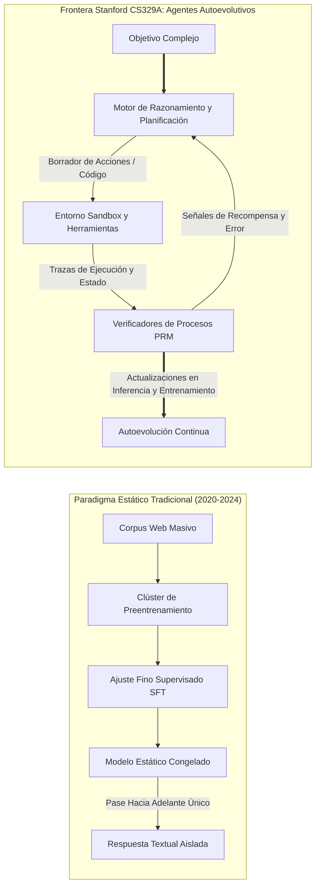

Bienvenidos al desglose técnico integral del curso **CS329A de la Universidad de Stanford: Self-Improving AI Agents (Agentes de IA Autoevolutivos, Otoño 2025)**.

Durante los últimos cuatro años, el panorama de la inteligencia artificial ha estado dominado por un dogma potente y omnipresente: *preentrenar modelos cada vez más grandes sobre corpus de texto colosales produce capacidades cognitivas crecientes de manera predecible*. Si bien este paradigma impulsó la revolución de la IA generativa moderna —dando origen a sistemas como GPT-4, Claude 3.5 y Gemini—, la frontera de la investigación en aprendizaje automático ha alcanzado un punto de inflexión decisivo.

Los modelos fundacionales estáticos (Static Foundation Models), sin importar cuán astronómico sea su recuento de parámetros, poseen limitaciones intrínsecas insalvables: son predictores pasivos y autorregresivos del siguiente token que operan en un régimen de bucle abierto (open-loop). Una vez que sus pesos quedan congelados tras el entrenamiento, no pueden asignar dinámicamente más cómputo a problemas difíciles, no pueden verificar de forma autónoma la veracidad de sus deducciones, ni pueden corregir iterativamente sus propios errores mediante retroalimentación ambiental.



Stanford CS329A aborda la pregunta cardinal de la próxima década de la IA: **¿Cómo construimos agentes de software que no se limiten a generar texto, sino que inspeccionen, verifiquen, planifiquen y perfeccionen continuamente su propio razonamiento y código?**

En esta conferencia inaugural, deconstruimos la trayectoria evolutiva desde los LLMs fundacionales hacia los sistemas agénticos, formalizamos la matemática de las leyes de escala y la asignación de cómputo en inferencia, analizamos los cuatro arquetipos de flujos de trabajo agénticos y aislamos el cuello de botella más crítico de la inteligencia autónoma: la **Brecha Generador-Verificador (Generator-Verifier Gap)**.

{/* truncate */}

---

### 1. La Trayectoria Evolutiva: Cómo Llegamos Aquí

Para comprender hacia dónde se dirigen los agentes autoevolutivos, debemos examinar las tres fases históricas del desarrollo de modelos fundacionales:

```
  Fase 1: Preentrenamiento (Predicción Autorregresiva No Supervisada)
  [Scraping Web / Billones de Tokens] ───> LLM Base (Completador Probabilístico)
                                                   │
  Fase 2: Alineación Posterior                     ▼
  [Pares Seleccionados Prompt-Respuesta] ─> SFT (Seguidor de Instrucciones)
  [Preferencias Humanas (RLHF / DPO)]   ─> Chatbot Conversacional Alineado
                                                   │
  Fase 3: Frontera CS329A                          ▼
  [Feedback de Ejecución + Verificación PRM] ──> Agente Autónomo Autoevolutivo
```

#### Fase 1: Preentrenamiento No Supervisado (Unsupervised Pre-Training)
Un modelo de lenguaje base se optimiza sobre billones de tokens minimizando la pérdida de Máxima Verosimilitud (MLE):
```text
L_MLE(θ) = - ∑ log P_θ(x_i | x_{1:i-1})
```
Aunque este objetivo fuerza al modelo a comprimir sintaxis, conocimiento fáctico y relaciones semánticas en cientos de miles de millones de pesos, el modelo base sigue siendo un imitador probabilístico sin restricciones. Ante la pregunta *"¿Cuál es la capital de Francia?"*, tiene tantas probabilidades de responder correctamente como de continuar el texto con *"¿Cuál es la capital de Alemania?"*, dado que ambas secuencias coexisten habitualmente en internet.

#### Fase 2: Ajuste por Instrucciones y RLHF (La "Receta ChatGPT")
Para transformar un completador descontrolado en un asistente interactivo útil, la industria consolidó una canalización en dos etapas:
1. **Ajuste Fino Supervisado (SFT):** Entrenamiento sobre demostraciones de alta calidad para dotar al modelo de una personalidad cooperativa.
2. **Aprendizaje por Refuerzo con Retroalimentación Humana (RLHF) / DPO:** Optimización contra un modelo de recompensa `r_ψ(x, y)` que aproxima las preferencias humanas:
```text
max_θ E_{(x, y) ~ D} [ r_ψ(x, y) ] - β · D_KL( π_θ(y | x) || π_ref(y | x) )
```
Si bien RLHF resolvió la docilidad conversacional y la seguridad, no dotó a los modelos de verdadera autonomía de resolución de problemas. Un chatbot alineado continúa generando su salida en una única pasada secuencial sin verificación activa ni interacción con herramientas.

#### Fase 3: La Frontera CS329A — Bucles Agénticos Autónomos
Los agentes autoevolutivos rompen las cadenas del pase hacia adelante único. Al acoplar herramientas externas (compiladores, navegadores, entornos REPL de Python), jerarquías de memoria estructurada y bucles de verificación automatizados, el sistema se transforma en un agente activo que observa el entorno, ejecuta acciones concretas, evalúa estados intermedios y refina sus hipótesis hasta alcanzar una solución formalmente válida.

---

### 2. Las Matemáticas de las Leyes de Escala: Entrenamiento vs. Inferencia

La piedra angular del aprendizaje automático contemporáneo es la **Hipótesis del Escalado (Scaling Hypothesis)**. En 2020, Kaplan et al. (OpenAI) y posteriormente Hoffmann et al. (Chinchilla, 2022) demostraron que la pérdida de entropía cruzada $L$ de un modelo autorregresivo sigue una ley de potencias respecto al presupuesto de cómputo C, los parámetros N y los tokens de entrenamiento D:

```text
L(N, D) = E + A / N^α + B / D^β
```

donde E representa la entropía irreducible del lenguaje natural, A y B son coeficientes de escala, y α ≈ 0.34, β ≈ 0.28 son exponentes empíricos.

```
Pérdida de Entropía Cruzada L
 ▲
 │ ╲  10^21 FLOPs (Era GPT-2)
 │  ╲
 │   ╲  10^23 FLOPs (Era GPT-3)
 │    ╲
 │     ╲  10^25 FLOPs (Era GPT-4)
 │      └─── Muro del Preentrenamiento (Agotamiento de datos y límites energéticos)
 └─────────────────────────────────────────────────────────────►
                       Presupuesto de Cómputo C (FLOPs)
```

No obstante, el escalado del preentrenamiento enfrenta restricciones físicas e industriales severas:
- **Agotamiento de Datos:** Se proyecta que los textos de alta calidad redactados por humanos en internet se consumirán por completo en esta década.
- **Costos de Capital y Densidad Eléctrica:** Clústeres que superen los 10²⁶ FLOPs demandan subestaciones eléctricas dedicadas de escala gigavatio e inversiones de cientos de millones de dólares.

#### La Segunda Frontera: Escalado de Cómputo en Tiempo de Inferencia
En lugar de invertir millones en reentrenar parámetros estáticos, **¿podemos desbloquear una inteligencia superior asignando más cómputo en el instante de la inferencia?**

Cuando un experto humano aborda una demostración matemática o un desafío de ingeniería de software, no redacta la solución definitiva en un flujo continuo y perfecto; formula hipótesis, prueba lemas intermedios, identifica caminos sin salida y retrocede (backtracking).

El **Escalado en Tiempo de Inferencia (Inference-Time Compute Scaling)** distribuye los FLOPs de prueba a través de tres dimensiones fundamentales:
1. **Muestreo Repetido (Best-of-N / Hipótesis de los Grandes Monos del Lenguaje):** Generar N trayectorias candidatas desde la política π_θ y seleccionar la óptima mediante un verificador. La probabilidad de obtener al menos una respuesta correcta sigue la métrica `Pass@k`:
```text
Pass@k = E[ 1 - C(n - c, k) / C(n, k) ]
```
donde n es el total de muestras y c es el recuento de trayectorias exitosas.
2. **Verificación Paso a Paso (PRM vs. ORM):** Los Modelos de Recompensa por Resultado (ORM) solo califican la respuesta final `r(x, y)`, imposibilitando aislar errores intermedios. Los Modelos de Recompensa de Procesos (PRM) asignan una recompensa escalar `r_t = R(x, y_{1:t})` a cada paso individual, permitiendo una asignación de crédito precisa.
3. **Algoritmos de Búsqueda en Árbol (MCTS, Beam Search):** Explorar el grafo combinatorio de razonamiento mediante Búsqueda en Árbol de Monte Carlo, balanceando la explotación de estados intermedios prometedores y la exploración de nuevas rutas.

Tal como lo demuestran modelos pioneros (OpenAI o1, DeepSeek-R1), multiplicar el cómputo de inferencia por 100× o 1,000× produce saltos cualitativos en competencias matemáticas (IMO) y de software (SWE-bench) que superan el simple ensanchamiento de parámetros brutos.

---

### 3. Los Cuatro Arquetipos Canónicos de Flujos de Trabajo Agénticos

Al diseñar sistemas de IA autónomos, confiar en un solo prompt suele fracasar por acumulación de varianza estocástica. Stanford CS329A formaliza las arquitecturas en cuatro patrones modulares:

```mermaid
flowchart TD
    subgraph Patron1 ["1. Encadenamiento de Prompts (Prompt Chaining)"]
        P1_In[Entrada de Tarea] --> P1_M1[Modelo Paso 1]
        P1_M1 -->|Salida Intermedia| P1_M2[Modelo Paso 2]
        P1_M2 --> P1_Out[Entrega Final]
    end

    subgraph Patron2 ["2. Enrutamiento Dinámico (Dynamic Routing)"]
        P2_In[Consulta] --> P2_Router{Enrutador de Intención}
        P2_Router -->|Matemáticas| P2_Math[Motor Simbólico]
        P2_Router -->|Código| P2_Code[Agente SWE]
        P2_Router -->|General| P2_LLM[LLM General]
    end

    subgraph Patron3 ["3. Paralelización (Parallelization)"]
        P3_In[Tarea] --> P3_A[Agente 1: Conservador]
        P3_In --> P3_B[Agente 2: Creativo]
        P3_In --> P3_C[Agente 3: Crítico Adversario]
        P3_A --> P3_Agg[Agregador de Consenso]
        P3_B --> P3_Agg
        P3_C --> P3_Agg
    end

    subgraph Patron4 ["4. Orquestador-Trabajadores (Orchestrator-Worker)"]
        P4_In[Especificación PRD] --> P4_Orch[Agente Orquestador]
        P4_Orch -->|Subtarea 1| P4_W1[Trabajador 1]
        P4_Orch -->|Subtarea 2| P4_W2[Trabajador 2]
        P4_W1 -->|Retroalimentación de Estado| P4_Orch
        P4_W2 -->|Retroalimentación de Estado| P4_Orch
        P4_Orch --> P4_Out[Entrega Integrada]
    end
```



#### 1. Encadenamiento de Prompts (Prompt Chaining: Descomposición Secuencial)
Divide una tarea monolítica en pasos deterministas donde la salida del paso `k` se convierte en el contexto del paso `k+1`. Al intercalar compuertas de validación entre etapas (por ejemplo: generar esquema $\to$ verificar cobertura $\to$ redactar borrador $\to$ corregir), se erradica la propagación de fallos.

#### 2. Enrutamiento Dinámico (Dynamic Routing: Especialización)
Clasifica la naturaleza de la petición entrante y la despacha al modelo o herramienta especializada más eficiente. Consultas algebraicas se canalizan a un entorno Python, mientras que consultas de refactorización masiva se delegan a un agente SWE específico.

#### 3. Paralelización (Parallelization: División y Votación)
- **Seccionamiento (Sectioning):** Descomponer subtareas independientes para su resolución concurrente.
- **Votación / Ensamble (Voting):** Invocar múltiples semillas o formulaciones en paralelo para neutralizar anomalías estocásticas mediante consenso mayoritario.

#### 4. Orquestador-Trabajadores (Orchestrator-Worker: Delegación Jerárquica)
Un agente central descompone un objetivo de alto nivel en un Grafo Acíclico Dirigido (DAG) de tareas, asigna las subtareas a agentes trabajadores, supervisa las excepciones en tiempo de ejecución y compila los resultados en un entregable unificado.

---

### 4. El Cuello de Botella Crítico: La Brecha Generador-Verificador

¿Por qué resulta tan desafiante crear agentes autoevolutivos?
La raíz del problema radica en la **Asimetría Generador-Verificador**:

```text
Complejidad(Verificación) ≪ Complejidad(Generación)   [Dominios Formales Cerrados]
```
```text
Complejidad(Verificación) ≈ Complejidad(Generación)   [Dominios Abiertos en Lenguaje Natural]
```

```
Capacidad de Verificación
 ▲
 │   Dominios Formales (Matemáticas, Python, Lean 4)
 │   ┌────────────────────────────────────────────────────────┐
 │   │ Verificador (Compilador / Tests / Solucionador Z3 SMT) │
 │   │ Es determinista, computacionalmente barato y 100% fiel │
 │   └────────────────────────────────────────────────────────┘
 │
 │   Dominios Abiertos (Ensayos, Negociación, Estrategia Legal)
 │   ┌────────────────────────────────────────────────────────┐
 │   │ Verificador (Juez LLM)                                 │
 │   │ Es ruidoso, susceptible a sesgos de longitud y adulación│
 │   └────────────────────────────────────────────────────────┘
 └─────────────────────────────────────────────────────────────►
                     Complejidad de Generación
```

En entornos formales como la programación y la demostración matemática, la verificación es determinista: el código compila o arroja un error; las pruebas unitarias pasan o fallan. Aquí, la autoevolución es directa: generar candidatos, ejecutar pruebas automatizadas, descartar fallos e incorporar los parches validados.

En cambio, en dominios abiertos en lenguaje natural, **juzgar si un texto generado es óptimo exige casi el mismo nivel de intelecto que producirlo desde cero**. Cuando empleamos un LLM para evaluar a otro LLM, caemos en la trampa circular de la supervisión estocástica: el juez comparte los mismos sesgos heurísticos (como el sesgo de verbosidad) que el generador.

Superar esta brecha compilando intenciones en restricciones formales y anclándolas en entornos de ejecución externos constituye el núcleo investigativo de CS329A.

---

### 5. Plan de Estudios de Stanford CS329A: Hoja de Ruta en 4 Partes

El programa académico de CS329A está estructurado en cuatro niveles de ingeniería progresivos:

```
┌─────────────────────────────────────────────────────────────────────────────┐
│                    Pila Arquitectónica de Stanford CS329A                   │
├─────────────────────────────────────────────────────────────────────────────┤
│  Parte 4 · Fronteras (L13 - L17)                                            │
│  - Demostraciones Matemáticas Formales (AlphaProof, Lean 4)                 │
│  - Confiabilidad de Sistemas Autónomos y Límites de Control de IA          │
│  - Agentes Robóticos Multimodales y Corporizados (VLA, RT-2, π0)            │
│  - Gran Final: Problemas Abiertos Futuros y Erosión de Alineación           │
├─────────────────────────────────────────────────────────────────────────────┤
│  Parte 3 · Ingeniería de Agentes (L10 - L12)                                │
│  - Agentes de Ingeniería de Software (SWE-bench, Interfaz ASI)              │
│  - Arquitecturas de Memoria Jerárquica Tipo OS (MemGPT, CacheBlend)         │
│  - Evaluación de Tareas de Largo Alcance y Valor Económico (Horizontes METR)│
├─────────────────────────────────────────────────────────────────────────────┤
│  Parte 2 · Entrenamiento y Evolución (L6 - L9)                              │
│  - Escalado en Entrenamiento y RL (DeepSeekMath y GRPO)                     │
│  - Autoevolución Abierta y Búsqueda de Arquitecturas (ADAS, AlphaEvolve)    │
│  - Flujos de Investigación Profunda Autónoma (AlphaCode, Search-o1)         │
│  - La Evolución Post-Entrenamiento: SFT -> RLHF -> RLVR -> Agent RL         │
├─────────────────────────────────────────────────────────────────────────────┤
│  Parte 1 · Fundamentos (L1 - L5)                                            │
│  - Escalado de Cómputo en Inferencia y Fronteras Óptimas de Snell           │
│  - Verificadores Supervisados por Procesos (PRM800K)                        │
│  - Integración de Herramientas y Feedback de Código (ReAct, RLEF)           │
│  - Planificación Multietapa y Búsqueda en Árbol (LATS MCTS)                 │
└─────────────────────────────────────────────────────────────────────────────┘
```

---

### 6. Puntos Clave y Preguntas Académicas Frecuentes

#### Puntos Clave
1. **El Giro Paradigmático:** La IA se ha desplazado de la predicción estática y puntual de texto a bucles de retroalimentación autónomos donde la acción, verificación y reflexión operan de manera continua.
2. **Fronteras Duales de Escala:** El ensanchamiento de parámetros de preentrenamiento ahora se complementa con el escalado de cómputo en inferencia (Best-of-N, PRMs, búsqueda en árbol), permitiendo que modelos compactos superen a gigantes mediante razonamiento deliberado.
3. **El Eje Universal:** Todo sistema agéntico exitoso implementa el ciclo unificado: **Generar $\to$ Verificar $\to$ Iterar**.
4. **El Cuello de Botella de la Verificación:** La velocidad de autoevolución de un agente está estrictamente limitada por la fidelidad y objetividad de su señal de verificación.

---

#### Preguntas Académicas Frecuentes

**P. ¿En qué se diferencia el escalado de cómputo en inferencia del simple Chain-of-Thought (CoT)?**
**R.** El CoT estándar obliga al modelo a generar sus pasos de razonamiento en una única trayectoria lineal sin verificación. Si el modelo comete un error aritmético o conceptual en el paso 2, ese error se propaga inevitablemente a todos los tokens posteriores. El escalado en inferencia introduce árboles de búsqueda y puntos de control de verificación: cada paso es evaluado por un Modelo de Recompensa de Procesos (PRM) o un compilador, permitiendo explorar caminos alternativos, podar ramas defectuosas y retroceder cuando se alcanza un callejón sin salida.

**P. ¿Por qué no entrenamos simplemente un LLM colosal para que actúe como verificador universal de todas las tareas humanas?**
**R.** Porque las redes neuronales probabilísticas no pueden corregir sus propios fallos estocásticos sin un ancla objetiva en el mundo real (Ground-truth Anchor). En lenguaje natural abierto, los jueces LLM muestran sesgos sistemáticos: premian las respuestas innecesariamente largas (sesgo de verbosidad), coinciden con afirmaciones autoritarias (sicofancia) y pasan por alto sutiles omisiones fácticas. La verdadera confiabilidad exige arraigar las afirmaciones en artefactos ejecutables y deterministas: suites de pruebas, consultas SQL, demostraciones en Lean 4 o bucles de retroalimentación en sensores robóticos.

---

### Avance de la Próxima Conferencia

En la **Conferencia 2**, profundizaremos en los fundamentos matemáticos del **Escalado de Cómputo en Tiempo de Inferencia**:
- Las fronteras de escalado óptimo en cómputo de Snell et al.
- El compromiso entre la cobertura de muestreo repetido y la profundidad de búsqueda secuencial.
- Cómo arquitecturas como *Archon* y *Large Language Monkeys* distribuyen eficientemente los presupuestos de generación y verificación.

¡Acompáñanos a descifrar el núcleo de la inteligencia artificial autoevolutiva!