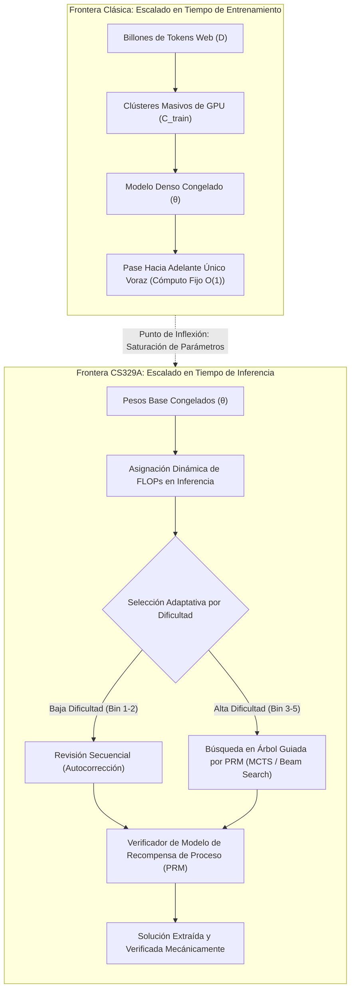
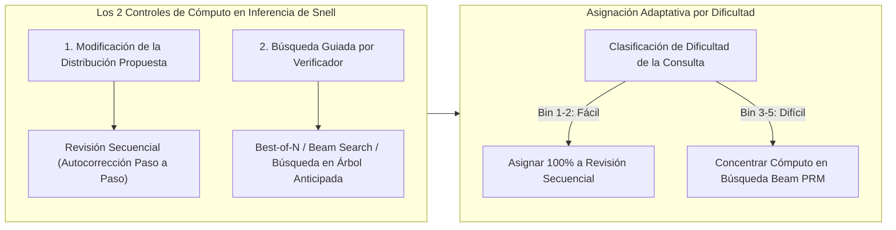
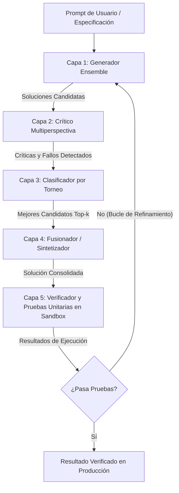

Bienvenidos a la segunda entrega de nuestro análisis definitivo de ingeniería sobre el curso de posgrado de la **Universidad de Stanford, CS329A: Self-Improving AI Agents (Agentes de IA con Automejora, Otoño 2025)**.

En nuestra clase inaugural, analizamos el cambio de paradigma macroeconómico que transforma los modelos estáticos de predicción del siguiente token en bucles agénticos autónomos con retroalimentación del entorno. Hoy nos enfrentamos al pilar computacional que hace viable esta autonomía: el **Escalado del Cómputo en Tiempo de Inferencia (Test-Time Compute Scaling)**.

Durante más de un lustro, la doctrina imperante en la industria de la IA estuvo dictada por las leyes de escalado del preentrenamiento (Kaplan et al., Chinchilla): *construir clústeres de GPUs masivos, expandir la huella de parámetros N y absorber decenas de billones de tokens web*. Sin embargo, una vez congelados los parámetros θ del modelo, ¿qué ocurre si nos negamos a aceptar una respuesta voraz (greedy) en 50 milisegundos? ¿Qué sucede si el agente dedica **10 segundos, 1 minuto o 10 minutos a explorar deliberadamente árboles de razonamiento, verificar pasos intermedios y revisar sus hipótesis** antes de comprometerse con una acción?

A través de los descubrimientos empíricos de *Large Language Monkeys* (Brown et al., 2024), el *Compute-Optimal Scaling* de Snell et al. (Stanford/UC Berkeley, 2024) y el marco de arquitectura modular *Archon*, formalizaremos matemáticamente cómo el intercambio de FLOPs de inferencia por capacidad de parámetros está redefiniendo la inteligencia artificial moderna.



{/* truncate */}

---

### 1. Escalado Clásico vs Cómputo en Inferencia: El Cambio de Paradigma

El aprendizaje profundo moderno se cimentó sobre la observación empírica de que la pérdida de validación decae como una ley de potencias (power law) respecto al cómputo de entrenamiento:

```text
L(N, D) = E + A / N^α + B / D^β
```

donde N es el número de parámetros sin incrustaciones y D es el tamaño del conjunto de datos en tokens. Sin embargo, esta formulación clásica trata el cómputo de inferencia como una constante trivial y estática: exactamente 2 FLOPs por parámetro por token generado en la decodificación autorregresiva.

#### Los Límites Físicos del Escalado en Preentrenamiento
A medida que la industria escaló los modelos más allá de 10^26 FLOPs (clase GPT-4), el preentrenamiento chocó contra tres restricciones severas:
1. **La Frontera de Agotamiento de Tokens Web:** El texto humano de alta calidad en la web es finito (~10^14 tokens). La generación masiva de datos sintéticos sin verificadores fiables induce al colapso del modelo (Model Collapse) y degeneración entrópica.
2. **Coste Exponencialmente Creciente:** Mejorar la precisión de un benchmark en un 1% en la cola plana de una curva de potencia requiere multiplicar por 10x los FLOPs de preentrenamiento, lo que representa cientos de millones de dólares en gasto de capital (CAPEX).
3. **La Falacia del Pase Hacia Adelante Estático:** Con independencia de si el modelo posee 7B o 1T de parámetros, la decodificación autorregresiva estándar genera cada token t_i mediante un número fijo de multiplicaciones matriciales:

```text
t_i ~ Softmax( W_u · LayerNorm( h_L(t_{1:i-1}) ) )
```

Problemas NP-completos, resolución de bugs de software que abarcan múltiples archivos y demostraciones matemáticas formales no pueden resolverse en una secuencia lineal sin retroceso (backtracking), especulación y verificación intermedia.

---

### 2. El Retorno del Teorema del Mono Infinito: Large Language Monkeys

En la teoría clásica de probabilidades, el *Teorema del Mono Infinito* de Émile Borel postula que un mono pulsando teclas al azar en una máquina de escribir durante un tiempo infinito casi con certeza redactará las obras completas de Shakespeare.

A finales de 2024, investigadores de UC Berkeley y Google Research evaluaron esta hipótesis en LLMs de vanguardia en su obra fundamental: **《Large Language Monkeys: Scaling Inference Compute with Repeated Sampling》** (Brown et al., 2024).

```
Cobertura (Pass@k %)
 ▲
100│                                     ┌────────────── Límite Superior de Cobertura Pass@k
 90│                                ┌────┘ (Alcanza 99% en MATH y CodeContests)
 80│                           ┌────┘
 70│                      ┌────┘
 60│                 ┌────┘ ◄── SWE-bench Lite: DeepSeek-Coder-V2 (k=250 -> 56.0%)
 50│            ┌────┘
 40│       ┌────┘   ◄── Claude 3.5 Sonnet Ejecución Única (43.0%)
 30│  ┌────┘
 20│ ┌┘
 10│┌┘  ◄── Gemma-2B Pass@1 (0.02%)
  0└┴──────┬──────────┬──────────┬──────────┬──────────►
    k=1    k=10       k=100      k=1,000    k=10,000   (Número de Muestras k)
```

#### Formulación Matemática del Estimador Insesgado pass@k
Al muestrear N respuestas candidatas de un modelo, donde exactamente C de ellas superan un banco de pruebas automatizado (pruebas unitarias), el estimador insesgado de mínima varianza (MVUE) para pass@k se define como:

```text
Pass@k = (1 / P) · ∑_{i=1}^P [ 1 - C(N - C_i, k) / C(N, k) ]
```

donde P es el número total de problemas, C_i es el recuento de soluciones correctas para el problema i, y C(n, r) representa el coeficiente binomial. Para evitar desbordamientos aritméticos con N = 10,000, las canalizaciones de producción utilizan este bucle multiplicativo numéricamente estable:

```text
Pass@k = 1 - ∏_{j=0}^{k-1} ( 1 - C_i / (N - j) )
```

#### Descubrimientos Empíricos: Modelos Pequeños Superan a los Gigantes
Los hallazgos de Large Language Monkeys revolucionaron la evaluación de modelos:
* **SWE-bench Lite (Corrección de Errores de Software en GitHub):**
  * `DeepSeek-Coder-V2-Instruct` con k=1 obtuvo una tasa de éxito modesta del **15.9%**.
  * Al escalar a k=250 muestras, su pass@250 se disparó al **56.0%**.
  * Esto superó al conjunto de GPT-4o y Claude 3.5 Sonnet (43.0%) por **13 puntos porcentuales**.
* **CodeContests (Programación Competitiva Extrema):**
  * El modelo ultraligero `Gemma-2B` tenía un pass@1 de **0.02%** (prácticamente cero).
  * Escalado a k=10,000, su pass@10,000 ascendió al **7.1%**, multiplicando su rendimiento por **355x** únicamente mediante muestreo en inferencia.
* **La Inversión Económica:**
  * Lograr un 29.62% en SWE-bench con DeepSeek-Coder-V2 (k=5) costó **$10.80**.
  * Lograr una precisión comparable con GPT-4o en ejecución única (24.0%) costó **$39.00 (3.6x más caro)**.
  * Claude 3.5 Sonnet en ejecución única (26.7%) costó **$51.00 (4.7x más caro)**.

```text
┌───────────────────────────────┬──────────┬────────────┬─────────────┐
│ Modelo y Estrategia           │ SWE-bench│ Coste ($)  │ Multiplicador│
├───────────────────────────────┼──────────┼────────────┼─────────────┤
│ DeepSeek-Coder-V2 (k=5)       │ 29.62%   │ $10.80     │ 1.0x (Base) │
│ GPT-4o (k=1 Greedy Único)     │ 24.00%   │ $39.00     │ 3.6x Coste  │
│ Claude 3.5 Sonnet (k=1)       │ 26.70%   │ $51.00     │ 4.7x Coste  │
│ DeepSeek-Coder-V2 (k=250)     │ 56.00%   │ $540.00    │ Estado Arte │
└───────────────────────────────┴──────────┴────────────┴─────────────┘
```

#### La Brecha Cobertura-Precisión: La Barrera del Verificador
No obstante, el muestreo repetido sin control tropieza con la **Brecha Cobertura-Precisión**.

En dominios formales cerrados con oráculos deterministas (como compiladores o pruebas unitarias), **Cobertura es igual a Éxito**: si 1 de cada 250 trayectorias supera las pruebas, se extrae mecánicamente.

En dominios abiertos o informales sin compiladores externos:
* En el conjunto de datos MATH, `Llama-3-8B-Instruct` alcanzó una cobertura del **98.44%** con k=10,000 (el 98% de los grupos contenía la solución correcta).
* Sin embargo, al aplicar **Votación por Mayoría (Majority Voting)**, la precisión aumentó de 40.5% a apenas **41.41%** (una ganancia ínfima de 0.9%p).
* La selección **Best-of-N** con un Modelo de Recompensa de Resultado (ORM) se estancó en torno a k=100 debido a falsos positivos y saturación de recompensa.

> **Principio de Ingeniería:** Multiplicar las muestras sin un verificador riguroso equivale a agrandar el pajar. Aunque la probabilidad de que la aguja (la solución) esté dentro alcance el 99%, encontrarla resulta imposible sin un imán de alta precisión (verificador).

---

### 3. Escalado de Cómputo Óptimo de Snell: Intercambio de Parámetros por FLOPs

En lugar de lanzar los dados 10,000 veces al azar, ¿cómo debe un ingeniero invertir de forma óptima un presupuesto determinado de inferencia?

A finales de 2024, Charlie Snell et al. (Stanford y UC Berkeley) publicaron su célebre artículo: **《Scaling LLM Test-Time Compute Optimally can be More Effective than Scaling Model Parameters》**.



#### Los Dos Controles del Cómputo en Inferencia
Snell et al. clasificaron los métodos de cómputo en inferencia en dos ejes ortogonales:
1. **Modificación de la Distribución Propuesta (Proposer):** Acondicionar al modelo para generar trayectorias superiores mediante revisión secuencial:
   ```text
   y_{t+1} ~ P_θ( y | x, y_1, ..., y_t, Critique_t )
   ```
2. **Búsqueda Guiada por Verificador (Verifier):** Evaluar sistemáticamente los nodos intermedios de razonamiento mediante Modelos de Recompensa de Proceso (PRM):
   ```text
   Score(Node_t) = PRM_ψ( x, y_{1:t} )
   ```

#### El Principio de Inversión Adaptativa por Dificultad
El descubrimiento cumbre de Snell et al. demostró que **la estrategia óptima se invierte radicalmente según la dificultad de la consulta**:

```text
Dificultad Bin 1-2 (Problemas Fáciles)  ───>  Domina la Revisión Secuencial
Dificultad Bin 3-5 (Problemas Difíciles)───>  Domina la Búsqueda Beam con PRM
```

1. **Problemas Fáciles (Bins 1–2):** 
   * En consultas sencillas, el primer intento del modelo base ya está muy cerca de la solución.
   * Aplicar búsquedas en árbol complejas introduce ruido de verificación, provocando sobreoptimización y caída de rendimiento al gastar más cómputo.
   * **Estrategia Óptima:** La Revisión Secuencial (pedir al modelo que corrija deslices algebraicos menores) alcanza la máxima precisión con un cómputo mínimo.
2. **Problemas Difíciles (Bins 3–5):**
   * En matemáticas de competición de alto nivel, la autocorrección lineal falla porque la trayectoria inicial cae en una trampa lógica insalvable.
   * **Estrategia Óptima:** Beam Search guiado por un PRM paso a paso poda los ramales erróneos de forma temprana.
3. **El Dividendo de la Asignación Óptima:**
   * La política óptima (Revisión en fáciles, Búsqueda PRM en difíciles) iguala la precisión del Best-of-N estándar consumiendo **4 veces menos cómputo (4x)**.

#### La Equivalencia de 14x Parámetros
El resultado más destacado de Snell et al. fue la comparación directa entre **aumentar el tamaño de los parámetros en 14x** frente a **multiplicar el cómputo de inferencia por 14x en un modelo pequeño**:

```text
Modelo con 14x Parámetros (Decodificación Voraz)  vs  Modelo 1x + 14x Cómputo de Inferencia
```

* Para problemas de dificultad fácil a moderada en MATH y GSM8K, el modelo pequeño con cómputo de inferencia óptimo igualó o superó al modelo 14 veces mayor.
* En problemas de extrema dificultad (Bin 5), los parámetros preentrenados siguieron siendo esenciales: si el modelo base carece de las representaciones semánticas fundamentales para plantear una hipótesis inicial, la búsqueda en inferencia degenera en alucinaciones continuas.

---

### 4. Ingeniería de Sistemas: Arquitectura Agéntica Modular Archon

Para implementar estas leyes teóricas en software de producción se requiere una ingeniería rigurosa. ¿Cómo ensamblar generadores, críticos, clasificadores y cajas de arena (sandboxes) de forma predecible?

El marco **Archon** (arxiv:2409.15254) resuelve este reto abstrayendo las operaciones de los LLMs en **capas de canalización modulares**:



#### Las Cinco Capas de Archon
1. **Capa Generadora (Generator):** Diversifica candidatos variando temperaturas (T=0.2 a 0.8) y combinando modelos heterogéneos (Claude 3.5 Sonnet + DeepSeek-V2).
2. **Capa Crítica (Critic):** Examina los candidatos para aislar omisiones matemáticas, fallos de tipado o vulnerabilidades de casos límite.
3. **Capa de Clasificación (Ranker):** Realiza evaluaciones cruzadas 1 contra 1 entre candidatos para generar un ranking sólido.
4. **Capa de Fusión (Fuser):** Recombina las ideas lógicas más sólidas de los mejores candidatos en una respuesta única superior (+8.9% de mejora).
5. **Capa Verificadora (Verifier):** Genera de 5 a 10 pruebas unitarias con un LLM, las ejecuta en un entorno aislado y valida la solución (+56% de mejora en codificación).

Mediante **Optimización Bayesiana**, Archon explora un espacio de diseño de **9,576 configuraciones posibles**, hallando la canalización óptima de Pareto para cualquier restricción de latencia y coste.

---

### 5. Estudio de Caso: Desmitificando OpenAI o1 y Modelos de Razonamiento

Los conceptos de la Clase 2 de Stanford CS329A explican con claridad los mecanismos internos de los modelos de razonamiento modernos como OpenAI o1 y DeepSeek-R1:

```
┌────────────────────────────────────────────────────────────────────────┐
│                   Dentro del Rastro de "Pensamiento" de o1             │
├────────────────────────────────────────────────────────────────────────┤
│ 1. Deliberación Oculta (Tokens de Inferencia):                         │
│    El modelo genera miles de tokens en su cadena de pensamiento antes  │
│    de emitir el primer carácter visible al usuario.                    │
│                                                                        │
│ 2. PRM y Recompensas Integradas:                                       │
│    Entrenado con aprendizaje por refuerzo (RL) para detectar callejones│
│    sin salida y retroceder (backtracking) hacia bifurcaciones previas. │
│                                                                        │
│ 3. Bucle de Autocorrección (Revisión de Snell):                        │
│    Expresiones como "Espera, esto no parece correcto, recalculemos"    │
│    reflejan políticas aprendidas de revisión secuencial.               │
└────────────────────────────────────────────────────────────────────────┘
```

El proceso de razonamiento visible no es un misterio opaco: es la encarnación entrenada del **Escalado en Tiempo de Inferencia**, que aúna revisión secuencial, verificación PRM y búsqueda adaptativa en una única arquitectura neuronal.

---

### 6. Resumen y Principios Técnicos Fundamentales

1. **Dos Ejes de Inteligencia:** La capacidad de la IA ya no depende exclusivamente del preentrenamiento. El escalado en tiempo de inferencia ofrece un eje independiente que permite a modelos ligeros superar a gigantes densos.
2. **El Principio Cobertura-Precisión:** El muestreo repetido (pass@k) incrementa la cobertura potencial de soluciones (DeepSeek-Coder-V2 15.9% -> 56.0%), pero aprovecharla exige verificadores PRM de alta precisión.
3. **Ley de Snell de Asignación Óptima:** Adaptar el cómputo según la dificultad reduce el gasto en un factor de 4x: use Revisión Secuencial para consultas sencillas y Búsqueda Beam con PRM para problemas complejos.
4. **Sistemas Agénticos Modulares:** Como demuestra Archon, el diseño del software (generadores, críticos, sintetizadores y sandboxes) es tan decisivo para la precisión final como el tamaño del modelo subyacente.

---

### Próxima Entrega de Stanford CS329A:
En la **Clase 3**, abordaremos el componente neurálgico de los agentes: **《Robust Verification: Modelos de Recompensa de Proceso (PRM), Ensembles y Supervisión Escalable》**. Descubriremos cómo construir verificadores inmunes al hackeo de recompensas que validen pasos matemáticos sin intervención humana. ¡Hasta la próxima!