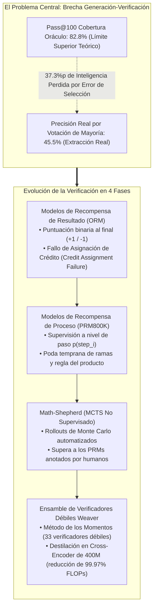
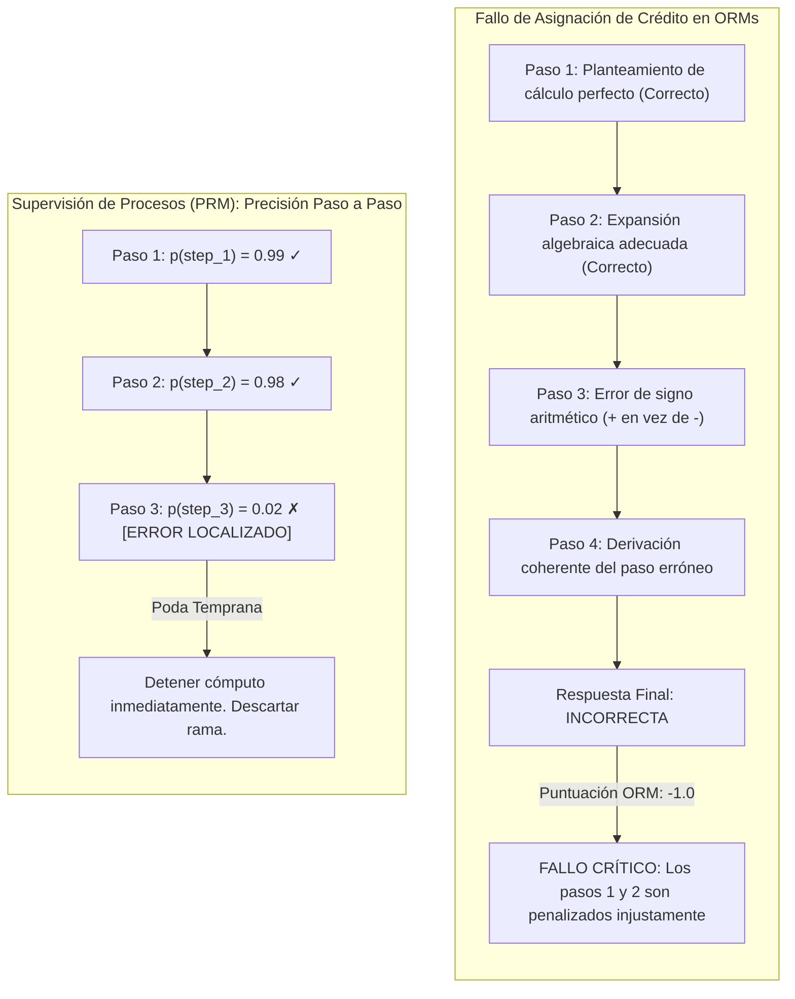
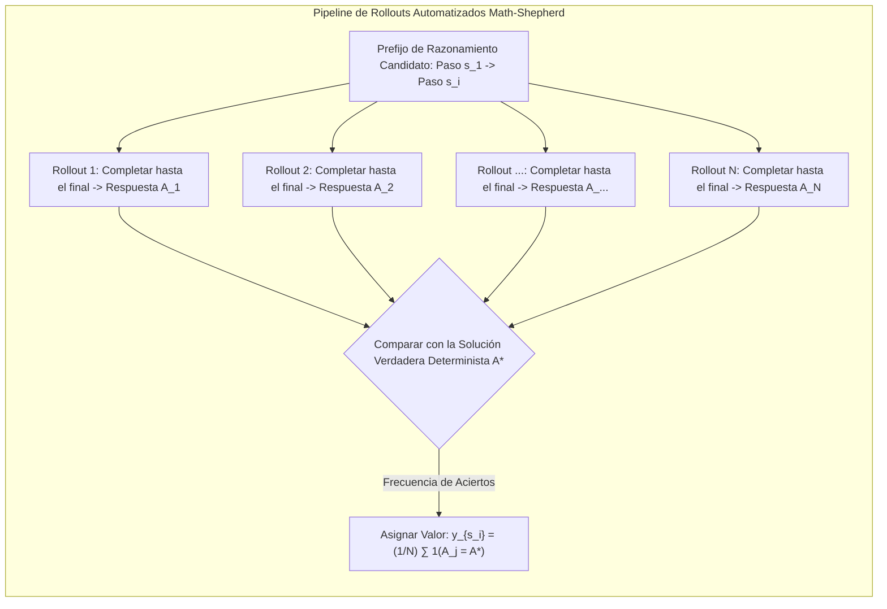
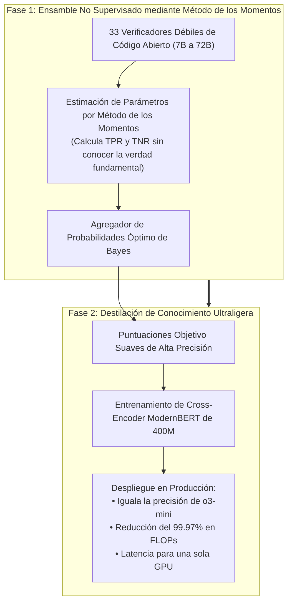

Bienvenidos a la tercera entrega de nuestro análisis exhaustivo de ingeniería sobre el curso de posgrado de la **Universidad de Stanford, CS329A: Self-Improving AI Agents (Agentes de IA con Automejora, Otoño 2025)**.

En la Clase 2, exploramos el escalado de cómputo en inferencia y alcanzamos una conclusión fundamental: aunque generar miles de trayectorias ($pass@k$) eleva la cobertura teórica por encima del 99%, este potencial latente resulta inutilizable sin un verificador de alta precisión. Al aplicar heurísticas como la votación por mayoría, el rendimiento choca contra una meseta insuperable.

Hoy abordamos el motor arquitectónico que rompe este cuello de botella: **la Verificación Robusta (Robust Verification)**.

Los matemáticos e ingenieros humanos rara vez resuelven problemas complejos en un flujo unidireccional irreflexivo; desarrollan un paso, comprueban su consistencia algebraica, detectan errores sutiles de signos y retroceden (backtracking) antes de proseguir. Por el contrario, los modelos de lenguaje autorregresivos estándar generan texto estrictamente hacia adelante. Una vez que un paso inicial desvía el razonamiento, el modelo inventa alucinaciones cada vez más complejas para justificar su error original.

¿Cómo podemos diseñar modelos verificadores independientes capaces de auditar los pasos intermedios, diagnosticar falacias lógicas y guiar a los agentes hacia soluciones matemáticamente sólidas sin incurrir en millones de dólares de etiquetado humano?

A través de las investigaciones de Cobbe et al. (GSM8K, OpenAI, 2021), la supervisión de procesos de Lightman et al. (PRM800K, 2023), la anotación automatizada por Monte Carlo de *Math-Shepherd* (Yu et al., 2023) y el vanguardista marco de ensamble *Weaver* (NeurIPS 2025), dominaremos los fundamentos de la **Ingeniería de Verificadores**.



{/* truncate */}

---

### 1. La Brecha Generación-Verificación: Definiendo el Cuello de Botella

Antes de evaluar arquitecturas de verificación específicas, debemos formalizar matemáticamente la distancia entre lo que un modelo puede generar y lo que un agente puede extraer con fiabilidad:

```text
Gap(K) = Pass@K - Actual_Success_Rate
```

En pruebas avanzadas como GPQA Diamond, modelos de pesos abiertos como `Llama-3.3-70B-Instruct` alcanzan un $Pass@100$ del **82.8%**. Esto significa que en más de 8 de cada 10 problemas, existe al menos una solución correcta dentro del conjunto de 100 respuestas generadas.

Sin embargo, al aplicar la habitual **Votación por Mayoría (Majority Voting)**, la precisión real cae drásticamente al **45.5%**.

```
Precisión (%)
 ▲
100│                                     ┌────────────── Pass@100 Frontera Oráculo (82.8%)
 90│                                ┌────┘
 80│                           ┌────┘
 70│                      ┌────┘
 60│                 ┌────┘
 50│            ┌────┘ ◄── 37.3%p de Inteligencia Perdida
 40│  ──────────┴──────────────────────── Meseta de Votación por Mayoría (45.5%)
 30│
 20│
 10│
  0└┴────────────────────────────────────────────────► Presupuesto de Muestras K
```

Un asombroso **37.3% de capacidad cognitiva latente se destruye** debido a una selección deficiente. Cuando múltiples razonamientos erróneos convergen hacia el mismo distractor verosímil, los métodos basados en frecuencia eligen falsos positivos.

#### El Origen de los Verificadores Independientes: Cobbe et al. (GSM8K, 2021)
Para cerrar esta brecha, Karl Cobbe y el equipo de OpenAI presentaron el benchmark **GSM8K** e introdujeron el paradigma del **verificador independiente**:

1. **Arquitectura Desacoplada:** El generador y el verificador no comparten pesos durante la inferencia. El generador se ajusta durante solo 2 épocas para preservar la entropía, mientras que el verificador se entrena sobre las respuestas generadas.
2. **Cabezales de Valor a Nivel de Token:** En lugar de puntuar únicamente al final de la secuencia, se conecta un cabezal de regresión lineal en cada posición de token del Transformer:
   ```text
   V(t_i) = W_v · h_L(t_i) + b_v
   ```
   La función de pérdida total equilibra el modelado de lenguaje y el error cuadrático medio (MSE):
   ```text
   L_total = L_LM(θ) + λ · || V(t_end) - y_true ||^2
   ```
3. **El Dividendo de 30x Parámetros:**
   * Utilizar un **verificador compacto de 6B parámetros** para escoger la mejor solución entre 100 candidatos igualó la precisión de un **modelo denso de 175B**.
   * Separar la generación de la verificación aportó un multiplicador de **30x en eficiencia de parámetros**.

---

### 2. Supervisión de Resultado vs Proceso: Lightman et al. (PRM800K)

Aunque el verificador de Cobbe fue un avance notable, seguía atrapado en la **Supervisión de Resultados (Outcome Reward Models, ORMs)**.

En mayo de 2023, Hunter Lightman y su equipo en OpenAI publicaron un artículo histórico: **《Let's Verify Step by Step》** (Lightman et al., 2023).



#### El Problema de Asignación de Crédito en el Razonamiento
Analicemos una demostración matemática de 10 pasos:
* **El Dilema del Falso Negativo:** El modelo elabora deducciones impecables desde el paso 1 hasta el 6. En el paso 7 comete un desliz aritmético menor que falsea el resultado numérico.
  * *Evaluación ORM:* Asigna una penalización de $-1$. Las brillantes deducciones de los pasos 1 a 6 son castigadas, contaminando el aprendizaje.
* **El Dilema del Falso Positivo (Acierto por Azar):** En el paso 3 el modelo comete un error grave, pero en el paso 8 comete un segundo error que anula el anterior, llegando de casualidad a la respuesta correcta.
  * *Evaluación ORM:* Asigna $+1$. Se recompensa un razonamiento defectuoso, agravando el reward hacking.

Este fallo de asignación temporal de crédito frena el escalado de los verificadores de resultados.

#### Formulación Matemática de los PRMs
Lightman et al. construyeron **PRM800K**, un conjunto de 800,000 anotaciones humanas paso a paso sobre 75,000 soluciones del benchmark MATH.

Para optimizar recursos, establecieron la **Regla de Terminación al Primer Error**: los evaluadores detenían el análisis tan pronto detectaban la primera falacia lógica.

El PRM predice la probabilidad de que el paso $s_i$ sea correcto:

```text
p(s_i) = σ( W_p · h_L( Token_{\text{newline}, i} ) )
```

La puntuación global para la trayectoria completa $S = (s_1, s_2, ..., s_M)$ se calcula mediante la **Regla del Producto**:

```text
Score_PRM(S) = ∏_{i=1}^M p(s_i \text{ is correct})
```

#### Superioridad Demostrada de los PRMs
En el conjunto de datos MATH bajo búsqueda Best-of-N hasta $N = 1,860$:

```text
┌───────────────────────────────┬──────────────┬──────────────┬─────────────┐
│ Estrategia de Selección       │ Best-of-1    │ Best-of-100  │ Best-of-1860│
├───────────────────────────────┼──────────────┼──────────────┼─────────────┤
│ Votación por Mayoría          │ 52.4%        │ 68.3%        │ 69.6%       │
│ Modelo de Resultado (ORM)     │ 52.4%        │ 70.1%        │ 72.4%       │
│ Modelo de Proceso (PRM)       │ 52.4%        │ 74.8%        │ 78.2%       │
└───────────────────────────────┴──────────────┴──────────────┴─────────────┘
```

1. **Curvas de Escalado Continuas:** Mientras que la votación y los ORMs se estancan cerca de $N = 100$, los PRMs mantienen un crecimiento monótono hasta miles de candidatos.
2. **Impuesto de Alineación Negativo:** A diferencia del RLHF clásico que suele degradar la destreza matemática en favor de la cortesía, la supervisión de procesos eleva la interpretabilidad y seguridad al tiempo que dispara la precisión.

---

### 3. Supervisión de Procesos Automatizada: Math-Shepherd y Rollouts de Monte Carlo

A pesar del éxito de PRM800K, existía una barrera insalvable: **el etiquetado humano de 800,000 pasos es económicamente insostenible** a escala industrial.

A finales de 2023, Yu, Shen, Zhou et al. crearon **Math-Shepherd**, un método automatizado de anotación paso a paso inspirado en la Búsqueda en Árbol de Monte Carlo (MCTS).



#### Intuición del Algoritmo
La máquina evalúa a la máquina:
> Si un paso intermedio $s_i$ es matemáticamente válido, continuar la solución $N$ veces desde ese punto conducirá frecuentemente a la solución correcta $A^*$. Si contiene un fallo irrecuperable, las terminaciones casi nunca alcanzarán $A^*$.

#### Estimación Dura vs Suave
Math-Shepherd define dos funciones de anotación:

1. **Estimación Dura (Hard Estimation, HE):** Asigna $+1$ si al menos uno de los $N$ rollouts alcanza la respuesta correcta, y $0$ si ninguno lo hace:
   ```text
   y^{HE}_{s_i} = 1( ∃ j \in {1, ..., N} : A_j = A^* )
   ```
2. **Estimación Suave (Soft Estimation, SE):** Asigna una probabilidad continua correspondiente a la tasa empírica de éxito entre los $N$ rollouts:
   ```text
   y^{SE}_{s_i} = (1 / N) · ∑_{j=1}^N 1( A_j = A^* )
   ```

#### El Resultado: Anotaciones Mecánicas Superan a las Humanas
Math-Shepherd generó **1.7 millones de pasos anotados** (más del doble que PRM800K) con un coste humano de cero dólares.

* **Humanos vs Máquinas:** En modelos LLaMA de código abierto, un PRM entrenado con Math-Shepherd **superó al PRM800K anotado por humanos en el benchmark MATH**.
* **Causa de la Inversión:** Los anotadores humanos de PRM800K evaluaron únicamente soluciones de GPT-4, omitiendo la distribución de fallos de modelos abiertos. Math-Shepherd aprendió directamente de la distribución nativa del modelo objetivo.
* **RL con Recompensas de Proceso:** Aplicando PPO con recompensas Math-Shepherd, `Mistral-7B` saltó del 28.6% al **43.5% en MATH**.

---

### 4. Teoría de Ensembles: El Marco Weaver (NeurIPS 2025)

Incluso con Math-Shepherd, un único verificador pequeño de 7B o 13B sigue cometiendo errores sutiles. Sin embargo, desplegar verificadores de 70B en producción es prohibitivo por latencia y coste.

Investigadores de Stanford y UW-Madison resolvieron este dilema en NeurIPS 2025: **《Weaver: Shrinking the Generation-Verification Gap with Weak Verifiers》** (Zhang et al., 2025).



#### Agregación de Verificadores sin Supervisión con el Método de los Momentos
Weaver reúne a 33 verificadores débiles (de 7B a 72B). En un entorno sin respuestas correctas conocidas, **¿en qué verificador debemos confiar?**

Weaver modela el problema como un **Modelo Naive Bayes con Variable Latente**:
* La veracidad real `Y in {0, 1}` es una variable latente inobservable.
* Cada verificador `k` posee una tasa de verdaderos positivos (``w_{k,1}``) y verdaderos negativos (``w_{k,0}``) desconocida:
  ```text
  `w_{k,1}` = P(S_k = 1 | Y = 1), \quad `w_{k,0}` = P(S_k = 0 | Y = 0)
  ```
* Asumiendo independencia condicional dado $Y$, la probabilidad conjunta de que los verificadores $i$ y $j$ acierten se expande algebraicamente.

Mediante el **Método de los Momentos**, Weaver resuelve las ecuaciones de covarianza y **recupera la fiabilidad exacta ``(`w_{k,1}`, `w_{k,0}`)`` de los 33 verificadores sin requerir ninguna etiqueta de prueba**.

La probabilidad a posteriori bayesiana óptima resultante es:

```text
P( Y=1 | S_1, ..., S_K ) = 1 / ( 1 + exp( - ( l_0 + ∑_{k=1}^K l_k(S_k) ) ) )
```

#### Resultados Excepcionales
1. **Superando a OpenAI o3-mini:**
   * Al combinar `Llama-3.3-70B-Instruct` con el ensamble Weaver en competiciones STEM, alcanzó un **87.7%**.
   * Esto superó a modelos de frontera consolidados como **OpenAI o3-mini (86.7%) y GPT-4o (69.0%)**.
2. **Destilación en un Cross-Encoder de 400M:**
   * Los autores destilaron las probabilidades de Weaver en un modelo **`ModernBERT-Large` de solo 400M parámetros**.
   * El modelo estudiante retuvo el **98.7% de la precisión del ensamble completo** recortando el cómputo (FLOPs) en un **99.97%**.

---

### 5. Estudio de Caso: Lista de Verificación para Diseñar Verificadores Industriales

Recomendaciones prácticas basadas en la Clase 3 de Stanford CS329A:

```text
┌────────────────────────────────────────────────────────────────────────┐
│             Checklist de Arquitectura de Verificación Industrial       │
├────────────────────────────────────────────────────────────────────────┤
│ 1. Dominios Cerrados Deterministas (Código, Pruebas Formales):         │
│    • Emplear oráculos de compilación y ejecución de tests unitarios.   │
│    • ORMs en cajas de arena aisladas (Docker / gVisor).                │
│                                                                        │
│ 2. Dominios de Razonamiento Abierto (Análisis Financiero, Legal):      │
│    • PRMs entrenados mediante rollouts automáticos (Math-Shepherd).     │
│    • Evaluación de trayectorias mediante la Regla del Producto.        │
│    • Poda temprana de ramas con probabilidad p < 0.2.                  │
│                                                                        │
│ 3. Optimización de Latencia y Coste:                                   │
│    • Ensamble offline basado en el Método de los Momentos (Weaver).    │
│    • Destilación a un cross-encoder sub-1B.                            │
│    • Inferencia en una sola GPU con latencias inferiores a 10 ms.      │
└────────────────────────────────────────────────────────────────────────┘
```

---

### 6. Resumen y Conclusiones de Ingeniería

1. **El Cuello de Botella es la Selección:** La frontera de la IA radica en seleccionar, no en generar. Cerrar la brecha del 30%+ exige verificadores desacoplados.
2. **Superioridad de los PRMs:** Los ORMs fallan por asignación de crédito defectuosa. Los PRMs paso a paso posibilitan un escalado continuo en búsquedas Best-of-N.
3. **Supervisión Automática:** La anotación humana es innecesaria; los rollouts de Monte Carlo (Math-Shepherd) generan supervisión alineada y de coste cero.
4. **Sinergia Ensamble-Destilación:** Combinar verificadores débiles con el Método de los Momentos (Weaver) vence a modelos punteros, y su destilación a 400M ahorra el 99.97% de cómputo.

---

### Próxima Entrega de Stanford CS329A:
En la **Clase 4**, pasaremos de los textos a la retroalimentación física del entorno: **《Tool Use & Code Feedback: Compiladores, Sandboxes de Ejecución y Bucles de Autocorrección》**. Descubriremos cómo los agentes interactúan con terminales y pruebas de software para generar código autocorrectivo. ¡Nos vemos pronto!