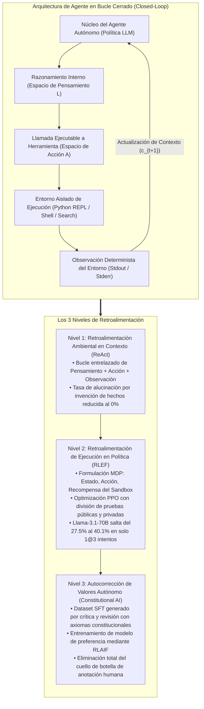
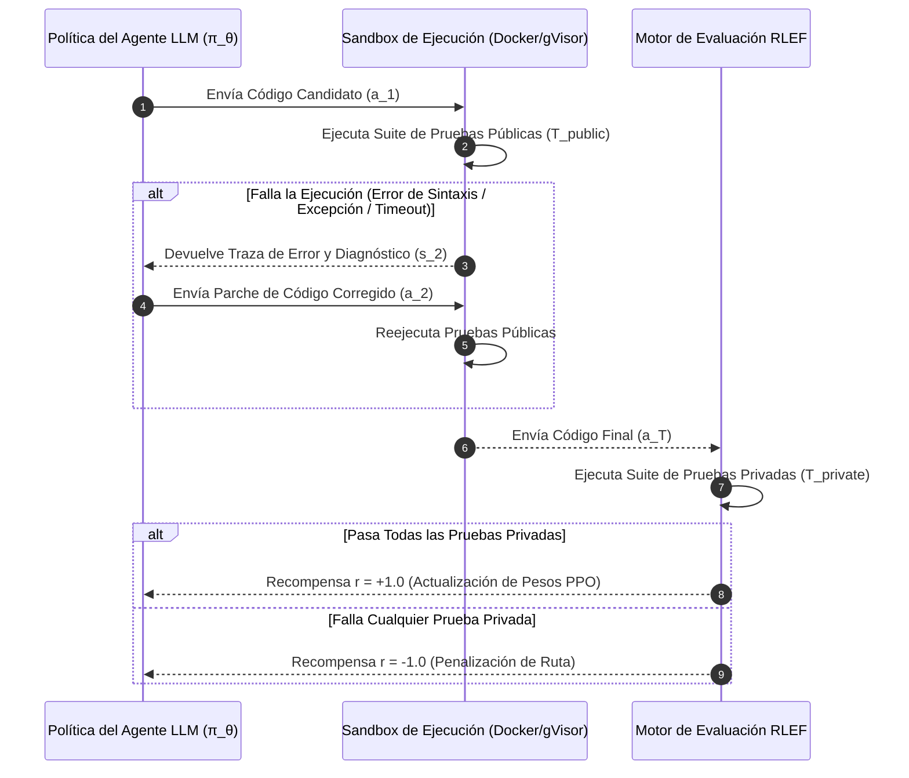
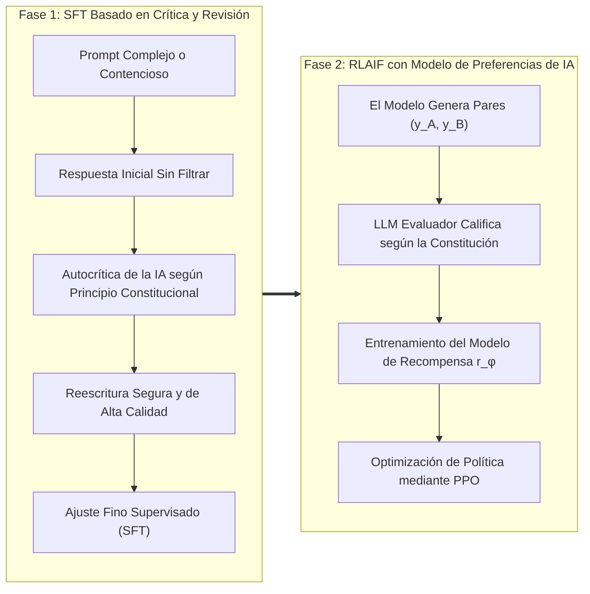

Bienvenidos a la cuarta entrega de nuestro análisis técnico exhaustivo del curso de posgrado de la **Universidad de Stanford, CS329A: Self-Improving AI Agents (Agentes de IA que se Perfeccionan a Sí Mismos, Otoño 2025)**.

En las Clases 2 y 3 exploramos cómo el escalado de cómputo en inferencia (Test-time Compute Scaling) y los Modelos de Recompensa de Proceso (PRM) permiten a los modelos de lenguaje explorar árboles de razonamiento y verificar rigurosamente derivaciones matemáticas intermedias. Sin embargo, a pesar de sus sofisticadas cadenas de pensamiento (CoT), los modelos confinados exclusivamente a la generación de texto puro siguen siendo **"estudiantes encerrados en una habitación resolviendo exámenes"**. Dependen por completo de la memoria paramétrica estática y congelada adquirida durante el preentrenamiento. Ante hechos dinámicos del mundo real, APIs en constante cambio o restricciones sintácticas inflexibles en código ejecutable, un modelo aislado alucina inevitablemente al no tener contacto con sistemas reales.

La **Clase 4** marca el punto de inflexión estructural que saca al modelo de ese confinamiento: **el uso de herramientas (Tool Use) y los bucles de retroalimentación de ejecución (Execution Feedback Loops)**.

Los agentes autónomos modernos no tratan el código o las llamadas a APIs como meros textos terminales, sino como **sensores y actuadores** interactivos. En esta sesión, analizamos y rediseñamos los tres niveles fundamentales de retroalimentación para agentes:
1. **Retroalimentación ambiental a nivel de prompt:** La unificación de razonamiento y acción mediante **ReAct** (Yao et al., 2022).
2. **Retroalimentación de ejecución a nivel de política:** La incorporación directa de diagnósticos de compiladores y suites de prueba en los pesos neuronales mediante **RLEF** (Reinforcement Learning from Execution Feedback, 2024).
3. **Alineación de valores autosupervisada:** La sustitución de costosos evaluadores humanos por bucles autónomos de crítica y revisión guiados por principios en **Constitutional AI** (Anthropic, 2022).



{/* truncate */}

---

### 1. La Armonización de Pensamiento y Acción: El Marco ReAct (Yao et al., 2022)

Antes de la publicación de ReAct (Yao et al., 2022, Universidad de Princeton y Google Research), la comunidad de IA se encontraba dividida en dos escuelas aisladas:
1. **Solo Razonamiento (Chain-of-Thought / CoT):** Se induce al modelo a generar reflexiones internas paso a paso. Aunque es eficaz para problemas matemáticos cerrados, sufre de graves alucinaciones debido a su desconexión con el entorno. Una vez que una afirmación errónea entra en el contexto, el modelo formula deducciones cada vez más elaboradas sobre esa premisa falsa.
2. **Solo Acción (Action-only / WebGPT, Act):** El modelo emite directamente comandos de API o búsquedas. Sin embargo, carece de una memoria de trabajo (Working Memory) para registrar por qué realizó una búsqueda o cuál es el subobjetivo inmediato, lo que conduce a bucles infinitos o pérdida del rumbo.

#### Expansión Matemática del Espacio de Acción

ReAct unifica ambos mundos formalizando el espacio total de acción del agente como la unión del espacio de acciones físicas y el espacio lingüístico de deliberación:

```text
A_hat = A ∪ L
```

Donde:
* `A` representa el conjunto de acciones externas ejecutables en el entorno (ej., `Search[query]`, `ExecuteCode[script]`, `Click[element]`).
* `L` representa el espacio de pensamientos libres en lenguaje natural.

Una propiedad matemática esencial es que una acción de pensamiento $a_t \in L$ **no altera el estado del entorno externo**. En su lugar, actualiza únicamente el contexto de memoria interna del agente:

```text
c_{t+1} = ( c_t, a_t )   (si a_t ∈ L)
```

Por el contrario, cuando el agente emite una acción ejecutable $a_t \in A$, el entorno físico se ejecuta y devuelve una observación determinista:

```text
c_{t+1} = ( c_t, a_t, o_t )   (si a_t ∈ A, donde o_t = Env(a_t))
```

#### Ciclo Tripartito de Interacción: Ejemplo Práctico

La traza de ejecución de ReAct alterna de forma rigurosa entre pensar, actuar y observar:

```text
Thought 1: Descomponer la consulta en dos subtareas. Primero, buscar el año de nacimiento de Alan Turing.
Action 1: Search["Alan Turing fecha de nacimiento"]
Observation 1: Alan Mathison Turing (23 de junio de 1912 - 7 de junio de 1954) fue un matemático británico...
Thought 2: Turing nació en 1912. Ahora debo consultar la población estimada de Londres en ese mismo año.
Action 2: Search["Londres poblacion 1912"]
Observation 2: En 1912, el condado administrativo de Londres contaba con una población oficial de aproximadamente 4.52 millones...
Thought 3: Ambos datos han sido verificados. La respuesta final es 4.52 millones.
Action 3: Finish["4.52 millones"]
```

#### Validación Empírica: Colapso de la Alucinación

Los experimentos desarrollados por Yao et al. demostraron incrementos drásticos en fiabilidad:
* **Benchmark de Recuperación de Conocimiento (HotpotQA):**
  * Al auditar los fallos de CoT, el **56% de los errores se debieron a alucinaciones directas** (invención de autores, fechas o entidades).
  * Con el bucle ReAct, la invención de hechos cayó al **0%**, ya que ante una laguna de conocimiento el modelo está obligado a consultar el entorno exterior.
* **Entornos Interactivos Basados en Texto (ALFWorld):**
  * En tareas de navegación multihabitación y manipulación de objetos, los modelos que solo actúan obtuvieron apenas un 45% de éxito por pérdida de objetivo, mientras que ReAct alcanzó el **71%**.
* **Regla Crítica de Ingeniería de Producción (Secuencia de Parada / Stop Sequence):**
  * Los modelos autorregresivos intentan continuar prediciendo texto indefinidamente. Si no se les restringe, generarán por su cuenta observaciones sintéticas inventadas (`Observation:`).
  * **Regla Mandatoria:** En el motor de inferencia debe configurarse una secuencia de parada (`stop=["\nObservation:"]`). En cuanto el LLM genera la línea `Action:`, la generación se detiene de inmediato. El orquestador ejecuta la herramienta real en el sandbox e inyecta la salida auténtica antes de reanudar el siguiente paso.

---

### 2. Retroalimentación en los Pesos Neuronales: RLEF (Reinforcement Learning from Execution Feedback)

Mientras que ReAct proporciona interacción en el contexto mediante prompts, el desarrollo de software exige una competencia superior: **la capacidad de depurar errores de compilación y fallos de aserción modificando el código de forma iterativa**.

#### La Paradoja de la Autodepuración Basada en Prompts

Cuando se solicita a un modelo preentrenado estático (Frozen LLM) que corrija un script defectuoso pegando la traza de error (Traceback) del compilador, estudios recientes (Olausson et al., 2024; Kapoor et al., 2024) revelaron un hallazgo sorprendente:

> **"Proporcionar el mensaje de error a un modelo congelado para que corrija su código suele ofrecer una precisión inferior a ignorar el error por completo y solicitar una solución totalmente nueva mediante muestreo independiente (Independent Sampling)."**

Los modelos preentrenados no han sido entrenados para correlacionar los números de línea de una excepción con las fallas lógicas de su sintaxis. Ante un error, entran en bucles redundantes, cambian nombres de variables sin sentido o reproducen el mismo defecto con saltos de línea distintos.

El marco **RLEF (arxiv:2410.02089, finales de 2024)** resolvió este problema de raíz sustituyendo los trucos de prompt por **aprendizaje por refuerzo (PPO)**.

#### Formulación de la Generación de Código Multiturno como un MDP

RLEF modela el proceso iterativo de "generación $\to$ ejecución $\to$ corrección" a lo largo de un máximo de $T$ turnos como un Proceso de Decisión de Markov (MDP) de tiempo discreto:
* **Espacio de Estados ($S$):** Especificación del problema, intentos de código previos y trazas de error del compilador/runtime:
  ```text
  s_t = ( Problem_Spec, Code_1, Err_1, ..., Code_{t-1}, Err_{t-1} )
  ```
* **Espacio de Acciones ($A$):** Parche de código o programa completo generado por el agente $a_t$.
* **Transición del Entorno:** El código se ejecuta dentro de un sandbox aislado equipado con un arnés de pruebas automatizado.



#### Suites de Prueba Duales: Prevención de la Manipulación de Recompensas (Reward Hacking)

Un principio arquitectónico fundamental de RLEF es la estricta **separación entre pruebas públicas y privadas**:
1. **Suite de Pruebas Públicas (`T_public`):** Disponible para el agente durante sus turnos de depuración. Los errores del compilador, fallos de aserción y stderr constituyen las observaciones $s_t$.
2. **Suite de Pruebas Privadas (`T_private`):** Oculta por completo al agente y evaluada únicamente al finalizar el episodio para otorgar la recompensa escalar.

Si el agente intenta engañar al sistema mediante atajos triviales (`if input == test_1: return val_1`), reprobará masivamente las pruebas privadas ocultas, recibiendo penalizaciones severas en sus gradientes de política.

#### Función Objetivo y Diseño de Recompensa

La política $\pi_\theta$ se optimiza mediante PPO incorporando una penalización por divergencia KL respecto al modelo base $\rho$:

```text
R(s_t, a_t) = r(s_t, a_t) - β * log( π_θ(a_t | s_t) / ρ(a_t | s_t) )
```

La función de recompensa ambiental escalar se define como:

```text
r(s_t, a_t) = {
    +1.0,  si supera todas las pruebas de T_private al término del episodio
    -1.0,  si fracasa tras agotar el presupuesto de reintentos T
    -0.2,  penalización intermedia si a_t contiene errores de sintaxis no compilables
}
```

#### Resultados en Benchmarks: Superando a AlphaCodium en CodeContests

En el benchmark de dificultad extrema **CodeContests** (problemas de olimpiadas de programación extraídos de Codeforces y LeetCode Hard), RLEF demostró un avance histórico:
* Al aplicar RLEF sobre `Llama-3.1-70B-Instruct`, su tasa de éxito pasó del **27.5% al 40.1%** con un presupuesto de solo 3 reintentos ($1@3$).
* Para dimensionar este logro, **AlphaCodium** (que utilizaba GPT-4 con un despliegue masivo de 100 muestras paralelas, $pass@100$) logró únicamente un **29.0%**. RLEF superó a GPT-4 en **11.1 puntos porcentuales** con solo 3 intentos secuenciales.

#### Experimento de Ablación con Retroalimentación Aleatoria

Para comprobar que el modelo aprendió razonamiento diagnóstico genuino, los investigadores realizaron una prueba de ablación crítica:
* Al suministrar intencionalmente mensajes de error de problemas ajenos no relacionados, el rendimiento del agente colapsó por debajo de la línea base.
* Esto confirmó matemáticamente que la política ajustada mediante RLEF **asocia activamente las líneas de error con la semántica del código para aplicar parches correctivos focalizados**.

---

### 3. Supervisión Autónoma de Valores: Constitutional AI y RLAIF

ReAct utiliza herramientas externas y RLEF aprovecha compiladores deterministas. Sin embargo, ¿cómo debemos proporcionar retroalimentación en áreas subjetivas o abiertas donde no existe un compilador?
* ¿Cumple esta propuesta de diseño de software con principios de arquitectura limpia y escalabilidad?
* ¿Identifica esta revisión de código las vulnerabilidades de seguridad sin caer en respuestas agresivas?
* ¿Resiste esta respuesta a intentos maliciosos de inyección de prompts?

El aprendizaje por refuerzo a partir de retroalimentación humana (RLHF) tradicional depende de miles de evaluadores humanos que juzgan manualmente pares de respuestas. Este enfoque tropieza con limitaciones críticas: costos desorbitados, discrepancias entre evaluadores, fatiga cognitiva y falta de transparencia.

En 2022, Anthropic introdujo **Constitutional AI (RLAIF: Aprendizaje por Refuerzo con Retroalimentación de IA)**, un marco que permite la autoalineación guiada exclusivamente por un conjunto declarativo de principios escritos (la "Constitución").



#### El Pipeline Constitucional en Dos Fases

1. **Fase 1: Crítica y Revisión (Critique $\to$ Revision $\to$ SFT)**
   * Se interroga al modelo con problemas complejos o desafiantes.
   * Tras generar su respuesta inicial $y_0$, se selecciona un principio de la Constitución y se le ordena al modelo:
     * **Prompt de Crítica:** *"Evalúa tu respuesta previa bajo el Principio 4: 'Asegura que el código no contenga vulnerabilidades y aplique tipado estático riguroso'. Identifica cada violación específica."*
     * **Prompt de Revisión:** *"Reescribe tu respuesta subsanando todos los defectos señalados y preservando la máxima profundidad técnica."*
   * Las respuestas revisadas y corregidas $`{y*}`$ se recopilan para entrenar el modelo mediante ajuste fino supervisado (SFT).

2. **Fase 2: RLAIF (Aprendizaje por Refuerzo con Retroalimentación de IA)**
   * El modelo ajustado genera pares de alternativas $(y_A, y_B)$ para un mismo problema $x$.
   * Un modelo evaluador de IA independiente analiza ambas opciones a la luz de la Constitución y emite probabilidades:
     ```text
     P( y_A > y_B | x, Constitution )
     ```
   * Con estas etiquetas se entrena un modelo de recompensa de preferencias $r_\phi(x, y)$, que luego guía la optimización final de la política del agente mediante PPO.

#### La Implicación: Supervisión Escalable (Scalable Oversight)

Constitutional AI demuestra que miles de horas de trabajo humano pueden condensarse en **un documento conciso de directrices declarativas en lenguaje natural**. Los arquitectos humanos supervisan el marco de reglas constitucionales, mientras flotas de modelos de IA escalan la evaluación a lo largo de miles de millones de tokens de forma reproducible.

---

### 4. Arquitectura Empresarial: Diseño de un Entorno de Ejecución Seguro

Integrar llamadas autónomas a herramientas y retroalimentación de código en entornos de producción exige una infraestructura multicapa de alta seguridad. El estándar recomendado por Stanford CS329A incluye:

```text
┌────────────────────────────────────────────────────────────────────────┐
│             Arquitectura Empresarial de Sandbox y Herramientas         │
├────────────────────────────────────────────────────────────────────────┤
│                                                                        │
│  [ Requerimiento del Cliente / Especificación PRD ]                    │
│          │                                                             │
│          ▼                                                             │
│  ┌──────────────────────────────────────────────────────────────────┐  │
│  │                    Núcleo del Agente Orquestador                 │  │
│  │  • Motor de Prompts ReAct con Secuencias de Parada Estrictas     │  │
│  │  • Gestor de Contexto (Memoria Deslizante + Índice de Código AST)│  │
│  │  • Despachador de Herramientas con Validación de Esquemas JSON   │  │
│  └───────────────────┬──────────────────────────────▲───────────────┘  │
│                      │ Llamada Estructurada         │ Telemetría Limpia│
│                      ▼                              │ (Stdout/Stderr)  │
│  ┌──────────────────────────────────────────────────┴───────────────┐  │
│  │                     Pasarela Segura del Sandbox                  │  │
│  │  • Aislamiento por MicroVM / Contenedores gVisor (Sin acceso FS) │  │
│  │  • Firewall de Red Saliente (Filtrado estricto por lista blanca) │  │
│  │  • Cuotas de Recursos: 2.0 Cores CPU, 2GB RAM, Timeout de 5s     │  │
│  ├──────────────────────────────────────────────────────────────────┤  │
│  │                     Entornos de Ejecución Aislados               │  │
│  │  ┌─────────────────────────┐     ┌────────────────────────────┐  │  │
│  │  │ Python REPL Efímero     │     │ Shell Bash Restringida     │  │  │
│  │  │ • Arnés Público Pytest  │     │ • Linter Estático AST      │  │  │
│  │  │ • Limpiador de Errores  │     │ • Escáner de Seguridad     │  │  │
│  │  └─────────────────────────┘     └────────────────────────────┘  │  │
│  └──────────────────────────────────────────────────────────────────┘  │
│                                                                        │
└────────────────────────────────────────────────────────────────────────┘
```

#### Principios Esenciales de Seguridad en Producción
1. **Sandboxing Efímero:** Toda ejecución de código debe desarrollarse en entornos desechables (contenedores gVisor o microVMs Firecracker) que se destruyen inmediatamente tras finalizar el proceso.
2. **Aislamiento de Tráfico Saliente (Egress Filtering):** Para evitar que ataques de inyección de prompts extraigan claves de API o secretos de entorno, el acceso a redes externas debe estar completamente bloqueado.
3. **Higienización de Trazas:** Antes de enviar las salidas de error al contexto del modelo, deben enmascararse las rutas absolutas del sistema operativo y los tokens confidenciales.

---

### 5. Preguntas Técnicas Frecuentes y Lecciones de Ingeniería

**P: ¿Cómo podemos evitar que un agente ReAct invente observaciones falsas sin esperar la respuesta real de la herramienta?**
**R:** Este es el fallo más habitual en implementaciones de agentes. Dado que los LLMs autorregresivos están entrenados para predecir diálogos continuos, tienden a anticipar la respuesta generando texto como `Observation: Éxito...`. La solución obligatoria es configurar tokens de parada en la inferencia: `stop=["\nObservation:"]`. En cuanto el modelo termina de emitir la llamada `Action:`, la generación se detiene de forma tajante. El backend intercepta el control, ejecuta la herramienta física en el sandbox y concatena el resultado real antes de activar el siguiente turno.

**P: ¿Por qué RLEF generaliza mejor que el ajuste fino supervisado (SFT) sobre registros estáticos de errores?**
**R:** El entrenamiento SFT sobre registros estáticos padece de **desplazamiento de distribución (Distributional Shift)**. Si en producción el modelo comete un error imprevisto que no figuraba en el dataset histórico, ingresa a un espacio de estados desconocido y fracasa sin remedio. En cambio, RLEF entrena al modelo dentro de un MDP donde explora sus propios errores característicos, experimenta penalizaciones reales y descubre parches correctivos mediante PPO, consolidando una notable resiliencia operativa.

---

### 6. Resumen y Conclusiones Técnicas

1. **Inteligencia Conectada al Entorno:** Los modelos limitados a la memoria estática alucinan con facilidad. ReAct integra el espacio de pensamiento y acción ($\hat = A \cup L$), erradicando la invención de hechos en tareas de consulta complejas.
2. **Retroalimentación en los Pesos:** La corrección por prompts en modelos congelados tiene un techo bajo. RLEF formaliza el flujo de depuración como un MDP guiado por compiladores, permitiendo que modelos de 70B superen a esquemas de 100 muestras en GPT-4.
3. **Autoalineación Constitucional:** Constitutional AI sustituye el costoso etiquetado humano por principios declarativos en lenguaje natural, facilitando bucles autónomos de crítica-revisión y supervisión a gran escala (RLAIF).
4. **Infraestructura de Ejecución Robusta:** Los despliegues empresariales requieren microVMs efímeras, cuotas de recursos, secuencias de parada rigurosas y la separación estricta entre pruebas públicas y privadas.

---

### Próxima Sesión de Stanford CS329A:
En la **Clase 5**, daremos el salto desde el uso de herramientas en turnos individuales hacia la planificación estratégica a largo plazo: **《Planificación Multietapa y Búsqueda en Árbol: ADaPT, LATS, SPRINT y MCTS para Agentes de Lenguaje》**. Analizaremos cómo los agentes anticipan decenas de pasos, construyen árboles de búsqueda y aplican retroceso como maestros de ajedrez. ¡No se lo pierdan!