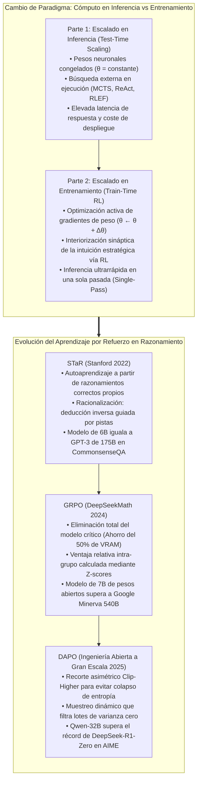
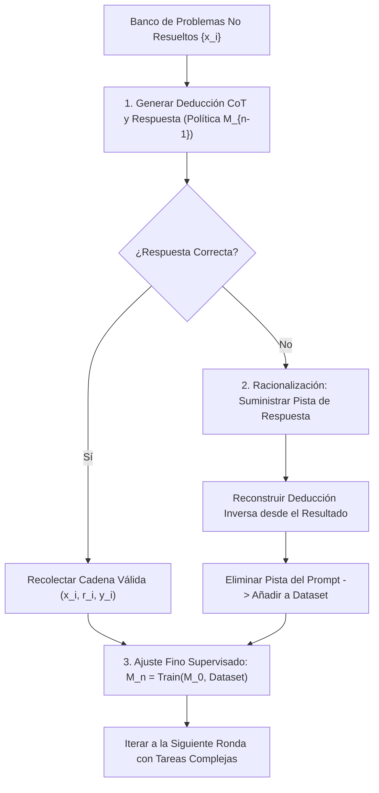
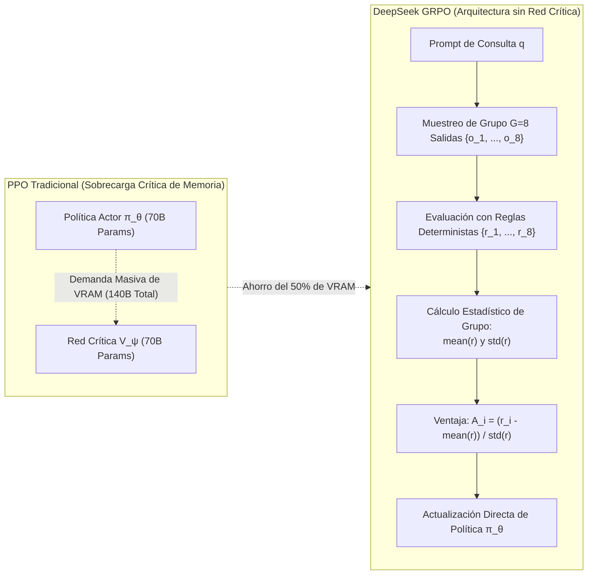

Bienvenidos a la sexta entrega de nuestro análisis técnico del curso de posgrado de la **Universidad de Stanford, CS329A: Self-Improving AI Agents (Agentes de IA que se Perfeccionan a Sí Mismos, Otoño 2025)**.

A lo largo de las Clases 1 a 5 (Parte 1: Fundamentos), estudiamos cómo exprimir al máximo la capacidad de modelos preentrenados y congelados mediante el cómputo en inferencia (Test-time Compute): explorando árboles de búsqueda con MCTS, recopilando diagnósticos de compiladores y podando caminos fallidos.

Sin embargo, debemos afrontar una verdad matemática ineludible:
Si a un estudiante de primaria se le otorgan diez minutos adicionales durante un examen, no será capaz de deducir una demostración compleja de cálculo infinitesimal. Si el modelo carece en sus sinapsis neuronales congeladas (parámetros de peso, $\theta$) de los conceptos matemáticos fundamentales, muestrear miles de rutas o forzar búsquedas exhaustivas no produce verdadera inteligencia: engendra pura suerte estocástica.

Hoy inauguramos la **Parte 2: Entrenamiento y Evolución (Clases 6 a 9)**, abordando la cuestión central de la autonomía:
> **«En lugar de gastar enormes recursos de cómputo en cada inferencia, ¿cómo podemos invertir cómputo masivo durante el entrenamiento para reescribir de forma permanente los pesos neuronales del modelo y convertirlo en un razonador de élite?»**

En esta **Clase 6**, desmantelamos los tres pilares algorítmicos que rompieron las limitaciones de la anotación humana y revolucionaron el razonamiento mediante **Aprendizaje por Refuerzo Posterior al Entrenamiento (Post-Training RL)**:
1. **Autoarranque del razonamiento:** Self-Taught Reasoner (**STaR**, Zelikman et al., Stanford 2022).
2. **La muerte de la red crítica (Critic):** Group Relative Policy Optimization (**GRPO**, DeepSeekMath 2024).
3. **Ingeniería industrial a escala de 1.000 GPUs:** Recorte desacoplado y muestreo dinámico (**DAPO**, 2025).



{/* truncate */}

---

### 1. Escalado en Entrenamiento vs Inferencia: Reorientación de la Frontera

Para comprender la rápida transición de la industria hacia el aprendizaje por refuerzo posterior al entrenamiento, debemos analizar la ecuación presupuestaria de cómputo (FLOPs):

```text
Compute_Total = Compute_Train + Compute_Inference
```

1. **Escalado en Inferencia (Test-Time Scaling):** El vector de parámetros $\theta$ permanece inmutable. El cómputo se consume en muestreos repetidos, búsquedas en haz y árboles MCTS. Aunque es útil en consultas puntuales, traslada una latencia prohibitiva y costes energéticos enormes a cada interacción de los usuarios en producción.
2. **Escalado en Entrenamiento (Train-Time Scaling):** El cómputo se invierte masivamente en la fase de entrenamiento para ajustar permanentemente los pesos $\theta$ mediante RL:

```text
θ* = argmax_θ E_{x ~ D, y ~ π_θ(·|x)} [ R(x, y) ]
```

Cuando el agente descubre estrategias deductivas óptimas mediante RL, la retropropagación graba esa habilidad directamente en las matrices de atención y capas densas. De este modo, en producción el modelo exhibe **una visión estratégica de gran maestro en una sola pasada hacia adelante (Single Forward Pass), sin necesidad de árboles de búsqueda externos**.

---

### 2. Autoarranque del Razonamiento: STaR (Zelikman et al., Stanford 2022)

El ajuste fino supervisado (SFT) requiere decenas de miles de ejemplos minuciosos (Problema $\to$ Razonamiento $\to$ Respuesta). Sin embargo, contratar a doctores en matemáticas o arquitectos de software para redactar millones de deducciones paso a paso resulta económicamente inasumible.

En 2022, el equipo de Eric Zelikman en la Universidad de Stanford planteó una propuesta transformadora:
> **«Si podemos verificar de forma automatizada y determinista si la respuesta final es correcta, ¿por qué no permitir que el propio modelo redacte sus razonamientos, filtrar aquellas cadenas que alcanzaron la solución válida y reentrenar al modelo sobre sus propios aciertos?»**

Así nació el **Self-Taught Reasoner (STaR)**.



#### Fundamento Matemático: Aproximación del Gradiente de Política

STaR no es un simple truco empírico; constituye una aproximación discreta del método de gradiente de política (Policy Gradient) bajo una función de recompensa indicadora $`1(y_hat = y*)`$:

```text
∇_θ J(θ) = ∑_i E_{r_hat, y_hat ~ π_θ(·|x_i)} [ 1(y_hat = y_i*) * ∇_θ log π_θ(r_hat, y_hat | x_i) ]
```

En las trayectorias erróneas, la función indicadora vale $\mathbb{1} = 0$, anulando el gradiente y descartando la muestra. En las trayectorias correctas donde $\mathbb{1} = 1$, se aplica ascenso de gradiente estándar, sesgando la distribución del modelo hacia rutas lógicas comprobadas.

#### La Racionalización: Construir Puentes Inversos

Un defecto evidente del filtrado ingenuo es que el modelo no puede aprender de problemas que jamás logra resolver. Si falla el 100% de los intentos en un problema complejo, genera cero datos positivos.

STaR resolvió esto mediante la **Racionalización**:
1. Ante una respuesta fallida, se suministra la respuesta correcta al final del prompt a modo de pista: *«Pista: La respuesta final es 42. Razona hacia atrás para explicar por qué 42 es el resultado matemáticamente necesario.»*
2. Al conocer el destino, el modelo logra tender el puente causal inverso.
3. **El paso clave:** Antes de integrar la muestra al conjunto de entrenamiento, **se suprime por completo la pista del texto**:

```text
Entrada de Dataset: Prompt [ x_i ] ──► Razonamiento Objetivo [ r_inverso ] + Respuesta [ y_i* ]
```

El modelo se entrena asumiendo que derivó la solución sin ayuda, interiorizando las conexiones deductivas para afrontar problemas similares en rondas posteriores.

#### Validación Empírica
* En el benchmark **CommonsenseQA**, aplicar STaR sobre un modelo **GPT-J de apenas 6B parámetros** catapultó su precisión del 60.0% al **72.5%**.
* Con ello, el modelo de 6B igualó las prestaciones de una versión especializada de **GPT-3 con 175B parámetros (73.0%)**, un modelo casi 30 veces más voluminoso.

---

### 3. La Muerte de la Red Crítica: DeepSeekMath y GRPO (2024)

Si bien STaR demostró el poder del autoarranque supervisado, el dominio del razonamiento formal exigía aprendizaje por refuerzo en línea auténtico.

#### El Colapso de PPO en Tareas de Deducción Matemática

El algoritmo estándar PPO (Proximal Policy Optimization), popularizado en el desarrollo de ChatGPT, requiere mantener en memoria dos redes neuronales gemelas:
1. **Red de Política (Actor, $\pi_\theta$):** Encargada de emitir los tokens.
2. **Red de Valor (Critic, $V_\psi$):** Encargada de predecir la recompensa esperada en cada estado intermedio.

Esto crea cuellos de botella insostenibles:
* **Sobrecarga de Memoria:** Entrenar un Actor de 70B exige desplegar un Critic de 70B, duplicando la VRAM necesaria.
* **Fallo en la Asignación de Crédito:** En demostraciones matemáticas extensas donde la recompensa escalar ($+1$ o $-1$) se otorga tras miles de tokens, entrenar un Critic preciso para cada token intermedio es inviable, desestabilizando los gradientes.

#### La Innovación de GRPO: Prescindir del Modelo de Valor

A comienzos de 2024, el equipo de DeepSeek introdujo **GRPO (Group Relative Policy Optimization)**:

> **«¿Por qué entrenar una costosa red de valor de miles de millones de parámetros? Para una consulta `q`, muestreemos un grupo de `G` soluciones $`{o_1, ..., o_G}`$ con la política actual. Calculemos la media y la desviación típica de sus recompensas y normalicemos mediante Z-scores. ¡Ese rango estadístico relativo constituye la ventaja (Advantage) exacta!»**



#### Función Objetivo Matemática de GRPO

GRPO optimiza la política $\pi_\theta$ regulada mediante divergencia KL frente a un modelo base $`pi_ref`$ sin recurrir a un Critic:

```text
J_GRPO(θ) = E_{q, {o_i}_{i=1}^G} [ 
    (1 / G) * ∑_{i=1}^G (1 / |o_i|) * ∑_{t=1}^{|o_i|} {
        min(
            ( π_θ(o_{i,t}) / π_old(o_{i,t}) ) * A_hat_{i,t},
            clip( π_θ(o_{i,t}) / π_old(o_{i,t}), 1 - ε, 1 + ε ) * A_hat_{i,t}
        )
    } - β * D_KL( π_θ || π_ref )
]
```

Donde la ventaja `A_hat_{i,t}` se calcula a partir de la estadística del grupo:

```text
A_hat_{i,t} = r_tilde_i = ( r_i - mean({r_1, ..., r_G}) ) / ( std({r_1, ..., r_G}) + δ )
```

#### Supervisión por Resultados vs por Procesos
1. **Supervisión de Resultados (Outcome):** Si la respuesta final de $o_i$ es acertada, $r_i = +1$; si falla, $-1$. La ventaja estandarizada `r_tilde_i` se asigna homogéneamente a cada token de la secuencia.
2. **Supervisión de Procesos (Process):** Se evalúan recompensas parciales por paso deductivo, acumulando la suma de ventajas futuras descontadas para cada token.

#### Récords en Benchmarks: 7B Derrota a 540B
* `DeepSeekMath-Base 7B`, preentrenado con 120B tokens matemáticos, **superó al modelo Minerva de 540B de Google**.
* La integración de GRPO impulsó la precisión en el benchmark MATH del 46.8% al **51.7%**, marcando el primer hito de código abierto donde un modelo puro de 7B rebasó el 50% en MATH sin calculadoras.
* Con 64 muestras de consistencia propia (Self-Consistency), alcanzó un asombroso **60.9%**.

---

### 4. De la Teoría a Clústeres de 1.000 GPUs: DAPO (2025)

Al replicar la fórmula teórica de GRPO en problemas de competición como **AIME 2024**, la comunidad científica tropezó con una barrera imprevista:
* Mientras DeepSeek-R1-Zero lograba 47 puntos en AIME, las implementaciones abiertas estándar de GRPO se estancaban en **apenas 30 puntos**.

En marzo de 2025, el marco **DAPO (Decoupled Clip and Dynamic Sampling Policy Optimization)** desveló cuatro reglas esenciales de ingeniería para estabilizar el RL a gran escala:

```text
GRPO Básico (30 pts) 
  ──► + Filtro de Longitud (36 pts) 
  ──► + Clip-Higher (38 pts) 
  ──► + Pérdida a Nivel de Token (42 pts) 
  ──► DAPO (50 pts, Superando a DeepSeek-R1-Zero)
```

#### Secreto 1: Recorte Asimétrico Clip-Higher ($`eps_low = 0.20, eps_high = 0.28`$)
* **El Fallo:** El recorte simétrico ($\pm 0.2$) asfixia la exploración. Si el modelo genera un token innovador con probabilidad inicial de 0.01, el límite superior $1 + 0.2 = 1.2\times$ lo restringe a 0.012, mientras que tokens comunes (0.9) escalan sin traba.
* **La Consecuencia:** El modelo deja de explorar ideas audaces y cae en el **colapso de entropía (Entropy Collapse)**, limitándose a respuestas breves y repetitivas.
* **La Solución DAPO:** Fijar $`eps_low = 0.20`$ para castigar malas rutas, pero elevar el límite superior a **$`eps_high = 0.28`$** (+40%), permitiendo que los tokens de alta creatividad escalen con fuerza.

#### Secreto 2: Muestreo Dinámico (Filtrado de Lotes Inertes)
* **El Fallo:** Si un problema resulta excesivamente fácil, las $G$ salidas aciertan ($r_i = 1$). Si es demasiado arduo, las $G$ fracasan ($r_i = 0$).
* En ambos casos, `formula`, la ventaja es cero y **miles de GPUs malgastan energía calculando gradientes nulos**.
* **La Solución DAPO:** Descartar activamente los lotes que no cumplan `0 < Correct Rollouts < G`, garantizando que el 100% del cómputo produzca gradientes informativos procedentes de varianza real.

#### Secreto 3: Normalización de Pérdida a Nivel de Token
El promedio por muestra diluye los fallos graves dentro de secuencias largas. DAPO normaliza la pérdida respecto a la suma agregada de tokens $\sum_i |o_i|$, impidiendo que los modelos inflen artificialmente sus respuestas para eludir penalizaciones.

#### Secreto 4: Penalización Suave para Secuencias Ultralargas
Cuando el modelo profundiza, corre el riesgo de superar el límite de contexto (ej.: 16.384 tokens). Penalizar con un $-1$ tajante arruina derivaciones valiosas. DAPO aplica una reducción suave y lineal a lo largo de los últimos 4.096 tokens, guiando al agente a cerrar sus demostraciones dentro del espacio disponible.

---

### 5. Arquitectura Empresarial: Infraestructura Distribuida de RL para Razonamiento

El despliegue productivo de modelos entrenados con GRPO/DAPO requiere desacoplar el motor de inferencia del clúster de gradientes:

```text
┌────────────────────────────────────────────────────────────────────────┐
│             Infraestructura Distribuida para GRPO/DAPO Empresarial     │
├────────────────────────────────────────────────────────────────────────┤
│                                                                        │
│  [ Banco Curricular de Tareas (Matemáticas / Compiladores / Tests) ]   │
│          │                                                             │
│          ▼                                                             │
│  ┌──────────────────────────────────────────────────────────────────┐  │
│  │                    Motor de Lotes y Muestreo Dinámico            │  │
│  │  • Balanceador de Dificultad: Filtro de lotes 100% éxito / fallo │  │
│  │  • Empaquetado y Optimización de Longitud de Ventana             │  │
│  └───────────────────┬──────────────────────────────────────────────┘  │
│                      │ Lotes de Alta Varianza                          │
│                      ▼                                                 │
│  ┌──────────────────────────────────────────────────────────────────┐  │
│  │                    Flota de Inferencia vLLM / TensorRT-LLM       │  │
│  │  • Nodos Dedicados a Generación Asíncrona de Grupos (G=8)        │  │
│  │  • Gestión de Memoria KV-Cache con PagedAttention                │  │
│  └───────────────────┬──────────────────────────────▲───────────────┘  │
│                      │ Trazas Generadas {o_1..o_G}  │ Pesos            │
│                      ▼                              │ Sincronizados θ  │
│  ┌──────────────────────────────────────────────────┴───────────────┐  │
│  │                    Verificadores Deterministas con Reglas        │  │
│  │  • Sandboxes Seguros Docker/gVisor (Python y SymPy)              │  │
│  │  • Comprobación de Estructura de Pensamiento `<think>`           │  │
│  │  • Normalización de Ventaja de Grupo: A_i = (r - μ) / σ          │  │
│  └───────────────────┬──────────────────────────────────────────────┘  │
│                      │ Flujo de Ventajas por Token                     │
│                      ▼                                                 │
│  ┌──────────────────────────────────────────────────────────────────┐  │
│  │                    Clúster de Entrenamiento Megatron / DeepSpeed │  │
│  │  • Modelo de Política Único (Sin modelo de valor Critic)         │  │
│  │  • Motor de Gradiente Asimétrico Clip-Higher (ε_high = 0.28)     │  │
│  │  • Optimización de Pérdida por Token vía FlashAttention-3        │  │
│  └──────────────────────────────────────────────────────────────────┘  │
│                                                                        │
└────────────────────────────────────────────────────────────────────────┘
```

#### Principios de Operación en Producción
1. **Exclusión Humana del Bucle de Refuerzo:** Entrenar únicamente con recompensas verificables y deterministas (compiladores, resolvedores simbólicos, pruebas unitarias). No emplear preferencias humanas en RL de razonamiento formal.
2. **Segregación Física de Flotas:** Separar las GPUs dedicadas al muestreo masivo (vLLM) de aquellas asignadas al cálculo de gradientes (Megatron-LM), enlazándolas mediante redes RDMA de baja latencia.
3. **Control Estricto de Formato:** Sancionar los desvíos del protocolo `<think> ... </think>` para evitar que el modelo intente adivinar la respuesta omitiendo el razonamiento.

---

### 6. Preguntas Técnicas Clave y Lecciones de Ingeniería

**P: ¿Por qué sigue siendo necesaria la penalización de divergencia KL en GRPO y cuándo debe relajarse?**
**A:** El término KL ($\beta `D_KL`(\pi_\theta \parallel `pi_ref`)$) previene el **hackeo de recompensas (Reward Hacking)** y el olvido catastrófico. Sin este anclaje, el modelo podría emitir secuencias anómalas que engañen al analizador de respuestas. No obstante, para fomentar la emergencia de razonamientos profundos y extensos, en las fases iniciales se fija deliberadamente $\beta \to 0$, reintroduciendo la regulación KL en fases posteriores de consolidación.

**P: En STaR, ¿la Racionalización no induce al modelo a copiar respuestas mediante trampas?**
**A:** El secreto radica en la estricta **disociación temporal entre la generación y la actualización de pesos**. La pista se facilita exclusivamente para trazar el camino causal inverso durante la deducción. Antes de incorporar el ejemplo al entrenamiento, la pista se suprime por completo. Para el modelo durante el descenso de gradiente, la solución parece haber sido concebida de forma plenamente autónoma.

---

### 7. Resumen y Conclusiones Técnicas

1. **La Frontera del Entrenamiento:** La inferencia no crea conocimientos ausentes de las sinapsis. El escalado en entrenamiento graba la capacidad de razonamiento estratégico directamente en los pesos neuronales.
2. **Autoarranque Eficaz:** STaR demuestra que los modelos pueden autoentrenarse filtrando sus aciertos y deduciendo hacia atrás mediante racionalización, igualando a arquitecturas 30 veces más grandes.
3. **Revolución sin Red Crítica:** GRPO de DeepSeek prescinde de modelos de valor, reduce el consumo de memoria en un 50% y obtiene ventajas robustas a partir de comparaciones relativas en grupo.
4. **Ingeniería de Escala:** DAPO estabiliza el aprendizaje mediante recorte asimétrico Clip-Higher ($\epsilon=0.28$), muestreo dinámico y pérdidas a nivel de token, superando a DeepSeek-R1-Zero con la mitad de pasos de cálculo.

---

### Próxima Sesión de Stanford CS329A:
En la **Clase 7**, daremos el salto desde la resolución de problemas prefijados hacia la investigación científica autónoma:
**《Clase 7: Evolución Abierta: ADAS, The AI Scientist, AlphaEvolve y Arquitecturas de Agentes Autoevolutivos》**.
Descubriremos cómo los agentes diseñan nuevas arquitecturas de aprendizaje automático y redactan sus propios artículos científicos. ¡No se lo pierdan!