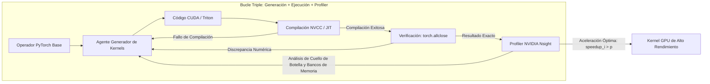

# Stanford CS329A (Ep 10): SWE-Agents — Ingeniería de Software Autónoma, CodeMonkeys, KernelBench y la Interfaz Agente-Sistema

La ingeniería de software en entornos productivos reales difiere radicalmente de los ejercicios algorítmicos aislados o los bancos de pruebas sintéticos. Un informe de error en GitHub no se limita a un único archivo bien acotado; suele hallarse disperso entre cientos de módulos, dependencias heredadas y millones de líneas de código distribuido. Además, en producción el software no solo debe ser semánticamente correcto (Correct), sino que debe resultar computacionalmente veloz (Fast) y estar perfectamente alineado con las arquitecturas físicas de hardware paralelo (Aligned).

Con esta lección inauguramos la **Parte 3: Ingeniería de Agentes (Lecciones 10 a 12)** del curso **Stanford CS329A: Self-Improving AI Agents (Agentes de IA Autoevolutivos)**, trasladándonos desde los clústeres de entrenamiento hacia los desafíos concretos del desarrollo de software a gran escala:
> **"¿Cómo pueden los agentes de IA explorar repositorios corporativos de millones de tokens, aislar fallos esquivos, sintetizar arneses de pruebas reproducibles y escribir kernels GPU que superen en velocidad a los estándares humanos de PyTorch?"**

En este artículo exploramos la frontera de **SWE-Agent Autonomous Coding (Codificación Autónoma con Agentes de Software)** a través de tres hitos: **CodeMonkeys Automated Refactoring (Refactorización Automatizada CodeMonkeys)** en el exigente **SWE-bench Benchmark GitHub**, **KernelBench GPU Performance Tuning (Optimización de Rendimiento en GPU con KernelBench)** mediante ciclos de retroalimentación con profilers, y la capa **Agent-Computer Interface ACI (Interfaz Agente-Sistema ASI)** diseñada en Stanford para suprimir la discordancia semántica entre la intención abstracta del modelo y el hardware físico.

{/* truncate */}


---

## 1. Desafíos Prácticos en Agentes de Ingeniería de Software

Abordar incidencias reales en repositorios abiertos exige resolver tres problemas arquitectónicos críticos:
1. **Explosión del Contexto (Context Explosion):** Un repositorio empresarial promedio supera los 3.000.000 de tokens. Procesar semejante volumen directamente en LLMs frontera resulta inviable por coste económico y dispersión atencional.
2. **Autoengaño en la Verificación (Self-Deceptive Verification):** Si se permite al agente modificar el código antes de formular una prueba independiente, tiende a escribir pruebas manipuladas que aprueban parches defectuosos.
3. **Barrera del Hardware:** Escribir extensiones de bajo nivel en CUDA o Triton exige coordinar alineaciones de memoria, accesos a registros y sincronización entre hilos, provocando el fallo casi total de los intentos directos de un solo disparo (One-shot).

```
┌─────────────────────────────────────────────────────────────────────────┐
│              Los 3 Pilares de los SWE-Agents en Producción              │
└────────────────────────────────────┬────────────────────────────────────┘
                                     │
       ┌─────────────────────────────┼─────────────────────────────┐
       ▼                             ▼                             ▼
┌──────────────────────────┐  ┌──────────────────────────┐  ┌──────────────────────────┐
│  CodeMonkeys SWE-bench   │  │   Profiler KernelBench   │  │  Interfaz ASI (Stanford) │
├──────────────────────────┤  ├──────────────────────────┤  ├──────────────────────────┤
│ • Compresión 50.5x       │  │ • Métrica fast_p de muro │  │ • Compresión DSL de 14x  │
│ • Depuración Bipersonal  │  │ • Bucle E+P con Profiler │  │ • Traductor AutoGuide    │
│ • Pruebas Discriminantes │  │ • Fusión y Memoria Comp. │  │ • Alineación de Hardware │
│ • 57.4% SWE-bench Verif. │  │ • Aceleración hasta 13x  │  │ • 3.8x más veloz q' Tuner│
└──────────────────────────┘  └──────────────────────────┘  └──────────────────────────┘
```

---

## 2. Resolución de Errores Reales en GitHub: CodeMonkeys (2025)

El estándar de oro para calibrar agentes de software autónomos es **SWE-bench Verified** (500 incidencias reales extraídas de proyectos como Django, SymPy y scikit-learn).

Presentado a inicios de 2025, **CodeMonkeys** logró una tasa de resolución récord del **57.4%** estructurando el proceso en tres fases estrictas:

```
                  [Informe de Error de GitHub y Repositorio de 3M Tokens]
                                         │
                                         ▼
           1. Canalización de Contexto (Escaneo Completo y Compresión 50.5x)
              (Qwen2.5-Coder local -> Resumen -> Jerarquización -> 128k)
                                         │
                                         ▼
           2. Máquinas de Estado de Generación (Depuración Bipersonal)
              ┌────────────────────────────────────────────────────────┐
              │ Máquina de Pruebas: Crea Test de Reproducción (Exit 2) │
              │                       │                                │
              │                       ▼                                │
              │ Máquina de Edición: Aplica Parche y Valida (Exit 0)    │
              └────────────────────────────────────────────────────────┘
                                         │
                                         ▼
           3. Máquina de Estado de Selección (Pruebas Discriminantes)
              (Sintetiza pruebas de casos límite para descartar parches falsos)
                                         │
                                         ▼
                       [Envío del Parche Final Verificado]
                     (57.4% Resuelto en SWE-bench Verified)
```

### Fase 1: Canalización de Contexto (Compresión 50.5x)
Interrogar modelos comerciales como Claude 3.5 Sonnet sobre repositorios de millones de tokens arruinaría cualquier presupuesto. CodeMonkeys desacopla la exploración contextual de la edición:
- Emplea un modelo local de bajo coste (`Qwen2.5-Coder-32B`) para rastrear cada archivo Python del proyecto.
- Extrae firmas de funciones, jerarquías de clases y documentación clave.
- Mediante un cribado posterior, condensa una base de 3.000.000 de tokens en una **ventana operativa de 128.000 tokens (reducción de 50.5x)**.
- Este artefacto se comparte entre 10 trayectorias paralelas, limitando el coste de exploración a **menos del 15% del total**.

### Fase 2: Depuración Bipersonal (Two-Sided Debugging)
Para evitar que el modelo asuma falsamente que un error ha sido resuelto, CodeMonkeys conecta dos máquinas de estados:
1. **Máquina de Pruebas (Testing State Machine):** Analiza el problema y redacta un script autónomo (`reproduce_issue.py`). Dicho script debe ejecutarse sobre el repositorio sin modificar y devolver obligatoriamente **Exit Code 2 (Fallo Confirmado)**.
2. **Máquina de Edición (Editing State Machine):** Con la prueba fallida establecida como criterio estricto, interviene el código fuente. Itera hasta 8 veces contra trazas de error hasta lograr que el script retorne **Exit Code 0 (Éxito)**.

### Fase 3: Selección por Pruebas Discriminantes
Muestrear 10 trayectorias paralelas ofrece una cobertura del **69.8%** (al menos un parche funcional presente). No obstante, elegir al azar hace caer la precisión al **45.8%**, pues muchos parches introducen regresiones secundarias.

CodeMonkeys resolvió esto mediante su **Máquina de Selección por Discriminación**:
- Identifica discrepancias de comportamiento sutiles entre dos parches candidatos $P_A$ y $P_B$.
- Instruye al modelo para redactar una **prueba discriminante** que apruebe en $P_A$ y suspenda en $P_B$.
- Al correr estas pruebas en sandboxes aislados, descarta candidatos defectuosos y consolida una precisión final del **57.4%**.

---

## 3. De la Corrección a la Velocidad de Ejecución: KernelBench (2025)

En la infraestructura de inteligencia artificial, la optimización de kernels GPU define la viabilidad económica de centros de datos enteros. FlashAttention requirió cinco años de refinamiento manual por expertos tras publicarse la arquitectura Transformer. ¿Pueden los agentes autónomos crear kernels de CUDA o Triton competitivos a partir de código PyTorch?

Presentado en febrero de 2025, **KernelBench** evalúa agentes sobre 250 operadores de PyTorch, analizando simultáneamente exactitud matemática y aceleración física en hardware.

```text
La Métrica de Aceleración fast_p en Tiempo Real:
========================================================================================
fast_p = (1 / N) * Σ_{i=1}^N  1[ correct_i  AND  speedup_i > p ]

Interpretación física:
  • fast_0 : Corrección Funcional (Coincidencia con PyTorch: torch.allclose)
  • fast_1 : Correcto y Más Rápido que PyTorch Estándar (Speedup > 1.0x)
  • fast_2 : Correcto y Más del Doble de Rápido que PyTorch (Speedup > 2.0x)
========================================================================================
```



### El Impacto de la Retroalimentación con Profiler
En esquemas de generación directa (One-shot), incluso modelos como o1 o DeepSeek-R1 presentan dificultades: **menos del 20% de sus kernels superan a PyTorch ($fast_1 < 20\%$)**, fallando a menudo por fallos de segmentación (Segfaults) o colisiones de memoria compartida.

Al acoplar el bucle triple de **Generación + Ejecución (Compilador) + Profiler Nsight (E+P)**:
- La tasa de éxito en operadores complejos (Nivel 2) con DeepSeek-R1 aumentó del 36% al **72%**.
- El agente incorporó de forma autónoma fusión de operadores (Operator Fusion), teselado (Tiling) y reducciones sobre memoria compartida, logrando **aceleraciones de hasta 13x respecto a PyTorch base**.

---

## 4. Alineación Semántica: Interfaz Agente-Sistema (ASI, Stanford 2025)

Al exigir que un modelo interactúe con punteros C++ de bajo nivel o configuraciones distribuidas, surge un desfase estructural. El grupo del profesor Alex Aiken en Stanford (ICML 2025) formalizó la **Agent-System Interface (ASI)** para sortear este abismo:
> **"Obligar a un LLM a lidiar con punteros crudos o registros de depuración incomprensibles es contraproducente. Es indispensable interponer una capa intermedia: un lenguaje de dominio específico (DSL) declarativo y un asistente AutoGuide que traduzca aserciones crudas en directrices prácticas."**

```text
┌─────────────────────────────────────────────────────────────────────────┐
│                        Agente de Razonamiento LLM                       │
│           (Intención Declarativa y Estrategia de Optimización)          │
└────────────────────────────────────▲────────────────────────────────────┘
                                     │
          ┌──────────────────────────┴──────────────────────────┐
          │ Directivas DSL de        ▲ Guía Práctica en         │
          │ Nivel Declarativo        │ Lenguaje Natural         │
          ▼                          │ (AutoGuide)              │
┌────────────────────────────────────┴────────────────────────────────────┐
│                    Capa Intermedia ASI (Stanford)                       │
│  • Lenguaje Específico (DSL): Reduce la Complejidad del Código 14x      │
│  • Traductor AutoGuide: Convierte Fallos de Hardware en Instrucciones    │
└────────────────────────────────────▲────────────────────────────────────┘
                                     │
          │ Código C++ de Bajo Nivel ▲ Señales de Fallo Físico  │
          │ y Asignación de Memoria  │ y Aserciones del Kernel  │
          ▼                          │                          │
┌────────────────────────────────────┴────────────────────────────────────┐
│                  Hardware Paralelo Físico en Ejecución                  │
│                (Memoria Distribuida, Núcleos GPU y VRAM)                │
└─────────────────────────────────────────────────────────────────────────┘
```

### Componentes de la Capa ASI
1. **Lenguaje de Dominio Específico (DSL):** Reemplaza miles de líneas de plantillas C++ complejas por directivas concisas sobre esquemas de memoria, **comprimiendo el código 14 veces** y previniendo errores de sintaxis.
2. **Traductor AutoGuide:** Cuando el hardware arroja errores opacos como `"Assertion failed: stride mismatch at dim 1"`, AutoGuide intercepta la señal y la traduce para el modelo:
   > *"Diagnóstico: Conflicto de alineación porque la dimensión 1 no se halla configurada en múltiplos de 32 bytes. Modifique la directiva de distribución Row-major para incorporar padding a 32 bytes."*

### Resultados: 10 Iteraciones Superan a 1.000
Con el soporte de ASI, un agente requirió solo **10 iteraciones** para concebir una distribución paralela **3.8 veces más veloz** que la mejor solución obtenida por **OpenTuner tras 1.000 iteraciones**. Tareas que consumían jornadas de trabajo a ingenieros especializados se solventaron en **10 minutos**.

---

## 5. Comparativa entre Enfoques de Ingeniería de Software

```text
=========================================================================================================
Dimensión              Autocompletado Clásico (Copilot) CodeMonkeys (SWE-bench)   KernelBench + ASI
---------------------------------------------------------------------------------------------------------
Unidad de Código       Funciones individuales / Snippet Parches multifile completos Kernels CUDA/Triton veloces
Manejo de Contexto     Archivos activos (4k-8k tokens)  128k comprimido (50.5x)   DSL declarativo (14x menos)
Bucle de Verificación  Compilación elemental            Depuración bipersonal     Nsight Profiler (fast_p)
Retroalimentación      Trazas de error básicas          Transición Exit 2 a 0     Traducción AutoGuide
Objetivo Primario      Corrección sintáctica            Solución de regresiones   Aceleración física en muro
=========================================================================================================
```

---

## 6. Preguntas Técnicas Frecuentes

### P1: ¿Por qué CodeMonkeys impone crear la prueba de reproducción ANTES de tocar el código?
Si el agente modifica el código en primer lugar, cae en la trampa del autoengaño: formula una solución defectuosa y acto seguido redacta una prueba complaciente que aprueba su propio código imperfecto.

Garantizar que la **Testing State Machine** genere primero un script que arroje **Exit Code 2 (Fallo Confirmado)** en el código original proporciona un árbitro inmutable. Solo cuando la posterior **Editing State Machine** transforma ese fallo en **Exit Code 0** queda matemáticamente demostrado que el error ha sido erradicado.

### P2: ¿Qué provoca los fallos en kernels de CUDA de un solo intento y cómo ayuda el profiler?
Los modelos comprenden operaciones matemáticas matriciales pero fallan en la mecánica interna de las GPUs:
- **Límites de Hilos:** Errores en índices como `blockIdx.x * blockDim.x + threadIdx.x` causan fallos de segmentación inmediatos.
- **Conflictos de Bancos:** Accesos concurrentes al mismo banco de memoria compartida serializan las operaciones, arruinando la latencia.

Los compiladores corrientes solo validan la sintaxis. El **bucle con Profiler (E+P)** aporta métricas precisas sobre ocupación de memoria y divergencia de warps, guiando al agente para introducir optimizaciones críticas como el reuso de registros y memoria compartida con padding.

---

## Resumen y Próxima Lección

Los agentes de ingeniería de software han superado la etapa del mero autocompletado de funciones. A través de **CodeMonkeys**, comprobamos cómo la compresión jerárquica de contexto y la depuración bipersonal resuelven problemas reales en SWE-bench. Con **KernelBench** y **ASI**, evidenciamos que enlazar profilers de hardware y abstracciones declarativas permite a las máquinas optimizar infraestructuras de cómputo de alto rendimiento.

En la **Lección 11**, abordaremos el problema crítico de la persistencia cognitiva: **Agent Memory — Sistemas Jerárquicos de Memoria, Cartridges, CacheBlend y Retención Contextual de Largo Plazo (MemGPT)**.

---

### Puntos Relevantes
- **Amortización del Contexto:** Filtrar repositorios con modelos ligeros (reducción 50.5x) hace económicamente viable el análisis de código a gran escala.
- **Depuración Bipersonal (Two-Sided):** Exigir una prueba previa que cambie de Exit 2 a Exit 0 es indispensable para evitar parches falsos.
- **Rendimiento como Ciclo Iterativo:** Desarrollar código GPU de vanguardia requiere integrar profilers de telemetría de hardware (métrica fast_p) dentro del bucle de decisión.