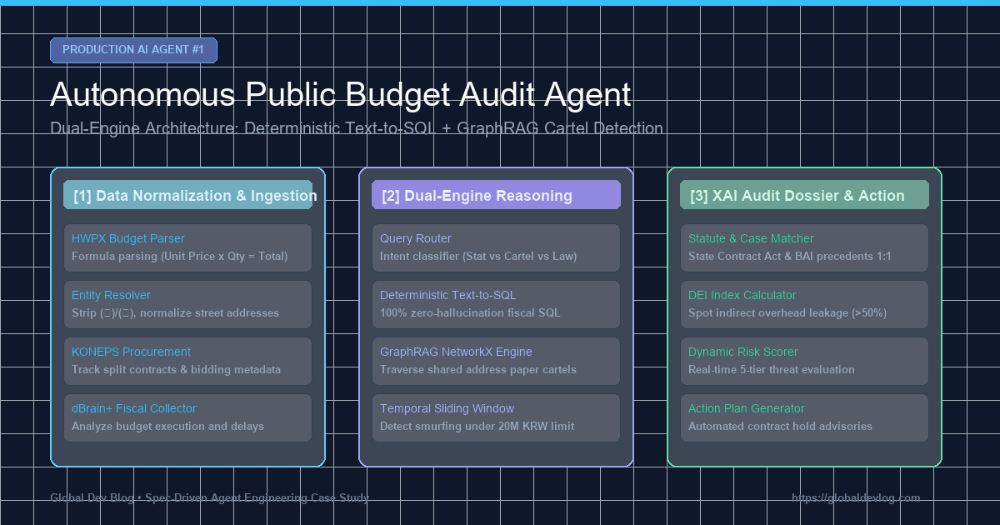

> **Aviso de simulación — datos sintéticos**
> - Esta entrada describe una **simulación construida con datos sintéticos (generados)**. Los «hallazgos», sanciones, importes de recuperación y recuentos no son resultados de auditoría reales.
> - Todos los organismos, empresas, regiones, importes y números de documento están **anonimizados o sustituidos por valores ficticios**; cualquier parecido con entidades reales no es intencionado.
> - Los registros de error, fragmentos de código y cifras de rendimiento fueron **reconstruidos para explicar el diseño** y pueden no coincidir con los registros de ejecución ni con la implementación actual del repositorio.
> - Salvo llamadas limitadas a las API de contratación pública (KONEPS) y de Open Fiscal Data, las fuentes de datos mencionadas (DART, registros mercantiles, e-Hojo+, K-EduFine, ALIO, NTIS, etc.) **no estaban conectadas**. Se está reconstruyendo el sistema con datos abiertos públicos; los resultados se publicarán solo como «indicadores estadísticos de anomalía», nunca como acusaciones.

> 📌 **Puntos Clave (Key Takeaways)**
> - **El Objetivo**: Construir un agente de IA autónomo capaz de auditar presupuestos públicos anuales de $500B, rastreando contrataciones gubernamentales, libros contables y documentos HWPX no estructurados para detectar sobrecostos y cárteles de licitación.
> - **Prevención Arquitectónica**: Eliminamos las alucinaciones numéricas delegando cálculos a un motor **Text-to-SQL Determinista**, aislando las redes de colusión en un **Grafo de Conocimiento Heterogéneo (GraphRAG)** en una arquitectura Dual-Brain.
> - **Errores Reales Resueltos**: (1) Solucionamos la fragmentación de nombres comerciales y direcciones que rompía la detección de cárteles con `EntityResolver`; (2) Capturamos la división temporal de contratos con ventanas deslizantes de 30 días; (3) Superamos la desconfianza del auditor integrando un generador XAI vinculado a leyes y jurisprudencia.
> - **Resultados**: 11 suites de pruebas de regresión pasadas al 100%, desarticulando un cártel de contratación de 38.5M KRW con domicilio compartido y un 70% de fuga en gastos indirectos.

{/* truncate */}

---

### Lecciones de Producción:
1. **Delega las matemáticas a la base de datos**: Los LLMs no deben calcular; deben traducir a SQL estricto.
2. **Los datos reales siempre están fragmentados**: Normalizar entidades corporativas y domicilios es esencial para que los grafos no colapsen.
3. **La explicabilidad otorga validez legal**: Un puntaje probabilístico no basta; vincular las alertas a estatutos legales y precedentes es indispensable.
