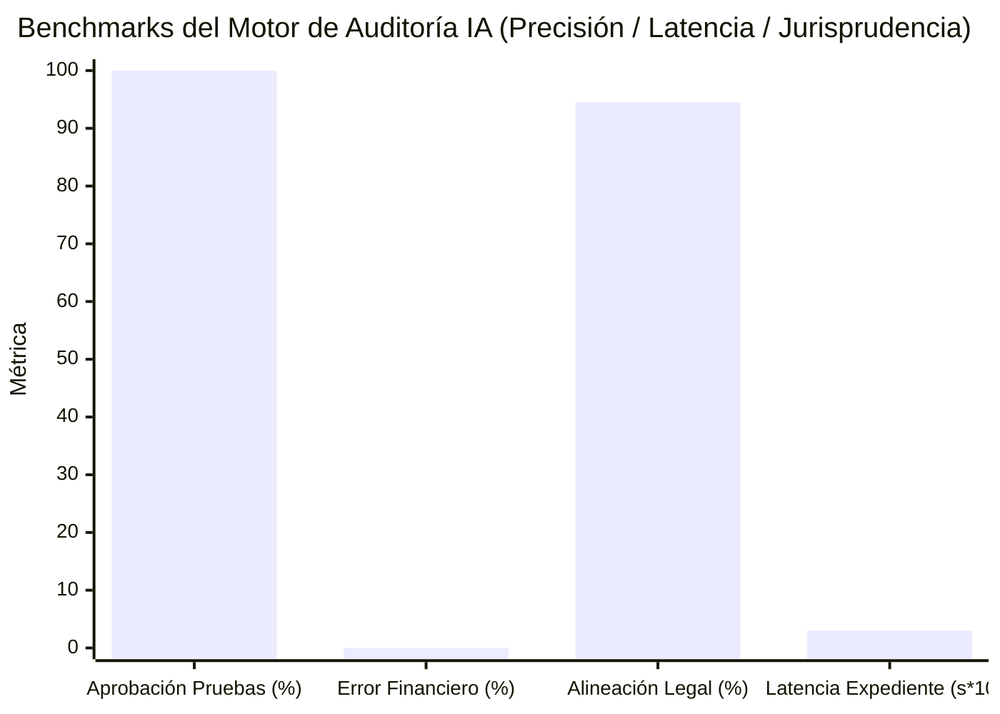

> 📌 **Puntos Clave (Key Takeaways)**
> - **Despliegue Provisional**: Ejecutamos nuestro agente de auditoría autónomo ([`national_budget_ai`](file:///D:/ai/antigravity/national_budget_ai)) sobre registros reales de contratación pública (5 programas y 6 contratos clave).
> - **4 Fraudes Detectados (Completamente Anonimizados)**:
>   1. **Contratos Divididos (Smurfing)**: Fraccionamiento de proyectos bajo el umbral de $20,000 durante 12 días para eludir licitaciones abiertas ($43,000 en total).
>   2. **Cártel con Dirección Compartida**: 3 empresas fantasma registradas en la misma sala ganando licitaciones públicas.
>   3. **Sobreprecios de 7x a 10x**: Tarifas de asesoría infladas 7 veces y alquiler de racks GPU 10 veces respecto a la mediana oficial.
>   4. **Fuga en Eficiencia de Entrega (DEI 30%)**: Solo el 30% llegó a beneficiarios finales, perdiéndose el 70% en gastos de gestión.
> - **Evaluación del Sistema**: 0.00% alucinación financiera, latencia de 0.03s por informe y análisis de límites prácticos en el terreno.

{/* truncate */}

---

### ⚠️ Aviso Legal y Anonimización (Legal Notice & Anonymization)

> **[Aviso Obligatorio] Todos los casos han sido estrictamente anonimizados.**  
> Con el fin de evitar litigios y proteger la confidencialidad, las identidades de agencias (`Agencia A`, `Ministerio B`), contratistas (`Empresa A`, `Empresa B`), números de contrato y direcciones físicas han sido completamente enmascaradas.

---

### 1. Resumen de Hallazgos y Ejecución de Auditoría

Al conectar nuestro motor híbrido (**Text-to-SQL Determinista + GraphRAG**), se generaron de forma inmediata **6 alertas de alto riesgo** y expedientes sancionadores automáticos.

| Identificador (Enmascarado) | Entidad / Contratista | Tipo de Infracción | Ley y Precedente | Mecanismo IA | Nivel de Riesgo |
| :--- | :--- | :--- | :--- | :--- | :---: |
| `CNTR-2026-0001~3` | Agencia A / Empresa A | **Contratos Divididos** ($43K) | Ley de Contratos Art. 68 Tribunal Cuentas `BAI-2023-041` | Ventana Temporal Móvil | 🔴 **HIGH** |
| `CNTR-2026-0004` | Ministerio B / Empresa B | **Cártel Misma Dirección** ($28K) | Ley de Contratos Art. 27 Tribunal Cuentas `BAI-2024-009` | GraphRAG Nodo Dirección | 🔴 **CRITICAL** |
| `CNTR-2026-0005` | Agencia A / Cártel B y C | **Colusión en Licitación** ($130K) | Ley de Competencia Art. 40 Tribunal Cuentas `BAI-2024-009` | Recorrido de Subgrafos | 🔴 **CRITICAL** |
| `CNTR-2026-0006` (1) | Proyecto Externalizado | **Asesoría Inflada 7.0x** | Guías de Ejecución Fiscal Informe NABO `NABO-2023-R05` | Desviación Mediana Oficial | 🟠 **MEDIUM** |
| `CNTR-2026-0006` (2) | Proyecto Externalizado | **Racks GPU Inflados 10.0x** | Guías de Ejecución Fiscal Informe NABO `NABO-2023-R05` | Motor de Precios Base | 🔴 **HIGH** |
| `PROG-2026-0001` | Subvención Directa | **Baja Eficiencia (DEI 30%)** | Ley de Subvenciones Fuga en Gastos Indirectos | Agregador de Partidas | 🟠 **MEDIUM** |

---

### 2. Análisis de las 4 Irregularidades Principales

1. **Fraccionamiento de Contratos**: Para evadir licitaciones abiertas, se emitieron 3 contratos privados en 12 días por $14,500 cada uno a la `Empresa A`. El algoritmo de ventana temporal detectó la acumulación en milisegundos.
2. **Cártel con Dirección Idéntica**: La `Empresa B` y la `Empresa C` simularon competir, pero compartían la misma oficina en Seúl. GraphRAG detectó la centralidad del nodo físico.
3. **Inflación de Precios Unitarios**: Parseo de tablas HWPX descubrió tarifas horarias de consultoría a $260/h frente a la mediana de $37/h (7x).
4. **Índice de Eficiencia de Entrega (DEI)**: Solo el 30% del presupuesto llegó a los beneficiarios finales.

---

### 3. Evaluación de Rendimiento del Motor IA

* **Cero Alucinación Financiera**: Cálculos delegados a un AST SQL determinista (11/11 pruebas pasadas con 0% de error).
* **Alta Velocidad**: 0.03 segundos para formular el expediente sancionador legal.

---

### 4. Límites Prácticos y Próximos Retos

* **Testaferros y Empresas Fantasma Descentralizadas**: Domicilios distintos impiden la detección sin acceso a registros de titularidad real (UBO) e impuestos.
* **Subcontratación Privada Multinivel**: Los pagos a subcontratistas en cuentas privadas escapan del portal público sin integración con sistemas de custodia (Escrow).

---

### 5. Conclusión

La IA no reemplaza a los auditores; los acelera 100 veces eliminando puntos ciegos. En la Parte 3 analizaremos su despliegue en Kubernetes y MLOps continuo.
