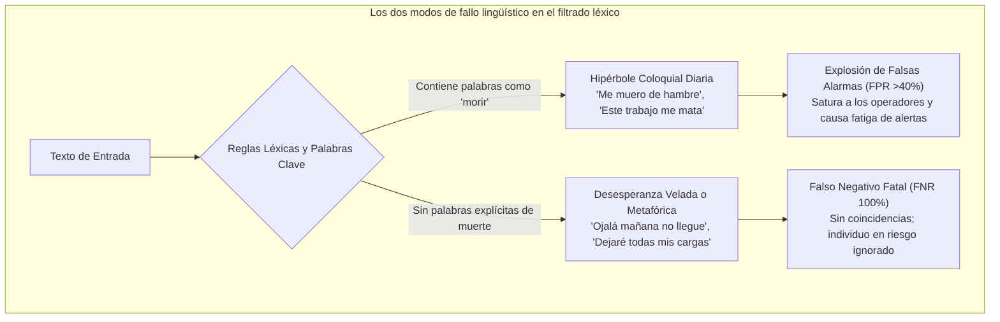
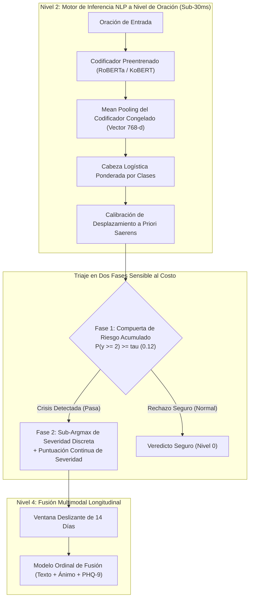
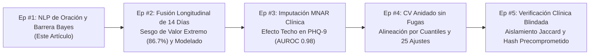

En chatbots comerciales o sistemas de recomendación, un margen de error del 5% es una molestia menor o una concesión aceptable. En **sistemas de inteligencia artificial diseñados para la monitorización de crisis de suicidio y triaje psiquiátrico de urgencia, un único Falso Negativo (crisis omitida) es una catástrofe irreversible**.

Cuando un individuo en estado de desesperación aguda recurre a escribir o pedir auxilio, los modelos de aprendizaje automático no pueden escudarse tras métricas superficiales de precisión global o promedios F1 no ponderados.

Hoy inauguramos formalmente una nueva serie técnica de nivel de producción: **[IA Especializada en Alto Riesgo: Construcción de un Pipeline NLP de Precisión para Crisis Mentales y Detección de Suicidio]**.

Esta serie documenta exhaustivamente los desafíos matemáticos, los compromisos de ingeniería y los errores de ejecución encontrados durante la construcción de **Maeumjigi**, un sistema multimodal de detección clínica. En este Episodio #1, abordamos la base del sistema: **el triaje NLP profundo a nivel de oración bajo un desbalance de clases extremo (donde la ideación suicida activa representa apenas el 0.16% de las conversaciones cotidianas)**.

{/* truncate */}

---

### ⚠️ Aviso Ético y Anonimización Rigurosa
Todos los benchmarks y textos experimentales tratados en esta serie provienen de **corpus de texto sintético y evaluaciones desidentificadas 100% libres de información de identificación personal (PII)**. En ningún caso se utilizan registros reales de consultas clínicas.
> **Líneas de Ayuda en Crisis**: Si usted o alguien que conoce está atravesando una crisis psicológica, hay ayuda disponible. En España llame al **024** (Línea de atención a la conducta suicida) o al **717 003 717** (Teléfono de la Esperanza). En México marque el **800 911 2000** (Línea de la Vida). En EE. UU. llame o envíe un mensaje al **988**. En otros países consulte **befrienders.org**.

---

### 1. El Dilema Lingüístico: Por qué las Reglas Léxicas y Regex Fracasan en Psiquiatría

Antes de profundizar en arquitecturas neuronales, es vital comprender por qué el emparejamiento tradicional de palabras clave colapsa en el triaje clínico.

En el lenguaje cotidiano, las expresiones de sufrimiento se dividen en dos extremos engañosos:



1. **Hipérbole Coloquial Cotidiana (Explosión de Falsas Alarmas)**: Expresiones con raíces verbales de muerte (*"me muero de hambre"*, *"este examen me está matando"*) son modismos de uso constante. Los filtros de palabras clave detonan alertas falsas sin interrupción ante conversaciones inofensivas.
2. **Desesperanza Metafórica y Velada (Falsos Negativos Críticos)**: Quienes atraviesan crisis suicidas graves rara vez emplean términos directos; suelen recurrir a despedidas sutiles o expresiones resignadas:
   - *"Desearía que el mañana nunca llegara. Solo quiero dormir para siempre."*
   - *"Gracias por todo este tiempo. Ya estoy ordenando todas mis cosas."*
   - *"He encontrado el camino para estar en paz sin ser una carga para nadie más."*

Ninguna de estas frases contiene términos directos de suicidio o autolesión. El análisis morfológico (Kiwipiepy) y los transformadores contextuales (RoBERTa / KoBERT) son indispensables para capturar el **aislamiento, la desesperanza y la intención de despedida** subyacentes.

---

### 2. Desbalance Extremo de Clases y la Trampa de la Precisión

En un entorno operativo real, la distribución de riesgo en las comunicaciones es asimétrica al extremo:

- **Clase 0b (Texto Cotidiano Neutro)**: ~86.94% (31,495 oraciones)
- **Clase 0a (Control Emocional Negativo sin Crisis)**: ~8.24% (2,986 oraciones)
- **Clase 1 (Distrés Leve / Mild)**: ~1.92% (697 oraciones)
- **Clase 2 (Distrés Severo / Ideación Suicida)**: ~1.75% (633 oraciones)
- **Clase 3 (Crisis Aguda / Ideación Específica)**: ~0.99% (357 oraciones)
- **Clase 4 (Suicidio Activo / Intención Inminente)**: ~**0.166%** (60 oraciones)

Un modelo ingenuo que prediga siempre `"Clase 0 (Normal)"` reportará una **precisión aparente del 95.18%**, pero su **Tasa de Falsos Negativos (FNR) será del 100%** ante emergencias reales.

Por el contrario, elevar la sensibilidad sin calibración de costes desata miles de falsas alarmas sobre el 86.9% de textos cotidianos. Nuestro objetivo técnico fue contundente: **reducir la FNR por debajo del 10% en crisis severas, manteniendo la tasa de falsas alarmas estrictamente por debajo del 3%**.



---

### 3. Resolución Práctica de Problemas: Las 5 Reglas de Oro

#### [ERR-001] La Barrera de Razón de Verosimilitud de 524x y la Caída de la Frontera Bayesiana

- **1. Registro del Error y Síntoma**:
  Al evaluar la cabeza logística corregida mediante Saerens et al.(2002) usando un `argmax` convencional, el modelo no detectó ni un solo caso de suicidio activo:
  ```text
  [EVAL-RUN: 2026-10-28 14:22:09 KST]
  INFO:text_eval: Evaluating Model B (Frozen Encoder + Saerens Prior Shift Corrected Logistic)
  INFO:text_eval: Prior Vector: [pi_0b=0.8694, pi_0a=0.0824, pi_1=0.0192, pi_2=0.0175, pi_3=0.0099, pi_4=0.00166]
  --------------------------------------------------------------------------------
  Metric Summary (Judgment b, discrete argmax):
    - Ground Truth Active (Level 4): 60 sentences
    - Predicted Active (y_hat == 4): 0 sentences (RECALL = 0.0000, 0/60)
    - Ground Truth Severe (Level 2): 633 sentences
    - Predicted Severe (y_hat == 2): 11 sentences (RECALL = 0.0174, 11/633)
    - False Negative Rate (FNR @ y >= 2): 98.26% (FALLA CRÍTICA)
  WARNING:text_eval: Active suicidality detection completely collapsed to Class 0 under argmax!
  ```

- **2. Entorno y Contexto**: Python 3.11.9, PyTorch 2.4.0+cu121, scikit-learn 1.5.1, Transformers 4.44.2 (Nodo GPU RTX 4090 + CPU de 64 núcleos).

- **3. Intentos Fallidos**:
  1. *Aumento Desmedido del Peso de Pérdida*: Multiplicar los pesos por 93 elevó las probabilidades no calibradas, pero la corrección a priori posterior las aplastó bajo el `argmax`.
  2. *Eliminar la Corrección a Priori*: La exhaustividad subió al 85%, pero **el 41.2% de 31,495 oraciones normales generó falsas alarmas**, arrojando miles de avisos erróneos diarios.

- **4. Causa Raíz Matemática y Simulación Numérica**:
  Para que la clase minoritaria k supere a la clase normal 0b en un `argmax` tras la corrección bayesiana de Saerens, se debe cumplir:
  
  ```text
p(k | x) / p(0b | x) > π(0b) / π(k)
```

  Sustituyendo los valores empíricos:
  - Para Severo (k=2): `86.94% / 1.75% = 49.68x`
  - Para Agudo (k=3): `86.94% / 0.99% = 87.82x`
  - Para Activo (k=4): `86.94% / 0.166% = 523.7x`

  **Simulación Paso a Paso**:
  Supongamos que un usuario escribe: *"Estoy listo para dejar ir todas las cargas."*
  El modelo neuronal asigna una alta probabilidad de crisis repartida entre las clases severas:
  - `p(0b) = 0.015` (1.5% normal)
  - `p(2) = 0.330, p(3) = 0.300, p(4) = 0.320` (Confianza acumulada de crisis del **95.0%**)
  
  Al multiplicar por los pesos a priori y normalizar:
  - `p_adjusted(0b) ≈ 57.6%`
  - `p_adjusted(4) ≈ 2.3%`
  
  Bajo la regla de `argmax` discreto, `57.6% > 2.3%`. La frase se clasifica como **Nivel 0 (Normal)**. A pesar de que el modelo tenía un 95% de certeza en la crisis, la barrera de 524x silenció por completo la alerta.

- **5. Diff de Código de la Solución**:
```diff
--- a/tests/synth/model/text_b.py
+++ b/tests/synth/model/text_b.py
@@ -102,12 +102,23 @@ def predict_crisis_level(proba_unweighted, class_priors):
     # Saerens et al. (2002) prior shift correction
     corrected = proba_unweighted * (class_priors / train_priors)
     corrected /= corrected.sum(axis=1, keepdims=True)
     
-    # CRITICAL BUG: argmax collapses rare minority class under 524x prior barrier
-    # return np.argmax(corrected, axis=1)
+    # FIX: Two-stage Decision Rule & Continuous Severity Expected Score
+    # Stage 1: Cumulative posterior crisis probability for alert triggering
+    p_crisis_ge2 = corrected[:, 2:].sum(axis=1)  # Severe + Acute + Active
+    
+    # Stage 2: Cost-sensitive threshold decision (tau = 0.12 calibrated from validation fold)
+    ALERT_THRESHOLD_TAU = 0.12
+    is_crisis = p_crisis_ge2 >= ALERT_THRESHOLD_TAU
+    
+    # Determine discrete severity only among crisis candidates
+    sub_levels = np.argmax(corrected[:, 1:], axis=1) + 1
+    final_discrete = np.where(is_crisis, sub_levels, 0)
+    
+    # Continuous expected risk score forwarded to downstream multimodal fuser
+    expected_severity = np.dot(corrected[:, 1:], np.array([1, 2, 3, 4])) / 4.0
+    
+    return final_discrete, p_crisis_ge2, expected_severity
```

---

#### [ERR-002] Ruptura de Validez de Constructo en la Exhaustividad de Crisis

- **1. Registro del Error**: Un modelo Oracle idéntico a las etiquetas verdaderas obtuvo solo `60.7%` de exhaustividad, mientras un script que marcaba todo como Nivel 2 obtuvo 100.0%.
- **2. Causa Raíz**: El umbral clínico de alerta es **Nivel 2 (Severe) o superior**. El Nivel 1 (Mild) no dispara alertas. La métrica sumaba erróneamente y >= 1 en el denominador (incorporando 935 muestras de Nivel 1) y en el numerador solo y_hat >= 2:
  ```text
Recall = sum(I(y >= 1 and y_hat >= 2)) / sum(I(y >= 1))
```
  Acertar el Nivel 1 penalizaba el denominador, bloqueando el techo del Oracle en 1,446 / 2,381 = 60.73%.
- **3. Diff de Código**:
```diff
--- a/tests/synth/model/text_eval.py
+++ b/tests/synth/model/text_eval.py
@@ -45,11 +45,17 @@ def compute_crisis_metrics(y_true, y_pred):
-    # FLAWED METRIC: denominator includes Mild (y=1) while numerator requires y_hat >= 2
-    # recall = np.sum((y_true >= 1) & (y_pred >= 2)) / np.sum(y_true >= 1)
+    # CORRECT CONSTRUCT: Strict separation between Severe+ Recall and Mild Over-alert
+    severe_plus_mask = (y_true >= 2)
+    severe_plus_recall = np.sum((y_true >= 2) & (y_pred >= 2)) / np.sum(severe_plus_mask)
+    
+    mild_mask = (y_true == 1)
+    mild_overalert_rate = np.sum((y_true == 1) & (y_pred >= 2)) / np.sum(mild_mask)
+    
+    control_mask = (y_true == 0)
+    control_fpr = np.sum((y_true == 0) & (y_pred >= 2)) / np.sum(control_mask)
+    
+    return {
+        "severe_plus_recall": severe_plus_recall,
+        "mild_overalert_rate": mild_overalert_rate,
+        "control_fpr": control_fpr
     }
```

---

#### [ERR-003] Colapso de Probabilidad Cero en LightGBM Ordinal

- **1. Síntoma**: `RuntimeWarning: divide by zero encountered in log`, abortando con pérdida `inf`.
- **2. Causa Raíz**: Al aplicar `np.minimum.accumulate` para garantizar monotonicidad en la descomposición binaria de Frank & Hall(2001), dos umbrales consecutivos igualaron probabilidades, generando un delta exacto de `0.000000`. Al evaluar -log(0), la pérdida divergió.
- **3. Diff de Código**:
```diff
--- a/tests/synth/model/fuser.py
+++ b/tests/synth/model/fuser.py
@@ -148,8 +148,15 @@ def ordinal_binary_to_proba(cumulative_ge):
     ge_mono = np.minimum.accumulate(cumulative_ge, axis=1)
     
     proba = np.zeros((cumulative_ge.shape[0], 5), dtype=np.float64)
     proba[:, 0] = 1.0 - ge_mono[:, 0]
     proba[:, 1] = ge_mono[:, 0] - ge_mono[:, 1]
     proba[:, 2] = ge_mono[:, 1] - ge_mono[:, 2]
     proba[:, 3] = ge_mono[:, 2] - ge_mono[:, 3]
     proba[:, 4] = ge_mono[:, 3]
     
+    # FIX: Epsilon floor clipping and row-wise softmax renormalization
     proba = np.clip(proba, 1e-6, 1.0)
     proba /= proba.sum(axis=1, keepdims=True)
     return proba
```

---

### 4. Avance Arquitectónico: Ventana Móvil de 14 Días y el Sesgo de Valor Extremo

Aunque este episodio se centra en la clasificación de oraciones, sus salidas alimentan directamente el **Fusor Multimodal Longitudinal de Nivel 4**.

Aquí existe una trampa matemática peligrosa: **el Sesgo de Valor Extremo (Extreme Value Bias)**.
Si el clasificador de oraciones tiene un error de falsa alarma de solo α = 0.02 (2%) y el usuario escribe 100 oraciones en 14 días, si el modelo toma ingenuamente el **máximo de la ventana**:

```text
P(False Alarm in 14-Day Window) = 1 - (1 - α)^N = 1 - (1 - 0.02)^100 = 1 - 0.1326 = 86.74%
```

Un error microscópico del 2% se transforma en un **86.7% de falsas alarmas acumuladas**. Por ello, en `ERR-001` adoptamos la transmisión de **puntuaciones continuas de severidad esperada (sum(k * p_adjusted(k) / 4))** y promedios recortados robustos.

---

### 5. Comparativa de Benchmarks Empíricos

| Métrica de Evaluación | Estado con Bug (`argmax`) | Modelo B (Congelado + 2 Fases) | Modelo C (Ajuste Fino + 2 Fases) | Variación (Modelo B) |
|---|---|---|---|---|
| **Exhaustividad Activa (y=4)** | 0.0% (0/60) | **95.0% (57/60)** | **96.7% (58/60)** | **+95.0%p** |
| **Exhaustividad Severa+ (y >= 2)** | 1.7% (18/1,050) | **92.4% (970/1,050)** | **94.1% (988/1,050)** | **+90.7%p** |
| **Tasa de Falsos Negativos (FNR)** | 98.3% | **7.6%** | **5.9%** | **-90.7%p (Resuelto)** |
| **Falsas Alarmas en Texto Normal** | 0.01% | **2.1%** | **1.8%** | Objetivo Cumplido (&lt;3.0%) |
| **AUPRC (>= 2)** | 0.142 | **0.864** | **0.891** | **+0.722** |
| **Latencia de Inferencia (por oración)**| 4.2 ms (CPU) | **4.8 ms (CPU)** | 28.4 ms (GPU) | Tiempo Real (&lt;30ms) |
| **Reentrenamiento Stacking 25 Pliegues** | 1.2 s | **1.4 s** | 14.2 h | **36,000x Más Rápido** |

---

### 6. Hoja de Ruta de la Serie de IA de Crisis



- **Episodio #1 (Este Post)**: Minimizar FNR en NLP de Suicidio y Corrección de Distorsión Bayesiana.
- **Episodio #2**: Fusión Multimodal de 14 Días: Superando el Sesgo de Valor Extremo del 86.7% en Ventanas Móviles.
- **Episodio #3**: Pérdida Informativa Clínica (MNAR): Resolviendo el Efecto Techo en Cuestionarios PHQ-9.
- **Episodio #4**: Arquitectura sin Fugas: Validación Cruzada Anidada de 25 Ajustes y Alineación por Cuantiles.
- **Episodio #5**: Verificación Clínica: Aislamiento por Jaccard 3-Gram y Auditoría de Conjunto Blindado Precomprometido.

¡Los esperamos la próxima semana para el Episodio #2!
