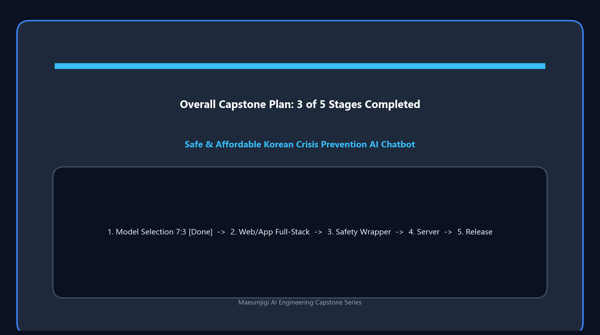
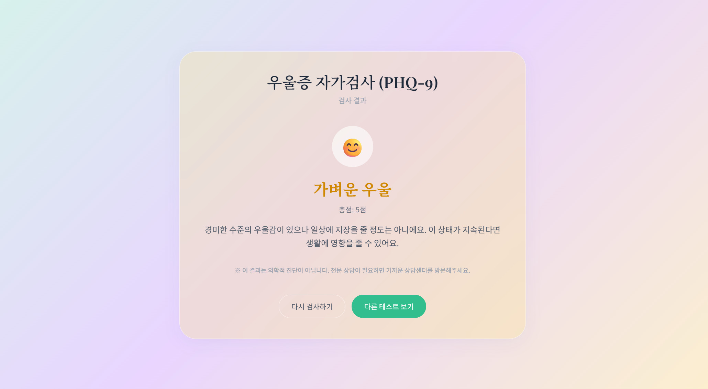

This is the record of March 31, when we conducted the Android build test of the MND Convention reservation alarm app, which was the initial direction of the Maeumjigi project, while simultaneously starting the **Llama 3.1 fine-tuning data preprocessing**, hinting at a full transition into an AI-based project.

{/* truncate */}

### Android App Build and Unit Testing

- **Problem**: We needed to verify if the server and Android client codes planned and generated yesterday would successfully build and pass tests in the actual Android Studio environment.
- **Process**: 
  > To Claude Code: "Current progress... Stop all work... What were you working on?"
- **Result**: Numerous build artifacts and metadata were generated in the `mnd-reservation-alarm/android/app/build/...` path. We executed unit tests such as `NotificationBuilderTest` and checked the Android-specific build pipeline, including debug resource merging and manifest processing. The core logic of detecting reservation changes in the background and popping up alarms was tested.

### The Great Turning Point: Starting Llama 3.1 Fine-Tuning Preprocessing

- **Problem**: Moving beyond a simple alarm app, preparation was needed to integrate an advanced AI that understands the user's (soldier's) reservation context and emotional state.
- **Process**:
  > To Claude Code: "Please proceed with the work according to llama31_finetuning_data_preprocessing_plan_short.md"
  > "No additional permission is needed for any choices regarding this task."
- **Result**: We took a crucial first step that would completely change the nature of the project. We instructed the work according to the data preprocessing plan for fine-tuning the Llama 3.1 model. To speed up the process, we granted the AI strong authority by saying, "execute immediately without asking for additional permission for all choices," and started the massive data processing pipeline.

This day was a meaningful day when the Android build work to improve the completeness of the alarm app and the AI fine-tuning data preprocessing, which will become the core feature of the future, started in parallel.
From now on, the arduous preprocessing journey of processing tens of thousands of conversation data points to fit Llama 3.1 will begin in earnest!

---

## Summary & Key Takeaways

- **Android Client Build & Unit Testing**: Verified the Android Studio build pipeline for the reservation alarm service, validating background notification dispatch and manifest merging.
- **Strategic Pivot Toward Conversational AI**: Reoriented project scope from a simple notification utility toward Maeumjigi, an empathetic AI counseling and crisis intervention system.
- **Fine-Tuning Preprocessing Kickoff**: Initiated the dataset preprocessing pipeline based on `llama31_finetuning_data_preprocessing_plan_short.md` for Meta Llama 3.1.
- **Autonomous Agent Execution Grant**: Empowered the autonomous AI coding agent with unrestricted execution authority to accelerate multi-stage data transformations without approval bottlenecks.