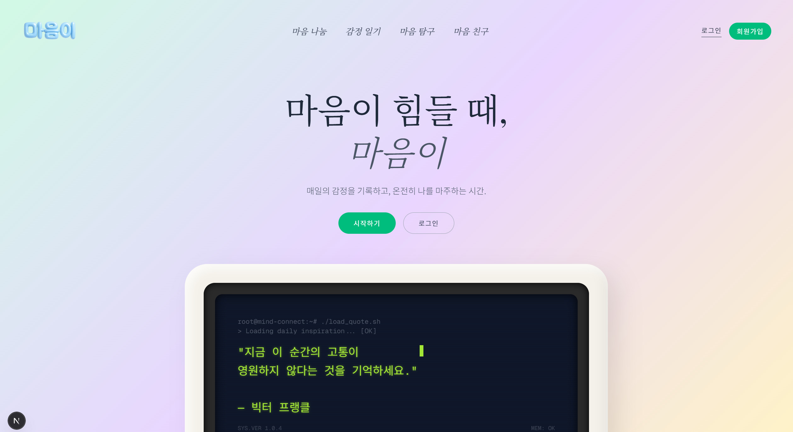
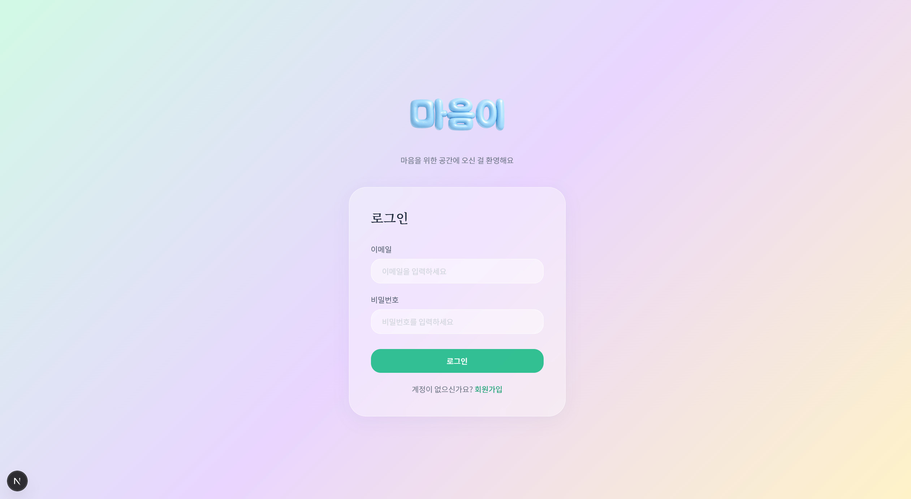

Over the two days of May 19th and 20th, the automation of evaluation for the 3rd fine-tuning (`fine_tuning_3`) and the enhancement of backend/frontend features for building the actual app service proceeded in parallel.

{/* truncate */}

### Concluding the 3rd Fine-Tuning and Automation Scripts

Based on the insights gained from the previous fine-tuning, the training for the 3rd fine-tuning, which was set up with concepts of knowledge graphs and ontologies in mind, was completed.

> "Select the checkpoint with the Best Eval from the experimental models in the fine_tuning_3 folder, replace the files in the adapter folder, and report the results."
> "Write a run_test_20_30.sh file that runs inference and evaluation in parallel for fine_tuning_3 as well."

Instead of manually digging through folders to copy checkpoints like before, I instructed the Artificial Intelligence (AI) to write a script that automatically extracted the best performing model weights (Best Checkpoint) and set them up in the `adapter` folder. Then, I executed the parallel inference script, `run_test_20_30.sh`, throwing the evaluation for the 4 Alias models to the background server.

### Backend/Frontend: Chatbot Database (DB) Saving and Community Board Features

While the models were hard at work running inferences on the server, I accelerated the `mental-health` DB and app integration work in my local environment.

> "Summarize seed_data.sql. What is the pw for users? Is it Test1234!? What was the db I was trying to apply this sql to?"

To break through the login issue that caused the frustrating `401 Unauthorized` error last time, I thoroughly examined `seed_data.sql` to verify the password hashing and user data.

As a result, I was able to leave a meaningful Git commit on the afternoon of May 20th:
`feat: Added chatbot DB save, board pagination, and emotion diary filter`

Finally, the conversation logs of our fine-tuned Large Language Model (LLM) chatbot officially started being saved to the DB! In addition, the pagination feature for the community board where users can communicate, and the emotion diary filter feature for recording daily moods were successfully added to the frontend.

It was a thrilling moment when the massive, invisible fine-tuned model finally began to be served in the beautiful vessel of a mobile app.

---

## Summary & Key Takeaways

- **Automated Checkpoint Selection**: Engineered server-side evaluation scripts (`run_test_20_30.sh`) that dynamically extract and stage the best-performing adapter weights without manual intervention.
- **Parallel Multi-Model Benchmarking**: Orchestrated background evaluation pipelines running simultaneous inference across four distinct alias model candidates on remote GPU compute nodes.
- **Full-Duplex Conversation Persistence**: Resolved authentication deadlocks (`401 Unauthorized`) and established persistent relational database logging for all multi-turn chatbot exchanges.
- **Frontend App Feature Expansion**: Integrated community discussion pagination and multi-attribute mood diary filtering into the production React Native mobile client.

