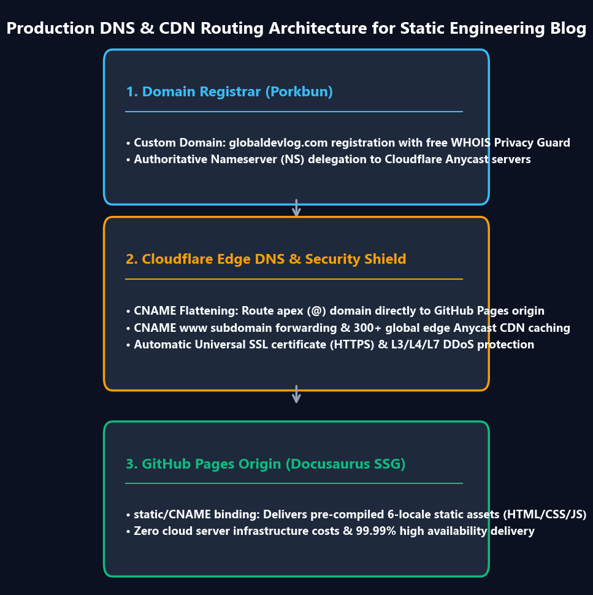

Héberger un blog technique sur GitHub Pages sous l'adresse `username.github.io/project` est l'un des moyens les plus rapides de publier. Mais pour une monétisation professionnelle, vous vous heurtez à une contrainte majeure : **Google AdSense interdit formellement les sous-domaines gratuits comme `*.github.io`**. Pour obtenir la validation AdSense et bâtir une autorité de domaine durable, vous devez posséder votre propre domaine apex personnalisé.

Migrer un site statique vers un domaine personnalisé implique la délégation de serveurs de noms, la terminaison SSL à l'edge, des redirections canoniques, l'hébergement d'`ads.txt` et une indexation propre sur Google, Naver et Bing.

Découvrez dans ce guide notre migration sans aucune interruption de service de `jbjihwan.github.io/global_blog` vers `https://globaldevlog.com`.

{/* truncate */}

---

### 📌 Synthèse Exécutive (3–5 lignes)
1. **Domaine propre obligatoire** : Google AdSense refuse les sous-domaines gratuits `github.io` ; un nom de domaine apex est indispensable.
2. **Puissance de Porkbun + Cloudflare** : Le CNAME Flattening et le certificat Universal SSL assurent une transition sans aucune interruption de service.
3. **SEO multi-moteurs** : Enregistrez vos sitemaps (`/sitemap.xml`) et flux RSS de manière synchronisée sur Google, Naver et Bing.
4. **Redirections canoniques** : Forcez systématiquement le HTTPS et redirigez le sous-domaine `www` vers le domaine apex.
