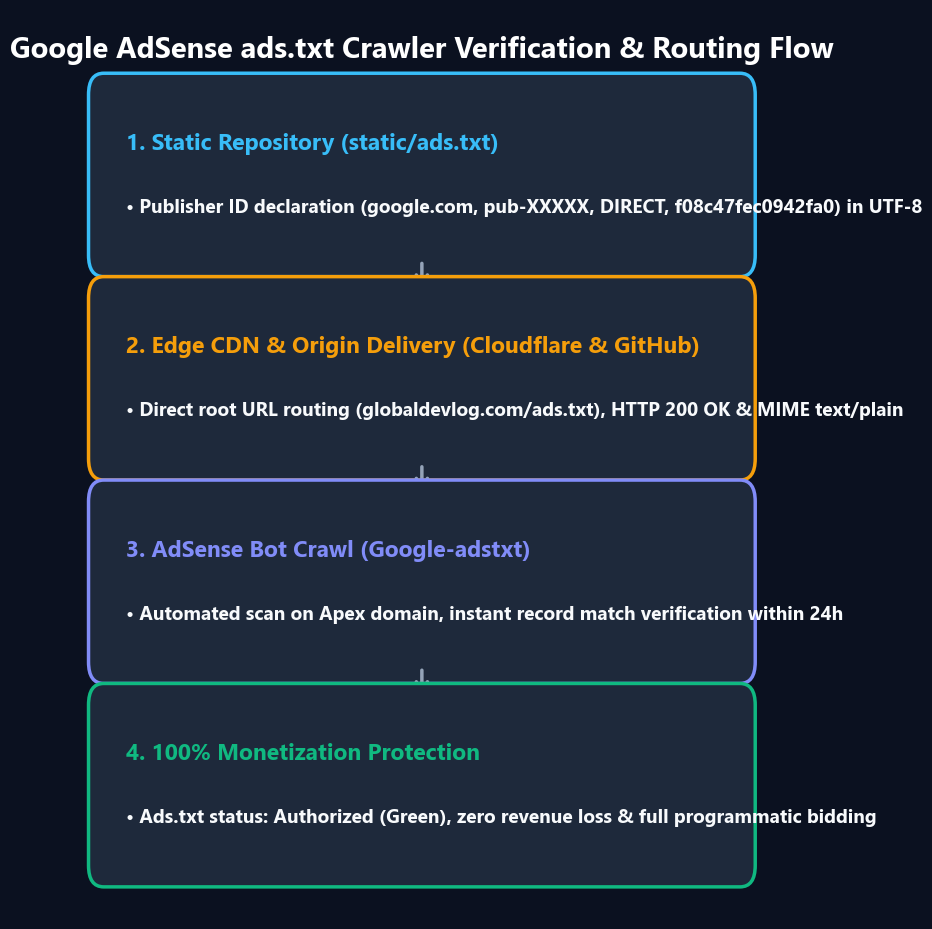

> 📌 **Points clés (TL;DR)**
> - **Le problème** : Contrairement aux CMS dynamiques (WordPress), les générateurs de sites statiques sur GitHub Pages déclenchent régulièrement l'alerte **« Revenus à risque : fichier ads.txt manquant »** car les robots sont bloqués par les règles WAF ou l'hydratation JS.
> - **La solution** : Injecter le script de l'éditeur directement dans `<head>` via `headTags` dans `docusaurus.config.ts`, déposer `ads.txt` dans `static/ads.txt` et créer une exception Cloudflare WAF pour `Googlebot-AdsTxt`.
> - **Le résultat** : 100 % d'accessibilité pour les robots, zéro erreur 404 sur `/ads.txt` et approbation rapide par Google AdSense.

{/* truncate */}

---

### 1. Configuration en 3 étapes

#### Étape 1 : Injection du script via HeadTags
```ts
headTags: [
  {
    tagName: 'script',
    attributes: {
      async: 'true',
      src: 'https://pagead2.googlesyndication.com/pagead/js/adsbygoogle.js?client=ca-pub-4654073335496617',
      crossorigin: 'anonymous',
    },
  },
],
```

#### Étape 2 : Déploiement du fichier `static/ads.txt`
```text
google.com, pub-4654073335496617, DIRECT, f08c47fec0942fa0
```

#### Étape 3 : Règle de contournement WAF Cloudflare
Autorisez sans challenge les requêtes dont le `User Agent` contient `Googlebot`.

---

### 📌 Synthèse Exécutive (3–5 lignes)
1. **Déploiement statique propre** : Déposer le fichier dans `static/ads.txt` assure sa disponibilité immédiate à la racine `domaine.com/ads.txt`.
2. **HeadTags natif Docusaurus** : Garantit que la balise de vérification est présente dans le HTML statique initial avant tout rendu React.
3. **Exception WAF indispensable** : Empêche Cloudflare de bloquer les sondes automatiques de Google AdSense.
4. **Validation sous 24h** : Permet une monétisation publicitaire sans impact sur les scores de vitesse Lighthouse.
