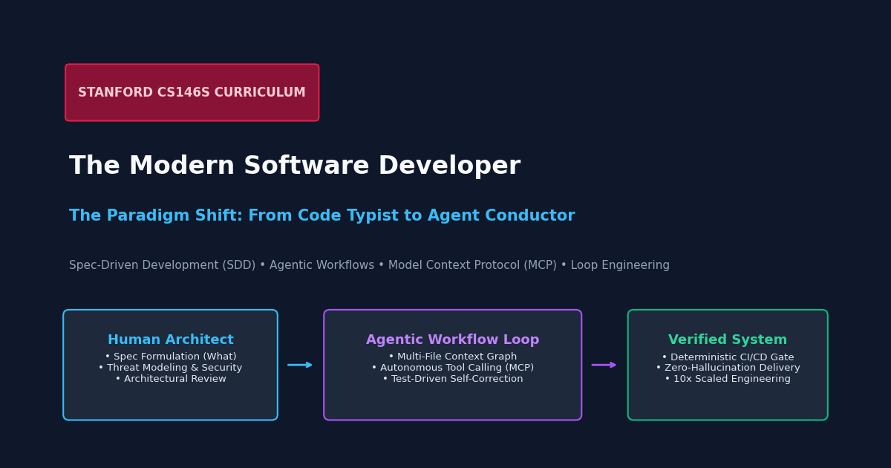
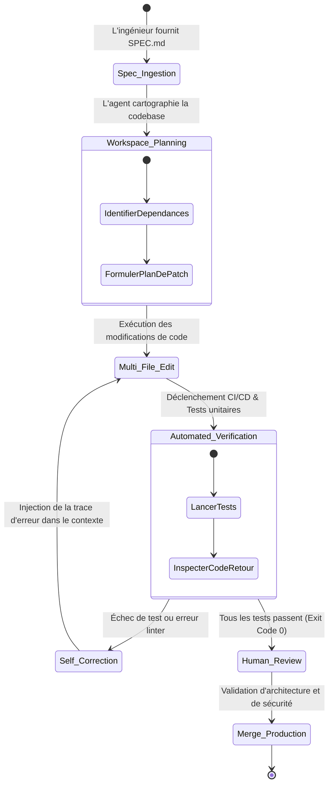

Bienvenue dans l'analyse technique approfondie du cours **CS146S : The Modern Software Developer de l'Université Stanford**.

Au cours des cinq dernières décennies, l'enseignement de l'informatique a formé les développeurs à être des dactylographes rigoureux : mémoriser des syntaxes, concevoir des algorithmes à partir de zéro et écrire manuellement des milliers de lignes de code répétitif. Aujourd'hui, l'industrie logicielle traverse sa mutation la plus radicale depuis l'invention du compilateur : le passage de la **programmation manuelle** au **Human-Agent Engineering**.

Dans ce cours inaugural, nous analysons comment les leaders technologiques (Google, Meta, OpenAI) redéfinissent la productivité, pourquoi l'ingénieur devient un chef d'orchestre de systèmes et comment le **Spec-Driven Development (SDD)**, les **Workflows Agentiques** et le **Model Context Protocol (MCP)** constituent la boîte à outils essentielle du développeur moderne.

{/* truncate */}

---

### 1. Le changement de paradigme : Du typiste de syntaxe au chef d'orchestre

Dans les flux traditionnels d'ingénierie logicielle, le goulot d'étranglement a toujours été la vitesse de frappe au clavier et la charge cognitive liée à la syntaxe. Un ingénieur conçoit une architecture, la traduit en jetons de langage (Java, TypeScript, Python) et passe 70 % de son temps sur des tâches subalternes : contrôleurs REST, interfaces de schémas, tests CRUD et corrections de fautes de frappe.

Avec l'arrivée des modèles de raisonnement et des agents de code autonomes (Claude Code, Cursor, GitHub Copilot Workspace), le coût marginal de génération de code syntaxiquement valide est devenu quasi nul.

```mermaid
flowchart TD
    subgraph Traditional_Workflow ["Paradigme traditionnel : Développeur dactylographe"]
        A1[Idée architecturale humaine] -->|Frappe manuelle 70% du temps| B1[Boilerplate & Syntaxe]
        B1 -->|Écriture manuelle de tests| C1[Compilation & Débogage local]
        C1 -->|Vélocité linéaire lente| D1[Livraison d'une seule fonctionnalité]
    end

    subgraph Modern_Agentic_Workflow ["Paradigme Stanford CS146S : Développeur chef d'orchestre"]
        A2[Architecte humain : Spécification & Invariants] ==>|Spécification précise SPEC.md| B2[Escouade d'agents IA autonomes]
        B2 -->|Édition multi-fichiers via MCP| C2[Loop Engineering automatisé : Test & Auto-réparation]
        C2 -->|Feedback continu| B2
        C2 ==>|Codebase vérifiée| D2[Revue humaine d'architecture & de sécurité]
        D2 ==>|Vélocité démultipliée par 10| E2[Déploiement en production]
    end
```



Les développeurs modernes ne sont plus évalués au nombre de lignes de code écrites par jour. Ils agissent en tant qu'**Engineering Managers dirigeant une équipe d'agents IA autonomes**. Lorsqu'un responsable technique délègue des tâches, il ne dicte pas chaque touche de clavier : il fournit des spécifications claires, délimite les frontières du système et fixe des critères d'acceptation déterministes.

---

### 2. Spec-Driven Development (SDD) : « Quoi » avant « Comment »

La méthodologie centrale enseignée à Stanford CS146S est le **Spec-Driven Development (SDD)**. Dans l'assistance IA naïve, les développeurs s'expriment par des prompts conversationnels vagues comme : *« Peux-tu créer un système d'authentification ? »*

Cette approche mène inévitablement à des dérives architecturales et des hallucinations. En SDD, le livrable principal n'est pas le code brut, mais un document de spécification formel et directement exploitable par la machine (**`SPEC.md`**).

```markdown
# Modèle de spécification d'ingénierie (SPEC.md)

## 1. Contexte & Domaine métier
- Traitement idempotent des webhooks de paiement pour Stripe API v2024-06.
- Base de données : PostgreSQL 16 avec Row-Level Security (RLS) activée.

## 2. Invariants & Contraintes strictes
- Toutes les mutations de base de données DOIVENT se produire dans une transaction explicite.
- La validation de signature webhook (HMAC-SHA256) DOIT échouer immédiatement avant tout parsing de charge utile.
- Seuil de latence : temps de réponse P99 < 80 ms.

## 3. Interfaces & Schémas
- Entrée : `POST /api/v1/payments/webhook` avec mémoire tampon brute.
- Événements gérés : `payment_intent.succeeded`, `payment_intent.payment_failed`.

## 4. Exigences de vérification & Tests
- Couverture de tests unitaires > 95 % pour les rollbacks sur identifiants d'événements dupliqués.
- Test de concurrence : 50 webhooks simultanés identiques doivent produire exactement 1 insertion.
```

---

### 3. Workflows agentiques & Loop Engineering automatisé

Un concept fondateur du cours est le **Loop Engineering**. Les modèles de fondation sont probabilistes ; attendre d'un LLM qu'il génère un système distribué complexe en une seule passe sans erreur est mathématiquement irréaliste.

Le développement logiciel moderne structure le travail des agents en une boucle fermée auto-correctrice :



---

### 4. Model Context Protocol (MCP) : Le protocole universel

Le **Model Context Protocol (MCP)** permet aux agents de s'émanciper du simple chat pour interagir avec des outils d'ingénierie réels (systèmes de fichiers, bases de données, terminaux).

---

### 📌 Synthèse Exécutive (3–5 lignes)
1. **Changement d'identité** : Le développeur passe du statut de typiste de syntaxe à celui de chef d'orchestre d'escouades d'agents IA.
2. **Spec-Driven Development (SDD)** : La rigueur d'ingénierie repose désormais sur des documents de spécification précis (`SPEC.md`).
3. **Loop Engineering & MCP** : Les architectures fiables s'appuient sur des boucles fermées d'auto-réparation et le protocole standardisé MCP.
4. **Le fardeau du relecteur** : La génération de code étant gratuite, la maîtrise des fondamentaux informatiques (systèmes d'exploitation, concurrence) devient indispensable pour auditer les failles subtiles.

### Références & Supports de cours
- **Playlist officielle des cours** : [Stanford CS146S: The Modern Software Development (YouTube Playlist)](https://www.youtube.com/playlist?list=PLxpwjSdVZQ95OWe3QvkVEcU1f1X-6NDj9)
- **Institution** : Université Stanford, Département d'Informatique
