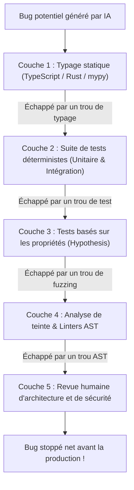

Bienvenue dans le deuxième volet de notre série technique sur le cours **Stanford CS146S : The Modern Software Developer**.

Dans le premier cours, nous avons défini le rôle de chef d'orchestre d'agents. Dans ce **Cours 2 (Semaine 1)**, le programme explore le moteur fondamental de cette transition : **les grands modèles de langage pour le code (Coding LLMs)** et la discipline du **Prompt Engineering**.

En nous appuyant sur les travaux d'Andrej Karpathy (*Deep Dive into LLMs*), d'OpenAI et de Google Cloud, ce cours dévoile comment les réseaux de neurones acquièrent leur maîtrise du code, pourquoi ils demeurent des simulateurs statistiques et comment appliquer la doctrine **« Trust but Verify »** face aux vulnérabilités du **modèle du gruyère** du code généré par IA.

{/* truncate */}

---

### 1. L'anatomie d'un LLM : Le pipeline d'entraînement en trois étapes

Pour piloter et déboguer efficacement un assistant IA, un ingénieur doit comprendre la genèse de ses poids :

```mermaid
flowchart LR
    subgraph Stage1 ["Étape 1 : Pré-entraînement"]
        D1[Milliers de milliards de tokens<br/>Web & Code GitHub] --> N1[Modèle de base Transformer<br/>Probabilité du prochain token P(w_t | Context)]
    end

    subgraph Stage2 ["Étape 2 : Supervised Fine-Tuning (SFT)"]
        N1 --> D2[Paires d'instructions de haute qualité<br/>Prompt & Réponse de référence]
        D2 --> N2[Assistant adapté aux instructions<br/>Protocole conversationnel]
    end

    subgraph Stage3 ["Étape 3 : RLHF & Alignement"]
        N2 --> D3[Classement de préférences humaines<br/>Scoring du modèle de récompense]
        D3 --> N3[LLM de code prêt pour la production<br/>Sûr, aligné et déterministe]
    end
```

---

### 2. Le modèle du gruyère de la sécurité du code IA

Aucune couche de vérification ne peut intercepter 100 % des défauts générés par une IA :




---

### 📌 Synthèse Exécutive (3–5 lignes)
1. **Les trois étapes de fabrication** : Le pré-entraînement apporte les bases linguistiques, le SFT enseigne le suivi d'instructions, et le RLHF assure l'alignement et la sécurité.
2. **Chain-of-Thought (CoT)** : Permet au modèle d'allouer de la puissance de calcul logique intermédiaire avant d'écrire le code.
3. **Le modèle du gruyère** : Pour contrer les anomalies stochastiques de l'IA, une défense en profondeur (typage $
ightarrow$ tests $
ightarrow$ analyse AST $
ightarrow$ revue humaine) est indispensable.
4. **« Trust but Verify »** : La vitesse de l'IA n'a de valeur que si des garde-fous déterministes garantissent la robustesse du système.

### Références & Supports de cours
- **Playlist officielle des cours** : [Stanford CS146S: The Modern Software Development (YouTube Playlist)](https://www.youtube.com/playlist?list=PLxpwjSdVZQ95OWe3QvkVEcU1f1X-6NDj9)
- **Institution** : Université Stanford, Département d'Informatique
