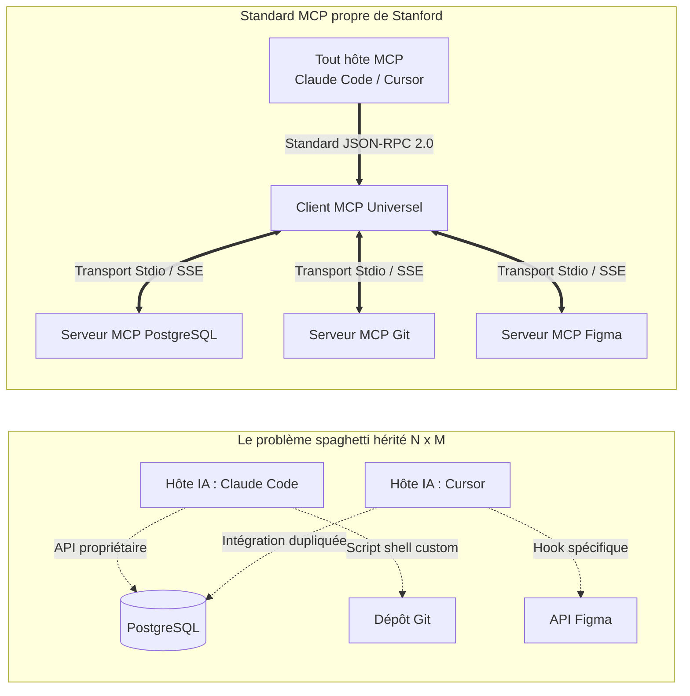

Bienvenue dans le troisième volet de notre analyse technique du cours **Stanford CS146S : The Modern Software Developer**.

Dans ce **Cours 3 (Semaine 2)**, le programme s'attaque au plus grand défi architectural des systèmes d'IA modernes : **Comment des modèles de fondation isolés peuvent-ils interagir de manière modulaire et sécurisée avec le monde extérieur ?**

Avant 2024, connecter un LLM à une base de données ou un terminal exigeait du code d'intégration propriétaire et fragile. En se basant sur le standard ouvert d'Anthropic, ce cours détaille le **Model Context Protocol (MCP)** — l'adaptateur universel qui accomplit pour les agents IA ce que le **Language Server Protocol (LSP)** a accompli pour les éditeurs de code modernes.

{/* truncate */}

---

### 1. La crise de la fragmentation : Pourquoi nous avions besoin d'un « LSP pour l'IA »

Historiquement, chaque outil d'IA (Cursor, Claude Code, GitHub Copilot) tentait de se connecter aux mêmes ressources d'entreprise :

---

### 2. L'architecture en 3 couches de MCP

1. **Hôte MCP (Host)** : L'application qui orchestre le flux de travail de l'agent (ex. Claude Code, Cursor).
2. **Client MCP** : La couche protocolaire dans l'hôte qui gère les connexions et sérialise les messages JSON-RPC 2.0.
3. **Serveur MCP** : Un processus léger exposant des ressources ou actions standardisées (serveur Git, serveur SQL, etc.).

---

### 📌 Synthèse Exécutive (3–5 lignes)
1. **LSP pour l'IA** : Le Model Context Protocol (MCP) élimine la complexité $N 	imes M$ entre modèles et outils via un standard ouvert JSON-RPC 2.0.
2. **Architecture modulaire** : La séparation Hôte / Client / Serveur garantit une extensibilité sans faille.
3. **Transports Stdio & HTTP/SSE** : Stdio garantit une isolation et une performance maximales en local, tandis que SSE connecte les services cloud distants.
4. **Sécurité par défaut** : Le principe du moindre privilège (mode lecture seule par défaut) protège les données sensibles des actions incontrôlées des agents.

### Références & Supports de cours
- **Playlist officielle des cours** : [Stanford CS146S: The Modern Software Development (YouTube Playlist)](https://www.youtube.com/playlist?list=PLxpwjSdVZQ95OWe3QvkVEcU1f1X-6NDj9)
- **Institution** : Université Stanford, Département d'Informatique