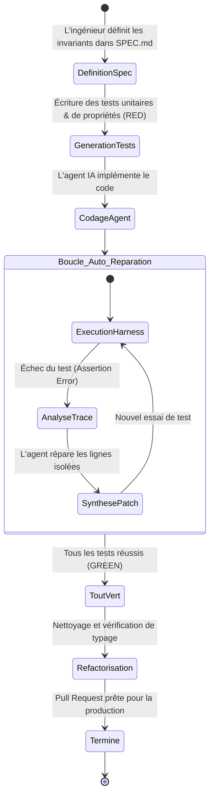

Bienvenue dans le quatrième volet de notre analyse technique du cours **Stanford CS146S : The Modern Software Developer**.

Dans les cours précédents, nous avons exploré la transition vers le rôle de chef d'orchestre, la mécanique des LLMs de code et le Model Context Protocol (MCP). Dans ce **Cours 4 (Semaine 3)**, le programme aborde le défi pratique le plus pressant : **Comment construire de manière fiable des systèmes de milliers de lignes quand les LLMs hallucinent inévitablement et introduisent des régressions silencieuses ?**

L'approche naïve — souvent appelée sur les réseaux sociaux « vibe coding » ou programmation conversationnelle au jugé — échoue totalement en entreprise. En s'appuyant sur les travaux de recherche de Stanford, ce cours présente le **Spec-Driven Development (SDD)** et montre comment ériger un banc de test automatisé (**Test Harness**) avec **boucles de rétroaction auto-réparatrices**.

{/* truncate */}

---

### 1. Le piège du « Vibe Coding » : Pourquoi les prompts informels mènent à la dégradation

Sans spécification formelle, chaque échange conversationnel augmente l'entropie du système :

```mermaid
flowchart TD
    subgraph Vibe_Coding_Entropy ["L'anti-pattern : Vibe Coding conversationnel"]
        V1["Prompt vague : 'Ajoute le paiement'"] --> V2["Le LLM génère 300 lignes de code"]
        V2 --> V3["Le développeur survole le code (Semble plausible)"]
        V3 --> V4["Merge dans la branche principale"]
        V4 --> V5["Prompt suivant : 'Ajoute des coupons'"]
        V5 --> V6["Le LLM écrase silencieusement la logique de paiement"]
        V6 --> V7["Régression catastrophique en production"]
    end

    subgraph Spec_Driven_Determinism ["Stanford CS146S : Spec-Driven Development (SDD)"]
        S1["Spécification formelle (PRD & Contrat d'interface)"] --> S2["Suite de tests d'acceptation déterministe"]
        S2 --> S3["Génération de code par IA (Claude Code / Cursor)"]
        S3 --> S4["Exécution automatisée des tests"]
        S4 -->|Tests en échec| S5["Boucle d'auto-réparation avec traces d'erreur"]
        S5 --> S3
        S4 -->|Tous les tests passent| S6["Merge vérifié sans régression"]
    end
```

---

### 2. Le banc de test en boucle fermée (Red-Green-Refactor pour agents)

Dans le paradigme SDD, le banc de test sert de garde-fou absolu :

---

### 📌 Synthèse Exécutive (3–5 lignes)
1. **Fin du Vibe Coding** : Les prompts informels mènent à l'amnésie contextuelle et à des régressions catastrophiques en production.
2. **Spec-Driven Development** : Les spécifications formelles (`SPEC.md`) et les contrats d'interface constituent le vrai livrable de l'ingénieur.
3. **Boucles auto-réparatrices** : En recevant les traces d'erreur d'exécution, l'agent itère jusqu'à ce que la suite de tests soit 100 % verte.
4. **Intégrité des tests** : Les fichiers de test doivent être sanctuarisés pour empêcher l'agent de modifier les assertions à son avantage.

### Références & Supports de cours
- **Playlist officielle des cours** : [Stanford CS146S: The Modern Software Development (YouTube Playlist)](https://www.youtube.com/playlist?list=PLxpwjSdVZQ95OWe3QvkVEcU1f1X-6NDj9)
- **Institution** : Université Stanford, Département d'Informatique
